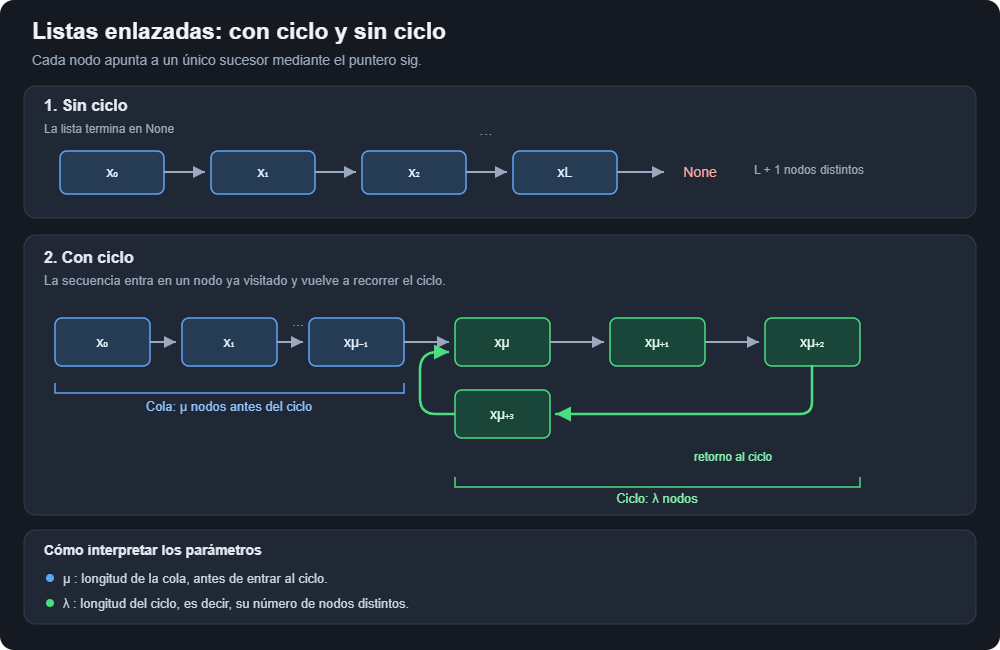

# Ejercicio 5 — Detección de ciclos con la liebre y la tortuga (Floyd)

**Tema 1 · Diseño y Análisis de Algoritmos · MatCom 2026**\
Conferencias que usa: **C3** (invariante, potencial, terminación) · Dificultad: ★★

---

## Enunciado

> Detección de ciclos en una lista enlazada con dos punteros que avanzan a velocidades 1 y 2 (algoritmo de Floyd). Demuestra que se encuentran si y solo si hay un ciclo, con un invariante, y que termina, con un potencial. Da el costo.

## 1. Planteamiento

Partimos de una lista enlazada clásica donde $x_0$ es la cabeza y $x_{i+1} = x_i$`.sig`. Estos son los datos con los que contamos pues para insertar un nuevo elemento se deben recorrer las referencias hasta llegar a None que identifica al último elemento. Entonces la problemática actual es qué pasaría si tenemos una lista corrupta con el "último" nodo referenciando uno anterior, y digo último entre comillas porque dado este fallo no tenemos forma de saber cuál es el último elemento de la lista. Podemos definir por ende:

**Precondición:** la lista es finita (tiene $n$ nodos alcanzables) y cada nodo tiene un único `sig` que es un nodo o `None`. La cabeza puede ser `None`.

**Postcondición:** dada la secuencia de nodos de la lista (que se repite infinitamente un tramo en caso de que exista ciclo), devuelve `True` si y solo si existe $i < j$ tal que $x_i = x_j$.



Con ciclo, los nodos $x_0, \dots, x_{\mu+\lambda-1}$ son distintos y $x_{k} = x_{k+\lambda}$ para todo $k \ge \mu$. Es decir: $x_i = x_j$ con $i \ne j$ si y solo si $i, j \ge \mu$ y $i \equiv j \pmod \lambda$.

Modelo: RAM, el costo es la cantidad de llamadas a `sig` (cada avance de un puntero), memoria $O(1)$.

## 2. Algoritmo

```python
def floyd(x0, sig, contador=None):
    """True si la lista que empieza en x0 tiene un ciclo."""
    tortuga, liebre = x0, x0
    while True:
        # la liebre avanza 2
        for _ in range(2):
            if liebre is None:
                return False
            liebre = sig(liebre)
            if contador is not None: contador[0] += 1
        if liebre is None:
            return False
        tortuga = sig(tortuga)
        if contador is not None: contador[0] += 1
        if tortuga == liebre:
            return True
```

## 3. El invariante

> **Invariante.** El invariante reforzado es posicional: al terminar la iteración número $k \ge 1$ del ciclo `while` (si no se retornó antes):
> $$\text{tortuga} = x_k, \qquad \text{liebre} = x_{2k},$$
> y los nodos $x_0, x_1, \dots, x_{2k}$ existen (ninguno es `None`).

**Inicialización** (antes de la iteración 1, "$k = 0$"): tortuga $=$ liebre $= x_0$.

**Mantenimiento.** En la iteración $k+1$ la liebre avanza dos veces: a $x_{2k+1}$ y a $x_{2k+2}$; si alguno es `None`, el algoritmo retorna. Si no retorna, la liebre queda en $x_{2(k+1)}$, y todos los $x_0, \dots, x_{2k+2}$ existen. La tortuga avanza una vez a $x_{k+1}$, que existe porque $k+1 \le 2k+2$. ∎

## 4. "Se encuentran si y solo si hay un ciclo"

**(⇐, si se encuentran hay ciclo).** Si el algoritmo retorna `True` en la iteración $k \ge 1$, por el invariante $x_k = x_{2k}$ con $k \ne 2k$. Dos índices distintos con el mismo nodo: la lista vuelve a pasar por un nodo, así que tiene un ciclo.

**(⇒, si no hay ciclo no se encuentran y además se termina).** Sin ciclo, los nodos $x_0, \dots, x_L$ son todos distintos. Por el invariante, en la iteración $k$ la comparación es entre $x_k$ y $x_{2k}$, con $k < 2k$: son nodos distintos, la comparación da falso. Y como la liebre recorre $x_{2k}$ con $2k$ creciendo, en algún momento $2k > L$ y la liebre lee `None`: el algoritmo retorna `False`. Esto pasa a más tardar en la iteración $\lceil (L+1)/2 \rceil$.

**(⇒, si hay ciclo se encuentran).** Esto es lo que necesita el potencial.

## 5. Terminación con ciclo: el potencial

Con ciclo nunca aparece `None`, así que el algoritmo termina solo si se encuentran. Mientras la tortuga no entró al ciclo ($k < \mu$) no hay nada que decir; el potencial empieza a funcionar cuando $k \ge \mu$.

> **Potencial.** Para $k \ge \mu$, sea $D_k$ la cantidad de pasos que la liebre tiene que dar **hacia adelante en el ciclo** para llegar a la tortuga:
> $$ D_k = (k - 2k) \bmod \lambda = (-k) \bmod \lambda \;\in\; \{0, 1, \dots, \lambda - 1\}. $$

Por qué esa fórmula: los dos están en el ciclo, la tortuga en el índice $k$ y la liebre en el $2k$; avanzar $d$ pasos desde $x_{2k}$ da $x_{2k+d}$, y eso es $x_k$ justo cuando $2k + d \equiv k \pmod\lambda$.

**El potencial baja exactamente 1 por iteración.** En una iteración la tortuga avanza 1 y la liebre 2, así que la liebre se acerca 1:
$$
D_{k+1} = (-(k+1)) \bmod \lambda = (D_k - 1) \bmod \lambda .
$$
Si $D_k > 0$, entonces $D_{k+1} = D_k - 1$: baja de a uno, **sin saltar el 0**. Este es el punto de la velocidad 2: si la liebre fuera a velocidad 3, la distancia bajaría de a 2 y podría pasar de 1 a $\lambda-1$, cruzándose sin coincidir. Igual terminarían encontrándose (cuando $\lambda \mid k$ y $k \ge \mu$, porque $x_k = x_{3k}$ exige $2k \equiv 0 \pmod \lambda$), pero el argumento de "baja de a 1" ya no sirve tal cual.

**Conclusión.** $D_\mu \le \lambda - 1$ y baja 1 por iteración mientras no es 0, así que existe una iteración $k$ con $\mu \le k \le \mu + \lambda - 1$ y $D_k = 0$, es decir $x_k = x_{2k}$: se encuentran. Hay que tener cuidado con un detalle: el algoritmo solo compara a partir de $k = 1$, así que si $\mu = 0$ y $D_0 = 0$ (están juntos en $x_0$ antes de empezar), el encuentro que cuenta es el siguiente, en $k = \lambda$. En todos los casos:

$$
k_{\text{encuentro}} = \text{el menor múltiplo de } \lambda \text{ que es} \ge \max(\mu, 1) \;\le\; \mu + \lambda .
$$

(La primera igualdad sale de que $D_k = 0 \iff \lambda \mid k$, y $x_k = x_{2k}$ con $k \ge 1$ exige $k \ge \mu$ por la caracterización de la sección 1.) ∎

## 6. Costo

Cada iteración completa hace 3 avances. Sin ciclo, la liebre hace $L+1$ llamadas (la última devuelve `None`) y la tortuga, que va a mitad de velocidad, hace $\lfloor L/2\rfloor$. Con ciclo se van a encontrar en un $k$ que cumple el invariante; sabemos que $\mu \le k \le \mu + \lambda$. Entonces:

| caso | iteraciones | llamadas a `sig` |
| --- | --- | --- |
| sin ciclo, $L+1$ nodos | $\lfloor L/2\rfloor + 1$ (la última incompleta) | $(L+1) + \lfloor L/2 \rfloor \le \tfrac32 n = O(n)$ |
| con ciclo | $k_{\text{enc}} \le \mu + \lambda$ | $k_{\text{enc}}$ (tortuga) $+\ 2k_{\text{enc}}$ (liebre) $= 3k_{\text{enc}} \le 3(\mu + \lambda) = O(n)$ |

donde $n$ es la cantidad de nodos distintos ($n = L+1$ o $n = \mu + \lambda$). Memoria $O(1)$: dos punteros. Es lineal, que es lo mejor posible porque hay que mirar todos los nodos (si un nodo no se visita, su `sig` podría apuntar a cualquier lado).

## 7. Bonus: encontrar $\mu$ y $\lambda$

Ya que estamos: en el encuentro $k$ es múltiplo de $\lambda$. Si pongo un puntero en $x_0$ y otro en $x_k$ y los avanzo juntos de a 1, después de $i$ pasos están en $x_i$ y $x_{k+i}$, que son iguales exactamente cuando $i \ge \mu$ (porque $\lambda \mid k$). Así que se encuentran por primera vez en $x_\mu$: eso da $\mu$. Y $\lambda$ sale dando una vuelta desde $x_\mu$. Lo implemento abajo para poder probar las fórmulas.

---

## 8. Casos de prueba

Construyo listas con cola $\mu$ y ciclo $\lambda$ arbitrarios (y listas sin ciclo), y compruebo:

1. la respuesta (ciclo / no ciclo);
2. que la iteración del encuentro es el menor múltiplo de $\lambda$ que es $\ge \max(\mu,1)$;
3. que el potencial $D$ baja exactamente 1 por iteración dentro del ciclo;
4. el costo exacto $3k$ con ciclo (que es $\le 3(\mu+\lambda)$) y $(L+1)+\lfloor L/2\rfloor$ sin ciclo;
5. la extracción de $\mu$ y $\lambda$.

```python
import random

def construir(mu, lam, sin_ciclo_largo=None):
    """Lista con nodos 0..n-1 representada como diccionario sig.
    Si sin_ciclo_largo es un número L, la lista es 0 -> 1 -> ... -> L -> None."""
    if sin_ciclo_largo is not None:
        L = sin_ciclo_largo
        sig = {i: (i + 1 if i < L else None) for i in range(L + 1)}
    else:
        n = mu + lam
        sig = {i: i + 1 for i in range(n - 1)}
        sig[n - 1] = mu                     # el último vuelve a x_mu
    # renombro los nodos al azar para que el orden de las etiquetas no ayude
    etiquetas = list(sig.keys()); random.shuffle(etiquetas)
    ren = dict(zip(sig.keys(), etiquetas))
    sig2 = {ren[a]: (ren[b] if b is not None else None) for a, b in sig.items()}
    return ren[0], (lambda x: sig2[x])

def floyd_vigilado(x0, sig, mu, lam):
    """Floyd devolviendo la iteración del encuentro; vigila el potencial D."""
    tortuga = liebre = x0
    k, D_anterior = 0, None
    while True:
        for _ in range(2):
            if liebre is None: return None
            liebre = sig(liebre)
        if liebre is None: return None
        tortuga = sig(tortuga)
        k += 1
        if lam is not None and k >= mu:
            D = (-k) % lam
            if D_anterior is not None and D_anterior > 0:
                assert D == D_anterior - 1, "el potencial no bajó exactamente 1"
            D_anterior = D
        if tortuga == liebre:
            return k

def mu_lambda(x0, sig):
    tortuga = liebre = x0
    while True:
        tortuga = sig(tortuga); liebre = sig(sig(liebre))
        if tortuga == liebre: break
    mu, a, b = 0, x0, liebre
    while a != b:
        a, b, mu = sig(a), sig(b), mu + 1
    lam, c = 1, sig(a)
    while c != a:
        c, lam = sig(c), lam + 1
    return mu, lam

random.seed(5)

# Casos a mano
x0, s = construir(0, 1);  assert floyd(x0, s)            # un nodo que se apunta a sí mismo
x0, s = construir(3, 1);  assert floyd(x0, s)
x0, s = construir(0, 0, sin_ciclo_largo=0); assert not floyd(x0, s)   # un solo nodo
assert not floyd(None, lambda x: None)                    # lista vacía
print("casos a mano: OK")

# Exhaustivo en tamaños chicos, con ciclo
for mu in range(0, 30):
    for lam in range(1, 30):
        x0, s = construir(mu, lam)
        c = [0]
        assert floyd(x0, s, c)
        k = floyd_vigilado(x0, s, mu, lam)
        esperado = lam * -(-max(mu, 1) // lam)       # menor múltiplo de lam >= max(mu,1)
        assert k == esperado, (mu, lam, k, esperado)
        assert c[0] == 3 * k <= 3 * (mu + lam)
        assert mu_lambda(x0, s) == (mu, lam)
print("con ciclo, mu y lambda en [0,30): encuentro, potencial, costo y (mu, lambda): OK")

# Exhaustivo sin ciclo
for L in range(0, 200):
    x0, s = construir(0, 0, sin_ciclo_largo=L)
    c = [0]
    assert not floyd(x0, s, c)
    assert c[0] == (L + 1) + L // 2
print("sin ciclo, L en [0,200): OK")

# Tabla de costos para listas grandes
print(f"\n{'mu':>7} {'lambda':>7} {'iter. encuentro':>16} {'llamadas a sig':>15} {'3(mu+lambda)':>13}")
for mu, lam in [(0, 1), (1000, 1), (1, 1000), (500, 500), (999, 7), (100000, 99999)]:
    x0, s = construir(mu, lam)
    c = [0]
    floyd(x0, s, c)
    k = c[0] // 3
    print(f"{mu:7} {lam:7} {k:16} {c[0]:15} {3*(mu+lam):13}")
```

### Salida

```text
casos a mano: OK
con ciclo, mu y lambda en [0,30): encuentro, potencial, costo y (mu, lambda): OK
sin ciclo, L en [0,200): OK

     mu  lambda  iter. encuentro  llamadas a sig  3(mu+lambda)
      0       1                1               3             3
   1000       1             1000            3000          3003
      1    1000             1000            3000          3003
    500     500              500            1500          3000
    999       7             1001            3003          3018
 100000   99999           199998          599994        599997
```

La fila $(\mu, \lambda) = (1000, 1)$ muestra un caso donde el encuentro es justo al entrar ($k = \mu$), y la fila $(1, 1000)$ el caso donde la tortuga tiene que dar casi una vuelta entera ($k = \lambda$).

---

**Uso de IA**: implementación de algoritmos, generación de casos de prueba y correcciones de redacción.
