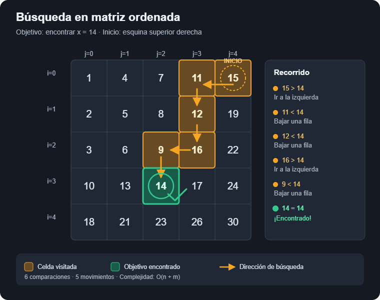

# Ejercicio 6 — Buscar en una matriz con filas y columnas ordenadas

**Tema 1 · Diseño y Análisis de Algoritmos · MatCom 2026**
Conferencias que usa: **C3** (invariante en tres pasos y potencial; la cota mínima de Boyer-Moore) · **C5** (cuándo la información no alcanza, el adversario, el argumento de mezclar) · Dificultad: ★★

---

## Enunciado

> Una matriz $n \times n$ tiene filas y columnas ordenadas de forma creciente. Diseña un algoritmo que decida si contiene un valor $x$ en $O(n)$ comparaciones, demuestra su correctitud con un invariante, y demuestra con un adversario que no se puede en $o(n)$.

---

## 1. Problema y modelo

Matriz $A[0..n-1][0..n-1]$ con $A[i][j] \le A[i][j+1]$ y $A[i][j] \le A[i+1][j]$. Decidir si existe $(i,j)$ con $A[i][j] = x$.

Modelo: comparaciones de tres salidas ($<$, $=$, $>$) entre $x$ y una celda, o entre dos celdas. El costo es el número de comparaciones. Es el modelo de comparaciones de C5: el algoritmo puede hacer todo el cómputo que quiera con los índices, pero sobre los valores solo sabe lo que le dijeron las comparaciones.

La **precondición** es que filas y columnas estén ordenadas de forma creciente; la **postcondición**, que se devuelve una posición con $A[i][j] = x$ si existe, y `None` si no.

Conclusiones basadas en las condiciones del problema:

- $A[0][0]$ es el mínimo : todos a su derecha (misma fila) y todos debajo (misma columna) son mayores por la precondicion, la submatriz restante es de valores mayores por transitividad. 
- $A[n-1][n-1]$ es el máximo pues todos arriba (misma columna) y todos a la izquierda (misma fila) son menores por la precondición y la submatriz es menor por transitividad.
- Podemos asegurar que las celdas que nos brindan mayor información por ende, son la superior derecha y la inferior izquierda (sin perdida de la generalidad tomamos $A[n-1][0]$) :

    -Si $A[n-1][0]$ = x terminamos.
    -Si $A[n-1][0]$ > x entonces podemos tachar el resto de su fila y buscar en la submatriz restante.
    -Si $A[n-1][0]$ < x entonces podemis tachar el resto de su columna y buscar en la submatriz restante.

## 2. Algoritmo: búsqueda en escalera

```python
def escalera(A, x, contador=None):
    """Devuelve (i, j) con A[i][j] == x, o None. A es n x m con filas y columnas crecientes."""
    n = len(A)
    if n == 0: return None
    m = len(A[0])
    i, j = 0, m - 1                   # esquina superior derecha
    while i < n and j >= 0:
        if contador is not None: contador[0] += 1
        v = A[i][j]
        if v == x:
            return (i, j)
        elif v > x:
            j -= 1                    # toda la columna j desde la fila i hacia abajo es >= v > x
        else:
            i += 1                    # toda la fila i desde la columna j hacia la izquierda es <= v < x
    return None
```

Cada comparación tiene una consecuencia segura en un sentido u otro. La esquina inferior izquierda funciona igual.



## 3. Correctitud parcial: el invariante

> **Invariante.** Al inicio de cada iteración, si $x$ está en la matriz, entonces está en la submatriz
> $$R(i,j) = \{(a,b) : a \ge i,\; b \le j\},$$
> es decir, en las filas $i..n-1$ y columnas $0..j$ (el rectángulo de abajo a la izquierda de la celda actual, es decir la celda a la que me moví tras la última iteración)


**Inicialización.** $i = 0$, $j = m-1$: $R(0, n-1)$ es toda la matriz.

**Mantenimiento.** Miro $v = A[i][j]$.

- Si $v = x$, el algoritmo devuelve una posición correcta.
- Si $v > x$: para toda fila $a \ge i$, por las columnas ordenadas, $A[a][j] \ge A[i][j] = v > x$. Entonces $x$ no está en la columna $j$ de $R(i,j)$, y si estaba en $R(i,j)$ está en $R(i, j-1)$. El algoritmo hace `j -= 1`. ✓
- Si $v < x$: para toda columna $b \le j$, por las filas ordenadas, $A[i][b] \le A[i][j] = v < x$. Entonces $x$ no está en la fila $i$ de $R(i,j)$, y si estaba está en $R(i+1, j)$. El algoritmo hace `i += 1`. ✓

**Conclusión.** Si el ciclo termina porque $i = n$ o $j = -1$, el rectángulo $R(i,j)$ es vacío; por el invariante $x$ no está en la matriz, y devolver `None` es correcto. Si devuelve una posición, es porque comparó y vio $A[i][j] = x$. ∎


## 4. Terminación (potencial) y costo

**Potencial** : $\Phi = (n - i) + (j + 1)$, la cantidad de filas más columnas que le quedan a $R(i,j)$. Empieza en $2n$, baja exactamente 1 por iteración (o crece $i$ o baja $j$), y el ciclo sigue solo si $n - i \ge 1$ y $j+1 \ge 1$, o sea $\Phi \ge 2$. Así que termina, el valor inicial acota el número de vueltas: a lo sumo $2n - 1$, una comparación cada una (de tres salidas):

$$
\text{comparaciones} \le 2n - 1 \quad \text{para } n\times n .
$$

El peor caso se alcanza: buscar un $x$ que no está y que obliga a recorrer toda la escalera, por ejemplo $A[i][j] = 2(i+j)$ y $x = 2n-1$, que hace zigzag por la antidiagonal; lo mido abajo. Memoria $O(1)$.


---

## 5. Casos de prueba

1. Contra fuerza bruta en matrices aleatorias con filas y columnas ordenadas (incluyendo repetidos y matrices rectangulares).
2. Invariante vigilado: en cada paso compruebo que todo lo descartado es $\ne x$.
3. Peor caso de la escalera: $2n-1$.

```python
import random

def matriz_ordenada(n, m, max_salto=3):
    """Matriz n x m con filas y columnas crecientes (no estrictas)."""
    A = [[0] * m for _ in range(n)]
    for i in range(n):
        for j in range(m):
            base = max(A[i-1][j] if i else 0, A[i][j-1] if j else 0)
            A[i][j] = base + random.randint(0, max_salto)
    return A

def bruta(A, x):
    return any(x in fila for fila in A)

def escalera_vigilada(A, x):
    n, m = len(A), len(A[0])
    i, j = 0, m - 1
    while i < n and j >= 0:
        # invariante: x no está fuera de R(i, j)
        for a in range(n):
            for b in range(m):
                if not (a >= i and b <= j):
                    assert A[a][b] != x
        v = A[i][j]
        if v == x: return (i, j)
        if v > x: j -= 1
        else: i += 1
    return None

random.seed(6)
# 1) y 2) correctitud
for _ in range(1500):
    n, m = random.randint(1, 7), random.randint(1, 7)
    A = matriz_ordenada(n, m)
    x = random.randint(-1, A[-1][-1] + 1)
    r = escalera(A, x)
    assert (r is not None) == bruta(A, x)
    if r: assert A[r[0]][r[1]] == x
    assert (escalera_vigilada(A, x) is not None) == bruta(A, x)
print("1500 matrices aleatorias (con repetidos y rectangulares): OK")

# Ejemplo de la ilustración
A = [[1, 4, 7, 11, 15], [2, 5, 8, 12, 19], [3, 6, 9, 16, 22],
     [10, 13, 14, 17, 24], [18, 21, 23, 26, 30]]
c = [0]
assert escalera(A, 14, c) == (3, 2) and c[0] == 6
print(f"ejemplo de la ilustración: x=14 en (3,2) con {c[0]} comparaciones")

# 3) peor caso 2n-1: A[i][j] = 2(i+j), x impar entre 2(n-1) y 2n
print(f"\n{'n':>5} {'comparaciones':>14} {'2n-1':>6}")
for n in [1, 2, 5, 10, 100, 500]:
    A = [[2 * (i + j) for j in range(n)] for i in range(n)]
    c = [0]
    assert escalera(A, 2 * (n - 1) + 1, c) is None
    print(f"{n:5} {c[0]:14} {2*n-1:6}")
    assert c[0] == 2 * n - 1
```

### Salida

```text
1500 matrices aleatorias (con repetidos y rectangulares): OK
ejemplo de la ilustración: x=14 en (3,2) con 6 comparaciones

    n  comparaciones   2n-1
    1              1      1
    2              3      3
    5              9      9
   10             19     19
  100            199    199
  500            999    999
```

---

**Uso de IA**: implementación de algoritmos, generación de casos de prueba y correcciones de redacción.
