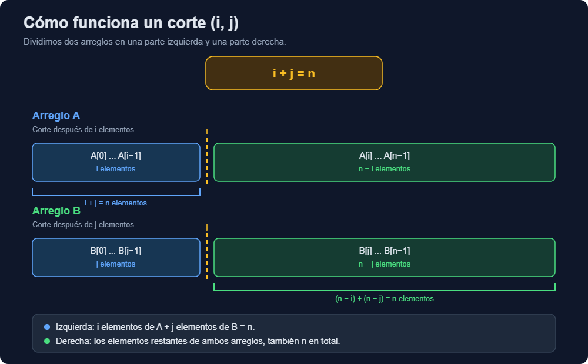

# Ejercicio 7 — Mediana de dos arreglos ordenados

**Tema 1 · Diseño y Análisis de Algoritmos · MatCom 2026**
Conferencias que usa: **C2** (el ciclo de cinco preguntas, la fuerza bruta como oráculo, la idea y su costo) · **C3** (invariante y potencial de la búsqueda binaria) · **C5** (Lemas 1 y 2 de los árboles de decisión, la cota de mezclar) · Dificultad: ★★★

---

## Enunciado

> Mediana de dos arreglos ordenados de largo $n$: el $n$-ésimo menor de los $2n$ elementos. Diseña un algoritmo $O(\log n)$, demuestra su correctitud y da la cota de información.

La fuerza bruta sirve además de oráculo para las pruebas, como en C2: se justifica sola, porque mezclar ordena y el $n$-ésimo de lo mezclado es la respuesta por definición.

## 1. El corte


El corte es **válido** si todo lo de la izquierda es $\le$ todo lo de la derecha. Como cada arreglo está ordenado, basta pedir las dos condiciones "cruzadas":

$$
A[i-1] \le B[j] \qquad\text{y}\qquad B[j-1] \le A[i]
$$

(cada una solo cuando los dos índices existen). Si el corte es válido, la izquierda son exactamente $n$ elementos que son $\le$ que los otros $n$, así que el $n$-ésimo menor es el máximo de la izquierda:

$$
\text{mediana} = \max(A[i-1],\, B[j-1])
$$

## 2. El predicado monótono

Defino, para $0 \le i \le n-1$:

$$
g(i) = \big[\, A[i] < B[n-1-i] \,\big].
$$

"Si tomo $i$ de $A$, ¿el próximo de $A$ todavía es menor que el último que tomé de $B$?" Si es así, me conviene tomar más de $A$.

**$g$ es monótono (verdadero, ..., verdadero, falso, ..., falso).** Al aumentar $i$, $A[i]$ crece (o se queda) y $B[n-1-i]$ decrece (o se queda). Así que si $g(i)$ es falso, $A[i] \ge B[n-1-i]$, y para $i' > i$: $A[i'] \ge A[i] \ge B[n-1-i] \ge B[n-1-i']$, falso también.

Sea $i^{\ast} =$ la cantidad de valores de $i$ con $g(i)$ verdadero $=$ el primer $i$ donde $g$ es falso (o $n$ si nunca es falso).

> **Lema del corte.** El corte $(i^{\ast}, n - i^{\ast})$ es válido.

*Demostración.* Escribo $j^{\ast} = n - i^{\ast}$.
- $B[j^{\ast}-1] \le A[i^{\ast}]$ (si existen ambos, o sea $i^{\ast} < n$ y $j^{\ast} > 0$): $g(i^{\ast})$ es falso, que dice $A[i^{\ast}] \ge B[n-1-i^{\ast}] = B[j^{\ast} - 1]$. ✓
- $A[i^{\ast}-1] \le B[j^{\ast}]$ (si existen ambos, o sea $i^{\ast} > 0$ y $j^{\ast} < n$): $g(i^{\ast}-1)$ es verdadero, que dice $A[i^{\ast}-1] < B[n - i^{\ast}] = B[j^{\ast}]$. ✓ ∎

Con empates el lema sigue funcionando, porque la mediana es un **valor**, y cualquier corte válido da el mismo máximo de la izquierda.

## 3. Algoritmo

Es la búsqueda binaria del ejercicio 2 aplicada a $g$:

```python
def mediana_dos(A, B, contador=None):
    """n-ésimo menor de A ∪ B, con len(A) == len(B) == n >= 1, ambos ordenados."""
    n = len(A)
    assert len(B) == n >= 1

    def menor(u, v):                       # comparación contada
        if contador is not None: contador[0] += 1
        return u < v

    lo, hi = 0, n
    while lo < hi:                         # invariante: lo <= i* <= hi
        i = (lo + hi) // 2                 # 0 <= i <= n-1, así que A[i] y B[n-1-i] existen
        if menor(A[i], B[n - 1 - i]):      # g(i) verdadero: i* > i
            lo = i + 1
        else:                              # g(i) falso: i* <= i
            hi = i
    i = lo
    j = n - i
    if i == 0: return B[j - 1]
    if j == 0: return A[i - 1]
    return B[j - 1] if menor(A[i - 1], B[j - 1]) else A[i - 1]
```

Ilustración con $n = 5$:

```
  A = [1, 4, 6, 9, 12]        B = [2, 3, 7, 8, 10]       unión ordenada: 1 2 3 4 6 7 8 9 10 12
                                                                                 ^ 5º menor = 6
  lo=0 hi=5   i=2: A[2]=6  < B[2]=7 ?  sí  -> lo=3
  lo=3 hi=5   i=4: A[4]=12 < B[0]=2 ?  no  -> hi=4
  lo=3 hi=4   i=3: A[3]=9  < B[1]=3 ?  no  -> hi=3
  i* = 3, j* = 2:

      A:  [ 1   4   6 |  9  12 ]
      B:  [ 2   3     |  7   8  10 ]
      izquierda = {1,2,3,4,6}   max = max(A[2], B[1]) = max(6, 3) = 6  ✓
```

## 4. Correctitud

- **Precondición.** $n \ge 1$, y $A$ y $B$ tienen largo $n$ y están ordenados de forma no decreciente.
- **Postcondición.** Devuelve el valor del $n$-ésimo menor del multiconjunto $A \cup B$.

**Invariante.** Al inicio de cada iteración del `while`, $lo \le i^{\ast} \le hi$. Es el invariante de la búsqueda binaria de C3 ("si $x$ está, está entre `lo` y `hi`"), aplicado al predicado $g$ en lugar de a un arreglo.

- *Inicialización.* $lo = 0$ y $hi = n$, y por definición $0 \le i^{\ast} \le n$.
- *Mantenimiento.* Sea $i = \lfloor (lo + hi)/2 \rfloor$. Como $lo < hi$, se tiene $0 \le lo \le i < hi \le n$, así que $A[i]$ y $B[n-1-i]$ existen. Si $g(i)$ es verdadero, por la monotonía todos los $i' \le i$ también lo son, así que $i^{\ast} \ge i + 1$ y `lo = i + 1` conserva el invariante. Si $g(i)$ es falso, el primer falso está en $i$ o antes, así que $i^{\ast} \le i$ y `hi = i` lo conserva.
- *Conclusión.* El ciclo termina con $lo = hi$, y por el invariante $lo = i^{\ast}$. Por el lema del corte, $(i^{\ast}, n - i^{\ast})$ es válido, y el algoritmo devuelve el máximo de la izquierda, que es el $n$-ésimo menor (sección 2). Si $i^{\ast} = 0$ o $i^{\ast} = n$, la izquierda viene toda de un solo arreglo y el máximo es su último elemento, sin comparar. ∎

**Terminación (potencial).** $\Phi = hi - lo$, el potencial de la búsqueda binaria de C3. Es un entero, sigue siendo $\ge 0$ porque $lo \le i < hi$, y baja estrictamente en cada vuelta: `lo = i + 1` lo deja en $hi - i - 1 < hi - lo$, y `hi = i` lo deja en $i - lo < hi - lo$. Así que el ciclo termina. Como además queda en a lo sumo la mitad en cada vuelta (ejercicio 2), hay a lo sumo $\lceil\log_2(n+1)\rceil$ vueltas.

## 5. Costo

La búsqueda binaria sobre $n+1$ valores posibles de $i^{\ast}$ hace a lo sumo $\lceil \log_2(n+1) \rceil$ comparaciones (ejercicio 2), y al final hay a lo sumo una comparación más para el máximo. Total:

$$
C(n) \le \lceil \log_2 (n+1) \rceil + 1 = O(\log n), \qquad \text{memoria } O(1).
$$

**Comentario sobre C2.** La versión clásica de divide y vencerás ("compara las medianas de $A$ y $B$, descarta la mitad de abajo de uno y la de arriba del otro, y recursa") es la misma idea vista desde otro lado: cada paso descarta la mitad de los cortes posibles, y su recurrencia $T(n) = T(n/2) + O(1)$ da $O(\log n)$ por el Teorema Maestro. La prefiero en forma de búsqueda binaria porque el invariante queda explícito y no hay que pelear con los casos de $n$ par e impar. Es la lección de C2: la idea y su costo son cosas distintas, y el análisis (y aquí también la demostración) se hace sobre la implementación concreta.

## 6. Cota de información

> **Afirmación.** Todo algoritmo de comparaciones (de dos salidas) hace al menos $\lceil \log_2(2n) \rceil = 1 + \lceil \log_2 n\rceil$ comparaciones en el peor caso.

**Demostración.**

*La salida depende solo de la hoja* (primera parte del Lema 2 de C5). El algoritmo nunca ve los valores, solo las respuestas, así que su salida tiene que estar escrita en términos de posiciones: la hoja dice "es $A[k]$" o "es $B[k]$". Dos entradas que reciben las mismas respuestas llegan a la misma hoja y dan la misma salida.

*Cada posición necesita su propia hoja* (el análogo de la segunda parte del Lema 2). Si dos entradas tienen como mediana posiciones distintas, por ejemplo $A[k]$ en una y $B[k']$ en la otra, no pueden compartir hoja: la salida de esa hoja estaría mal para una de las dos. Así que basta mostrar que cada uno de los $2n$ elementos es la respuesta correcta para alguna entrada:

- $A[k]$ es el $n$-ésimo menor si exactamente $n - 1$ elementos son menores que él: los $k$ anteriores de $A$ y $n - 1 - k$ de $B$. Eso se logra con $B[0..n-2-k] < A[k] < B[n-1-k]$, por ejemplo intercalando. Es posible para todo $k \in \{0, \dots, n-1\}$.
- Simétricamente para $B[k]$.

El árbol de decisión necesita al menos $2n$ hojas, y un árbol binario de altura $h$ tiene a lo sumo $2^h$ hojas. Así que $h \ge \log_2 2n$, y como la altura es entera, $h \ge \lceil\log_2 2n\rceil$. ∎

```
  ejemplo n = 3: cada uno de los 6 elementos puede ser el 3er menor
  (los números son el orden de cada elemento en la unión)

     A[0] es la mediana:  A = [3, 4, 5]   B = [1, 2, 6]
     A[1]               :  A = [2, 3, 4]   B = [1, 5, 6]
     A[2]               :  A = [1, 2, 3]   B = [4, 5, 6]
     B[0], B[1], B[2]   :  intercambiando los papeles de A y B
```

**¿Qué tan cerca queda el algoritmo?**

| $n$ | algoritmo $\le \lceil\log_2(n+1)\rceil + 1$ | cota $\lceil\log_2 2n\rceil$ |
|---|---|---|
| $n = 2^k$ | $k + 2$ | $k + 1$ |
| otro caso | $\lceil \log_2 n\rceil + 1$ | $\lceil \log_2 n\rceil + 1$ |

O sea, coinciden exactamente salvo cuando $n$ es potencia de 2, donde difieren en una comparación. Lo mido abajo sobre **todas** las entradas posibles para $n$ chico.

---

## 7. Casos de prueba

1. Exhaustivo: para $n \le 8$, todas las formas de intercalar $A$ y $B$ (son $\binom{2n}{n}$, hasta 12 870), contra `sorted(A+B)[n-1]`.
2. Aleatorio con muchos repetidos.
3. Peor caso de comparaciones (sobre todas las intercalaciones) contra la cota de información.
4. Verifico la construcción de la cota: que cada uno de los $2n$ elementos es la respuesta para alguna entrada.

```python
import itertools, math, random

def todas_las_intercalaciones(n):
    """Todas las entradas con valores 1..2n distintos, salvo renombrar: C(2n, n)."""
    for S in itertools.combinations(range(1, 2 * n + 1), n):
        A = list(S)
        B = [v for v in range(1, 2 * n + 1) if v not in S]
        yield A, B

# 1) y 3) exhaustivo + peor caso de comparaciones
print(f"{'n':>3} {'entradas':>9} {'peor caso medido':>17} {'ceil(log2(n+1))+1':>18} {'cota ceil(log2 2n)':>19}")
for n in range(1, 9):
    peor, cuantas = 0, 0
    for A, B in todas_las_intercalaciones(n):
        c = [0]
        assert mediana_dos(A, B, c) == sorted(A + B)[n - 1]
        peor = max(peor, c[0]); cuantas += 1
    cota = math.ceil(math.log2(2 * n))
    garantia = math.ceil(math.log2(n + 1)) + 1
    print(f"{n:3} {cuantas:9} {peor:17} {garantia:18} {cota:19}")
    assert cota <= peor <= garantia

# 2) aleatorio con repetidos y n grande
random.seed(7)
for _ in range(3000):
    n = random.randint(1, 60)
    A = sorted(random.randint(0, 20) for _ in range(n))
    B = sorted(random.randint(0, 20) for _ in range(n))
    assert mediana_dos(A, B) == sorted(A + B)[n - 1]
print("3000 casos aleatorios con repetidos: OK")

# Ejemplo de la ilustración
assert mediana_dos([1, 4, 6, 9, 12], [2, 3, 7, 8, 10]) == 6

# 4) cada uno de los 2n elementos es la mediana de alguna entrada
for n in range(1, 9):
    alcanzados = set()
    for A, B in todas_las_intercalaciones(n):
        m = sorted(A + B)[n - 1]
        alcanzados.add(("A", A.index(m)) if m in A else ("B", B.index(m)))
    assert len(alcanzados) == 2 * n
print("para n = 1..8, las 2n posiciones posibles aparecen como respuesta: la cota de información aplica")

# Escala: n = 10^6, cuántas comparaciones
n = 10**6
A = list(range(0, 2 * n, 2)); B = list(range(1, 2 * n, 2))
c = [0]
r = mediana_dos(A, B, c)
print(f"n = 10^6: mediana = {r}, comparaciones = {c[0]} "
      f"(cota de información = {math.ceil(math.log2(2*n))})")
```

### Salida

```text
  n  entradas  peor caso medido  ceil(log2(n+1))+1  cota ceil(log2 2n)
  1         2                 1                  2                   1
  2         6                 3                  3                   2
  3        20                 3                  3                   3
  4        70                 4                  4                   3
  5       252                 4                  4                   4
  6       924                 4                  4                   4
  7      3432                 4                  4                   4
  8     12870                 5                  5                   4
3000 casos aleatorios con repetidos: OK
para n = 1..8, las 2n posiciones posibles aparecen como respuesta: la cota de información aplica
n = 10^6: mediana = 999999, comparaciones = 20 (cota de información = 21)
```

Dos cosas que vi en la salida y que al principio me confundieron:

- En $n = 1$ el algoritmo hace 1 comparación, menos que la garantía de 2: con un solo elemento por arreglo, la búsqueda termina en $i^{\ast} = 0$ o $i^{\ast} = n$ y la comparación final del máximo nunca hace falta. La cota de información (1) se alcanza.
- En $n = 10^6$ la entrada que probé usó 20 comparaciones, **menos** que la cota de 21. No hay contradicción: la cota es para el **peor caso**, y esa entrada en particular tomó un camino del árbol de decisión más corto que el peor. En la tabla de arriba, que sí recorre todas las entradas, el peor caso medido nunca baja de la cota.

---

**Uso de IA**: implementación de algoritmos, generación de casos de prueba y correcciones de redacción.
