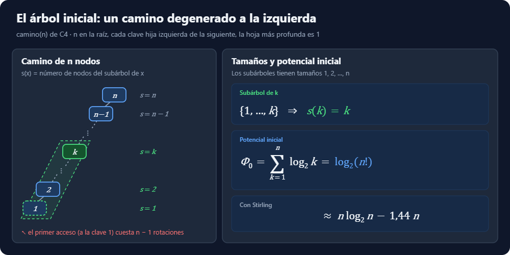
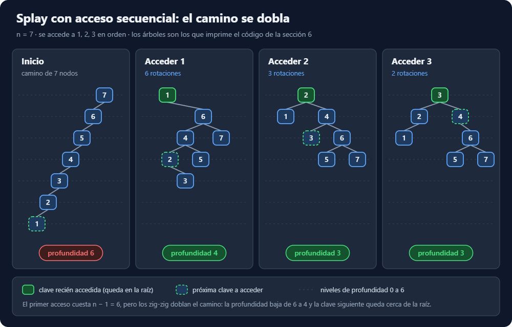

# Ejercicio 13 — Acceso secuencial en un splay tree que empieza como un camino

**Tema 1 · Diseño y Análisis de Algoritmos · MatCom 2026**
Conferencias que usa: **C4** (el splay y su costo, el lema de acceso y su consecuencia, la medición en orden y la figura 4; ejercicio 4) · Dificultad: ★★

---

## Enunciado

> En un splay tree que empieza como un camino de $n$ nodos se accede a las claves $1, 2, \dots, n$ en orden. Acota el costo total con el lema de acceso y la cuenta de la sección 5 de la conferencia 4, y compáralo con lo que mide la sección 6. ¿Es ajustada la cota?

---

## 1. Las herramientas

**Costo**. Se cuentan rotaciones, "y 1 cuando el nodo ya es la raíz". Aquí eso nunca pasa para $n \ge 2$: al acceder a $k+1$ la raíz es $k$. Así que el costo $c$ de cada acceso es exactamente su número de rotaciones.

**Potencial**. Si $s(x)$ es el número de nodos del subárbol de $x$,
$$
\Phi = \sum_{x} \log_2 s(x).
$$

**El árbol inicial.** Tomo el mismo camino que la función `camino(n)` de C4: $n$ en la raíz, cada clave hija izquierda de la siguiente, y la hoja más profunda es $1$. El subárbol de $k$ es $\{1, \dots, k\}$, así que $s(k) = k$: los subárboles tienen tamaños $1, 2, \dots, n$, es decir el árbol esta degenerado a la izquierda.



Con esto, las tres herramientas:

- **Cada acceso cuesta, amortizado, $\le 3\log_2 n + 1$.** El lema de acceso de C4 dice que $\hat c = c + \Delta\Phi \le 3\big(\log_2 s(\text{raíz}) - \log_2 s(x)\big) + 1$. La raíz tiene $s = n$, y $s(x) \ge 1$ da $\log_2 s(x) \ge 0$, así que $\hat c \le 3\log_2 n + 1$.
- **El potencial inicial es $\Phi_0 = \log_2 1 + \log_2 2 + \dots + \log_2 n = \log_2 n! \le n\log_2 n$**, porque $n! = 1 \cdot 2 \cdots n$ tiene $n$ factores y cada uno es $\le n$, así que $n! \le n^n$.
- **$\Phi_n \ge 0$**, porque cada nodo cumple $s(x) \ge 1$ (su subárbol lo contiene a él), así que $\log_2 s(x) \ge 0$, y $\Phi$ es una suma de términos no negativos. Esto vale para cualquier árbol, así que no hace falta saber cómo queda el árbol al final.

## 2. El telescopio

Numero los estados: $\Phi_0$ es el potencial inicial y $\Phi_k$ el potencial después del acceso $k$. Por definición, cada acceso cumple
$$
\hat c_k = c_k + \Phi_k - \Phi_{k-1}.
$$
Sumando los $n$ accesos, cada $\Phi$ intermedio aparece una vez con $+$ y una vez con $-$, y se cancela:
$$
\sum_{k=1}^{n} \hat c_k = \sum_{k=1}^{n} c_k + (\Phi_1 - \Phi_0) + (\Phi_2 - \Phi_1) + \dots + (\Phi_n - \Phi_{n-1}) = \sum_{k=1}^{n} c_k + \Phi_n - \Phi_0 .
$$
Despejando el costo real:
$$
\sum_{k=1}^{n} c_k = \sum_{k=1}^{n} \hat c_k + \Phi_0 - \Phi_n \;\le\; n(3\log_2 n + 1) + n\log_2 n,
$$
porque cada acceso cuesta $\le 3\log_2 n + 1$ amortizado (lema de acceso), $\Phi_0 \le n\log_2 n$ (paso 1), y $\Phi_n \ge 0$ se está restando, así que quitarlo solo agranda el lado derecho. No sustituyo $\Phi_n$, lo acoto.

Esto es lo que C4 llama "pagar $\Phi_0$ aparte, una sola vez": el lema solo controla los $\hat c_k$, y el potencial que el camino trae de entrada hay que sumarlo.

## 3. El resultado asintótico

$$
n(3\log_2 n + 1) + n\log_2 n = 4n\log_2 n + n \;\le\; 5n\log_2 n \quad (n \ge 2),
$$
porque para $n \ge 2$ se tiene $\log_2 n \ge 1$, o sea $n \le n\log_2 n$. Así que el total es **$O(n\log n)$**, con $c = 5$ y $n_0 = 2$ (las constantes no se escriben dentro de la $O$).

## 4. Comparar con lo medido

Dividiendo la cota entre los $n$ accesos, por acceso queda
$$
3\log_2 n + 1 + \frac{\Phi_0}{n}.
$$
Para $n = 800$, con $\log_2 800 \approx 9{,}6$:

- $3 \cdot 9{,}6 + 1 = 29{,}8$;
- $\Phi_0 / n = \log_2 n!/n \approx (n\log_2 n - 1{,}44\,n)/n = \log_2 n - 1{,}44 \approx 9{,}6 - 1{,}44 \approx 8{,}2$ (el $1{,}44 \approx \log_2 e$ sale de la fórmula de Stirling);
- en total, **la cota da unas 38 rotaciones por acceso**.

La sección 6 de C4 midió exactamente este escenario (camino inicial, claves en orden, tres rondas):

```text
     n   splay   subir a la raíz   log₂ n        (tabla de C4)
   100     4.2              50.5      6.6
   200     4.2             100.5      7.6
   400     4.3             200.5      8.6
   800     4.4             400.5      9.6
```

**Lo medido son 4,4 rotaciones por acceso**, unas 9 veces menos que la cota. Repito la medición con una sola ronda en la sección 6 de este documento y da lo mismo: con splay, $\approx 4{,}4$ por acceso, constante; con subir a la raíz, $\approx n/2$ por acceso, exactamente $n(n+1)/2 - 1$ en total (el $\Theta(n^2)$ es el ejercicio 4 de C4).

Por qué splay sale tan barato se ve en cómo evoluciona el árbol ($n = 7$; los árboles son los que imprime el código de la sección 6):



El primer acceso cuesta $n - 1$, pero los zig-zig **doblan el camino**: la profundidad baja de $n-1$ a más o menos la mitad (de 6 a 4 en el dibujo), y los accesos siguientes encuentran a $k+1$ cerca de la raíz. Subir a la raíz no hace eso: deja "otro camino casi tan largo como el original" (figura 4 de C4).

## 5. ¿Es ajustada?

**La cota crece como $\log n$ por acceso** ($3\log_2 n + 1 + \Phi_0/n \approx 4\log_2 n$), **y lo medido se queda constante**, en $\approx 4{,}4$.

**Cota inferior del costo real.** La clave $1$ empieza en el fondo del camino, a profundidad $n - 1$, así que el primer acceso solo ya cuesta $n - 1$ rotaciones. Los demás cuestan $\ge 0$, así que
$$
n - 1 \;\le\; \sum_{k=1}^{n} c_k \;\le\; 4n\log_2 n + n .
$$
Ese primer acceso cuesta en real mucho más que su $3\log_2 n + 1$ amortizado; lo paga la caída del potencial, y por eso hay que sumar $\Phi_0$ en el telescopio. Pero eso pasa una sola vez: lo medido ($\approx 4{,}4\,n$) está pegado a la cota inferior, no a la superior.

**Conclusión: la cota no es ajustada; sobra un factor $\log n$.** El costo real es $\Theta(n)$: $\Omega(n)$ por el primer acceso, y $O(n)$ por el **teorema de acceso secuencial** (Tarjan, 1985), que dice que acceder a todas las claves en orden cuesta $O(n)$ desde cualquier árbol inicial. Las mediciones solo lo apoyan; la demostración del $O(n)$ no sale del lema de acceso, es un argumento aparte.

**Dónde se pierde.** No en tirar $\Phi_n$: en las mediciones el árbol final vuelve a ser un camino con raíz $n$, así que $\Phi_n = \Phi_0$ (sección 6). Se pierde en el lema, acceso por acceso: al acceder a $k+1$ justo después de $k$, el subárbol de $k+1$ es chico, $\log_2 s(x) \approx 0$, y el lema cobra casi $3\log_2 n$ aunque el splay real haga unas pocas rotaciones.

| | total para $n$ accesos en orden |
|---|---|
| lema de acceso + telescopio | $\le n(3\log_2 n + 1) + \Phi_0 - \Phi_n \le 4n\log_2 n + n = O(n\log n)$ |
| cota inferior (primer acceso) | $\ge n - 1$ |
| medido (splay), aquí y en C4 | $\approx 4{,}2$–$4{,}4$ rotaciones por acceso |
| teorema de acceso secuencial | $O(n)$, ajustado |
| medido (subir a la raíz), aquí y en C4 | $\approx n/2$ por acceso; aquí exactamente $n(n+1)/2 - 1$ en total |

Una cota amortizada es una garantía de peor caso sobre secuencias (C4), y no tiene por qué ser ajustada en una secuencia particular.

---

## 6. Casos de prueba

Implemento el splay tree con tamaños de subárbol (para calcular el potencial), y:
1. compruebo que el árbol sigue siendo un ABB correcto y que cada splay deja a $x$ en la raíz;
2. **ejecuto el lema** (la técnica de `vigilar_lema` en C4: "un lema como este también se puede ejecutar"): en cada acceso calculo $c + \Delta\Phi$ y compruebo que es $\le 3(\log_2 n - \log_2 s(x)) + 1$;
3. comparo el total real con la cota del lema y con la versión gruesa $n(3\log_2 n + 1) + \Phi_0 - \Phi_n$;
4. mido subir a la raíz en el mismo escenario.

```python
import math, random

class Nodo:
    __slots__ = ("k", "l", "r", "p", "s")
    def __init__(self, k):
        self.k, self.l, self.r, self.p, self.s = k, None, None, None, 1

def tam(x): return x.s if x else 0
def actualizar(x): x.s = 1 + tam(x.l) + tam(x.r)

def rotar(x):
    """Sube x un nivel (rotación simple)."""
    p, g = x.p, x.p.p
    if p.l is x:
        p.l = x.r
        if x.r: x.r.p = p
        x.r = p
    else:
        p.r = x.l
        if x.l: x.l.p = p
        x.l = p
    p.p, x.p = x, g
    if g:
        if g.l is p: g.l = x
        else: g.r = x
    actualizar(p); actualizar(x)

def splay(x):
    rot = 0
    while x.p:
        p, g = x.p, x.p.p
        if g is None:                              # zig
            rotar(x); rot += 1
        elif (g.l is p) == (p.l is x):             # zig-zig: primero el padre
            rotar(p); rotar(x); rot += 2
        else:                                      # zig-zag
            rotar(x); rotar(x); rot += 2
    return rot

def subir_a_la_raiz(x):
    rot = 0
    while x.p:
        rotar(x); rot += 1
    return rot

def camino_izquierdo(n):
    """Raíz n, hijo izquierdo n-1, ..., hoja 1. Devuelve la lista de nodos por clave."""
    nodos = [Nodo(k) for k in range(1, n + 1)]
    for k in range(1, n):
        nodos[k].l, nodos[k - 1].p = nodos[k - 1], nodos[k]
    for k in range(n):
        nodos[k].s = k + 1
    return nodos

def raiz(x):
    while x.p: x = x.p
    return x

def potencial(t):
    total, pila = 0.0, [t]
    while pila:
        x = pila.pop()
        if x:
            total += math.log2(x.s); pila += [x.l, x.r]
    return total

def es_abb(t):
    claves, pila, x = [], [], t
    while pila or x:                               # recorrido en orden iterativo
        while x: pila.append(x); x = x.l
        x = pila.pop(); claves.append(x.k)
        if x.s != 1 + tam(x.l) + tam(x.r): return False
        x = x.r
    return claves == sorted(claves)

def dibujar(t, pref=""):
    """Dibujo de lado (la raíz a la izquierda, el hijo derecho arriba)."""
    if t is None: return []
    return dibujar(t.r, pref + "    ") + [pref + str(t.k)] + dibujar(t.l, pref + "    ")

# Ilustración con n = 7
nodos = camino_izquierdo(7)
for k in [1, 2, 3]:
    r = splay(nodos[k - 1])
    print(f"después de acceder {k} ({r} rotaciones):")
    print("\n".join(dibujar(nodos[k - 1])))
    print()

# 1), 2) y 3)
print(f"{'n':>6} {'rot. splay':>11} {'por acceso':>11} {'Σ lema':>9} {'lema/real':>10}"
      f" {'n(3lg n+1)+Φ0-Φn':>18} {'Φ0':>9} {'Φn':>9}")
for n in [10, 100, 1000, 10000, 50000]:
    nodos = camino_izquierdo(n)
    phi0 = potencial(nodos[-1])
    phi = phi0
    total, suma_lema = 0, 0.0
    vigilar = n <= 1000
    for k in range(n):
        x = nodos[k]
        r_t, r_x = math.log2(n), math.log2(x.s)
        c = splay(x)
        assert x.p is None                                 # x quedó en la raíz
        cota = 3 * (r_t - r_x) + 1
        if vigilar:
            phi_nuevo = potencial(x)
            assert c + (phi_nuevo - phi) <= cota + 1e-9    # el lema, ejecutado
            phi = phi_nuevo
        total += c
        suma_lema += cota
    t = raiz(nodos[0])
    assert es_abb(t)
    phin = potencial(t)
    gruesa = n * (3 * math.log2(n) + 1) + phi0 - phin
    assert total <= suma_lema + phi0 - phin + 1e-6
    print(f"{n:6} {total:11} {total / n:11.2f} {suma_lema:9.0f} {(suma_lema + phi0 - phin) / total:10.2f}"
          f" {gruesa:18.0f} {phi0:9.0f} {phin:9.0f}")

# 4) subir a la raíz en el mismo escenario
print(f"\n{'n':>6} {'rot. subir a la raíz':>21} {'por acceso':>11} {'n/2':>7}")
for n in [10, 100, 1000, 3000]:
    nodos = camino_izquierdo(n)
    total = sum(subir_a_la_raiz(nodos[k]) for k in range(n))
    assert es_abb(raiz(nodos[0]))
    print(f"{n:6} {total:21} {total / n:11.2f} {n / 2:7.1f}")

# Extra: el teorema de acceso secuencial dice "desde cualquier árbol inicial".
# Pruebo con árboles iniciales aleatorios (insertando claves al azar sin balancear).
def abb_aleatorio(n):
    claves = list(range(1, n + 1)); random.shuffle(claves)
    nodos = {k: Nodo(k) for k in claves}
    t = nodos[claves[0]]
    for k in claves[1:]:
        x, z = t, nodos[k]
        while True:
            if k < x.k:
                if x.l: x = x.l
                else: x.l, z.p = z, x; break
            else:
                if x.r: x = x.r
                else: x.r, z.p = z, x; break
    def arreglar(x):
        if x: arreglar(x.l); arreglar(x.r); actualizar(x)
    import sys; sys.setrecursionlimit(10**6)
    arreglar(t)
    return [nodos[k] for k in range(1, n + 1)]

random.seed(13)
print()
for n in [1000, 10000]:
    nodos = abb_aleatorio(n)
    total = sum(splay(nodos[k]) for k in range(n))
    print(f"árbol inicial aleatorio, n={n}: {total / n:.2f} rotaciones por acceso")
```

### Salida

```text
después de acceder 1 (6 rotaciones):
        7
    6
            5
        4
                3
            2
1

después de acceder 2 (3 rotaciones):
            7
        6
            5
    4
        3
2
    1

después de acceder 3 (2 rotaciones):
            7
        6
            5
    4
3
    2
        1

     n  rot. splay  por acceso    Σ lema  lema/real   n(3lg n+1)+Φ0-Φn        Φ0        Φn
    10          28        2.80        87       3.09                110        22        22
   100         416        4.16      1442       3.47               2093       525       525
  1000        4374        4.37     20490       4.68              30897      8529      8529
 10000       44112        4.41    268121       6.08             408631    118458    118458
 50000      220688        4.41   1563207       7.08            2391446    708356    708356

     n  rot. subir a la raíz  por acceso     n/2
    10                    54        5.40     5.0
   100                  5049       50.49    50.0
  1000                500499      500.50   500.0
  3000               4501499     1500.50  1500.0

árbol inicial aleatorio, n=1000: 2.52 rotaciones por acceso
árbol inicial aleatorio, n=10000: 2.55 rotaciones por acceso
```

Lectura de la tabla:
- "por acceso" se estabiliza en $\approx 4{,}4$: el total real es **lineal**.
- "Σ lema" (la suma de las cotas del lema con el $\log_2 s(x)$ verdadero de cada acceso) crece como $3n\log_2 n$, y el cociente cota/real crece con $\log n$. **La cota no es ajustada.**
- $\Phi_0 = \Phi_n$ en todos los casos: el árbol vuelve a ser un camino con raíz $n$ al final, así que el término de potencial de la cuenta telescópica no aporta nada. Toda la holgura está en la desigualdad del lema.
- Subir a la raíz gasta $\approx n/2$ rotaciones por acceso: $\Theta(n^2)$ en total, como en C4. Los totales (54, 5049, 500499, 4501499) son exactamente $n(n+1)/2 - 1$.
- Desde un árbol inicial aleatorio el acceso secuencial cuesta todavía menos ($\approx 2{,}5$ por acceso), y también lineal: el teorema de Tarjan vale para cualquier árbol inicial, y el camino es de los peores.

---

**Uso de IA**: implementación de algoritmos, generación de casos de prueba, tablas de resultados y correcciones de redacción.
