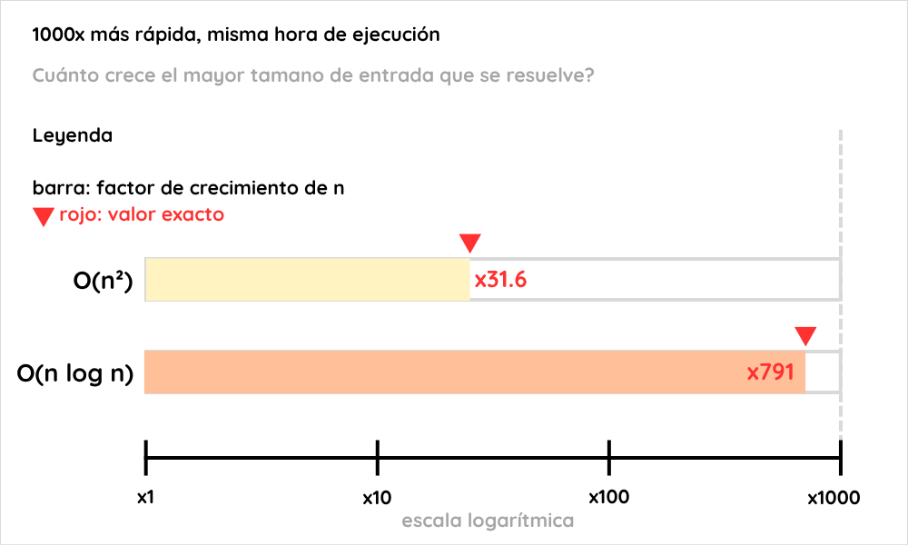

# Ejercicio 1: una computadora 1000 veces más rápida

## Enunciado

Una computadora 1000 veces más rápida, ¿cuánto crece el tamaño de entrada que se resuelve en una hora con un algoritmo `O(n²)`? ¿Y con uno `O(n log n)`? Estima los dos factores.


## Convenciones

- **Modelo.** Word RAM. El tiempo de un algoritmo es el número de operaciones que ejecuta, y la computadora de referencia hace `10⁹` operaciones por segundo.
- **Presupuesto.** En una hora la computadora actual dispone de `B = 3600 · 10⁹ = 3.6 · 10¹²` operaciones. Una computadora `k` veces más rápida dispone de `k·B` en el mismo tiempo.
- **Costo exacto.** `O(·)` es solo una cota superior, así que "un algoritmo `O(n²)`" no fija cuánto cuesta. Para que la pregunta tenga respuesta se interpreta que el costo crece exactamente como la función indicada: `T(n) = c·n²` y `T(n) = c·n·log₂ n`, con `c > 0` constante. Ambas son estrictamente crecientes para `n ≥ 1`.
- **Tamaño máximo.** `N(T, B) = max { n ≥ 1 : T(n) ≤ B }`.
- **Factor.** `F = N(T, k·B) / N(T, B)`.
- **Versión real.** Para deducir las fórmulas se resuelve `T(n*) = B` con `n*` real. Entonces `N = ⌊n*⌋`, y `N > n* − 1`.
- **Logaritmos.** En base 2. El cociente `log f / log n` que aparecerá no depende de la base.
- **Alcance de la cota.** Los resultados valen para este modelo de costo exacto. No dicen nada sobre un algoritmo cuyo costo real sea menor que `c·n²`. Los términos de orden menor no se analizan aquí.

## Idea

Hay que comparar dos ecuaciones: `T(n) = B` para la computadora actual y `T(n') = k·B` para la rápida. Se dividen miembro a miembro.

- Con `T(n) = c·n²`, la constante `c` y el presupuesto `B` se cancelan y el factor sale de una raíz.
- Con `T(n) = c·n·log n`, el `log` no se cancela. Queda una ecuación de punto fijo cuya solución depende del tamaño de `n`.

Para comprobar los valores numéricos se usa la función `mayor_n` que aparece en la conferencia (sección 7), la cual calcula `N(T, B)` por búsqueda binaria.

## Algoritmo

Función `mayor_n` tomada de la conferencia (sección 7) y escrita en pseudocódigo:

```
mayor_n(T, B):                  // pre: T estrictamente creciente, T(1) <= B
    alto = 2
    while T(alto) <= B:         // fase 1: duplicar hasta pasarse
        alto = 2 * alto
    bajo = ⌊alto / 2⌋
    while bajo + 1 < alto:      // fase 2: bisección
        medio = ⌊(bajo + alto) / 2⌋
        if T(medio) <= B:
            bajo = medio
        else:
            alto = medio
    return bajo
```

El factor se calcula así: `F = mayor_n(T, k·B) / mayor_n(T, B)`.

## Por qué funciona

**Caso `O(n²)`.** Si se multiplica el trabajo disponible por 1000, la entrada puede crecer lo que haga que `n²` crezca 1000 veces, y eso es `√1000 ≈ 31.6`. Duplicar la entrada cuadruplica el costo, así que el factor es una raíz y la entrada gana muy poco.

**Caso `O(n log n)`.** El costo crece un poco más que linealmente, así que no se recibe el factor completo de 1000. Pero el `log` crece muy despacio. Multiplicar `n` por unos 800 solo suma unos 10 al `log₂ n`, que ya vale unos 36 para estos tamaños. Por eso el factor queda cerca de 1000, por debajo, y se acerca más a 1000 cuanto mayor es `n`.

Para precisarlo, sea `n'` el tamaño que se resuelve con la computadora rápida y `f = n'/n`. Dividiendo `n'·log n' = k·n·log n` entre `n·log n` queda `f · (1 + log f / log n) = k`. Como `f > 1`, el paréntesis es mayor que 1 y por tanto `f < k`. Y como `f < k`, se tiene `log f < log k`, lo que da la cota `f > k / (1 + log k / log n)` de la Tabla 3.

**Contraste** (Tabla 4): `n` crece 1000 veces, `n³` crece 10 veces y `2ⁿ` solo suma `log₂ 1000 ≈ 10` unidades. Los dos algoritmos del enunciado están entre lo lineal y lo cuadrático, y `n log n` está mucho más cerca de lo lineal.

## Resultados



## Casos de prueba

Los resultados siguientes salen de `verificar_ejercicio_01.py`.¹

**Tabla 1. Mayor `n` resuelto en una hora.** Los valores coinciden exactamente con los valores de referencia fijados en el script.

| costo | actual | 10x | 1000x | factor 1000x |
|---|---|---|---|---|
| n | 3.6e+12 | 3.6e+13 | 3.6e+15 | 1000.0 |
| n log n | 9.86e+10 | 9.06e+11 | 7.8e+13 | 791.4 |
| n^2 | 1.9e+06 | 6e+06 | 6e+07 | 31.6 |
| n^3 | 1.53e+04 | 3.3e+04 | 1.53e+05 | 10.0 |
| 2^n | 41 | 45 | 51 | 1.2 |

**Tabla 2. Factor para `n²` con `k = 1000`.**

| presupuesto B | n (B) | n' (1000 B) | n'/n | raíz de 1000 |
|---|---|---|---|---|
| 1e6 | 1e+03 | 3.16e+04 | 31.62 | 31.62 |
| 1e9 | 3.16e+04 | 1e+06 | 31.62 | 31.62 |
| 1e12 | 1e+06 | 3.16e+07 | 31.62 | 31.62 |
| 1e15 | 3.16e+07 | 1e+09 | 31.62 | 31.62 |
| 1e18 | 1e+09 | 3.16e+10 | 31.62 | 31.62 |

**Tabla 3. Factor para `n log n` con `k = 1000`.** La columna "cota inferior" es `k / (1 + log₂ k / log₂ n)`.

| presupuesto B | n (B) | n' (1000 B) | f = n'/n | cota inferior | k |
|---|---|---|---|---|---|
| 1e6 | 6.27e+04 | 3.96e+07 | 631.4 | 615.3 | 1000 |
| 1e9 | 3.96e+07 | 2.88e+10 | 726.4 | 716.9 | 1000 |
| 1e12 | 2.88e+10 | 2.25e+13 | 783.3 | 777.1 | 1000 |
| 3.6e12 (1 h) | 9.86e+10 | 7.8e+13 | 791.4 | 785.6 | 1000 |
| 1e15 | 2.25e+13 | 1.85e+16 | 820.9 | 816.5 | 1000 |
| 1e18 | 1.85e+16 | 1.57e+19 | 847.5 | 844.3 | 1000 |

**Tabla 4. Factor de crecimiento de la entrada según `k` (B = 1 hora).** Para `2ⁿ` se indica cuánto *suma* el tamaño de entrada, no el factor.

| costo | k = 10 | k = 100 | k = 1000 | predicción |
|---|---|---|---|---|
| n | 10.0 | 100.0 | 1000.0 | k |
| n log n | 9.2 | 85.1 | 791.4 | < k, casi k |
| n^2 | 3.2 | 10.0 | 31.6 | raíz de k |
| n^3 | 2.2 | 4.6 | 10.0 | raíz cúbica de k |
| 2^n | +4 | +7 | +10 | suma log2 k |

Las Tablas 2 y 3 muestran que el factor cuadrático es constante, y que el de `n log n` es creciente, queda siempre por encima de la cota inferior y por debajo de `k`.

¹ **Verificación en código.** El script `verificar_ejercicio_01.py` (Python 3, sin dependencias) implementa `mayor_n` y comprueba:
(1) los valores de la Tabla 1 contra valores de referencia, con coincidencia exacta en notación `.3g`;
(2) búsqueda exhaustiva para todo `B` entre `T(1)` y `3000`, con los 5 costos (15 000 casos), donde `mayor_n` coincide con el escaneo lineal y cumple `T(N) ≤ B < T(N+1)`;
(3) 1 500 pruebas aleatorias (semilla 0, `B ≤ 20 000`) contra fuerza bruta, sin discrepancias;
(4) para `n²`, que `|N'/N − √k| ≤ 2√k/N` con `k ∈ {10, 100, 1000}` y `B` de `10⁶` a `10¹⁸`;
(5) para `n log n`, que `f < k`, que `f` respeta la cota inferior de la Tabla 3 (con tolerancia `2/N`), que satisface la ecuación de punto fijo y que crece con `B`.
Todas las verificaciones pasaron.
