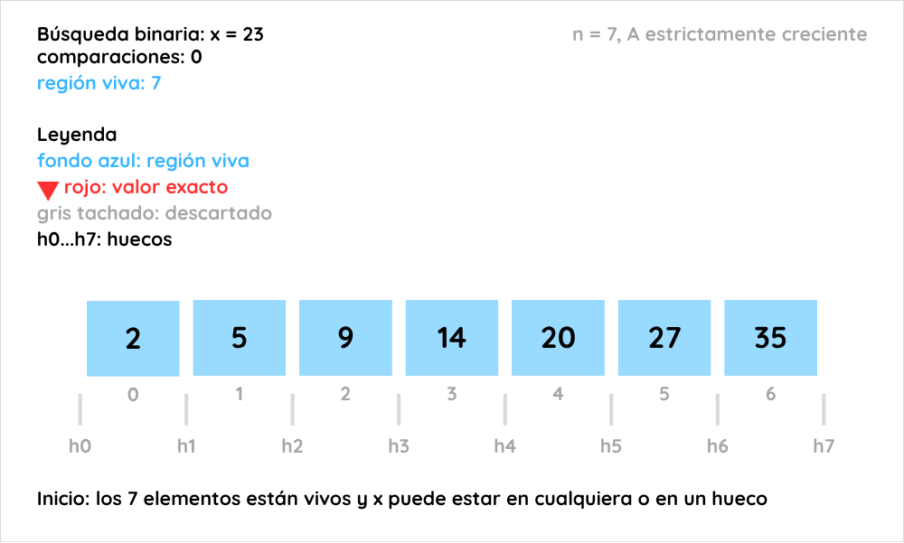
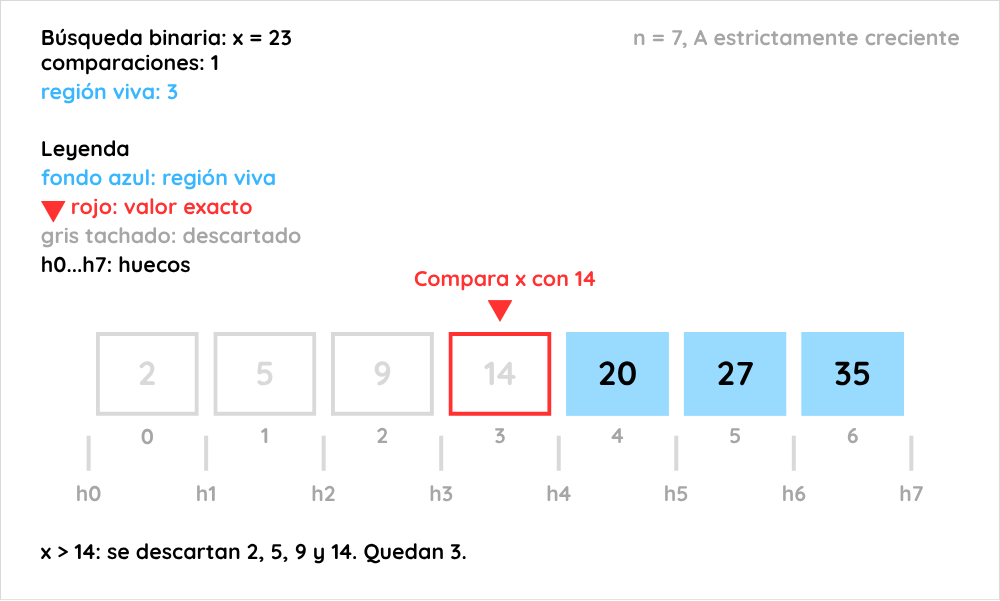
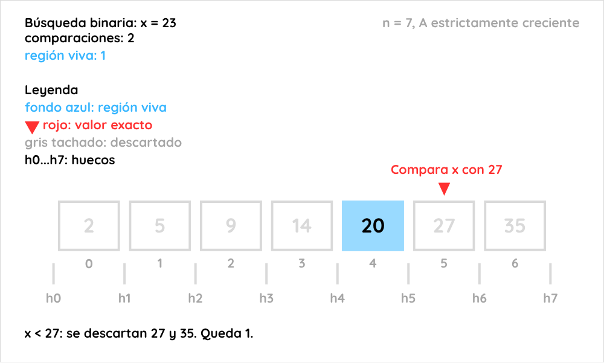
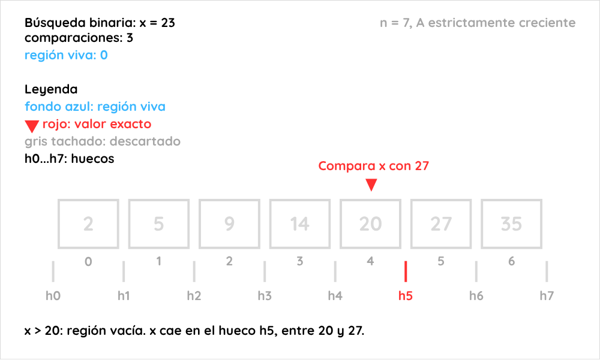
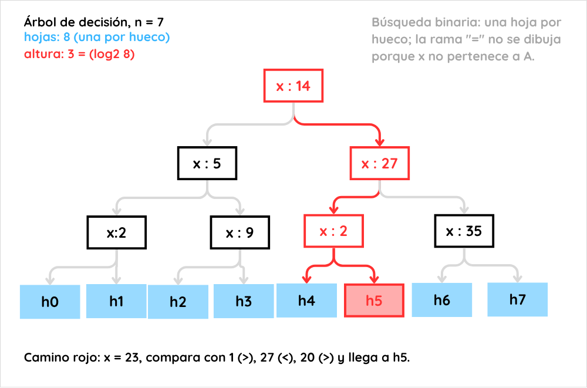

# Ejercicio 2: búsqueda binaria, invariante, potencial y cota de información

## Enunciado

Da el invariante y el potencial de la búsqueda binaria, y la cota de información que la hace óptima.

## Convenciones

- **Entrada.** Un arreglo `A[0], …, A[n-1]` estrictamente creciente, con `n ≥ 0`, y un valor `x`.
- **Huecos.** El hueco `h_j`, con `0 ≤ j ≤ n`, es el conjunto de valores entre `A[j-1]` y `A[j]`. Se toma `A[-1] = -∞` y `A[n] = +∞` solo como notación: nunca se leen. Hay `n + 1` huecos.
- **Postcondición.** El algoritmo devuelve `("está", i)` con `A[i] = x`, o `("hueco", j)` con `x ∉ A` y `A[j-1] < x < A[j]`.
- **Modelo de comparaciones.** El algoritmo solo accede a los datos comparando `x` con un elemento `A[i]`, y la respuesta es `<`, `=` o `>`. Una comparación con los tres resultados posibles cuenta como **una**. El cómputo sobre los índices y las respuestas es gratis. Sobre los valores solo se sabe lo que dijeron las comparaciones.
- **Costo.** Número de comparaciones en el peor caso, para un `n` dado.
- **Región viva.** `A[lo:hi]`, es decir, las posiciones `i` con `lo ≤ i < hi`, de tamaño `s = hi - lo`.
- **Logaritmos.** En base 2. Para `n ≥ 1`, `⌈log₂(n+1)⌉ = ⌊log₂ n⌋ + 1`. Para `n = 0` vale 0 y también se usa la fórmula `⌈log₂(n+1)⌉`.
- **Una cota viene con su modelo.** La cota de este ejercicio vale en el modelo de comparaciones. Un algoritmo que use otra cosa, como calcular una dirección a partir del valor de `x`, usar una tabla hash o hacer aritmética sobre los valores, queda fuera y puede hacer menos.

## Idea

Si el arreglo está ordenado, una sola comparación de `x` con el elemento del medio descarta ese elemento y toda una mitad. La región donde `x` todavía puede estar se reduce a la mitad en cada vuelta, y se repite hasta que queda vacía. El invariante dice exactamente qué se sabe de `x` fuera de la región viva, y el potencial `hi - lo` mide cuánto queda por descartar.

Para la cota, la idea es contar cuántas respuestas distintas debe poder dar cualquier algoritmo cuando `x` no está: una por hueco. Esas respuestas viven en las hojas de un árbol de decisión, y un árbol de altura baja tiene pocas hojas.

## Algoritmo

```
busqueda_binaria(A, x):            // pre: A[0] < A[1] < ... < A[n-1]
    lo = 0
    hi = n
    while lo < hi:
        m = ⌊(lo + hi) / 2⌋
        r = comparar(x, A[m])      // una sola comparación: r es <, = o >
        if r == "=":
            return ("está", m)
        else if r == "<":
            hi = m                 // se descartan A[m], ..., A[hi-1]
        else:
            lo = m + 1             // se descartan A[lo], ..., A[m]
    return ("hueco", lo)
```

## Por qué funciona

**Qué descarta cada comparación.** Como `A` es estrictamente creciente, si `x < A[m]` entonces `x` es menor que todos los elementos a partir de `m`, y si `x > A[m]` es mayor que todos los elementos hasta `m`. Por eso un solo resultado elimina media región, no solo el elemento comparado.

**Por qué el invariante tiene que decir más.** Una primera idea natural es "si `x` está en `A`, está en `A[lo:hi]`". Es verdadera, pero no alcanza: al salir con `lo = hi` solo dice que `x` no está, y la postcondición exige además **qué hueco** se devuelve. Hay que decir también qué se sabe de `x` fuera de la región viva: es mayor que todo lo que quedó a la izquierda y menor que todo lo que quedó a la derecha. Con eso, cuando la región se vacía, `x` queda atrapado entre `A[lo-1]` y `A[lo]`.

**Por qué la cota usa los huecos.** Cada comparación tiene tres respuestas, y contar todas las salidas posibles con tres ramas por nodo daría una cota de la forma `log₃`, más débil de lo que hace falta (Tabla 3). Si solo se miran las entradas en que `x` no está, ninguna comparación responde `=`, y el árbol que recorren esas entradas es binario. Hay `n + 1` huecos, y cada uno exige su propia hoja.

## Ejemplo ilustrado

Se busca `x = 23` en `A = [2, 5, 9, 14, 20, 27, 35]`, con `n = 7`.













*Árbol de decisión.* La misma búsqueda vista para todas las entradas con `x ∉ A`: 8 hojas, una por hueco, y altura 3 = `⌈log₂ 8⌉`. El camino de `x = 23` va en rojo.

## Invariante

Sea `n` el tamaño de `A`. En la guarda del `while` (antes de cada vuelta y al salir del ciclo) se cumple:

> **`I`**: (1) `0 ≤ lo ≤ hi ≤ n`; (2) para todo `i` con `0 ≤ i < lo`, `A[i] < x`; (3) para todo `i` con `hi ≤ i < n`, `A[i] > x`.

**Inicialización.** Con `lo = 0` y `hi = n`, (1) es inmediata, y (2) y (3) hablan de rangos vacíos.

**Mantenimiento.** Supongamos `I` y `lo < hi`, con `s = hi - lo ≥ 1`. Entonces `m = lo + ⌊s/2⌋` cumple `lo ≤ m < hi`, así que `A[m]` existe. Hay tres casos, uno por respuesta:

- **`x = A[m]`:** el algoritmo devuelve y no hay otra vuelta.
- **`x < A[m]`:** `hi' = m`.
  - (1): `lo ≤ m < hi ≤ n`.
  - (2): `lo` no cambia, vale por la hipótesis.
  - (3): sea `m ≤ i < n`. Si `i ≥ hi`, vale por la hipótesis. Si `m ≤ i < hi`, como `A` es estrictamente creciente, `A[i] ≥ A[m] > x`.
- **`x > A[m]`:** `lo' = m + 1`.
  - (1): `lo ≤ m < m + 1 ≤ hi`, pues `m < hi`.
  - (3): `hi` no cambia, vale por la hipótesis.
  - (2): sea `0 ≤ i < m + 1`. Si `i < lo`, vale por la hipótesis. Si `lo ≤ i ≤ m`, como `A` es estrictamente creciente, `A[i] ≤ A[m] < x`.

Lo recién descartado (`A[m..hi-1]` o `A[lo..m]`) se justifica con la respuesta y el orden de los datos, y lo anterior con la hipótesis.

**Corolarios.**

- **C1 (localización).** Si `x ∈ A`, entonces `x = A[i]` para algún `i` con `lo ≤ i < hi`. Por (2) y (3), ningún índice fuera de la región viva puede valer `x`.
- **C2 (salida).** Si `lo = hi`, entonces `x ∉ A` y `A[lo-1] < x < A[lo]`. Todo índice cumple `i < lo` o `i ≥ hi = lo`, así que por (2) y (3) ninguno vale `x`. Además, (2) con `i = lo - 1` da `A[lo-1] < x` si `lo ≥ 1`, y (3) con `i = lo` da `x < A[lo]` si `lo < n`.

**Terminación (potencial).** Sea `Φ = hi - lo`. Por (1), `Φ` es un entero no negativo. En una vuelta que no devuelve, con `s = Φ ≥ 1`:

- si `x < A[m]`, `Φ' = m - lo = ⌊s/2⌋`;
- si `x > A[m]`, `Φ' = hi - (m + 1) = s - ⌊s/2⌋ - 1`, que vale `⌊s/2⌋ - 1` si `s` es par y `⌊s/2⌋` si `s` es impar.

En los dos casos `Φ' ≤ ⌊Φ/2⌋ < Φ`, porque `Φ ≥ 1`. Un entero no negativo no puede bajar estrictamente para siempre, así que el ciclo termina. El `+ 1` de `lo = m + 1` es necesario: sin él, con `s = 1` el potencial valdría `Φ' = 1` y no bajaría.

**Cota sobre las vueltas.** Por inducción, tras `k` comparaciones sin devolver, `Φ_k ≤ ⌊n / 2^k⌋`, porque `⌊⌊n / 2^k⌋ / 2⌋ = ⌊n / 2^(k+1)⌋`. La vuelta `k + 1` solo se ejecuta si `Φ_k ≥ 1`, es decir, si `2^k ≤ n`, o sea `k ≤ ⌊log₂ n⌋`. Por tanto el número de comparaciones es a lo sumo `⌊log₂ n⌋ + 1` si `n ≥ 1`, y 0 si `n = 0`. Para `n ≥ 1`, con `t = ⌊log₂ n⌋`, se tiene `2^t < n + 1 ≤ 2^(t+1)`, así que `⌊log₂ n⌋ + 1 = ⌈log₂(n+1)⌉`.

## Correctitud

**Correctitud parcial.** Si el algoritmo termina, hay dos formas de salir:

- Devuelve `("está", m)`: la comparación dijo `x = A[m]`, que es la postcondición.
- Sale porque `lo < hi` es falsa: por (1), `lo = hi`. Por C2, `x ∉ A` y `A[lo-1] < x < A[lo]`, que es la postcondición para `("hueco", lo)`.

**Terminación.** Se demostró con el potencial `Φ = hi - lo`.

**Correctitud total.** La suma de las dos, para toda entrada que cumpla la precondición.

## Complejidad

- **Comparaciones.** A lo sumo `⌈log₂(n+1)⌉`, por la cota sobre las vueltas (una comparación por vuelta).
- **Tiempo y memoria.** `O(log n)` operaciones, porque cada vuelta hace una cantidad constante. Memoria extra `O(1)`: las variables `lo`, `hi`, `m` y `r`.
- **Peor caso exacto.** Por la cota inferior de la última sección, ningún algoritmo del modelo hace menos de `⌈log₂(n+1)⌉` comparaciones en el peor caso, así que la búsqueda binaria hace **exactamente** `⌈log₂(n+1)⌉` y es óptima.¹

## Casos de prueba

Los resultados siguientes salen de `verificar_ejercicio_02.py`.¹

**Tabla 1. Traza de `A = [2, 5, 9, 14, 20, 27, 35]`, `x = 23`**

| vuelta | lo | hi | región `s = hi - lo` | m | A[m] | respuesta | nueva región |
|---|---|---|---|---|---|---|---|
| 1 | 0 | 7 | 7 | 3 | 14 | x > A[m] | [4, 7) con s = 3 |
| 2 | 4 | 7 | 3 | 5 | 27 | x < A[m] | [4, 5) con s = 1 |
| 3 | 4 | 5 | 1 | 4 | 20 | x > A[m] | [5, 5) con s = 0 |

Salida: `('hueco', 5)`, con 3 comparaciones.

**Tabla 2. Peor caso exacto de la búsqueda binaria y mínimo sobre todas las estrategias**

| n | búsqueda binaria (peor caso) | ⌈log₂(n+1)⌉ | mínimo exhaustivo |
|---|---|---|---|
| 0 | 0 | 0 | 0 |
| 1 | 1 | 1 | 1 |
| 2 | 2 | 2 | 2 |
| 3 | 2 | 2 | 2 |
| 4 | 3 | 3 | 3 |
| 5 | 3 | 3 | 3 |
| 6 | 3 | 3 | 3 |
| 7 | 3 | 3 | 3 |
| 8 | 4 | 4 | 4 |
| 15 | 4 | 4 | 4 |
| 16 | 5 | 5 | 5 |
| 31 | 5 | 5 | 5 |
| 32 | 6 | 6 | 6 |
| 100 | 7 | 7 | 7 |
| 127 | 7 | 7 | 7 |
| 128 | 8 | 8 | 8 |
| 1000 | 10 | 10 | — |
| 1023 | 10 | 10 | — |
| 1024 | 11 | 11 | — |

**Tabla 3. Contar todas las salidas con tres ramas frente a contar solo los huecos**

| n | salidas posibles `2n + 1`, tres ramas | huecos `n + 1`, dos ramas |
|---|---|---|
| 7 | altura >= 3 | altura >= 3 |
| 100 | altura >= 5 | altura >= 7 |
| 1000 | altura >= 7 | altura >= 10 |
| 1000000 | altura >= 14 | altura >= 20 |

**Tabla 4. Casos borde**

| `A` | `x` | salida | comparaciones |
|---|---|---|---|
| `[]` | 5 | `('hueco', 0)` | 0 |
| `[7]` | 3 | `('hueco', 0)` | 1 |
| `[7]` | 7 | `('está', 0)` | 1 |
| `[7]` | 9 | `('hueco', 1)` | 1 |
| `[2, 5, 9, 14, 20, 27, 35]` | 1 | `('hueco', 0)` | 3 |
| `[2, 5, 9, 14, 20, 27, 35]` | 2 | `('está', 0)` | 3 |
| `[2, 5, 9, 14, 20, 27, 35]` | 14 | `('está', 3)` | 1 |
| `[2, 5, 9, 14, 20, 27, 35]` | 23 | `('hueco', 5)` | 3 |
| `[2, 5, 9, 14, 20, 27, 35]` | 35 | `('está', 6)` | 3 |
| `[2, 5, 9, 14, 20, 27, 35]` | 40 | `('hueco', 7)` | 3 |

## Cota inferior

**Teorema.** Todo algoritmo del modelo de comparaciones que cumpla la especificación hace, en el peor caso, al menos `⌈log₂(n+1)⌉` comparaciones.

**Paso 0: el árbol de decisión.** Fijemos `n` y un algoritmo, y consideremos la familia `A = (2, 4, …, 2n)` con `x` variable. El algoritmo solo ve las respuestas, así que la primera pregunta no depende de la entrada, la segunda depende solo de la primera respuesta, y así sucesivamente. Todas las ejecuciones forman un árbol: cada nodo interno es una comparación de `x` con algún `A[i]`, con un hijo por respuesta (`<`, `=`, `>`), y cada hoja es una salida, que depende solo de la hoja. El número de comparaciones de una ejecución es la profundidad de su hoja. Usaremos las `n + 1` entradas `x_j = 2j + 1`, con `0 ≤ j ≤ n`, donde `x_j` cae en el hueco `h_j`.

**Paso 1: un árbol binario de altura `h` tiene a lo sumo `2^h` hojas.** Por inducción sobre `h`. Si `h = 0`, el árbol es una sola hoja y `1 = 2^0`. Si `h > 0`, la raíz tiene a lo sumo dos subárboles, cada uno de altura a lo sumo `h - 1`, y por hipótesis cada uno tiene a lo sumo `2^(h-1)` hojas. Entre los dos, a lo sumo `2^h`.

**Paso 2: las entradas con `x ∉ A` recorren un árbol binario.** Con tres respuestas por nodo, el paso 1 daría `3^h` y solo concluiría `h ≥ ⌈log₃(2n+1)⌉` (Tabla 3), más débil. Pero ninguna `x_j` está en `A`, así que ninguna comparación responde `=`. Sea `T'` la unión de los caminos de `x_0, …, x_n`. Sus nodos tienen a lo sumo dos hijos (`<` y `>`), es decir, `T'` es un árbol binario, y su altura `h` es el máximo de comparaciones de esas `n + 1` ejecuciones, que no supera el costo en el peor caso.

**Paso 3: huecos distintos, hojas distintas.** *Si `i < j`, las ejecuciones de `x_i` y de `x_j` terminan en hojas distintas.* Supongamos que terminan en la misma hoja. Entonces recorren el mismo camino y reciben las mismas respuestas. Observemos que `x_i = 2i + 1 < A[i] = 2i + 2 < x_j`. Si en ese camino se hubiera comparado con `A[i]`, `x_i` habría recibido `<` y `x_j` habría recibido `>`, y se habrían separado. Por tanto el camino nunca compara con `A[i]`. Tomemos ahora `y = A[i]` como entrada. En cada comparación del camino, con `A[k]` y `k ≠ i`, `y` recibe la misma respuesta que `x_i`: si `k < i`, `A[k] ≤ 2i < x_i` y `A[k] < y`, ambos dan `>`; si `k > i`, `A[k] ≥ 2i + 4 > x_i` y `A[k] > y`, ambos dan `<`. Entonces `y` recorre el mismo camino, llega a la misma hoja y recibe la misma salida que `x_i`, que es `("hueco", i)`. Pero `y ∈ A`, y la salida correcta para `y` es `("está", i)`. Contradicción.

**Paso 4: conclusión.** Por el paso 3, `T'` tiene al menos `n + 1` hojas, y por el paso 1, `n + 1 ≤ 2^h`. Entonces `h ≥ log₂(n+1)`, y como `h` es entero, `h ≥ ⌈log₂(n+1)⌉`. Como `h` no supera el costo en el peor caso, el algoritmo hace al menos `⌈log₂(n+1)⌉` comparaciones. ∎

**Optimalidad.** La búsqueda binaria hace a lo sumo `⌈log₂(n+1)⌉` (Complejidad) y todo algoritmo hace al menos esa cantidad. Por tanto es óptima, y su peor caso es exactamente `⌈log₂(n+1)⌉`.

**Alcance.** La cota es un teorema del modelo de comparaciones. No dice nada de algoritmos que usen el valor de `x` para calcular una posición, como una tabla hash o una búsqueda por interpolación con acceso directo.

¹ **Verificación en código.** El script `verificar_ejercicio_02.py` (Python 3, sin dependencias, generado por LLM a partir del pseudocódigo) implementa la búsqueda y comprueba:
(1) la traza de la Tabla 1 y los casos borde de la Tabla 4, incluidos `n = 0`, `n = 1`, valores menores y mayores que todos los elementos, y presentes en los extremos y en el medio;
(2) 2 560 casos exhaustivos (todos los arreglos estrictamente crecientes con valores en `0..7` y `x` entre `-1` y `8`), con el invariante `I` y el potencial vigilados en cada vuelta, la salida igual a la de una referencia por recorrido lineal, y que `Φ_k ≤ ⌊n / 2^k⌋` y las comparaciones no superan `⌈log₂(n+1)⌉`;
(3) 3 000 pruebas aleatorias (semilla 0, `n ≤ 200`) contra la referencia, sin discrepancias;
(4) para `n` de 0 a 128, que el peor caso exacto de la búsqueda binaria, `⌈log₂(n+1)⌉` y el mínimo sobre **todas** las estrategias de comparaciones coinciden (el mínimo se calcula por búsqueda exhaustiva sobre los intervalos de clases de entrada consistentes, y la Tabla 2 muestra una selección de valores), y para `n = 1 000`, `1 023` y `1 024`, que el peor caso coincide con la fórmula;
(5) que para `n` de 0 a 200 los `n + 1` huecos recorren `n + 1` caminos distintos, solo con respuestas `<` y `>`, y que para `n = 7` las 8 hojas están a profundidad 3.
Todas las verificaciones pasaron.
