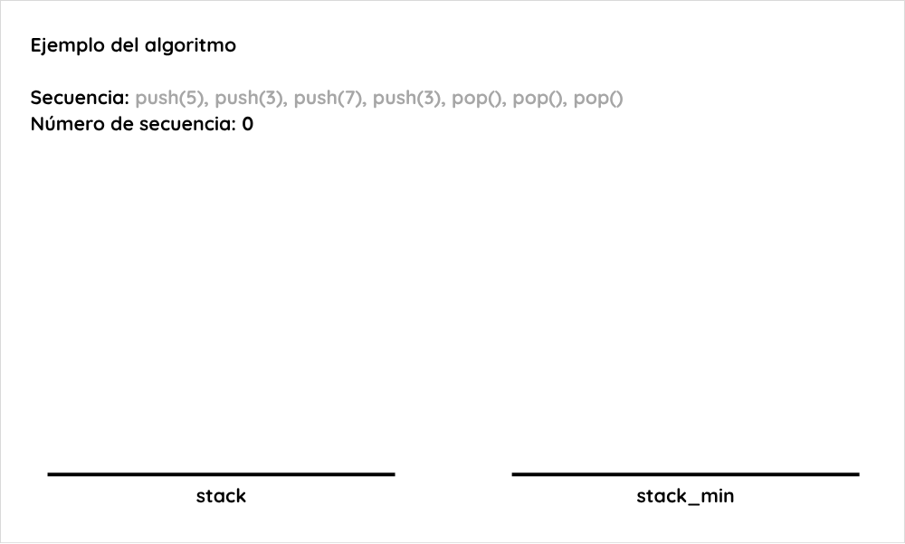
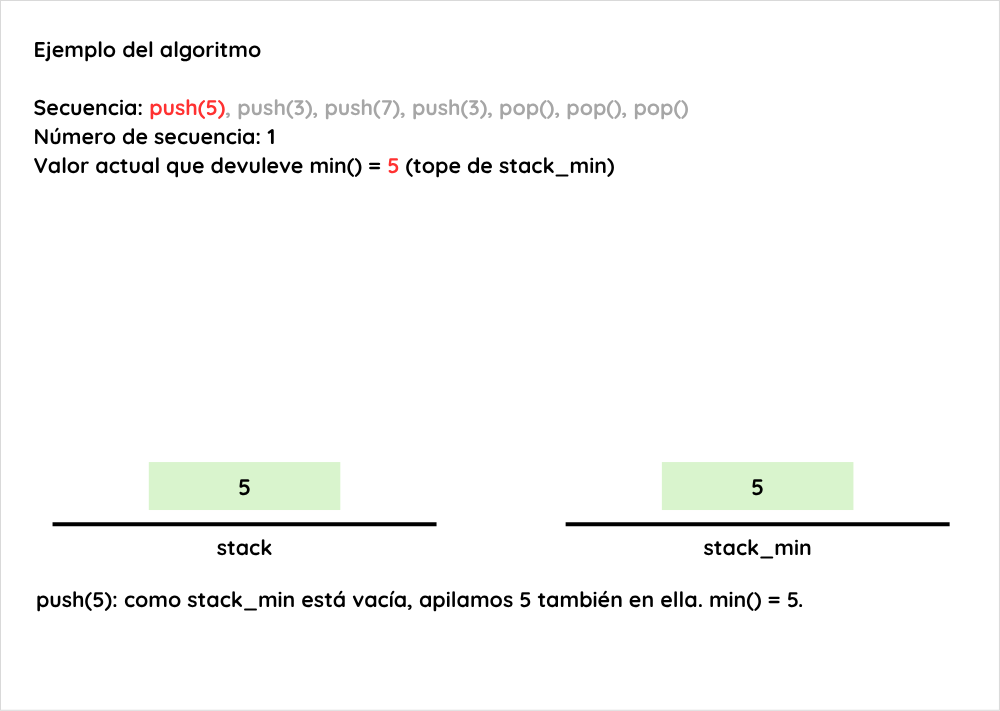
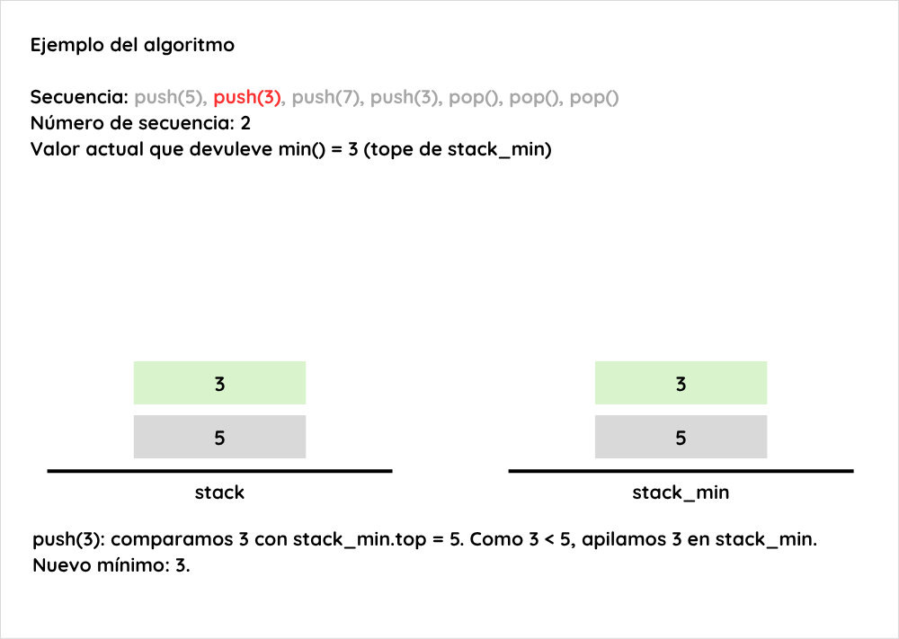
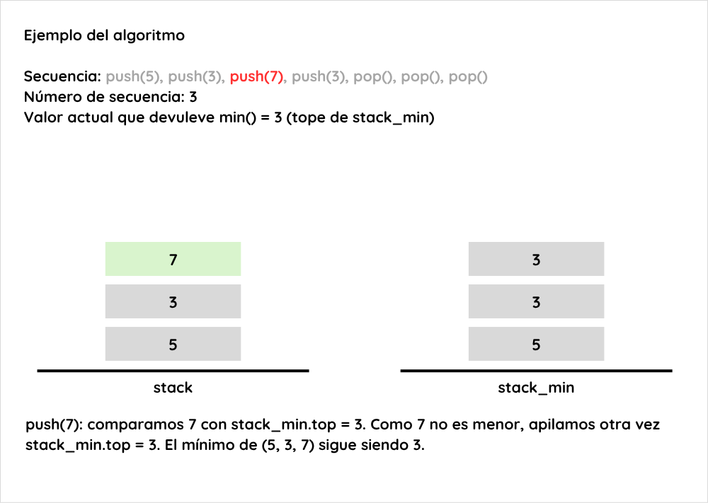
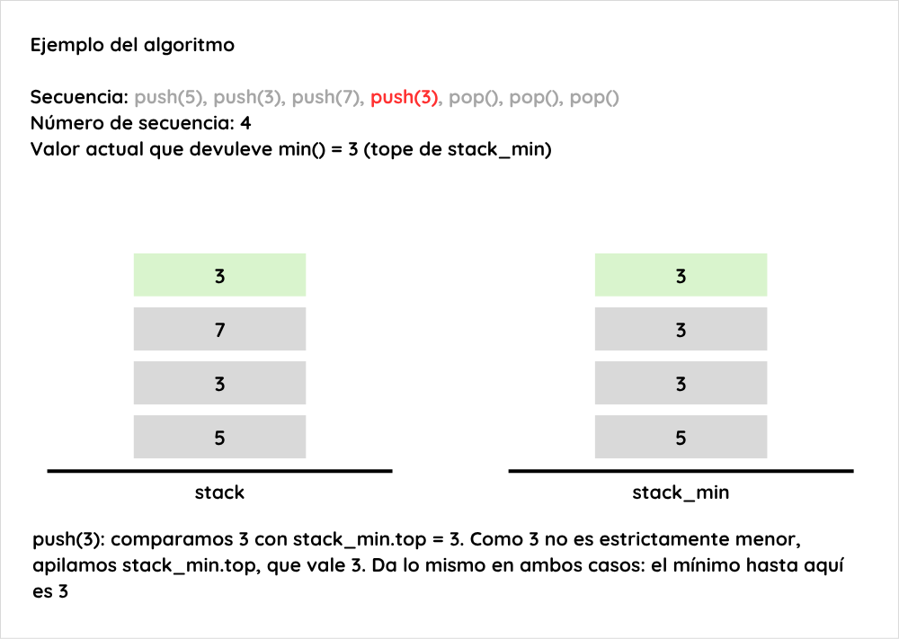
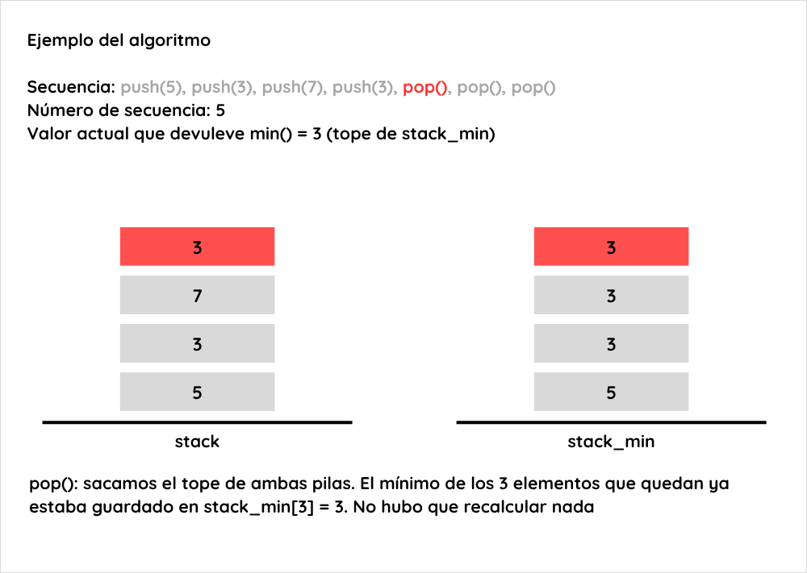
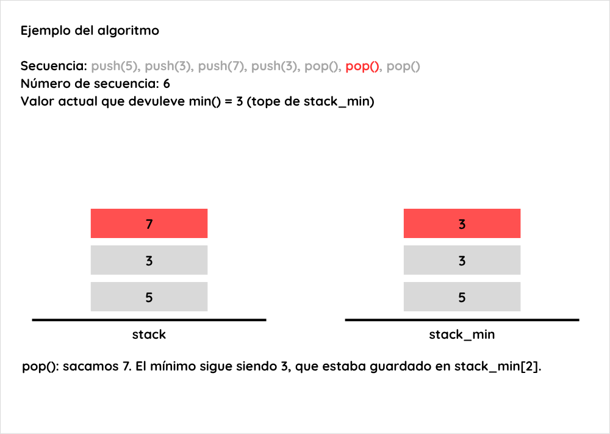
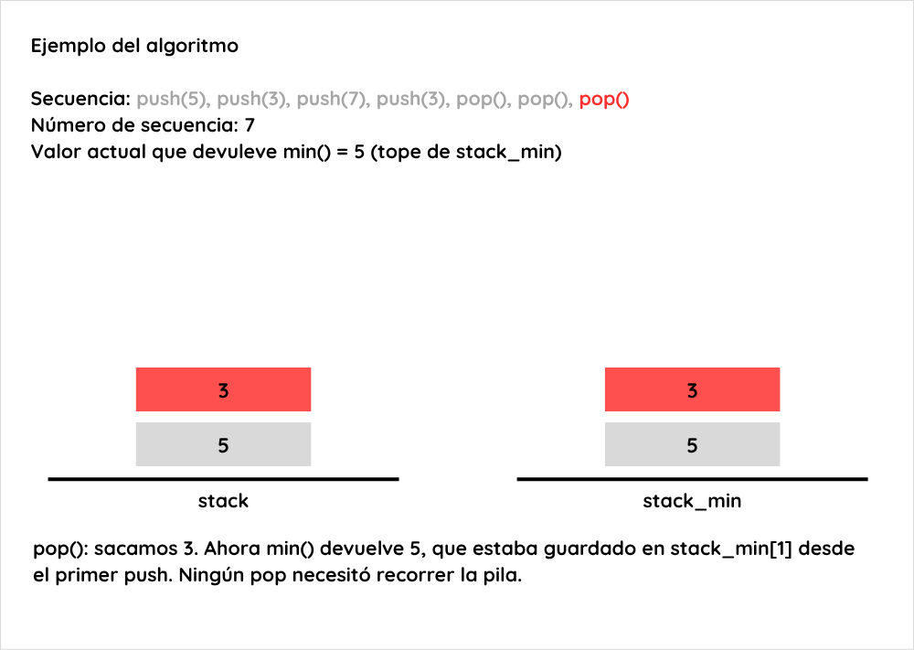

# Ejercicio 3: Pila con operación `min` en O(1) en el peor caso

## Enunciado
Una pila con una operación mínimo que cuesta O(1) en el peor caso. Diseña la estructura, enuncia el invariante que la hace correcta y da el costo de cada operación.

## Convenciones
- `n` es el número de elementos de `stack`. Las posiciones se numeran de 1 a `n`, con la posición 1 en el fondo.
- Las operaciones primitivas de pila (`push`, `pop`, `top`, `isEmpty`) cuestan O(1) en el peor caso (por ejemplo, con lista enlazada o arreglo de capacidad fija).

## Idea
Llevar dos pilas en paralelo. `stack` es la pila normal del usuario. `stack_min` recibe, en cada `push`, el mínimo de todo lo que hay en `stack` hasta ese momento.

## Estructura
```
stack = ()
stack_min = ()

push(num):
    stack.push(num)
    if stack_min.isEmpty() or num < stack_min.top:
        stack_min.push(num)
    else:
        stack_min.push(stack_min.top)

pop():                  // precondición: n ≥ 1
    stack.pop()
    stack_min.pop()

min():                  // precondición: n ≥ 1
    return stack_min.top
```

`pop` y `min` requieren `n ≥ 1`. Sobre una pila vacía no están definidas, porque no hay elemento que sacar ni mínimo que devolver. La implementación debe verificarlo o lanzar error.

## Por qué funciona
Por la naturaleza LIFO de la pila, cuando se hace `pop` de un elemento el estado de la pila vuelve a ser exactamente el que tenía antes de haber hecho `push`. Esto sugiere guardar el mínimo hasta el momento en el instante del `push`, para no tener que recalcularlo en el `pop`.

## Ejemplo ilustrado
Secuencia: `push(5)`, `push(3)`, `push(7)`, `push(3)`, `pop()`, `pop()`, `pop()`.


















## Invariante
Se cumple siempre, antes y después de cada operación:

1. `|stack_min| = n`.
2. Para todo `1 ≤ i ≤ n`: `stack_min[i] = min(stack[1..i])`, incluyendo el elemento `i`-ésimo.

## Correctitud
- **Inicialización:** ambas pilas están vacías, `n = 0`. El invariante se cumple vacuamente.
- **Mantenimiento, `push` con pila vacía:** tras el `push`, `n = 1` y `stack_min[1] = num = min(stack[1..1])`. Los tamaños coinciden.
- **Mantenimiento, `push` con pila no vacía (`n ≥ 1`):** el nuevo elemento queda en la posición `n+1` de ambas pilas, así que los tamaños siguen siendo iguales. Por hipótesis, `stack_min[n] = min(stack[1..n])`. Se inserta `min(stack_min[n], num)`, que es `min(min(stack[1..n]), num) = min(stack[1..n+1])`. Las posiciones `1..n` no cambian.
- **Mantenimiento, `pop` (`n ≥ 1`):** se elimina la posición `n` de ambas pilas, así que los tamaños siguen siendo iguales (`n − 1`). Para `i ≤ n − 1`, `stack_min[i]` no cambia y depende solo de `stack[1..i]`, que tampoco cambia.
- **`min` (`n ≥ 1`):** no modifica nada. Por el invariante con `i = n`, `stack_min[n] = min(stack[1..n])`, que es el mínimo de toda la pila. Por tanto, devuelve el valor correcto.

## Complejidad
| Operación | Costo | Justificación |
|-----------|-------|---------------|
| `push`    | O(1)  | Dos `push` de pila, un `isEmpty`, un `top` y una comparación. Sin ciclos. |
| `pop`     | O(1)  | Dos `pop` de pila. |
| `min`     | O(1)  | Un `top` de pila. |

Cada operación hace una cantidad constante, independiente de `n`, de operaciones primitivas O(1) y a lo sumo una comparación, sin ciclos ni recorridos. Con un arreglo dinámico, `push` sería O(1) amortizado.

**Espacio extra:** O(n), porque `stack_min` tiene tantos elementos como `stack`.

## Casos de prueba
Se eligieron casos que cubren la pila vacía, los extremos de orden (creciente y decreciente), los valores repetidos, los `pop` que restauran un mínimo anterior y la violación de la precondición. El caso C5 es la secuencia del ejemplo ilustrado.¹

| ID | Qué prueba | Operaciones | `stack_min` final | `min()` final |
|----|------------|-------------|-------------------|---------------|
| C1 | primer `push` con pila vacía | `push(4)` | (4) | 4 |
| C2 | orden creciente: el mínimo no cambia | `push(1), push(2), push(3)` | (1,1,1) | 1 |
| C3 | orden decreciente: el mínimo cambia siempre | `push(3), push(2), push(1)` | (3,2,1) | 1 |
| C4 | valores repetidos | `push(4), push(4), pop(), min()` | (4) | 4 |
| C5 | ejemplo ilustrado | `push(5), push(3), push(7), push(3), pop(), pop(), pop()` | (5) | 5 |
| C6 | `pop` que restaura un mínimo anterior | `push(5), push(2), pop(), min()` | (5) | 5 |
| C7 | vaciar la pila y volver a usarla | `push(1), pop(), push(9), min()` | (9) | 9 |
| C8 | precondición | `pop()` o `min()` sobre pila vacía | error | error |

¹ **Verificación en código** (`verificar_ejercicio_03.py`, Python 3, generado con un LLM a partir del pseudocódigo). Se implementó la estructura tal como el pseudocódigo, contando las primitivas `push`, `pop`, `top` e `isEmpty`, y se comprobó lo siguiente:
- **Invariante:** `|stack_min| = n` y `stack_min[i] = min(stack[1..i])` se cumplen después de cada operación de los casos C1 a C7.
- **Casos de la tabla:** los valores finales de `stack_min` y `min()` coinciden con los calculados a mano, y en C8 tanto `pop()` como `min()` lanzan error.
- **Pruebas aleatorias:** 3000 secuencias de 120 operaciones (360 000 en total), con rangos de valores pequeños para forzar repetidos, comparadas contra una pila ingenua que recorre todo para hallar el mínimo. No hubo ninguna discrepancia y el invariante se mantuvo en todos los pasos.
- **Costo:** con n = 0, 10, 1000 y 100 000, `push` usó como máximo 5 primitivas, `pop` 2 y `min` 1. Esos números no dependen de n, lo que respalda el costo O(1) en el peor caso.

## Alternativas descartadas
1. Mantener una variable `min` que llevara el mínimo en cada momento. La variable se actualizaría en el momento del `push()` (si el valor nuevo que entra a la cola es menor que el que hay en la variable, se actualiza `min`). Al momento del `push()`, si el valor que sale coincide con el de `min`, se recorren los valores de la pila para actualizar el valor de `min` pues podría haber cambiado. Esto hace el `push()` y el `min()` O(1) pero el `pop()` podría ser O(n) y no se puede amortizar el costo, se descartó por esta misma razón (demasiado costoso).

2. Llevar los mismos valores de la pila ordenados en una estructura auxiliar (como un heap) así `min()` sería O(1), pero `push()` y `pop()` serían O(log n), y la intención implícita es que la pila siga siendo una pila con sus operaciones `push()` y `pop()` siendo O(1). Se descartó para buscar que esas operaciones fueran O(1) también.