# Ejercicio 6: Búsqueda en matriz n×n con filas y columnas ordenadas

## Enunciado
Una matriz n×n tiene filas y columnas ordenadas de forma creciente. Diseña un algoritmo que decida si contiene un valor x en O(n) comparaciones, demuestra su correctitud con un invariante y demuestra con un adversario que no se puede en o(n).

## Convenciones
- `A` es una matriz n×n. Las posiciones se escriben (fila, columna), con índices de 1 a `n`.
- "Ordenadas de forma creciente" se entiende en sentido no estricto (≤): `A[i][j] ≤ A[i][j+1]` y `A[i][j] ≤ A[i+1][j]`. Puede haber valores repetidos.
- Se busca el valor `x`. Se cuenta como una comparación cada vez que se compara un elemento de `A` con `x`, y su resultado puede ser <, = o >.

## Idea
La posición (1,n) es la que más información aporta: es el mayor de su fila y el menor de su columna. Ahí se coloca un único puntero. Cada comparación permite descartar una fila o una columna completa (de la parte que aún no se ha descartado).

## Algoritmo
```
r = 1; c = n
while r ≤ n and c ≥ 1:
    if A[r][c] = x:  return "sí"
    if A[r][c] > x:  c = c - 1      // se descarta la columna c, el puntero va a la izquierda
    else:            r = r + 1      // se descarta la fila r, el puntero va hacia abajo
return "no"                         // el puntero salió de la matriz
```

## Por qué funciona
- **`A[r][c] > x`:** todo lo que está debajo en la columna `c` es ≥ `A[r][c]`, luego > `x`. La columna `c` no contiene a `x`, y el puntero se mueve hacia la izquierda.
- **`A[r][c] < x`:** todo lo que está a la izquierda en la fila `r` es ≤ `A[r][c]`, luego < `x`. La fila `r` no contiene a `x`, y el puntero se mueve hacia abajo.
- **`A[r][c] = x`:** el algoritmo se detiene y responde "sí".
- **El puntero sale de la matriz** (`r > n` o `c < 1`): no queda región viva y `x` no está.

## Ejemplo ilustrado

### Ejemplo 1: el valor está en la matriz
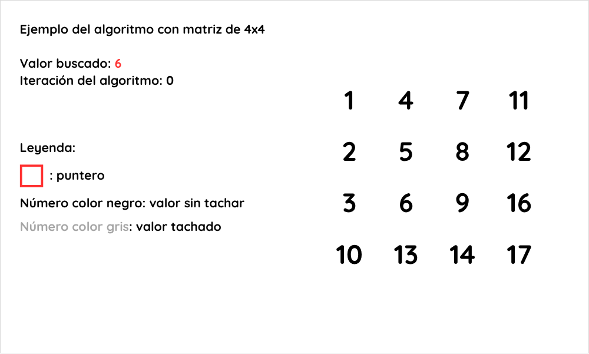

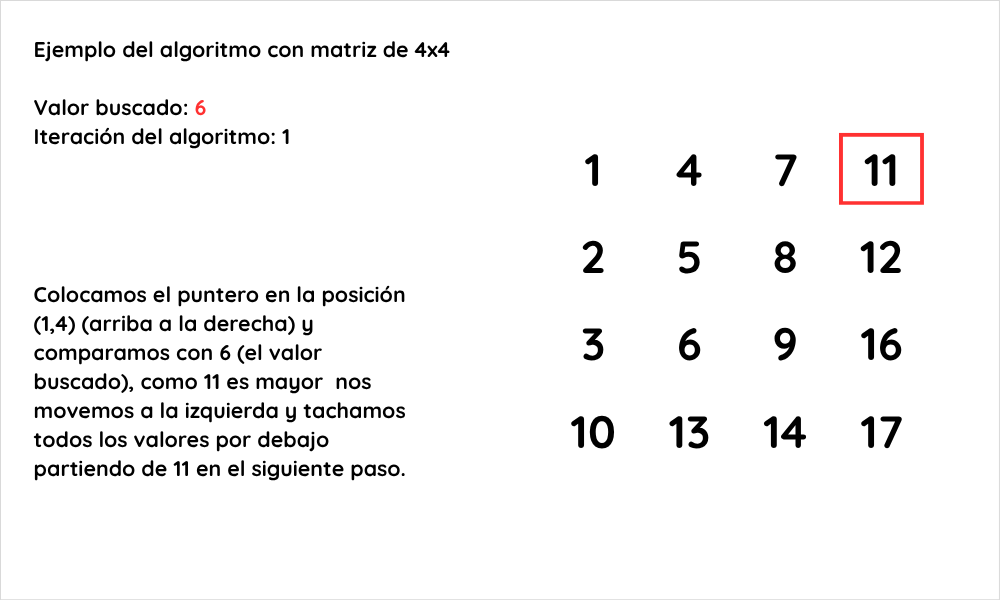

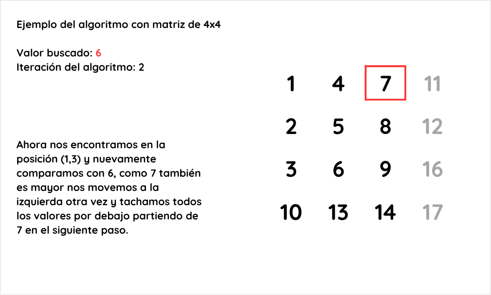

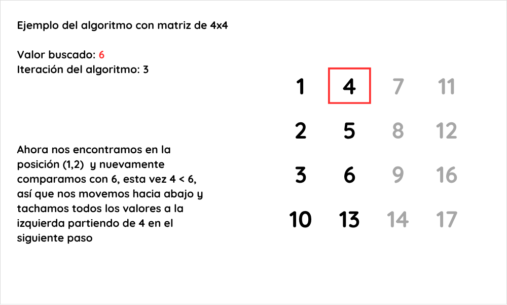

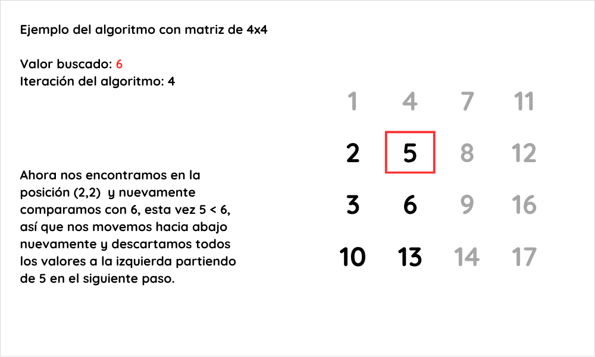

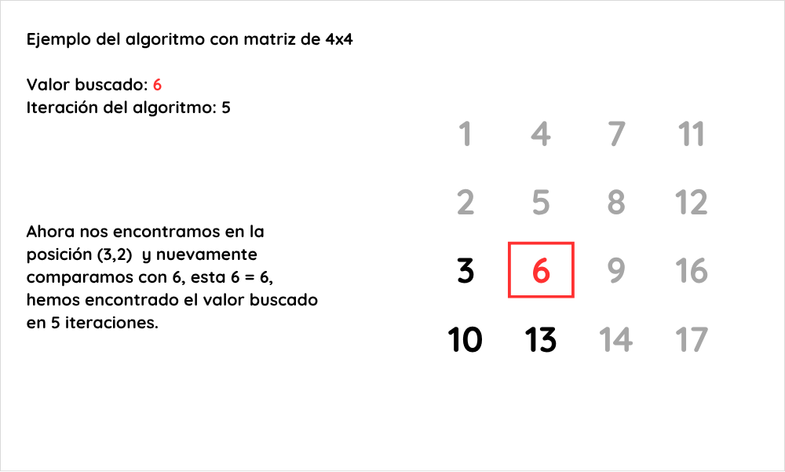

### Ejemplo 2: el valor no está en la matriz
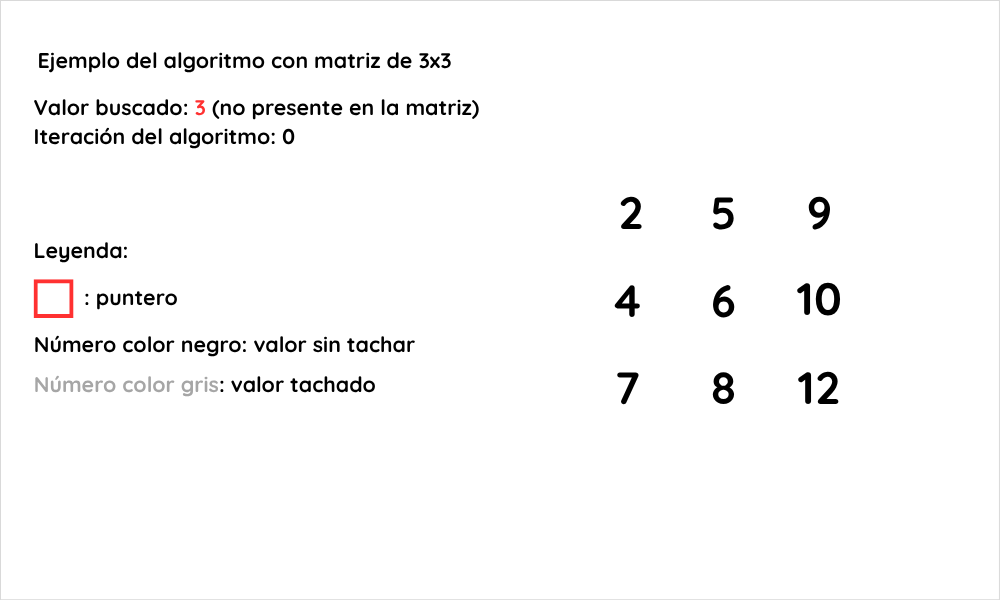

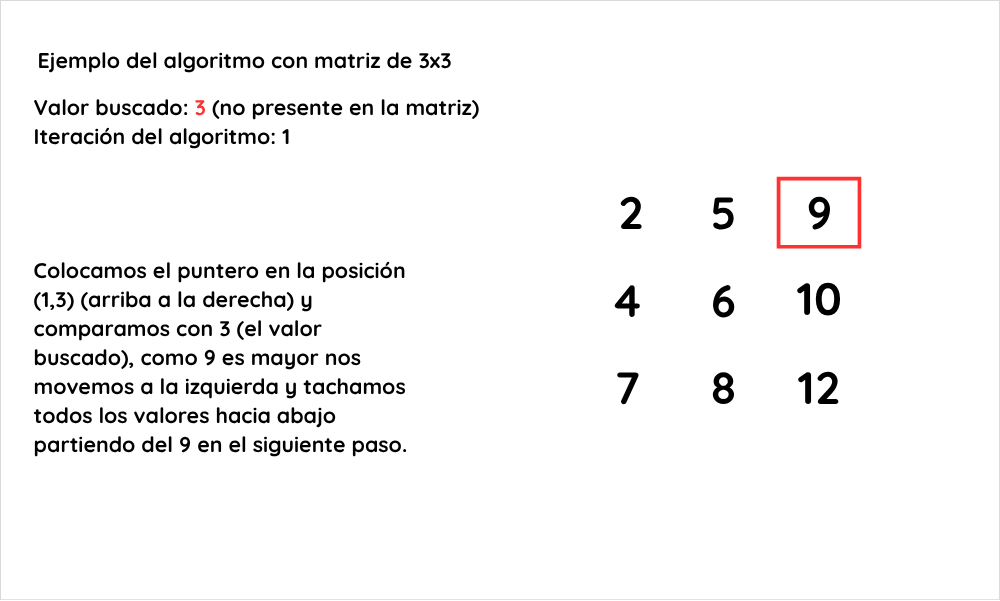

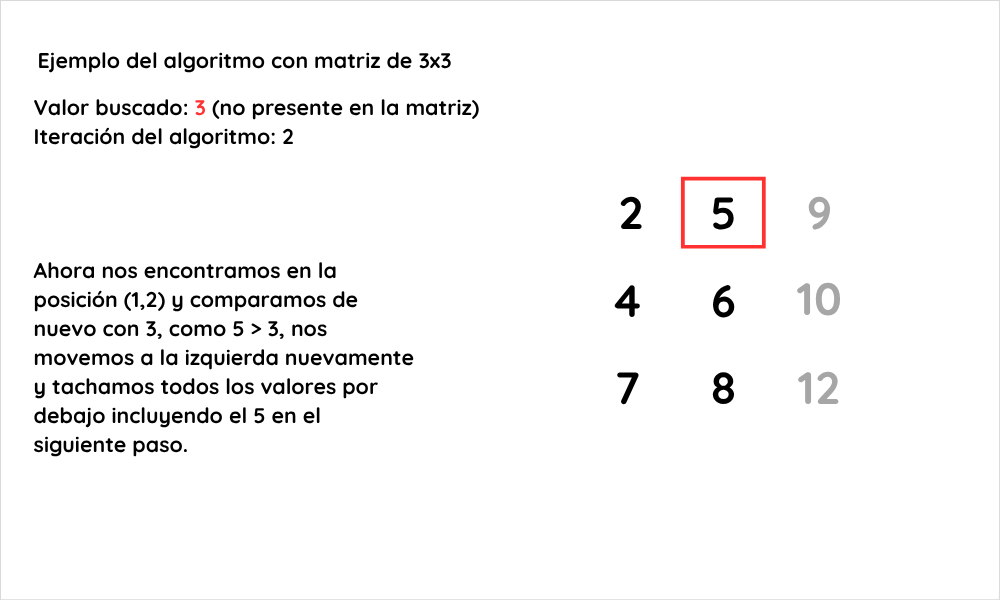

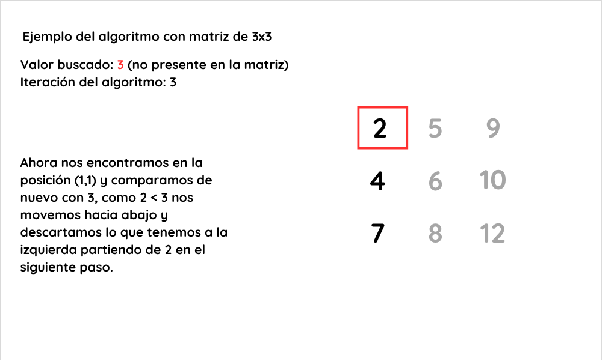

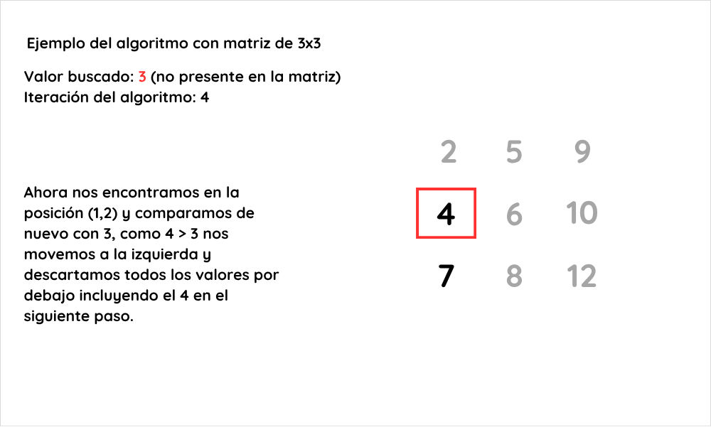

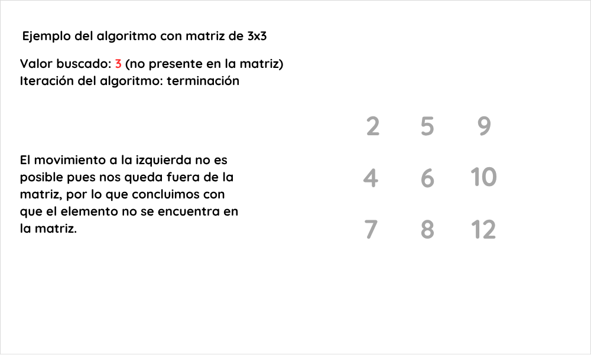

## Invariante


## Correctitud


## Complejidad
Los elementos de las filas y columnas descartadas se consideran "tachados". La región viva es siempre un rectángulo: las filas `r..n` por las columnas `1..c`. Se define

> `s = (n − r + 1) + c`

que es el número de filas vivas más el de columnas vivas del rectángulo (puede valer 0 en una de las dos partes).

- Al inicio `r = 1` y `c = n`, así que `s = 2n`.
- Cada comparación que no termina el algoritmo reduce `s` exactamente en 1: o bien `c` baja en 1, o bien `r` sube en 1. Esto vale también en el último paso, cuando el rectángulo se queda sin filas o sin columnas.
- El ciclo solo corre mientras `r ≤ n` y `c ≥ 1`, es decir, con al menos 1 fila y 1 columna vivas, luego `s ≥ 2` antes de cada comparación y `s ≥ 1` después.

Entonces:
- Comparaciones que reducen `s`: a lo sumo 2n − 1.
- Más una comparación final si se encuentra el valor.

Así que el número de comparaciones está acotado por 2n y es O(n).


## Casos de prueba
Se eligieron casos que cubren un `x` presente, `x` fuera del rango de la matriz (menor que el mínimo y mayor que el máximo), una esquina, valores repetidos y el peor caso. Los casos usan tres matrices:¹

```
A (ejemplo ilustrado)     B (con repetidos)     C (peor caso)
 2   5   9                1  1  3                2   8  14
 4   6  10                1  2  3                4  10  16
 7   8  12                2  2  5                6  12  18
```

| ID | Matriz | Qué prueba | `x` | Resultado | Comparaciones | Recorrido del puntero |
|----|--------|------------|-----|-----------|---------------|-----------------------|
| C1 | A | `x` presente en posición intermedia | 6 | sí | 3 | (1,3) → (1,2) → (2,2) |
| C2 | A | `x` menor que el mínimo | 1 | no | 3 | (1,3) → (1,2) → (1,1) → fuera |
| C3 | A | `x` mayor que el máximo | 13 | no | 3 | (1,3) → (2,3) → (3,3) → fuera |
| C4 | A | `x` en la esquina superior izquierda | 2 | sí | 3 | (1,3) → (1,2) → (1,1) |
| C5 | A | `x` ausente, valor intermedio | 3 | no | 4 | (1,3) → (1,2) → (1,1) → (2,1) → fuera |
| C6a | B | repetidos en la columna del puntero; `x` en (1,3) | 3 | sí | 1 | (1,3) |
| C6b | B | `x` repetido varias veces; se detiene en la primera aparición que visita | 1 | sí | 2 | (1,3) → (1,2) |
| C6c | B | `x` repetido; el puntero baja una fila antes de encontrarlo | 2 | sí | 3 | (1,3) → (1,2) → (2,2) |
| C6d | B | `x` ausente entre repetidos | 4 | no | 4 | (1,3) → (2,3) → (3,3) → (3,2) → fuera |
| C7a | A | peor caso con `x` presente | 7 | sí | 5 | (1,3) → (1,2) → (2,2) → (3,2) → (3,1) |
| C7b | C | peor caso con `x` ausente | 7 | no | 5 | (1,3) → (1,2) → (1,1) → (2,1) → (3,1) → fuera |

Todos los casos cumplen `comparaciones ≤ 2n − 1 = 5`, y los peores casos (C7a y C7b) la alcanzan.

¹ **Verificación en código** (`verificar_ejercicio_06.py`, Python 3, generado con un LLM a partir del pseudocódigo). Una comparación es cada vez que se compara `A[r][c]` con `x` (resultado <, = o >). Se comprobó lo siguiente:
- **Casos de la tabla:** C1 a C7 coinciden con lo calculado a mano, tanto en la respuesta como en el número de comparaciones y el recorrido del puntero.
- **Peor caso, búsqueda exhaustiva:** se probaron todas las matrices ordenadas con valores en 0..4 para n = 1, 2, 3 y en 0..3 para n = 4, con todos los `x` de −1 hasta el máximo más 1. Los máximos de comparaciones fueron 1, 3, 5 y 7, es decir, **2n − 1** en los cuatro tamaños (5, 105, 4116 y 24 696 matrices). Esta comprobación es computacional y no sustituye la demostración de la sección Complejidad.
- **Cuándo se alcanza:** solo cuando el puntero pasa por la esquina inferior izquierda (n,1). En la matriz A el único `x` entero que llega a 5 comparaciones es el 7, y no hay ningún entero ausente que lo logre. Por eso C7b usa la matriz C.
- **Familia general:** con `A[i][j] = 2·((j−1)·n + i)` y `x = 2n + 1`, que está ausente, se obtienen exactamente 2n − 1 comparaciones. Está verificada para n = 1 a 40.
- **Pruebas aleatorias contra fuerza bruta:** 36 750 búsquedas en matrices aleatorias de n = 1 a 30, con repetidos. Todas dieron la respuesta correcta y ninguna superó 2n − 1 comparaciones.
## Cota inferior (adversario)