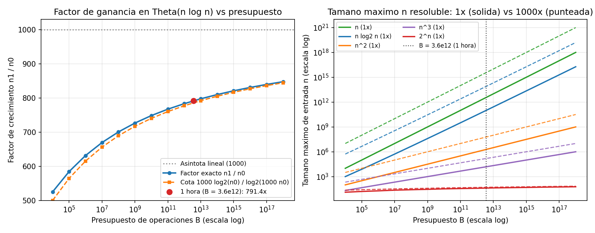

# Ejercicio 1 — Impacto de una máquina mil veces más rápida

## Planteamiento y modelo de costo

Queremos analizar cuánto crece el tamaño máximo de entrada que podemos resolver en una hora si pasamos a una computadora $1000$ veces más rápida, comparando un algoritmo de orden $\Theta(n^2)$ frente a otro de orden $\Theta(n \log n)$.

Para hacer cuentas concretas adoptamos el modelo simplificado que vimos en la primera conferencia:
- La máquina original ejecuta $10^9$ operaciones por segundo, lo que en una hora ($3600\text{ s}$) representa un presupuesto de $B = 3{,}6 \cdot 10^{12}$ operaciones.
- La máquina nueva ejecuta $1000$ veces más operaciones en el mismo tiempo, así que dispone de un presupuesto $B' = 1000\,B = 3{,}6 \cdot 10^{15}$ operaciones.
- Si el costo del algoritmo es $T(n)$, llamamos $n_0$ al mayor tamaño de entrada tal que $T(n_0) \le B$, y $n_1$ al mayor tamaño tal que $T(n_1) \le 1000\,B$. El factor de ganancia en tamaño de entrada es $f = n_1 / n_0$.

---

## Caso 1: Algoritmo cuadrático $\Theta(n^2)$

Supongamos que $T(n) = c\,n^2$ para alguna constante positiva $c > 0$. Igualando al presupuesto antes y después de la mejora:
$$c\,n_0^2 = B \qquad \text{y} \qquad c\,n_1^2 = 1000\,B.$$

Dividiendo ambas expresiones, tanto la constante oculta $c$ como el presupuesto $B$ se cancelan exactamente:
$$\frac{c\,n_1^2}{c\,n_0^2} = 1000 \quad \Longrightarrow \quad \frac{n_1}{n_0} = \sqrt{1000} = 10\sqrt{10} \approx 31{,}62.$$

Es decir, el factor de ganancia es **independiente del presupuesto $B$ y de la constante $c$**. Con $c = 1$ y $B = 3{,}6 \cdot 10^{12}$, pasamos de resolver instancias de tamaño $n_0 = \lfloor\sqrt{3{,}6 \cdot 10^{12}}\rfloor \approx 1{,}897 \cdot 10^6$ a $n_1 \approx 6{,}000 \cdot 10^7$.

---

## Caso 2: Algoritmo $\Theta(n \log n)$

Tomemos $T(n) = c\,n \log_2 n$. De nuevo, al dividir $T(n_1) = 1000\,T(n_0)$ la constante $c$ (y la base del logaritmo) se cancela. Llamando $f = n_1 / n_0$, tenemos:
$$(f\,n_0) \log_2(f\,n_0) = 1000\,n_0 \log_2 n_0 \quad \Longrightarrow \quad f\big(\log_2 n_0 + \log_2 f\big) = 1000 \log_2 n_0.$$

Despejando $f$ obtenemos una relación implícita:
$$f = 1000 \cdot \frac{\log_2 n_0}{\log_2 n_0 + \log_2 f}.$$

De esta ecuación se deducen enseguida dos cotas muy ajustadas:
1. **Cota superior ($f < 1000$):** Como $f > 1$, se tiene $\log_2 f > 0$, por lo que el denominador es estrictamente mayor que el numerador y no se llega a ganar el factor $1000$ completo que tendría un algoritmo lineal.
2. **Cota inferior analítica:** Como $f < 1000$, sabemos que $\log_2 f < \log_2 1000 \approx 9{,}966$. Sustituyendo esa cota en el denominador:
   $$f > 1000 \cdot \frac{\log_2 n_0}{\log_2 n_0 + \log_2 1000} = 1000 \cdot \frac{\log_2 n_0}{\log_2(1000\,n_0)}.$$

A diferencia del caso cuadrático, aquí el factor **sí depende ligeramente de $B$** (a través de $\log_2 n_0$), y tiende asintóticamente a $1000$ cuando $B \to \infty$, aunque a velocidad logarítmica.

### Estimación numérica para $B = 3{,}6 \cdot 10^{12}$

Primero estimamos $n_0$ a mano sabiendo que $n_0 \log_2 n_0 = 3{,}6 \cdot 10^{12}$:
- Como $B \approx 3{,}6 \cdot 10^{12}$ y $\log_2(10^{11}) \approx 11 \cdot 3{,}322 \approx 36{,}54$, probamos $n_0 \approx \frac{3{,}6 \cdot 10^{12}}{36{,}54} \approx 9{,}85 \cdot 10^{10}$.
- Con $\log_2 n_0 \approx 36{,}52$, la cota inferior analítica nos da:
  $$f \ge 1000 \cdot \frac{36{,}52}{36{,}52 + 9{,}97} = 1000 \cdot \frac{36{,}52}{46{,}49} \approx 785{,}5.$$
- Si hacemos una iteración de punto fijo sustituyendo $\log_2 f \approx \log_2(785{,}5) \approx 9{,}617$ en el denominador:
  $$f \approx 1000 \cdot \frac{36{,}52}{36{,}52 + 9{,}617} \approx 791{,}6.$$

---

## Comparación general entre distintos órdenes de complejidad

Para poner en perspectiva cómo rinde una mejora de $1000\times$ en el hardware según la complejidad del algoritmo, la siguiente tabla resume qué ocurre también con los órdenes $\Theta(n)$, $\Theta(n^3)$ y $\Theta(2^n)$ bajo el mismo presupuesto de una hora ($B = 3{,}6 \cdot 10^{12}$):

| Orden $T(n)$ | Relación $T(n_1) = 1000\,T(n_0)$ | Tamaño en $1\text{ h}$ ($n_0$) | Tamaño con $1000\times$ ($n_1$) | Factor $n_1 / n_0$ |
|:---:|:---:|:---:|:---:|:---:|
| $\Theta(n)$ | $n_1 = 1000\,n_0$ | $3{,}60 \cdot 10^{12}$ | $3{,}60 \cdot 10^{15}$ | **$1000{,}00\times$** |
| $\Theta(n \log_2 n)$ | $n_1 \approx n_0 \cdot \frac{1000 \log_2 n_0}{\log_2(1000\,n_0)}$ | $9{,}86 \cdot 10^{10}$ | $7{,}80 \cdot 10^{13}$ | **$\approx 791{,}37\times$** |
| $\Theta(n^2)$ | $n_1 = \sqrt{1000}\,n_0$ | $1{,}90 \cdot 10^{6}$ | $6{,}00 \cdot 10^{7}$ | **$\approx 31{,}62\times$** |
| $\Theta(n^3)$ | $n_1 = \sqrt[3]{1000}\,n_0 = 10\,n_0$ | $1{,}53 \cdot 10^{4}$ | $1{,}53 \cdot 10^{5}$ | **$10{,}00\times$** |
| $\Theta(2^n)$ | $n_1 = n_0 + \log_2 1000 \approx n_0 + 9{,}97$ | $41$ | $51$ | **$\approx 1{,}24\times$** ($+10$ elem.) |

El contraste es evidente: mientras que un algoritmo $\Theta(n \log n)$ aprovecha casi el $80\%$ de la ganancia ideal de un algoritmo lineal ($791\times$ frente a $1000\times$), el cuadrático solo multiplica por $31{,}6$, el cúbico por $10$, y un algoritmo exponencial apenas suma $10$ unidades al tamaño de entrada.

### Clasificación de complejidad: Problemas en P frente a problemas NP-completos

Esta tabla ilustra de manera directa la frontera entre la clase **P** (tiempo polinomial $O(n^k)$) y los algoritmos de fuerza bruta exponencial ($\Theta(2^n)$ o $\Theta(n!)$) típicos de problemas **NP-completos** (como SAT, Mochila 0/1 exacta, Conjunto Independiente o Viajante de Comercio):

- **En problemas dentro de P ($\Theta(n), \Theta(n \log n), \Theta(n^k)$):** Una mejora multiplicativa de factor $M$ en la velocidad del procesador produce una **mejora multiplicativa** en el tamaño de entrada resoluble (por un factor $M^{1/k}$ en $\Theta(n^k)$, o cercano a $M$ en $\Theta(n \log n)$).
- **En problemas exponenciales / NP-completos resueltos en $\Theta(2^n)$:** Una mejora multiplicativa de factor $M = 1000$ en el hardware solo produce una **mejora aditiva** de $\log_2 M \approx 10$ unidades en el tamaño de la entrada ($n_1 = n_0 + \log_2 M$). Por eso el avance del hardware jamás convierte un algoritmo exponencial en tratable para entradas grandes, mientras que pasar de un algoritmo $\Theta(n^2)$ a uno $\Theta(n \log n)$ en la misma máquina permite saltar de $n \approx 1{,}9 \cdot 10^6$ a $n \approx 9{,}9 \cdot 10^{10}$ (un factor de más de $50\,000\times$ sin cambiar de computadora).

---

## Verificación numérica y gráficas

En [ejercicio-01.py](ejercicio-01.py) se calcula el valor exacto de $n_0$ y $n_1$ mediante doblado exponencial seguido de búsqueda binaria sobre el presupuesto:

```text
=== Comparacion en 1 hora (B = 3.6e12) con maquina 1000x mas rapida ===
     Orden |        n0 (1x) |     n1 (1000x) |   Factor n1/n0
--------------------------------------------------------------
         n |        3.6e+12 |        3.6e+15 |        1000.00
  n log2 n |      9.857e+10 |      7.801e+13 |         791.37
       n^2 |      1.897e+06 |          6e+07 |          31.62
       n^3 |      1.533e+04 |      1.533e+05 |          10.00
       2^n |             41 |             51 |           1.24

=== Evolucion del factor para n log2 n segun el presupuesto B ===
 Presupuesto B |           n0 |  Factor real |  Cota inferior |  1 iteracion
--------------------------------------------------------------------------
          10^4 |         1002 |       525.12 |         500.07 |       526.48
          10^6 |    6.275e+04 |       631.44 |         615.27 |       632.37
          10^8 |    4.523e+06 |       700.51 |         689.29 |       701.03
         10^10 |    3.522e+08 |       748.35 |         740.19 |       748.66
         10^12 |    2.878e+10 |       783.28 |         777.10 |       783.48
         10^14 |     2.43e+12 |       809.84 |         805.01 |       809.97
         10^16 |    2.102e+14 |       830.68 |         826.82 |       830.78
         10^18 |    1.851e+16 |       847.46 |         844.30 |       847.53
```



**Análisis de la visualización:**
- **Panel izquierdo:** Muestra cómo evoluciona el factor $n_1 / n_0$ para $\Theta(n \log n)$ cuando el presupuesto $B$ varía desde $10^4$ hasta $10^{18}$. Se observa que la cota analítica $1000 \frac{\log_2 n_0}{\log_2(1000\,n_0)}$ (curva naranja discontinua) acompaña siempre por debajo a la curva exacta (azul), cerrando la brecha a medida que $B$ crece, y que el punto correspondiente a $1\text{ hora}$ ($B = 3{,}6 \cdot 10^{12}$, marcado en rojo) se sitúa en $791{,}4\times$.
- **Panel derecho:** En escala log-log, cada complejidad polinómica $T(n) = n^k$ aparece como una recta de pendiente $1/k$, y multiplicar por $1000$ la velocidad desplaza verticalmente cada curva en $\frac{1}{k}\log_{10}(1000) = 3/k$ décadas (tres órdenes de magnitud para $n$ y casi tres para $n \log n$, frente a $1{,}5$ décadas para $n^2$ y solo $1$ década para $n^3$), mientras que la curva de $2^n$ permanece prácticamente pegada al fondo.
