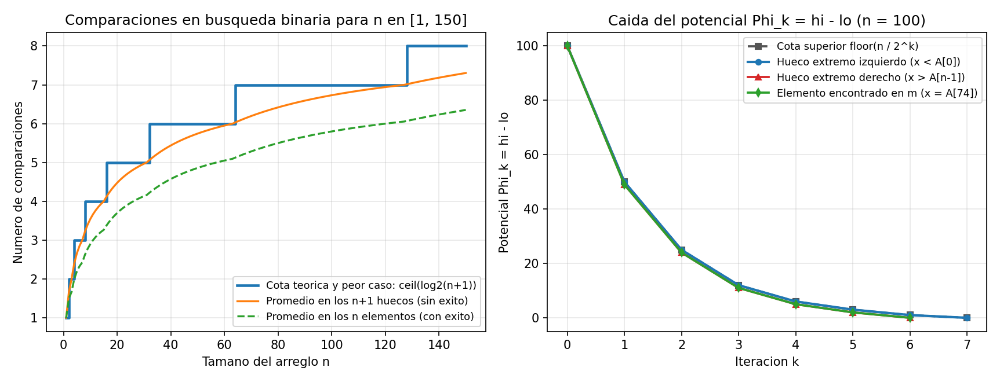

# Ejercicio 2 — Invariante, potencial y optimalidad de la búsqueda binaria

## Especificación del problema e implementación

Dado un arreglo $A[0..n)$ ordenado de forma estrictamente creciente ($A[0] < A[1] < \dots < A[n-1]$) y un valor buscado $x$, queremos encontrar un índice $i \in \{0, \dots, n-1\}$ tal que $A[i] = x$, o determinar que $x$ no pertenece al arreglo. Trabajamos en el modelo de comparaciones de tres vías: en cada consulta comparamos $x$ contra algún elemento $A[m]$ y obtenemos una de las tres respuestas posibles ($x < A[m]$, $x = A[m]$ o $x > A[m]$).

Utilizando intervalos semiabiertos $[lo, hi)$, el código queda sin casos borde:

```python
def busqueda_binaria(A, x):
    lo, hi = 0, len(A)
    while lo < hi:
        m = (lo + hi) // 2
        if x == A[m]:
            return m
        elif x < A[m]:
            hi = m
        else:
            lo = m + 1
    return None
```

### Traza paso a paso y el error clásico `lo = m`

Tomemos el arreglo de $n = 10$ elementos:
$$A = [4,\ 9,\ 15,\ 22,\ 31,\ 38,\ 44,\ 57,\ 63,\ 70]$$
y sigamos dos ejecuciones: primero buscando $x = 22$ (que está en la posición $3$) y luego buscando $x = 25$ (que no está y cae en el hueco entre $A[3]=22$ y $A[4]=31$):

| Búsqueda | Paso | $[lo, hi)$ al entrar | $\Phi = hi - lo$ | $m = \lfloor(lo+hi)/2\rfloor$ | $A[m]$ | Comparación | Nuevo $[lo, hi)$ | Nuevo $\Phi$ |
|:---:|:---:|:---:|:---:|:---:|:---:|:---:|:---:|:---:|
| **$x = 22$** | 1 | $[0, 10)$ | $10$ | $5$ | $38$ | $22 < 38$ | $[0, 5)$ | $5$ |
| | 2 | $[0, 5)$ | $5$ | $2$ | $15$ | $22 > 15$ | $[3, 5)$ | $2$ |
| | 3 | $[3, 5)$ | $2$ | $4$ | $31$ | $22 < 31$ | $[3, 4)$ | $1$ |
| | 4 | $[3, 4)$ | $1$ | $3$ | $22$ | $22 = 22$ | devuelve `3` | $0$ |
| **$x = 25$** | 1 | $[0, 10)$ | $10$ | $5$ | $38$ | $25 < 38$ | $[0, 5)$ | $5$ |
| | 2 | $[0, 5)$ | $5$ | $2$ | $15$ | $25 > 15$ | $[3, 5)$ | $2$ |
| | 3 | $[3, 5)$ | $2$ | $4$ | $31$ | $25 < 31$ | $[3, 4)$ | $1$ |
| | 4 | $[3, 4)$ | $1$ | $3$ | $22$ | $25 > 22$ | $[4, 4)$ | $0$ (sale y devuelve `None`) |

Observemos qué ocurre en el **Paso 4** de la búsqueda de $x = 25$ si en la rama `x > A[m]` hubiéramos escrito por error `lo = m` en vez de `lo = m + 1`:
- Al entrar al Paso 4 tenemos $[lo, hi) = [3, 4)$, de longitud $\Phi = 1$, por lo que $m = \lfloor(3+4)/2\rfloor = 3 = lo$.
- Como $x = 25 > A[3] = 22$, la asignación `lo = m` haría `lo = 3`, dejando el intervalo exactamente igual ($[3, 4)$) y el potencial estancado en $\Phi = 1$.
- A partir de ahí, los pasos $5, 6, \dots$ repetirían indefinidamente $lo=3, hi=4, m=3$, entrando en un bucle infinito.

---

## Invariante de ciclo y correctitud parcial

En lugar de afirmar únicamente que "si $x$ está en $A$, entonces se encuentra en $A[lo..hi)$", formulamos un invariante más expresivo que caracteriza simultáneamente las dos zonas descartadas del arreglo:

> **Invariante (I):** Al inicio de cada iteración del bucle se cumple $0 \le lo \le hi \le n$, todo elemento en el prefijo $A[0..lo)$ es estrictamente menor que $x$ ($\forall i < lo,\ A[i] < x$), y todo elemento en el sufijo $A[hi..n)$ es estrictamente mayor que $x$ ($\forall i \ge hi,\ A[i] > x$).

1. **Inicialización:** Antes de la primera iteración se asigna $lo = 0$ y $hi = n$. Como $n \ge 0$, se cumple $0 \le lo \le hi \le n$. Los subarreglos $A[0..0)$ y $A[n..n)$ son vacíos, por lo que las condiciones sobre sus elementos se cumplen por vacuidad.
2. **Mantenimiento:** Supongamos que (I) es cierto al comienzo de una iteración en la que $lo < hi$. Por propiedades de la división entera, el punto medio $m = \lfloor(lo + hi)/2\rfloor$ satisface $lo \le m < hi$. Analizamos las tres ramas:
   - Si $x = A[m]$, el procedimiento retorna $m$ inmediatamente, cumpliendo la postcondición.
   - Si $x < A[m]$: como el arreglo $A$ es estrictamente creciente, para todo índice $k \ge m$ se tiene $x < A[m] \le A[k]$. Unidos a la hipótesis inductiva sobre $A[hi..n)$, todos los elementos de $A[m..n)$ son mayores que $x$. Al actualizar $hi' = m$ (con $lo \le m \le hi$), el invariante se conserva.
   - Si $x > A[m]$: como $A$ es creciente, para todo $k \le m$ se tiene $A[k] \le A[m] < x$. Junto con la hipótesis inductiva sobre $A[0..lo)$, todos los elementos en $A[0..m+1)$ son menores que $x$. Al actualizar $lo' = m + 1$ (y dado que $m < hi \implies m + 1 \le hi$), el invariante se conserva.
3. **Conclusión:** Si el ciclo termina sin haber retornado un índice en la primera rama, la condición de salida garantiza $lo \ge hi$, que combinada con $lo \le hi$ implica $lo = hi$. En ese punto, el invariante asegura que $A[0..lo)$ tiene elementos menores que $x$ y $A[lo..n)$ tiene elementos mayores que $x$. Como la unión de ambos tramos es todo el arreglo $A[0..n)$, ningún elemento es igual a $x$, por lo que devolver `None` es correcto (y además $lo$ es exactamente el índice de inserción donde $x$ mantendría el orden). $\blacksquare$

---

## Función de potencial, terminación y cota superior

Definimos como función de potencial el tamaño del intervalo activo:
$$\Phi = hi - lo.$$

- **No negatividad:** Por el invariante $lo \le hi$, siempre se tiene $\Phi \ge 0$ (y dentro del cuerpo del ciclo, $\Phi \ge 1$).
- **Decrecimiento al menos a la mitad en cada paso:** Sea $\Phi = hi - lo \ge 1$ al iniciar una iteración que no encuentra $x$. Entonces $m = lo + \lfloor \Phi / 2 \rfloor$:
  - Si $x < A[m]$, el nuevo potencial es $\Phi' = m - lo = \lfloor \Phi / 2 \rfloor$.
  - Si $x > A[m]$, el nuevo potencial es $\Phi' = hi - (m + 1) = \Phi - \lfloor \Phi / 2 \rfloor - 1 = \lceil \Phi / 2 \rceil - 1 \le \lfloor \Phi / 2 \rfloor$.

En ambos casos se cumple la recurrencia:
$$\Phi_{k} \le \lfloor \Phi_{k-1} / 2 \rfloor < \Phi_{k-1}.$$

Como $\Phi$ es un entero que decrece estrictamente en cada paso sin volverse negativo, el algoritmo termina siempre. Además, aplicando por inducción la propiedad $\lfloor \lfloor a / b \rfloor / c \rfloor = \lfloor a / (bc) \rfloor$ desde $\Phi_0 = n$, tras $k$ comparaciones sin éxito el potencial verifica:
$$\Phi_k \le \left\lfloor \frac{n}{2^k} \right\rfloor.$$

Para que el algoritmo haga una $(k+1)$-ésima comparación es necesario que $\Phi_k \ge 1$, es decir, $2^k \le n$, o equivalentemente $k \le \lfloor \log_2 n \rfloor$. Por lo tanto, el número total de comparaciones en el peor caso es a lo sumo:
$$\lfloor \log_2 n \rfloor + 1 = \lceil \log_2(n + 1) \rceil,$$
usando memoria auxiliar $O(1)$.

---

## Cota inferior de teoría de la información y optimalidad exacta

A primera vista, como cada comparación contra $A[m]$ tiene $3$ resultados posibles ($<, =, >$), un conteo ingenuo sobre el árbol ternario de decisión solo daría una cota inferior en base $3$. Sin embargo, podemos restringir el análisis a las búsquedas **infructuosas** (cuando $x \notin A$).

**Teorema.** Cualquier algoritmo basado en comparaciones que determine correctamente si $x$ está en un arreglo ordenado de $n$ elementos realiza al menos $\lceil \log_2(n + 1) \rceil$ comparaciones en el peor caso.

**Demostración.** Consideremos el árbol de decisión $T$ del algoritmo para un arreglo fijo $A[0] < A[1] < \dots < A[n-1]$, el cual define $n + 1$ intervalos abiertos o **huecos**:
$$H_0 = (-\infty, A[0]), \quad H_1 = (A[0], A[1]), \quad \dots, \quad H_n = (A[n-1], +\infty).$$

1. Si ejecutamos el algoritmo con cualquier valor $x \in H_j$, como $x$ no coincide con ningún elemento de $A$, **ninguna comparación del camino seguido toma jamás la rama de igualdad ($=$)**. Por tanto, el subárbol $T_{\neq}$ formado por todos los caminos correspondientes a entradas $x \notin A$ se ramifica únicamente en dos hijos por nodo ($<$ y $>$), es decir, **$T_{\neq}$ es un árbol binario**.
2. Escojamos un representante $y_j \in H_j$ en cada uno de los $n + 1$ huecos. Si dos representantes de huecos distintos, digamos $y_i$ e $y_j$ con $i < j$, terminaran en la misma hoja de $T_{\neq}$, habrían obtenido exactamente las mismas respuestas ($<$ o $>$) frente a todos los elementos de $A$ inspeccionados en ese camino. Pero entre $H_i$ y $H_j$ existe al menos el elemento $A[i]$ tal que $y_i < A[i] < y_j$. Eso significa que el camino nunca comparó contra $A[i]$, y si alimentáramos al algoritmo con la entrada $x = A[i]$, seguiría exactamente el mismo camino hasta esa hoja y respondería erróneamente "no está".
3. Por consiguiente, los $n + 1$ huecos deben llegar a **al menos $n + 1$ hojas distintas** del árbol binario $T_{\neq}$. Todo árbol binario con $L \ge n + 1$ hojas tiene altura al menos $\lceil \log_2 L \rceil \ge \lceil \log_2(n + 1) \rceil$. $\blacksquare$

Como el costo en el peor caso de la búsqueda binaria coincide exactamente con esta cota inferior ($\lceil \log_2(n+1) \rceil$, sin siquiera factor constante de diferencia), el algoritmo es **exactamente óptimo** en el modelo de comparaciones.

---

## Clasificación de complejidad y comparación con problemas relacionados

El problema de búsqueda en un arreglo ordenado pertenece a la clase **P** y, más aún, se resuelve en **tiempo sublineal** $\Theta(\log n)$ y espacio auxiliar $O(1)$ gracias a dos hipótesis simultáneas: el **orden total preexistente** en el arreglo y el **acceso aleatorio en $O(1)$** del modelo Word RAM. Si quitamos cualquiera de las dos hipótesis, o si cambiamos las suposiciones sobre los datos, la complejidad cambia drásticamente:

| Problema / Variante | Hipótesis sobre la estructura | Costo en el peor caso | Costo promedio | Cota inferior y modelo |
|---|---|---|---|---|
| **Búsqueda binaria en arreglo ordenado (este ejercicio)** | Arreglo contiguo en RAM ordenado ($A[0] < \dots < A[n-1]$) | **$\lceil \log_2(n+1) \rceil = \Theta(\log n)$** | $\approx \log_2 n - 1$ | $\lceil \log_2(n+1) \rceil$ (información sobre los $n+1$ huecos) |
| **Búsqueda en arreglo desordenado** | Arreglo en RAM sin orden | **$n = \Theta(n)$** | $n / 2$ | $n$ comparaciones (adversario: el último no mirado puede ser $x$) |
| **Búsqueda en lista enlazada ordenada** | Elementos en orden pero sin acceso aleatorio (solo punteros `sig`) | **$n = \Theta(n)$** | $n / 2$ | $\Omega(n)$ accesos a punteros (no se puede saltar al punto medio en $O(1)$) |
| **Búsqueda por interpolación** | Arreglo ordenado de números reales/enteros + aritmética sobre claves | **$\Theta(n)$** (datos muy sesgados) | **$O(\log \log n)$** (datos uniformes) | Usa operaciones aritméticas sobre los valores, saliendo del modelo puro de comparaciones |
| **Búsqueda de un pico local 1D (Ejercicio 14)** | Arreglo en RAM **sin orden** | **$\lceil \log_2 n \rceil = \Theta(\log n)$** | $\approx \log_2 n$ | $\lceil \log_2 n \rceil$ (propiedad local en vez de búsqueda global) |

---

## Verificación experimental y gráficas

En [ejercicio-02.py](ejercicio-02.py) comprobamos mediante aserciones que el invariante (I) y la caída $\Phi_k \le \lfloor \Phi_{k-1}/2 \rfloor$ se cumplen en $3500$ instancias aleatorias, y medimos el número exacto de comparaciones probando todos los $n$ elementos y los $n+1$ huecos para cada tamaño $n$:

```text
    n |  Peor caso |  Prom. huecos |  Prom. exito |  ceil(log2(n+1))
--------------------------------------------------------------------
    1 |          1 |          1.00 |         1.00 |                1
    3 |          2 |          2.00 |         1.67 |                2
    7 |          3 |          3.00 |         2.43 |                3
    8 |          4 |          3.22 |         2.62 |                4
   15 |          4 |          4.00 |         3.27 |                4
   16 |          5 |          4.12 |         3.38 |                5
   31 |          5 |          5.00 |         4.16 |                5
   32 |          6 |          5.06 |         4.22 |                6
   64 |          7 |          6.03 |         5.12 |                7
  100 |          7 |          6.73 |         5.80 |                7
  150 |          8 |          7.30 |         6.35 |                8
```



**Observaciones sobre la gráfica:**
- **Panel izquierdo:** El peor caso empírico coincide punto por punto con la función escalonada $\lceil \log_2(n+1) \rceil$, dando un salto de una comparación justo después de cada número de la forma $n = 2^k - 1$ (en $n = 1, 3, 7, 15, 31, 63, 127$). Precisamente en $n = 2^k - 1$ el árbol de decisión está completamente lleno y todas las hojas de búsqueda sin éxito están a profundidad $k$, por lo que la curva naranja (promedio en los huecos) toca la escalera azul en cada $2^k - 1$. El promedio de búsquedas con éxito (curva verde) se mantiene aproximadamente una comparación por debajo, ya que la mayoría de los elementos están en los dos últimos niveles del árbol pero algunos se encuentran antes en niveles superiores.
- **Panel derecho:** Para $n = 100$, se grafica la evolución del potencial $\Phi_k = hi - lo$ en cada iteración $k$. El hueco extremo izquierdo (curva azul, que toma siempre $hi = m$, con $\Phi' = \lfloor \Phi/2 \rfloor$) sigue exactamente la cota superior teórica $\lfloor 100 / 2^k \rfloor$ ($100 \to 50 \to 25 \to 12 \to 6 \to 3 \to 1 \to 0$), mientras que el hueco extremo derecho (curva roja, que toma siempre $lo = m + 1$, con $\Phi' = \lceil \Phi/2 \rceil - 1$) cae ligeramente por debajo cuando $\Phi$ es par y termina una iteración antes.
