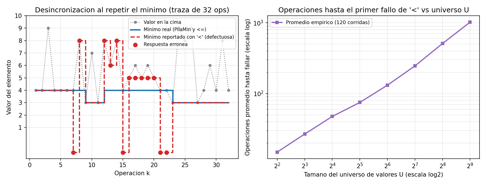

# Ejercicio 3 — Diseño de una pila con mínimo en $O(1)$ en el peor caso

## Planteamiento e idea de la estructura

Necesitamos implementar una estructura de datos tipo pila sobre un conjunto con orden total que soporte las tres operaciones habituales (`apilar(x)`, `desapilar()` y `cima()`) más una cuarta operación `minimo()` que devuelva el menor elemento actualmente almacenado, garantizando que **todas las operaciones cuesten $O(1)$ en el peor caso** (asumiendo que comparar dos elementos toma $O(1)$ en el modelo Word RAM). Las operaciones `desapilar()`, `cima()` y `minimo()` tienen como precondición que la pila no esté vacía.

La propiedad clave de una pila (LIFO) es que el conjunto de elementos situados por debajo de una celda permanece fijo durante todo el tiempo de vida de esa celda en la pila: ninguna inserción ni eliminación futura puede alterar lo que hay debajo de ella hasta que ella misma sea desapilada. Por lo tanto, si al insertar una celda guardamos junto con su `valor` el **mínimo del prefijo desde el fondo hasta esa celda**, ese mínimo parcial nunca queda desactualizado.

Para asegurar que `apilar(x)` sea $O(1)$ **en el peor caso** y no solo en sentido amortizado, representamos la pila mediante una lista simplemente enlazada desde el `tope` (un arreglo dinámico como `list` en Python tiene costo amortizado $O(1)$, pero cuando se llena necesita realojar y copiar $\Theta(k)$ elementos en una sola operación):

```python
class _Celda:
    __slots__ = ("valor", "minimo", "abajo")
    def __init__(self, valor, minimo, abajo):
        self.valor, self.minimo, self.abajo = valor, minimo, abajo

class PilaMin:
    def __init__(self):
        self.tope = None

    def apilar(self, x):
        m = x if (self.tope is None or x < self.tope.minimo) else self.tope.minimo
        self.tope = _Celda(x, m, self.tope)

    def desapilar(self):
        celda = self.tope
        self.tope = celda.abajo
        return celda.valor

    def cima(self):
        return self.tope.valor

    def minimo(self):
        return self.tope.minimo
```

---

## Invariante estructural y demostración de correctitud

Numeremos las celdas de la pila desde el fondo hacia la cima como $c_1, c_2, \dots, c_k$, donde $k \ge 0$ es la cantidad actual de elementos y $c_k$ es la celda apuntada por `self.tope` (cuando $k \ge 1$).

> **Invariante de representación (I):** La cadena de punteros `abajo` desde `tope` es finita de longitud $k \ge 0$ y, para todo $i \in \{1, \dots, k\}$, el campo `minimo` de la $i$-ésima celda cumple:
> $$c_i.\text{minimo} = \min_{1 \le j \le i} \{c_j.\text{valor}\}.$$

Demostramos por inducción sobre la secuencia de operaciones que el invariante se cumple tras crear la estructura y se preserva en cada operación:

1. **Inicialización (`__init__`):** Al construir la pila, `tope = None`, por lo que $k = 0$. El rango $1 \le i \le 0$ es vacío y el invariante se cumple trivialmente.
2. **Mantenimiento:** Supongamos que la pila tiene $k$ celdas $c_1, \dots, c_k$ que satisfacen (I) antes de una operación:
   - **`apilar(x)`:** Las celdas existentes $c_1, \dots, c_k$ no se modifican, por lo que para todo $i \in \{1, \dots, k\}$ la igualdad sigue siendo cierta. Se añade en la cima la celda $c_{k+1}$ con $c_{k+1}.\text{valor} = x$ y $c_{k+1}.\text{abajo} = c_k$.
     - Si $k = 0$ (`tope` era `None`), se asigna $c_1.\text{minimo} = x = \min_{1 \le j \le 1}\{c_j.\text{valor}\}$.
     - Si $k \ge 1$, el código asigna $c_{k+1}.\text{minimo} = \min(x, c_k.\text{minimo})$. Por hipótesis inductiva sobre $c_k$, tenemos $c_k.\text{minimo} = \min_{1 \le j \le k}\{c_j.\text{valor}\}$, y por asociatividad del mínimo:
       $$c_{k+1}.\text{minimo} = \min\!\left(x,\ \min_{1 \le j \le k}\{c_j.\text{valor}\}\right) = \min_{1 \le j \le k+1}\{c_j.\text{valor}\}.$$
   - **`desapilar()`:** Con la precondición $k \ge 1$, reasigna `tope` a $c_k.\text{abajo} = c_{k-1}$. Las celdas restantes son $c_1, \dots, c_{k-1}$, cuyos campos no cambiaron y siguen cumpliendo (I). Además devuelve $c_k.\text{valor}$, que era efectivamente el último elemento apilado.
   - **`cima()` y `minimo()`:** Son operaciones de solo lectura; no alteran ninguna celda y preservan (I).
3. **Conclusión:** Cuando se invoca `minimo()` sobre una pila no vacía ($k \ge 1$), el algoritmo devuelve `tope.minimo` $= c_k.\text{minimo}$, que por el invariante (I) evaluado en $i = k$ es exactamente $\min_{1 \le j \le k}\{c_j.\text{valor}\}$, es decir, el menor elemento de toda la pila. $\blacksquare$

---

## Variante de dos pilas para ahorrar memoria y el peligro de los duplicados

Si la pila contiene muchos elementos pero el mínimo cambia pocas veces, guardar el mínimo en cada celda duplica el uso de datos. Una alternativa clásica mantiene dos pilas separadas:
- `datos`: contiene todos los elementos apilados.
- `minimos`: guarda únicamente los nuevos mínimos a medida que aparecen.

Para que esta variante funcione cuando **el mínimo se repite**, al hacer `apilar(x)` se debe apilar $x$ en `minimos` siempre que `x <= minimos[-1]` (y al hacer `desapilar()`, si el valor extraído coincide con `minimos[-1]`, también se desapila de `minimos`). Su invariante es que, si el mínimo actual aparece $r \ge 1$ veces en `datos`, entonces aparece exactamente $r$ veces en la cima de `minimos`.

Si por descuido se escribe la condición estricta `x < minimos[-1]` en lugar de `<=`, la segunda copia del mínimo no se registra en `minimos`, y al desapilar esa segunda copia se borra la única copia que había en `minimos`, dejando un mínimo falso mientras el verdadero mínimo aún sigue más abajo en la pila.

### Traza comparativa paso a paso

Veamos este fenómeno sobre la secuencia de 7 operaciones: `apilar(5)`, `apilar(3)`, `apilar(7)`, `apilar(3)`, `desapilar()`, `desapilar()`, `desapilar()`:

| Paso | Operación | `PilaMin` de pares `(valor, min)` (fondo $\to$ cima) | Variante 2 pilas con `<=` (`minimos`) | Variante 2 pilas con `<` (`minimos`) | Mínimo real vs. reportado por `<` |
|:---:|---|:---:|:---:|:---:|:---:|
| 1 | `apilar(5)` | `[(5, 5)]` | `[5]` | `[5]` | $5$ vs. $5$ (ok) |
| 2 | `apilar(3)` | `[(5, 5), (3, 3)]` | `[5, 3]` | `[5, 3]` | $3$ vs. $3$ (ok) |
| 3 | `apilar(7)` | `[(5, 5), (3, 3), (7, 3)]` | `[5, 3]` | `[5, 3]` | $3$ vs. $3$ (ok) |
| 4 | `apilar(3)` | `[(5, 5), (3, 3), (7, 3), (3, 3)]` | `[5, 3, 3]` | `[5, 3]` *(omite el 2.º `3`)* | $3$ vs. $3$ (ok aún) |
| 5 | `desapilar() -> 3` | `[(5, 5), (3, 3), (7, 3)]` | `[5, 3]` | `[5]` *(sacó el único `3`)* | **$3$ vs. $5$ (FALLO)** |
| 6 | `desapilar() -> 7` | `[(5, 5), (3, 3)]` | `[5, 3]` | `[5]` | **$3$ vs. $5$ (FALLO)** |
| 7 | `desapilar() -> 3` | `[(5, 5)]` | `[5]` | `[5]` *(vuelve a coincidir)* | $5$ vs. $5$ (ok) |

En los pasos 5 y 6, el elemento `3` del paso 2 continúa dentro de la pila, pero la variante con `<` ya descartó su registro en el paso 5 y reporta erróneamente que el mínimo es `5`.

---

## Análisis de complejidad y cota inferior

| Operación | Tiempo en el peor caso | Detalle de pasos primitivos |
|:---:|:---:|---|
| `apilar(x)` | $\Theta(1)$ | $1$ comparación (`x < tope.minimo`), reservar $1$ nodo y $3$ asignaciones de referencias |
| `desapilar()` | $\Theta(1)$ | $2$ lecturas de campos y $1$ actualización del puntero `tope` |
| `cima()` | $\Theta(1)$ | $1$ lectura del campo `tope.valor` |
| `minimo()` | $\Theta(1)$ | $1$ lectura del campo `tope.minimo` |

- **Complejidad espacial:** Con $k$ elementos almacenados, la estructura ocupa exactamente $k$ nodos de tamaño fijo ($3$ palabras por celda: `valor`, `minimo`, `abajo`), lo que supone espacio $\Theta(k)$.
- **Optimalidad:** Toda operación que lee o modifica el estado de la estructura debe ejecutar al menos una instrucción elemental, por lo que tiene cota inferior trivial $\Omega(1)$. Como las cuatro operaciones corren en tiempo $O(1)$ en el peor caso, el diseño es asintóticamente óptimo.

### Clasificación de complejidad y comparación con estructuras relacionadas

Este problema pertenece a la categoría de mantenimiento de estadísticas de orden dinámicas bajo restricciones de acceso. La restricción **LIFO** (último en entrar, primero en salir) es lo que permite lograr tiempo **$O(1)$ estricto en el peor caso** sin necesidad de árboles balanceados ni colas de prioridad:

| Estructura / Problema | Tipo de modificaciones permitidas | Costo de `insertar` / `eliminar` | Costo de `minimo()` | Por qué cambia la complejidad |
|---|---|---|---|---|
| **Pila con mínimo en lista enlazada (este ejercicio)** | Solo por un extremo (LIFO) | **$O(1)$ peor caso** | **$O(1)$ peor caso** | Los elementos debajo de una celda nunca cambian mientras esa celda exista |
| **Pila con mínimo sobre arreglo dinámico (`list`)** | Solo por un extremo (LIFO) | $O(1)$ **amortizado**, $\Theta(n)$ peor caso al redimensionar | **$O(1)$ peor caso** | El realojamiento de memoria contigua copia todo el arreglo cuando se llena |
| **Cola FIFO con mínimo (usando dos `PilaMin`)** | Inserción por detrás, extracción por delante (FIFO) | $O(1)$ **amortizado**, $\Theta(n)$ peor caso al volcar la pila de entrada | **$O(1)$ peor caso** | El mínimo global es $\min(\text{min}(P_{\text{in}}), \text{min}(P_{\text{out}}))$ |
| **Cola FIFO con mínimo por cola monótona (arreglo circular / lista)** | FIFO | $O(1)$ **amortizado**: un encolar puede descartar muchos candidatos de golpe, $\Theta(n)$ en el peor caso | **$O(1)$ peor caso** | Mantiene solo la subsucesión creciente de candidatos a mínimo |
| **Cola de prioridad general (Min-Heap)** | Inserción arbitraria y extracción del mínimo (sin orden LIFO/FIFO) | **$\Theta(\log n)$** | **$O(1)$** consultar, **$\Theta(\log n)$** extraer | Si existiera con $o(\log n)$ por extracción en el modelo de comparaciones, ordenaría en $o(n \log n)$ violando la cota $\Omega(n \log n)$ |

---

## Pruebas automatizadas y visualización del fallo

En [ejercicio-03.py](ejercicio-03.py) verificamos primero el invariante estructural en todas las celdas de la pila durante $4000$ operaciones aleatorias, y luego comparamos las tres variantes frente a un oráculo que calcula `min()` sobre toda la lista en secuencias de $25\,000$ operaciones con distintos tamaños de universo $U$:

```text
Invariante estructural comprobado celda por celda en 4000 operaciones: 0 fallos.

=== Primera operacion con fallo en 25 000 pasos (--- si no falla) ===
                 Variante |   Univ. 10^12 |   Univ. 1000 |   Univ. 10
---------------------------------------------------------------------
   Pila enlazada de pares |           --- |          --- |        ---
         Dos pilas con <= |           --- |          --- |        ---
  Dos pilas con < (error) |           --- |         1683 |          3
```



**Observaciones sobre la gráfica:**
- **Panel izquierdo:** Muestra una traza de $32$ operaciones con valores en $[2, 9]$. Mientras el mínimo no se repite o la copia duplicada sigue en la pila, la curva roja punteada (`<`) coincide con la azul (`PilaMin` y `<=`). En cuanto se apila una segunda copia del mínimo actual y luego se desapila (puntos rojos marcados), la variante con `<` pierde el mínimo real y salta prematuramente a un valor mayor (o incluso vacía su pila de mínimos antes de tiempo, cayendo a $-1$ al final de la traza).
- **Panel derecho:** Al variar el tamaño del universo $U \in \{4, 8, \dots, 512\}$ en escala log-log, el número medio de operaciones hasta que la versión defectuosa con `<` comete su primer error crece linealmente con $U$: cuando los valores se eligen de un conjunto grande casi no hay colisiones en el mínimo y el bug puede pasar desapercibido durante miles de pasos, mientras que con dominios pequeños falla en unas pocas decenas de operaciones.
