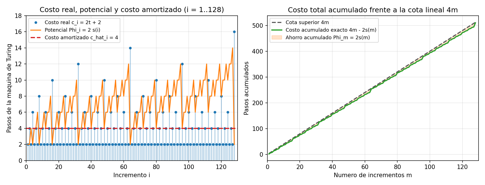

# Ejercicio 4 — Análisis amortizado del contador binario en una máquina de Turing

## Modelo y tabla de transiciones

Queremos demostrar mediante el método del potencial que ejecutar $m$ incrementos sucesivos desde $0$ en un contador binario implementado sobre una máquina de Turing de una sola cinta toma $O(m)$ pasos en total, a pesar de que un incremento individual puede llegar a costar $\Theta(\log m)$ pasos.

Representamos el entero actual en binario sobre la cinta con el bit menos significativo (LSB) en la celda $0$, los bits más significativos hacia la izquierda (posiciones negativas) y el resto de las celdas con el símbolo blanco `_` (en particular, la celda $+1$ contiene `_` y actúa como tope derecho). Inicialmente la cinta contiene un único `0` en la celda $0$ y el cabezal descansa sobre esa celda. Al terminar cada incremento, el cabezal debe quedar nuevamente estacionado sobre la celda $0$ (el LSB).

Cada incremento se ejecuta con dos estados activos (`acarreo` y `volver`) más el estado de parada `fin`:

| Estado actual | Símbolo leído | Símbolo escrito | Movimiento | Nuevo estado | Explicación de la transición |
|:---:|:---:|:---:|:---:|:---:|---|
| `acarreo` | `1` | `0` | $\leftarrow$ ($-1$) | `acarreo` | $1 + 1 = 10_2$: escribe `0` y propaga el acarreo a la izquierda |
| `acarreo` | `0` | `1` | $\rightarrow$ ($+1$) | `volver` | $0 + 1 = 1$: absorbe el acarreo y empieza el regreso al LSB |
| `acarreo` | `_` | `1` | $\rightarrow$ ($+1$) | `volver` | El número gana un bit a la izquierda; escribe `1` y regresa |
| `volver` | `0` | `0` | $\rightarrow$ ($+1$) | `volver` | Camina hacia la derecha sobre los `0` recién escritos |
| `volver` | `_` | `_` | $\leftarrow$ ($-1$) | `fin` | Detecta el blanco a la derecha del LSB y da un paso atrás |

### Correctitud y costo real de un incremento individual

Sea $v \ge 0$ el valor almacenado antes del $i$-ésimo incremento ($v = i - 1$), y sea $t \ge 0$ el número de unos consecutivos en los que termina la representación binaria de $v$:
$$v = \dots 0\,\underbrace{11\dots1}_{t\text{ unos}} \qquad \Longrightarrow \qquad v + 1 = \dots 1\,\underbrace{00\dots0}_{t\text{ ceros}}.$$

1. **Fase de acarreo:** Empezando en la posición $0$, el cabezal lee los $t$ unos finales, los reemplaza por `0` moviéndose $t$ veces a la izquierda ($t$ pasos), y en la posición $-t$ encuentra el primer `0` (o el blanco `_` si $v = 2^t - 1$), lo sobrescribe con un `1`, se mueve una celda a la derecha (posición $-t + 1$) y pasa al estado `volver` ($1$ paso).
2. **Fase de regreso:** Desde la posición $-t + 1$ hasta la posición $0$ hay exactamente los $t$ ceros que acabamos de escribir. La máquina avanza sobre ellos sin modificarlos ($t$ pasos), llega al blanco `_` de la posición $+1$ y retrocede una celda para detenerse en `fin` sobre la posición $0$ ($1$ paso).

Sumando ambas fases, el costo real del $i$-ésimo incremento en número de transiciones es exactamente:
$$c_i = t + 1 + t + 1 = 2t + 2.$$

Cuando $v = 2^k - 1$ (todos sus $k$ bits son `1`), tenemos $t = k \approx \log_2 i$, por lo que ese incremento aislado cuesta $c_i = 2\lfloor\log_2 m\rfloor + 2 = \Theta(\log m)$. Multiplicar ese peor caso individual por $m$ daría la cota pesimista $O(m \log m)$ que vimos en la primera conferencia.

---

## Función de potencial y costo amortizado

En la máquina de Turing, cada `1` que queda escrito en la cinta representa una "deuda" doble para el futuro: cuando algún acarreo posterior lo alcance, la máquina tendrá que gastar $1$ paso para apagarlo a `0` al ir hacia la izquierda y otro paso más para caminar sobre ese `0` al regresar hacia la derecha.

Por ello, definimos el potencial tras el $i$-ésimo incremento como **el doble de la cantidad de unos en la cinta**:
$$\Phi_i = 2 \cdot s(i),$$
donde $s(i)$ denota el número de bits iguales a `1` en la escritura binaria de $i$. Verifiquemos las propiedades del potencial:
- **Estado inicial:** Antes del primer incremento ($i = 0$), la cinta solo tiene `0`, luego $\Phi_0 = 2 \cdot s(0) = 0$.
- **No negatividad:** Como $s(i) \ge 0$ para todo $i \ge 0$, se cumple siempre $\Phi_i \ge 0$.

Calculemos el cambio de potencial $\Delta \Phi_i = \Phi_i - \Phi_{i-1}$ en el $i$-ésimo incremento. Si $i - 1$ termina en $t$ unos, la fase de acarreo apaga esos $t$ unos (los convierte en `0`) y enciende exactamente un `1` nuevo en la posición $-t$. Por tanto, el número de unos en la cinta varía en:
$$s(i) - s(i - 1) = 1 - t \quad \Longrightarrow \quad \Delta \Phi_i = 2(1 - t) = 2 - 2t.$$

El **costo amortizado** $\hat{c}_i$ del $i$-ésimo incremento resulta ser idénticamente constante e igual a $4$, sin importar cuántos unos finales $t$ tenga el número:
$$\hat{c}_i = c_i + \Delta \Phi_i = (2t + 2) + (2 - 2t) = 4.$$

### Suma telescópica y fórmula cerrada exacta

Sumando sobre los primeros $m$ incrementos:
$$\sum_{i=1}^m c_i = \sum_{i=1}^m \big(\hat{c}_i - \Delta \Phi_i\big) = \sum_{i=1}^m 4 - (\Phi_m - \Phi_0) = 4m - 2s(m).$$

Como $s(m) \ge 1$ para todo $m \ge 1$ (y $\Phi_m = 2s(m) > 0$), obtenemos simultáneamente la fórmula exacta y la cota superior lineal:
$$\sum_{i=1}^m c_i = 4m - 2s(m) < 4m = O(m).$$

Por otro lado, como $t \ge 0$, cada incremento ejecuta al menos $c_i \ge 2$ transiciones, por lo que $\sum_{i=1}^m c_i \ge 2m = \Omega(m)$. En conclusión, la secuencia de $m$ incrementos cuesta $\Theta(m)$ pasos en el peor caso (con un promedio asintótico de $4 - \frac{2s(m)}{m} \to 4$ pasos por incremento). $\blacksquare$

### Traza paso a paso de los incrementos $i = 1, \dots, 8$

La siguiente tabla muestra cómo evoluciona la cinta desde $0$ hasta $8$, y cómo los picos del costo real $c_i$ cuando $i$ es potencia de $2$ se compensan exactamente con las caídas de $\Phi_i$:

| Incremento $i$ | Transición | Cinta final | Unos al final ($t$) | Costo real $c_i = 2t+2$ | Potencial $\Phi_i = 2s(i)$ | $\Delta\Phi_i$ | Amortizado $\hat{c}_i$ | Acumulado $\sum c_k$ | Fórmula $4i - 2s(i)$ |
|:---:|:---:|:---:|:---:|:---:|:---:|:---:|:---:|:---:|:---:|
| $0$ | estado inicial | `0` | — | — | $0$ | — | — | $0$ | $0$ |
| $1$ | $0 \to 1$ | `1` | $0$ | $2$ | $2$ | $+2$ | **$4$** | $2$ | $4(1) - 2 = 2$ |
| $2$ | $1 \to 2$ | `10` | $1$ | $4$ | $2$ | $0$ | **$4$** | $6$ | $4(2) - 2 = 6$ |
| $3$ | $2 \to 3$ | `11` | $0$ | $2$ | $4$ | $+2$ | **$4$** | $8$ | $4(3) - 4 = 8$ |
| $4$ | $3 \to 4$ | `100` | $2$ | $6$ | $2$ | $-2$ | **$4$** | $14$ | $4(4) - 2 = 14$ |
| $5$ | $4 \to 5$ | `101` | $0$ | $2$ | $4$ | $+2$ | **$4$** | $16$ | $4(5) - 4 = 16$ |
| $6$ | $5 \to 6$ | `110` | $1$ | $4$ | $4$ | $0$ | **$4$** | $20$ | $4(6) - 4 = 20$ |
| $7$ | $6 \to 7$ | `111` | $0$ | $2$ | $6$ | $+2$ | **$4$** | $22$ | $4(7) - 6 = 22$ |
| $8$ | $7 \to 8$ | `1000` | $3$ | $8$ | $2$ | $-4$ | **$4$** | $30$ | $4(8) - 2 = 30$ |

*(Observación sobre el modelo)*: En una RAM donde solo contamos cambios de bits sin costo de desplazamiento del cabezal, basta con $\Phi = s(i)$ y el costo amortizado es $2$. En la máquina de Turing, el coeficiente $2$ en $\Phi_i = 2s(i)$ es indispensable porque el cabezal debe ir y volver sobre los $t$ bits modificados. Si la máquina tuviera el bit menos significativo a la izquierda pero mantuviera la convención de estacionar el cabezal siempre en el bit **más** significativo, cada incremento tendría que recorrer todos los $\lfloor\log_2 i\rfloor + 1$ bits del número, costando $\Theta(m \log m)$ de verdad.

### Comparación entre modelos de cómputo y variantes del problema

| Variante / Modelo | Costo peor caso individual | Costo total de $m$ incrementos | Costo amortizado por operación | Función de potencial $\Phi_i$ |
|---|---|---|---|---|
| **Contador binario en Word RAM** (palabra de $\ge \log_2 m$ bits) | $\Theta(1)$ (operación primitiva `x + 1`) | $\Theta(m)$ | $1$ operación | No requiere potencial |
| **Contador binario bit a bit** (cobrando solo flips de bits) | $\lfloor \log_2 m \rfloor + 1 = \Theta(\log m)$ | $2m - s(m) = \Theta(m)$ | $2$ flips de bit | $\Phi_i = s(i)$ (número de unos) |
| **Máquina de Turing de 1 cinta con cabezal en el LSB (este ejercicio)** | $2\lfloor \log_2 m \rfloor + 2 = \Theta(\log m)$ | $4m - 2s(m) = \Theta(m)$ | $4$ transiciones | $\Phi_i = 2s(i)$ (paga ida y vuelta del cabezal) |
| **Máquina de Turing de 1 cinta estacionando el cabezal en el MSB** | $\Theta(\log m)$ | **$\Theta(m \log m)$** | $\Theta(\log m)$ (no es $O(1)$) | Ningún potencial baja a $O(1)$ porque cada incremento atraviesa todo el número |

---

## Simulación y visualización

En [ejercicio-04.py](ejercicio-04.py) simulamos paso a paso la máquina de Turing durante $2^{14} - 1 = 16\,383$ incrementos, comprobando en cada uno que el cabezal regresa a la posición $0$, que $c_i = 2t + 2$, que $\hat{c}_i = 4$ y que la suma acumulada coincide con $4m - 2s(m)$:

```text
=== Resumen para distintos valores de m ===
      m |  Pasos totales |    Cota 4m |  Prom. c_i |  Max c_i
------------------------------------------------------------
      8 |             30 |         32 |     3.7500 |        8
     16 |             62 |         64 |     3.8750 |       10
     64 |            254 |        256 |     3.9688 |       14
    100 |            394 |        400 |     3.9400 |       14
   1000 |           3988 |       4000 |     3.9880 |       20
   1024 |           4094 |       4096 |     3.9980 |       22
  10000 |          39990 |      40000 |     3.9990 |       28
  16383 |          65504 |      65532 |     3.9983 |       28

Verificacion completada en 16 383 incrementos: costo amortizado = 4 y formula 4m - 2s(m) exactos.
```



**Observaciones sobre la gráfica ($m = 1, \dots, 128$):**
- **Panel izquierdo:** Los puntos y bastones azules muestran el costo real $c_i = 2t + 2$ de cada incremento (la mitad de ellos, cuando $i$ es impar, valen solo $2$; los cuartos valen $4$; y los picos más altos se alcanzan en las potencias de dos: $c_{64} = 14$ y $c_{128} = 16$). La curva naranja muestra el potencial acumulado $\Phi_i = 2s(i)$: se aprecia visualmente cómo $\Phi_i$ sube escalón a escalón antes de cada potencia de $2$ (llegando a $\Phi_{63} = 12$ y $\Phi_{127} = 14$) y se desploma a $2$ justo en el incremento caro ($i = 64, 128$), pagando exactamente el pico para que el costo amortizado permanezca fijo en la línea roja $\hat{c}_i = 4$.
- **Panel derecho:** El costo total acumulado $\sum_{i=1}^m c_i = 4m - 2s(m)$ (curva verde) corre pegado por debajo a la recta $4m$ (línea gris discontinua), separado únicamente por la franja sombreada de ancho $\Phi_m = 2s(m) \le 2\lceil\log_2(m+1)\rceil$, que se estrecha a solo $2$ unidades en cada potencia de dos ($m = 1, 2, 4, 8, 16, 32, 64, 128$).
