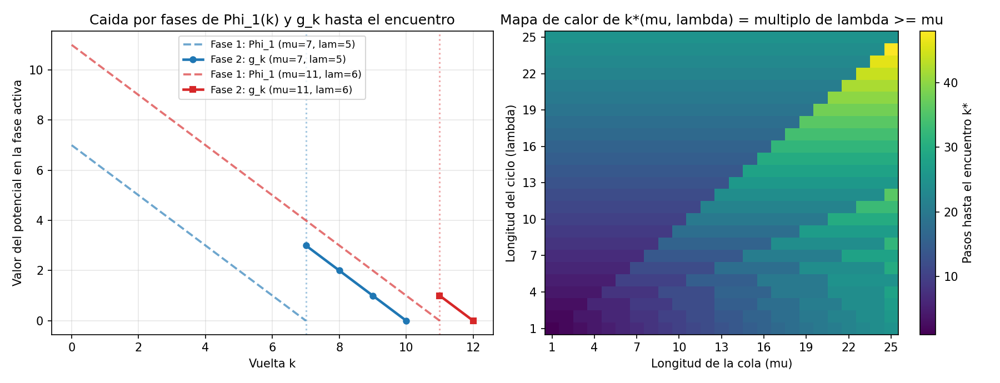

# Ejercicio 5 — Detección de ciclos de Floyd (la tortuga y la liebre)

## Planteamiento y modelo de la lista

Recibimos el puntero inicial `cabeza` de una lista simplemente enlazada donde cada nodo tiene un único enlace `sig` (que apunta al siguiente nodo o vale `None`). Queremos decidir si al avanzar desde `cabeza` siguiendo `sig` entramos en algún ciclo o si llegamos a `None`, usando **memoria auxiliar $O(1)$** (sin marcar nodos, modificar enlaces ni usar tablas hash).

Si llamamos $x_0 = \text{cabeza}$ y $x_{i+1} = x_i.\text{sig}$, el hecho de que `sig` sea una función determinista sobre el conjunto de nodos implica que la sucesión $(x_i)_{i \ge 0}$ solo puede comportarse de dos maneras:

1. **Lista finita sin ciclo:** existen $L \ge 0$ nodos todos distintos $x_0, x_1, \dots, x_{L-1}$ tales que $x_{L-1}.\text{sig} = \text{None}$.
2. **Lista con ciclo (forma de $\rho$):** hay una cola inicial de $\mu \ge 0$ nodos $x_0, \dots, x_{\mu-1}$ que no se repiten, seguida de un ciclo cerrado de longitud $\lambda \ge 1$ formado por los nodos $x_\mu, x_{\mu+1}, \dots, x_{\mu+\lambda-1}$, donde $x_{\mu+\lambda} = x_\mu$. En este caso la sucesión es infinita y para cualquier par de índices $i, j \ge \mu$ se cumple:
   $$x_i = x_j \iff i \equiv j \pmod \lambda.$$

En ambos escenarios llamaremos $n$ a la cantidad de nodos alcanzables desde `cabeza` ($n = L$ si no hay ciclo, y $n = \mu + \lambda$ si lo hay).

> **Observación clave (periodicidad):** Si en algún momento dos índices distintos $i < j$ caen en el mismo nodo ($x_i = x_j$), como cada paso aplica la misma función `sig`, por inducción $x_{i+r} = x_{j+r}$ para todo $r \ge 0$. Por tanto, la sucesión se vuelve periódica a partir de $i$, nunca alcanza `None` y obligatoriamente hay un ciclo cuya longitud $\lambda$ divide a $j - i$.

---

## El algoritmo de los dos punteros

Mantenemos dos punteros que parten de `cabeza`: la **tortuga** `t`, que da 1 paso por iteración, y la **liebre** `h`, que da 2 pasos por iteración:

```python
def floyd(cabeza):
    t = h = cabeza
    while h is not None and h.sig is not None:
        t = t.sig
        h = h.sig.sig
        if t is h:
            return True
    return False
```

---

## Invariante de ciclo y demostración de correctitud

Numeremos las iteraciones del bucle `while` con $k = 0, 1, 2, \dots$

> **Invariante:** Al comenzar la iteración $k$ (justo antes de evaluar la condición del `while`), los punteros están en las posiciones:
> $$t = x_k \quad \text{y} \quad h = x_{2k},$$
> y además en ninguna iteración previa $1 \le j \le k$ se ha dado $x_j = x_{2j}$.

- **Inicialización ($k = 0$):** Antes de entrar al ciclo hacemos `t = h = cabeza`, que es $x_0 = x_{2\cdot 0}$, y el rango $1 \le j \le 0$ es vacío.
- **Mantenimiento:** Supongamos que el invariante se cumple al inicio de la vuelta $k$ y la condición `h is not None and h.sig is not None` resulta verdadera. Esto garantiza que los nodos $x_{2k}$ y $x_{2k+1}$ existen, por lo que $x_{2k+2} = x_{2(k+1)}$ está bien definido (pudiendo ser `None`). Al ejecutar el cuerpo:
  - `t` pasa de $x_k$ a $x_k.\text{sig} = x_{k+1}$.
  - `h` pasa de $x_{2k}$ a $x_{2k}.\text{sig}.\text{sig} = x_{2(k+1)}$.
  - Si `t is h`, entonces $x_{k+1} = x_{2(k+1)}$ con $k+1 \ge 1$ y el algoritmo retorna `True`.
  - Si no son iguales, entonces $x_{k+1} \ne x_{2(k+1)}$ y comenzamos la vuelta $k+1$ conservando el invariante.
- **Conclusión (correctitud parcial):**
  - *Si el algoritmo devuelve `True` en algún paso $k \ge 1$:* por el invariante acabamos de encontrar $x_k = x_{2k}$ con $k < 2k$. Por la observación de periodicidad, la lista tiene un ciclo.
  - *Si el algoritmo devuelve `False`:* salió del `while` porque $x_{2k}$ o $x_{2k+1}$ es `None`, luego la lista termina en `None` y no tiene ciclo.

Para que la equivalencia *"se encuentran $\iff$ hay ciclo"* sea total, falta demostrar que cuando hay ciclo el algoritmo **no puede quedarse iterando para siempre sin que se encuentren**, lo cual probamos a continuación con una función de potencial.

---

## Función de potencial y prueba de terminación

### Caso 1: Lista sin ciclo ($L$ nodos)
Definimos el potencial como la cantidad de nodos que le quedan por delante a la liebre:
$$\Phi(k) = L - 2k.$$
- En cada iteración la liebre avanza dos posiciones, así que $\Phi(k+1) = \Phi(k) - 2$.
- Para entrar al cuerpo del ciclo hace falta que $x_{2k+1}$ no sea `None`, es decir, $2k + 1 \le L - 1 \implies \Phi(k) = L - 2k \ge 2$.
- Como empieza en $L$ y decrece de 2 en 2 manteniéndose positivo, el bucle da exactamente $\lfloor L/2 \rfloor$ vueltas y termina.

### Caso 2: Lista con ciclo ($\mu$ nodos de cola y $\lambda$ de ciclo)
Sea $k_0 = \max(\mu, 1)$ el primer paso $k \ge 1$ en el que la tortuga ya está dentro del ciclo ($k \ge \mu$). Como la liebre lleva el doble de pasos ($2k \ge 2k_0 > \mu$), a partir de $k_0$ **ambos punteros están dentro del ciclo**. Dividimos el análisis en dos fases:

1. **Fase 1 ($k < k_0$, la tortuga aún va por la cola):**
   Tomamos $\Phi_1(k) = k_0 - k \ge 1$, que cuenta cuántas vueltas le faltan a la tortuga para entrar al ciclo. En cada paso $k$ sube en 1, así que $\Phi_1$ disminuye exactamente en $1$ por vuelta hasta llegar a $0$ cuando $k = k_0$.
2. **Fase 2 ($k \ge k_0$, persecución dentro del ciclo):**
   Como $t = x_k$ y $h = x_{2k}$ están ambos en el ciclo de largo $\lambda$, la distancia medida a favor del ciclo desde la posición de la liebre hasta la de la tortuga es:
   $$g_k = (k - 2k) \bmod \lambda = (-k) \bmod \lambda \in \{0, 1, \dots, \lambda - 1\}.$$
   Observemos qué pasa al dar un paso de $k$ a $k+1$ mientras no se hayan encontrado ($g_k > 0$):
   - Como $g_k \in \{1, \dots, \lambda - 1\}$, al restar $1$ módulo $\lambda$ no hay desbordamiento negativo y se cumple exactamente:
     $$g_{k+1} = (-(k+1)) \bmod \lambda = (g_k - 1) \bmod \lambda = g_k - 1.$$
   - Intuitivamente: la tortuga se aleja 1 paso y la liebre se acerca 2 pasos por detrás, por lo que la distancia que le falta a la liebre para alcanzar a la tortuga se reduce en **exactamente 1 nodo por vuelta** (sin poder saltársela nunca).
   - Además, $g_k = 0 \iff \lambda \mid k \iff 2k \equiv k \pmod \lambda \iff x_{2k} = x_k$.

Si queremos escribir un único potencial escalar para todo el recorrido con ciclo, basta combinar ambas fases con peso lexicográfico:
$$\Phi(k) = \lambda \cdot \max(k_0 - k,\, 0) + \big((-k) \bmod \lambda\big),$$
que es un entero no negativo y decrece estrictamente en cada vuelta ($\Delta \Phi \le -1$ tanto en la Fase 1 como en la Fase 2).

Por lo tanto, el encuentro ocurre de manera inevitable en la vuelta:
$$k^* = \text{el menor múltiplo de } \lambda \text{ que cumple } k^* \ge \max(\mu, 1),$$
y como en la Fase 2 se dan a lo sumo $\lambda - 1$ pasos después de $k_0$, obtenemos la cota cerrada:
$$k^* \le k_0 + \lambda - 1 \le \mu + \lambda = n. \quad \blacksquare$$

---

## Traza paso a paso en dos ejemplos concretos

### Ejemplo A: $\mu = 4, \lambda = 5$ ($n = 9$ nodos)
Los nodos de la cola son $0, 1, 2, 3$ y el ciclo es $4 \to 5 \to 6 \to 7 \to 8 \to 4$. Aquí $k_0 = 4$ y el primer múltiplo de $5$ mayor o igual a $4$ es $k^* = 5$:

| Vuelta $k$ | Tortuga $t = x_k$ | Liebre $h = x_{2k}$ | Fase | $\Phi_1(k)$ | Distancia $g_k = (-k)\bmod 5$ | $\Phi(k) = 5\Phi_1 + g_k$ |
|:---:|:---:|:---:|:---:|:---:|:---:|:---:|
| $0$ | $x_0$ (nodo $0$) | $x_0$ (nodo $0$) | Fase 1 (en cola) | $4$ | $0$ | $20$ |
| $1$ | $x_1$ (nodo $1$) | $x_2$ (nodo $2$) | Fase 1 (en cola) | $3$ | $4$ | $19$ |
| $2$ | $x_2$ (nodo $2$) | $x_4$ (nodo $4$) | Fase 1 (en cola) | $2$ | $3$ | $13$ |
| $3$ | $x_3$ (nodo $3$) | $x_6$ (nodo $6$) | Fase 1 (en cola) | $1$ | $2$ | $7$ |
| $4$ | $x_4$ (nodo $4$) | $x_8$ (nodo $8$) | **Fase 2 (entra al ciclo)** | $0$ | $1$ | $1$ |
| $5$ | $x_5$ (nodo $5$) | $x_{10}$ (nodo $5$) | **¡Encuentro! ($t = h$)** | $0$ | $0$ | $0$ |

### Ejemplo B: $\mu = 7, \lambda = 5$ ($n = 12$ nodos)
Aquí la cola mide $7$ ($0..6$) y el ciclo mide $5$ ($7..11$). Cuando la tortuga entra al ciclo en $k = 7$ (nodo $7$), la liebre va por $x_{14}$ (nodo $9$, a distancia $g_7 = (-7) \bmod 5 = 3$ por detrás en el ciclo), así que la Fase 2 dura 3 vueltas hasta $k^* = 10$:

| Vuelta $k$ | Tortuga $t = x_k$ | Liebre $h = x_{2k}$ | Fase | $\Phi_1(k)$ | Distancia $g_k = (-k)\bmod 5$ | $\Phi(k) = 5\Phi_1 + g_k$ |
|:---:|:---:|:---:|:---:|:---:|:---:|:---:|
| $0$ | $x_0$ (nodo $0$) | $x_0$ (nodo $0$) | Fase 1 | $7$ | $0$ | $35$ |
| $1..6$ | $x_1 \dots x_6$ | $x_2 \dots x_{12}$ | Fase 1 ($\Phi_1$ baja de $6$ a $1$) | $6 \to 1$ | — | $34 \to 9$ |
| $7$ | $x_7$ (nodo $7$) | $x_{14}$ (nodo $9$) | **Fase 2 (ambas en ciclo)** | $0$ | $3$ | $3$ |
| $8$ | $x_8$ (nodo $8$) | $x_{16}$ (nodo $11$) | Fase 2 ($g_k$ baja en 1) | $0$ | $2$ | $2$ |
| $9$ | $x_9$ (nodo $9$) | $x_{18}$ (nodo $8$) | Fase 2 ($g_k$ baja en 1) | $0$ | $1$ | $1$ |
| $10$ | $x_{10}$ (nodo $10$) | $x_{20}$ (nodo $10$) | **¡Encuentro! ($t = h$)** | $0$ | $0$ | $0$ |

---

## Complejidad y optimalidad

- **Tiempo:** Cada vuelta del `while` ejecuta tres lecturas de puntero `sig` y una comparación de identidad, o sea $O(1)$. Como da $\lfloor L/2 \rfloor$ vueltas sin ciclo y $k^* \le \mu + \lambda$ vueltas con ciclo, el tiempo total es $\Theta(n)$ en el peor caso (a lo sumo $3n$ accesos a `sig`).
- **Espacio:** $O(1)$ palabras de memoria (`t` y `h`).
- **Cota inferior:** Cualquier algoritmo correcto necesita inspeccionar al menos $\Omega(n)$ enlaces en el peor caso: si sobre una lista sin ciclo de $n$ nodos dejara algún enlace $x_i.\text{sig}$ sin leer, un adversario podría redirigir ese puntero hacia $x_0$ formando un ciclo sin que la ejecución del algoritmo cambie en absoluto. Por tanto, el algoritmo de Floyd es asintóticamente óptimo en tiempo y espacio.

### Clasificación de complejidad y comparación con problemas relacionados

Desde el punto de vista de la complejidad computacional, una lista simplemente enlazada es un **grafo dirigido funcional** (cada vértice tiene grado de salida a lo sumo $1$). El algoritmo de Floyd demuestra que detectar un ciclo en este tipo de grafos pertenece no solo a **P** (tiempo lineal $\Theta(n)$), sino también a la clase **L** (*espacio determinista logarítmico* en bits, ya que dos punteros ocupan $O(\log n)$ bits de memoria):

| Problema / Algoritmo | Tiempo (peor caso) | Espacio auxiliar | Evaluaciones de `sig` (con ciclo) | Observaciones y clase de complejidad |
|---|---|---|---|---|
| **Algoritmo de Floyd (tortuga y liebre — este ejercicio)** | **$\Theta(\mu + \lambda) = \Theta(n)$** | **$O(1)$ punteros** ($O(\log n)$ bits) | $3 k^* \le 3(\mu + \lambda)$ | Óptimo en tiempo y espacio; pertenece a **L $\subseteq$ P** |
| **Algoritmo de Brent (1980, teletransporte en potencias de 2)** | **$\Theta(\mu + \lambda) = \Theta(n)$** | **$O(1)$ punteros** | $\le 2\max(\mu, \lambda) + \lambda$ | Misma complejidad asintótica pero ahorra $\approx 36\%$ de accesos a `sig` porque solo mueve un puntero por paso |
| **Marcado con conjunto / tabla hash (`set`)** | $\Theta(n)$ esperado | **$\Theta(n)$ punteros** | $\mu + \lambda$ | Hace el mínimo exacto de pasos ($\mu + \lambda$), pero viola la restricción de memoria $O(1)$ |
| **Detección de algún ciclo en un grafo dirigido general ($G=(V,E)$)** | $\Theta(|V| + |E|)$ con DFS | $\Theta(|V|)$ | — | Polinomial (**$\in \text{P}$**), pero ya no basta memoria $O(1)$ de punteros en DFS estándar |
| **Ciclo de longitud dada / Ciclo Hamiltoniano en grafo general** | Exponencial $O^*(2^n)$ conocido | Polinomial | — | **NP-completo**: cuando los nodos tienen grado de salida $\ge 2$, hay ramificación de decisiones |

---

## Verificación experimental y visualización

En [ejercicio-05.py](ejercicio-05.py) construí las $675$ listas posibles con $\mu, \lambda \in [0, 25]$ ($\mu + \lambda > 0$) y verifiqué con `assert` en cada vuelta que $t = x_k$, $h = x_{2k}$, que en la Fase 2 la distancia $g_k$ decrece exactamente de 1 en 1 y que el número total de pasos coincide siempre con $\lceil \max(\mu, 1)/\lambda \rceil \cdot \lambda$ (con ciclo) o $\lfloor \mu/2 \rfloor$ (sin ciclo).

El script genera además la siguiente visualización:



**Análisis de la gráfica:**
- **Panel izquierdo (transición de fase del potencial):** Se muestran las curvas de $\mu = 7, \lambda = 5$ (azul) y $\mu = 11, \lambda = 6$ (rojo). En la **Fase 1** (línea discontinua, a la izquierda de la línea vertical punteada $k = \mu$), el potencial relevante es $\Phi_1(k) = \mu - k$, que cae con pendiente $-1$ hasta que la tortuga pisa la entrada del ciclo en $k = \mu$. Justo ahí arranca la **Fase 2** (línea continua con marcadores): la distancia circular $g_k = (-k) \bmod \lambda$ toma el relevo y cae también linealmente con pendiente $-1$ hasta tocar $0$ en $k^* = 10$ y $k^* = 12$ respectivamente.
- **Panel derecho (mapa de calor de $k^*(\mu, \lambda)$):** Al graficar los pasos hasta el encuentro para $\mu, \lambda \in [1, 25]$, aparecen escalones horizontales de ancho $\lambda$ en cada fila: para un $\lambda$ fijo, a medida que $\mu$ crece dentro del intervalo $((c-1)\lambda,\, c\lambda]$, el número de pasos $k^*$ permanece constante e igual a $c\lambda$, porque la liebre aprovecha el tiempo que la tortuga tarda en recorrer la cola y siempre la termina atrapando en el mismo múltiplo de $\lambda$.
