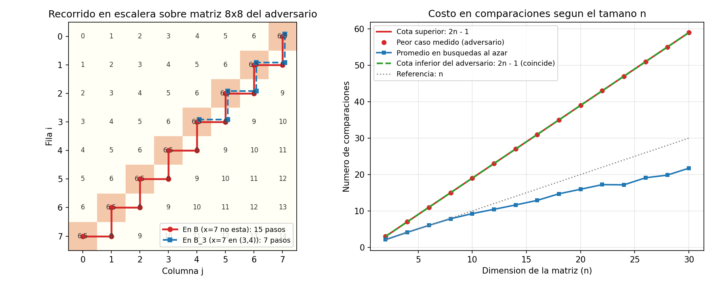

# Ejercicio 6 — Búsqueda en una matriz con filas y columnas ordenadas

## Descripción del problema y modelo de costo

Dada una matriz $M[0..n)[0..n)$ de números reales cuyas filas y columnas están ordenadas de manera creciente:
$$M[i][j] \le M[i][j+1] \quad \text{y} \quad M[i][j] \le M[i+1][j],$$
y un valor buscado $x$, queremos determinar si $x$ se encuentra en $M$. Medimos el costo por el **número de comparaciones ternarias** ($<, =, >$) entre $x$ y entradas $M[i][j]$ de la matriz.

Si aplicáramos búsqueda binaria por separado en cada una de las $n$ filas, haríamos $O(n \log n)$ comparaciones porque estaríamos ignorando el orden vertical. Para bajar a $O(n)$ necesitamos que **una sola comparación descarte simultáneamente toda una fila o toda una columna** de la región activa.

---

## El algoritmo de búsqueda en escalera

Si nos situamos en la **esquina superior derecha** de la submatriz candidata actual, digamos en $(i, j)$, esa celda tiene una propiedad especial: es a la vez **el máximo de su fila** dentro de la submatriz ($M[i][0..j]$) y **el mínimo de su columna** dentro de la submatriz ($M[i..n)[j]$). Por lo tanto:
- Si $x < M[i][j]$, entonces $x$ es menor que todos los elementos de la columna $j$ desde la fila $i$ hacia abajo, así que descartamos la columna $j$ haciendo `j -= 1`.
- Si $x > M[i][j]$, entonces $x$ es mayor que todos los elementos de la fila $i$ desde la columna $0$ hasta la $j$, así que descartamos la fila $i$ haciendo `i += 1`.

*(Por simetría, también se podría empezar en la esquina inferior izquierda $(n-1, 0)$; en cambio, empezar en $(0, 0)$ o $(n-1, n-1)$ no sirve porque allí ambos ejes crecen o decrecen en el mismo sentido).*

```python
def escalera(M, x):
    n = len(M)
    i, j = 0, n - 1
    while i < n and j >= 0:
        if x == M[i][j]:
            return True
        elif x < M[i][j]:
            j -= 1   # descarta el resto de la columna j
        else:
            i += 1   # descarta el resto de la fila i
    return False
```

---

## Invariante de correctitud y potencial de terminación

### Demostración de correctitud
> **Invariante:** Al inicio de cada iteración del bucle `while`, si $x$ pertenece a $M$, entonces existe un par $(i^*, j^*)$ con $i \le i^* < n$ y $0 \le j^* \le j$ tal que $M[i^*][j^*] = x$ (es decir, $x$ solo puede estar dentro de la submatriz esquina inferior-izquierda $M[i..n)[0..j]$).

- **Inicialización:** Antes de la primera iteración tenemos $i = 0$ y $j = n - 1$. La submatriz $M[0..n)[0..n-1]$ es la matriz completa $M$, por lo que el invariante se cumple trivialmente.
- **Mantenimiento:** Supongamos que el invariante es cierto al comenzar una vuelta con $i < n$ y $j \ge 0$, y comparamos $x$ con el pivote $M[i][j]$:
  1. Si $x = M[i][j]$, el algoritmo devuelve `True` y acierta porque encontró a $x$.
  2. Si $x < M[i][j]$, como la columna $j$ es creciente, para todo $i' \in [i, n)$ se cumple $M[i'][j] \ge M[i][j] > x$. Luego $x$ no puede estar en la columna $j$ de la submatriz. Al decrementar $j \leftarrow j - 1$, si $x$ estaba en $M[i..n)[0..j]$, obligatoriamente está en $M[i..n)[0..j-1]$.
  3. Si $x > M[i][j]$, como la fila $i$ es creciente, para todo $j' \in [0, j]$ se cumple $M[i][j'] \le M[i][j] < x$. Luego $x$ no puede estar en la fila $i$ de la submatriz. Al incrementar $i \leftarrow i + 1$, el invariante se conserva en $M[i+1..n)[0..j]$.
- **Conclusión:** Cuando el ciclo termina sin haber retornado `True`, la guarda falla porque $i = n$ o $j = -1$. En cualquiera de los dos casos la submatriz $M[i..n)[0..j]$ es vacía; por el invariante, $x$ no está en $M$, así que devolver `False` es correcto. $\blacksquare$

### Terminación y cota superior de comparaciones
Definimos como función de potencial la suma de filas y columnas que quedan vivas en la submatriz:
$$\Phi(i, j) = (n - i) + (j + 1).$$
- **Inicio:** En $(i, j) = (0, n - 1)$, $\Phi = n + n = 2n$.
- **Decrecimiento:** Cada iteración que no retorna `True` incrementa $i$ en $1$ o decrementa $j$ en $1$, por lo que $\Phi$ disminuye exactamente en $1$ por vuelta.
- **Cota en el ciclo:** Mientras se cumple la guarda $i < n \land j \ge 0$, tenemos $n - i \ge 1$ y $j + 1 \ge 1$, o sea $\Phi(i, j) \ge 2$. La salida del bucle por agotamiento ocurre exactamente en el instante en que $\Phi$ cae a $1$ (cuando $i = n$ y $j \ge 0$, o bien $j = -1$ e $i < n$).

Como $\Phi$ empieza en $2n$ y cae de $1$ en $1$ hasta $1$, el algoritmo realiza **a lo sumo $2n - 1$ comparaciones** en el peor caso, con tiempo $O(n)$ y memoria adicional $O(1)$.

---

## Ejemplo concreto ($4 \times 4$) y traza del peor caso

Consideremos la matriz $4 \times 4$ del adversario (donde la antidiagonal $i + j = 3$ vale $2.5$ y el resto de entradas vale $i + j$) buscando el valor $x = 3$:

$$B = \begin{pmatrix}
0.0 & 1.0 & 2.0 & \mathbf{2.5} \\
1.0 & 2.0 & \mathbf{2.5} & 4.0 \\
2.0 & \mathbf{2.5} & 4.0 & 5.0 \\
\mathbf{2.5} & 4.0 & 5.0 & 6.0
\end{pmatrix}, \qquad x = 3.$$

La escalera se ve obligada a recorrer un zigzag de $2n - 1 = 7$ pasos pegado a la antidiagonal:

| Paso | Coordenada $(i, j)$ | Valor $B[i][j]$ | Resultado de comparar | Movimiento | Submatriz restante | Potencial $\Phi$ antes $\to$ después |
|:---:|:---:|:---:|:---:|:---:|:---:|:---:|
| 1 | $(0, 3)$ | $2.5$ | $3 > 2.5$ | baja ($i \leftarrow 1$) | $M[1..4)[0..3]$ | $8 \to 7$ |
| 2 | $(1, 3)$ | $4.0$ | $3 < 4.0$ | izquierda ($j \leftarrow 2$) | $M[1..4)[0..2]$ | $7 \to 6$ |
| 3 | $(1, 2)$ | $2.5$ | $3 > 2.5$ | baja ($i \leftarrow 2$) | $M[2..4)[0..2]$ | $6 \to 5$ |
| 4 | $(2, 2)$ | $4.0$ | $3 < 4.0$ | izquierda ($j \leftarrow 1$) | $M[2..4)[0..1]$ | $5 \to 4$ |
| 5 | $(2, 1)$ | $2.5$ | $3 > 2.5$ | baja ($i \leftarrow 3$) | $M[3..4)[0..1]$ | $4 \to 3$ |
| 6 | $(3, 1)$ | $4.0$ | $3 < 4.0$ | izquierda ($j \leftarrow 0$) | $M[3..4)[0..0]$ | $3 \to 2$ |
| 7 | $(3, 0)$ | $2.5$ | $3 > 2.5$ | baja ($i \leftarrow 4$, sale) | vacía ($i = 4$) | $2 \to 1$ |

---

## Cota inferior por adversario: no se puede en $o(n)$, y de hecho hacen falta $2n - 1$

Aquí una cota por teoría de la información no basta: como la salida es booleana (o a lo sumo una de $n^2 + 1$ posiciones), el número de hojas del árbol de decisión solo daría $\Omega(\log n)$. La dificultad real está en que hay $2n - 1$ celdas **desacopladas entre sí** respecto al orden de la matriz: las $n$ de la antidiagonal y las $n - 1$ de la diagonal justo debajo de ella. Cada una se puede cambiar sin tocar el orden de las demás, así que conocer unas no informa nada sobre las otras.

### Teorema: Cualquier algoritmo basado en comparaciones (de $x$ con entradas de la matriz) necesita al menos $2n - 1$ comparaciones en el peor caso.

**Demostración.** Fijemos el valor buscado en $x = n - 1$ y definamos la matriz base $B$ de tamaño $n \times n$ como:
$$B[i][j] = \begin{cases}
i + j & \text{si } i + j \ne n - 1, \\
n - \tfrac{3}{2} & \text{si } i + j = n - 1 \text{ (la antidiagonal).}
\end{cases}$$

1. **$B$ tiene filas y columnas estrictamente crecientes y no contiene a $x$:**
   Fuera de la antidiagonal, $i + j$ aumenta en $1$ al avanzar hacia abajo o hacia la derecha. Al cruzar la antidiagonal pasamos de $i + j = n - 2$ a $n - 1.5$ y luego a $i + j = n$, manteniendo el orden estricto $n - 2 < n - 1.5 < n$. Además, ninguna celda vale $n - 1$, por lo que la respuesta correcta para $(B, x)$ es `False`.
2. **Las $2n - 1$ matrices perturbadas $B_c$:**
   Llamo **celdas libres** a las $n$ de la antidiagonal, $(k, n - 1 - k)$ con $0 \le k \le n - 1$, y a las $n - 1$ de la diagonal de abajo, $(k, n - k)$ con $1 \le k \le n - 1$. Para cada celda libre $c$ definimos la matriz $B_c$ idéntica a $B$ salvo en $c$, donde ponemos exactamente el valor $x = n - 1$.
   - Si $c$ está en la antidiagonal, sus vecinos superiores e izquierdos valen $n - 2$ y los inferiores y derechos valen $n$. Como $n - 2 < n - 1 < n$, el orden se mantiene.
   - Si $c$ está en la diagonal de abajo ($i + j = n$, donde $B$ vale $n$), sus vecinos superiores e izquierdos están en la antidiagonal y valen $n - \tfrac32$, y los inferiores y derechos valen $n + 1$. Como $n - \tfrac32 < n - 1 < n + 1$, el orden también se mantiene.
   - En los dos casos **$B_c$ sigue teniendo filas y columnas estrictamente crecientes**, y en $B_c$ sí aparece $x$, así que la respuesta correcta para $(B_c, x)$ es `True`.
3. **Argumento de engaño del adversario:**
   Supongamos que un algoritmo determinista ejecuta menos de $2n - 1$ comparaciones cuando las respuestas a sus consultas se contestan según la matriz $B$. Como hay $2n - 1$ celdas libres, existe al menos una, $c$, que el algoritmo **nunca consultó**.
   Como $B$ y $B_c$ coinciden en todas las demás celdas, el algoritmo recibe exactamente la misma secuencia de respuestas sobre $B$ que sobre $B_c$, y por tanto emite el mismo veredicto en ambas. Pero la respuesta correcta es `False` en $B$ y `True` en $B_c$, de modo que el algoritmo falla en al menos una de las dos. $\blacksquare$

En conclusión, ningún algoritmo puede hacer menos de $2n - 1$ comparaciones en el peor caso, y en particular no puede hacer $o(n)$. La escalera hace como mucho $2n - 1$: es **exactamente óptima**, no solo asintóticamente. De hecho, el zigzag que recorre la escalera sobre $B$ (ver la traza de arriba) visita justamente las $2n - 1$ celdas libres.

### Clasificación de complejidad y comparación con variantes de búsqueda matricial

Si medimos la complejidad en función del número total de celdas de la entrada $N = n^2$, el algoritmo de la escalera corre en tiempo **$\Theta(n) = \Theta(\sqrt{N})$**, por lo que es un algoritmo **sublineal en el tamaño de la entrada** (y por supuesto polinomial, dentro de **P**). Es muy ilustrativo comparar las distintas estrategias posibles sobre una matriz $n \times n$:

| Algoritmo / Variante de la matriz | Hipótesis de orden en la matriz $n \times n$ | Comparaciones en el peor caso | ¿Es óptimo para esa hipótesis? | Por qué ocurre esa complejidad |
|---|---|---|---|---|
| **Búsqueda en escalera desde $(0, n-1)$ (este ejercicio)** | Filas crecientes y columnas crecientes ($M[i][j] \le M[i][j+1], M[i+1][j]$) | **$2n - 1 = \Theta(n)$** | **Sí, exactamente** (cota inferior del adversario: $\ge 2n - 1$) | La esquina superior-derecha es un punto de silla del orden parcial y descarta 1 fila o 1 columna por paso |
| **Búsqueda binaria fila por fila** | Solo usa que las filas son crecientes | **$n \lceil \log_2(n+1) \rceil = \Theta(n \log n)$** | Óptimo si las columnas no estuvieran ordenadas | Desaprovecha el orden vertical de las columnas |
| **Divide y vencerás por 4 cuadrantes** | Filas y columnas crecientes | **$T(n) = 3T(n/2) + O(1) = \Theta(n^{\log_2 3}) \approx \Theta(n^{1{,}585})$** | No (peor que la escalera y que $n \log n$) | Comparar con el centro $(n/2, n/2)$ solo descarta $1$ de los $4$ cuadrantes, dejando $3$ subproblemas de lado $n/2$ |
| **Matriz ordenada en orden lexicográfico de filas (serpentina)** | Además $M[i][n-1] \le M[i+1][0]$ (cada fila empieza donde terminó la anterior) | **$\lceil \log_2(n^2 + 1) \rceil \approx 2 \log_2 n = \Theta(\log n)$** | **Sí** (equivale a un arreglo 1D de largo $n^2$) | El orden entre filas elimina la independencia de la antidiagonal |

---

## Experimentos y visualización

En [ejercicio-06.py](ejercicio-06.py) puse a prueba el algoritmo en 20 000 matrices aleatorias con repeticiones (verificando que nunca supera $2n - 1$ pasos y que para todo $n \le 12$ alcanza ese máximo), comprobé que $B$ y las $2n - 1$ variantes $B_c$ son estrictamente crecientes, y enfrenté al adversario tanto la escalera completa como una versión defectuosa que empieza en la columna $n - 2$. La escalera consulta las $2n - 1$ celdas libres; la versión defectuosa deja sin mirar dos, $(0, n-1)$ y $(1, n-1)$, y falla en la matriz que pone $x$ en la primera:

```text
   n | celdas libres | escalera: libres sin mirar | incompleta: libres sin mirar
   4 |             7 |                          0 |                            2
  16 |            31 |                          0 |                            2
  64 |           127 |                          0 |                            2
```



**Observaciones sobre la gráfica:**
- **Panel izquierdo (cuadrícula $8 \times 8$ del adversario):** Las celdas sombreadas en naranja forman la antidiagonal donde $B[i][j] = 6.5$. Cuando buscamos $x = 7$ en $B$ (curva roja continua), cada vez que la escalera pisa la antidiagonal ve $7 > 6.5$ y baja una fila; inmediatamente cae en una celda con valor $8$, ve $7 < 8$ y retrocede una columna a la izquierda. Ese zigzag visita las $8$ celdas de la antidiagonal y las $7$ celdas inmediatamente inferiores, consumiendo los $2(8) - 1 = 15$ pasos exactos. En cambio, si ejecutamos el algoritmo sobre la matriz perturbada $B_3$ donde la celda $(3, 4)$ vale $7$ (curva azul punteada), sigue la misma ruta hasta detenerse con éxito en el paso $7$.
- **Panel derecho (escalamiento con $n$):** La cantidad de comparaciones en el peor caso frente al adversario (puntos rojos) calza exactamente sobre la recta teórica $2n - 1$, y la cota inferior del adversario (recta verde discontinua) coincide con ella: no queda ninguna franja entre lo que hace el algoritmo y lo que es posible. En búsquedas sobre matrices ordenadas aleatorias (curva azul), el promedio crece también linealmente con pendiente cercana a $1.2n$, por debajo del peor caso; la recta gris punteada $n$ queda como referencia.
