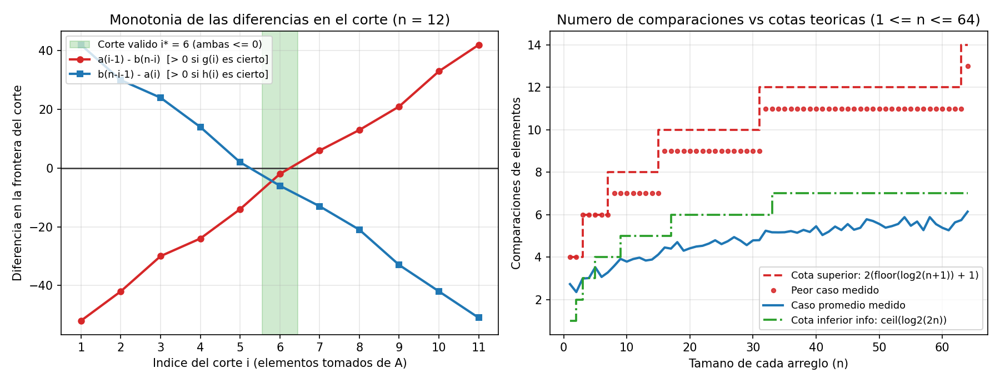

# Ejercicio 7 — Mediana de dos arreglos ordenados en $O(\log n)$

## Definición del problema y precisiones

Dados dos arreglos $A[0..n)$ y $B[0..n)$ de longitud $n \ge 1$, ambos ordenados de forma creciente no estricta ($A[0] \le A[1] \le \dots \le A[n-1]$ y análogamente $B$), buscamos el **$n$-ésimo menor elemento** del multiconjunto unión $A \cup B$ (que tiene $2n$ elementos en total, contando multiplicidades).

Conviene dejar claras tres cuestiones desde el principio:
1. **Cuál de las dos medianas buscamos:** En un conjunto de tamaño par $2n$, la mediana inferior ocupa el rango $n$ (índice $n - 1$ al ordenar desde $0$) y la mediana superior ocupa el rango $n + 1$. El enunciado pide el $n$-ésimo menor, es decir, la **mediana inferior** (`sorted(A + B)[n - 1]`).
2. **Elementos repetidos:** La definición por rango de orden (`sorted(A + B)[n - 1]`) sigue siendo unívoca aunque haya valores repetidos dentro de un mismo arreglo o entre ambos.
3. **Modelo de costo:** Contamos el número de comparaciones entre elementos de entrada. Mezclar los dos arreglos como en *MergeSort* resolvería el problema en $\Theta(n)$ comparaciones; queremos bajar a $O(\log n)$ aprovechando que ambos arreglos ya vienen ordenados.

---

## Caracterización mediante cortes y búsqueda binaria

Cualquier subconjunto de $n$ elementos formado por un prefijo de $A$ y un prefijo de $B$ queda determinado por un único entero $i \in \{0, 1, \dots, n\}$:
- Tomamos los primeros $i$ elementos de $A$: $A[0..i)$.
- Tomamos los primeros $j = n - i$ elementos de $B$: $B[0..n-i)$.

Para no escribir casos bordes cuando $i = 0$ o $i = n$, extendemos ambos arreglos con centinelas en los extremos:
$$a(-1) = -\infty, \quad a(k) = A[k] \text{ para } 0 \le k < n, \quad a(n) = +\infty,$$
$$b(-1) = -\infty, \quad b(k) = B[k] \text{ para } 0 \le k < n, \quad b(n) = +\infty.$$

Con esta notación, la parte izquierda del corte $I_i = A[0..i) \cup B[0..n-i)$ tiene exactamente $n$ elementos y la parte derecha $D_i = A[i..n) \cup B[n-i..n)$ tiene los otros $n$. Para que todos los elementos de $I_i$ sean menores o iguales que todos los de $D_i$, como dentro de cada arreglo el orden ya está garantizado ($a(i-1) \le a(i)$ y $b(n-i-1) \le b(n-i)$), solo hace falta verificar las **dos condiciones cruzadas**:

1. Definimos el predicado $g(i) \equiv \big[a(i - 1) > b(n - i)\big]$ (*"sobran elementos de $A$"*, hay que mover el corte hacia la izquierda).
2. Definimos el predicado $h(i) \equiv \big[b(n - i - 1) > a(i)\big]$ (*"faltan elementos de $A$"*, hay que mover el corte hacia la derecha).
3. Diremos que el corte $i \in [0, n]$ es **válido** si no ocurre ni $g(i)$ ni $h(i)$, es decir:
   $$a(i - 1) \le b(n - i) \quad \text{y} \quad b(n - i - 1) \le a(i).$$

```python
def mediana_inferior(A, B):
    n = len(A)
    lo, hi = 0, n
    while True:
        i = (lo + hi) // 2
        j = n - i
        if a(i - 1) > b(j):          # g(i): tomamos demasiados de A
            hi = i - 1
        elif b(j - 1) > a(i):        # h(i): tomamos muy pocos de A
            lo = i + 1
        else:                        # corte valido: ni g(i) ni h(i)
            return max(a(i - 1), b(j - 1))
```

---

## Traza en un ejemplo concreto ($n = 5$)

Tomemos $A = [2, 5, 8, 12, 16]$ y $B = [1, 3, 9, 10, 14]$. La unión ordenada de los $10$ elementos es $[1, 2, 3, 5, \mathbf{8}, 9, 10, 12, 14, 16]$, cuyo $5$-to menor elemento es **$8$**. Veamos la tabla completa de los $n + 1 = 6$ cortes posibles:

| Corte $i$ | $j = 5 - i$ | $a(i-1)$ | $b(5-i)$ | $b(4-i)$ | $a(i)$ | $g(i): a(i-1)>b(j)$ | $h(i): b(j-1)>a(i)$ | Diagnóstico del corte |
|:---:|:---:|:---:|:---:|:---:|:---:|:---:|:---:|:---:|
| $0$ | $5$ | $-\infty$ | $+\infty$ | $14$ | $2$ | `False` | `True` | Faltan de $A$ ($14 > 2$) |
| $1$ | $4$ | $2$ | $14$ | $10$ | $5$ | `False` | `True` | Faltan de $A$ ($10 > 5$) |
| $2$ | $3$ | $5$ | $10$ | $9$ | $8$ | `False` | `True` | Faltan de $A$ ($9 > 8$) |
| **$3$** | **$2$** | **$8$** | **$9$** | **$3$** | **$12$** | **`False`** | **`False`** | **Corte válido** ($\max(8, 3) = 8$) |
| $4$ | $1$ | $12$ | $3$ | $1$ | $16$ | `True` | `False` | Sobran de $A$ ($12 > 3$) |
| $5$ | $0$ | $16$ | $1$ | $-\infty$ | $+\infty$ | `True` | `False` | Sobran de $A$ ($16 > 1$) |

Se aprecia claramente la estructura monótona de la tabla: $h(i)$ empieza siendo `True` y cambia a `False` para no volver a subir, mientras que $g(i)$ empieza en `False` y cambia a `True` más adelante. En el punto donde ambos son `False` ($i = 3$), el corte deja $A[0..3) = [2, 5, 8]$ y $B[0..2) = [1, 3]$ a la izquierda.

**Ejecución de la búsqueda binaria sobre este ejemplo:**
1. **Iteración 1:** $[lo, hi] = [0, 5]$ ($\Phi = 6$). Punto medio $i = 2, j = 3$. Se evalúa $g(2): 5 > 10$ (`False`) y luego $h(2): 9 > 8$ (`True`). Actualiza $lo \leftarrow 3$.
2. **Iteración 2:** $[lo, hi] = [3, 5]$ ($\Phi = 3$). Punto medio $i = 4, j = 1$. Se evalúa $g(4): 12 > 3$ (`True`). Actualiza $hi \leftarrow 3$.
3. **Iteración 3:** $[lo, hi] = [3, 3]$ ($\Phi = 1$). Punto medio $i = 3, j = 2$. Tanto $g(3): 8 > 9$ como $h(3): 3 > 12$ dan `False`. Devuelve $\max(a(2), b(1)) = \max(8, 3) = 8$.

---

## Demostración formal de correctitud y terminación

### Lema 1 (Propiedad del corte válido)
*Si $i \in [0, n]$ es un corte válido, entonces el $n$-ésimo menor elemento de $A \cup B$ es exactamente $\max(a(i-1), b(n-i-1))$.*

**Demostración.** Para ese $i$ y $j = n - i$, todo elemento de la mitad izquierda $I_i = A[0..i) \cup B[0..j)$ es menor o igual a $\max(a(i-1), b(j-1))$ (porque $A$ y $B$ son crecientes), y a su vez por validez tenemos:
$$a(i-1) \le a(i) \quad \text{y} \quad a(i-1) \le b(j), \qquad b(j-1) \le b(j) \quad \text{y} \quad b(j-1) \le a(i),$$
lo que implica que $\max(a(i-1), b(j-1)) \le \min(a(i), b(j))$. Por monotonía de $A$ y $B$, cualquier elemento de la mitad derecha $D_i = A[i..n) \cup B[j..n)$ es mayor o igual a $\min(a(i), b(j))$. Así, los $n$ elementos de $I_i$ son menores o iguales que los $n$ elementos de $D_i$, de modo que el $n$-ésimo menor de la unión es el máximo de $I_i$, que es $\max(a(i-1), b(j-1))$ (nótese que como $n \ge 1$, no pueden ser $i = 0$ y $j = 0$ a la vez, por lo que al menos uno de los dos términos del máximo no es $-\infty$). $\blacksquare$

### Lema 2 (Monotonía de los predicados $g$ y $h$)
*Al crecer $i$ de $0$ a $n$, $g(i)$ es monótono creciente ($\text{False} \dots \text{False}, \text{True} \dots \text{True}$) y $h(i)$ es monótono decreciente ($\text{True} \dots \text{True}, \text{False} \dots \text{False}$).*

**Demostración.** Si $i$ aumenta a $i + 1$, como $A$ y $B$ son crecientes, $a(i) \ge a(i - 1)$ y $b(n - i - 1) \le b(n - i)$. Por tanto, la diferencia $a(i - 1) - b(n - i)$ es una función no decreciente de $i$: si era $> 0$ en $i$, seguirá siendo $> 0$ en $i + 1$. Análogamente, $b(n - i - 1) - a(i)$ es no creciente en $i$. $\blacksquare$

### Lema 3 (Existencia garantizada de un corte válido)
*Sea $p = \min\{i \in [0, n] : \lnot h(i)\}$. Entonces $p$ está bien definido y es un corte válido.*

**Demostración.** El conjunto no es vacío porque para $i = n$ se tiene $b(n - n - 1) = b(-1) = -\infty \le a(n) = +\infty$, luego $h(n) = \text{False}$. Por definición de $p$, se cumple $\lnot h(p)$. Falta ver que también se cumple $\lnot g(p)$:
- Si $p = 0$, entonces $a(-1) = -\infty \le b(n)$, luego $g(0) = \text{False}$.
- Si $p > 0$, por minimalidad de $p$ sabemos que $h(p - 1)$ es verdadero, es decir, $b(n - (p - 1) - 1) > a(p - 1)$, que se reescribe exactamente como $b(n - p) > a(p - 1)$, lo cual implica $\lnot g(p)$. $\blacksquare$

### Invariante del ciclo y potencial
> **Invariante:** Al inicio de cada iteración del bucle `while`, el corte válido canónico $p$ del Lema 3 pertenece al intervalo cerrado $[lo, hi]$ (es decir, $0 \le lo \le p \le hi \le n$).

- **Inicialización:** Al empezar, $lo = 0$ y $hi = n$, y por el Lema 3 sabemos que $p \in [0, n]$.
- **Mantenimiento:** Sea $i = \lfloor (lo + hi)/2 \rfloor$:
  - Si se cumple $g(i)$, como $g(p)$ es falso y $g$ es monótona creciente (Lema 2), tiene que ser $i > p$, o sea $p \le i - 1$. Al asignar $hi \leftarrow i - 1$, se mantiene $lo \le p \le hi$.
  - Si se cumple $h(i)$, como $h(p)$ es falso y $h$ es monótona decreciente (Lema 2), tiene que ser $i < p$, o sea $p \ge i + 1$. Al asignar $lo \leftarrow i + 1$, se mantiene $lo \le p \le hi$.
  - Si no se cumple ni $g(i)$ ni $h(i)$, entonces $i$ es un corte válido (puede ser $p$ u otro corte válido si hay elementos empatados) y el algoritmo termina devolviendo el valor correcto por el Lema 1.
- **Terminación con potencial:** Tomemos $\Phi = hi - lo + 1$ (la cantidad de cortes candidatos en el intervalo). Por el invariante, mientras el bucle no haya retornado, $p \in [lo, hi]$ garantiza $\Phi \ge 1$. Además, en cada paso que continúa, el nuevo tamaño del intervalo es a lo sumo $\lfloor \Phi / 2 \rfloor$. Como empieza en $\Phi_0 = n + 1$, realiza a lo sumo:
  $$\lfloor \log_2(n + 1) \rfloor + 1 \text{ iteraciones}.$$
  Cada iteración evalúa a lo sumo 2 comparaciones ($g(i)$ y $h(i)$), y al salir el `max` final hace una más. Las comparaciones contra un centinela $\pm\infty$ no cuentan: en una implementación real se deciden mirando los índices ($i = 0$ o $j = 0$), sin tocar ningún elemento. Contando así, con el `max` incluido y los centinelas fuera, el peor caso es **$2(\lfloor \log_2(n + 1) \rfloor + 1) = O(\log n)$ comparaciones**, con memoria $O(1)$: lo comprobé recorriendo todas las intercalaciones para $n \le 8$. (El `ejercicio-07.py` cuenta al revés, incluye los centinelas y omite el `max`, y llega al mismo número.) $\blacksquare$

---

## Cota inferior por teoría de la información

### Teorema: Todo algoritmo basado en comparaciones necesita al menos $\lceil \log_2(2n) \rceil = 1 + \lceil \log_2 n \rceil$ comparaciones en el peor caso.

**Demostración.** En un modelo de árbol de decisión por comparaciones sobre entradas con $2n$ elementos todos distintos, el algoritmo solo observa relaciones de orden y al terminar debe identificar qué posición de la entrada ($A[k]$ o $B[k]$, para algún $k \in \{0, \dots, n - 1\}$) contiene al $n$-ésimo menor elemento.

Existen $2n$ posiciones posibles en total. Veamos que **cada una de esas $2n$ posiciones es la única respuesta correcta para alguna entrada válida**:
- Para cualquier $k \in \{0, \dots, n - 1\}$, si tomamos $A[0..n)$ creciente y construimos $B$ poniendo sus primeros $n - 1 - k$ elementos menores que $A[0]$ y sus restantes $k + 1$ elementos mayores que $A[n - 1]$, entonces delante de $A[k]$ hay exactamente $k$ elementos de $A$ y $n - 1 - k$ elementos de $B$, que suman $n - 1$ elementos menores. Por tanto, $A[k]$ es el $n$-ésimo menor.
- Intercambiando los roles de $A$ y $B$, obtenemos entradas donde la única respuesta es $B[k]$.

Como dos instancias cuya respuesta está en posiciones distintas no pueden compartir la misma hoja del árbol de decisión, el árbol debe tener al menos $2n$ hojas. Un árbol binario de altura $h$ tiene a lo sumo $2^h$ hojas, de donde:
$$2^h \ge 2n \implies h \ge \lceil \log_2(2n) \rceil = 1 + \lceil \log_2 n \rceil. \quad \blacksquare$$

Por consiguiente, nuestro algoritmo de búsqueda binaria sobre el corte ($\le 2\lfloor \log_2(n+1)\rfloor + 2$) es asintóticamente óptimo.

### Clasificación de complejidad y comparación con problemas relacionados

El problema de encontrar la mediana de dos arreglos ordenados de tamaño $n$ pertenece a la clase **P** y, más específicamente, es **sublineal** ($\Theta(\log n)$ tiempo y $O(1)$ espacio sobre una entrada de $2n$ elementos). Veamos cómo cambia la complejidad cuando varían las hipótesis de orden o el número de arreglos:

| Problema / Variante | Hipótesis sobre la entrada | Complejidad temporal óptima | Cota inferior (comparaciones) | Idea algorítmica y modelo |
|---|---|---|---|---|
| **Mediana de 2 arreglos ordenados (este ejercicio)** | Dos arreglos $A, B$ ya ordenados de largo $n$ | **$\Theta(\log n)$** | $\lceil \log_2(2n) \rceil = 1 + \lceil \log_2 n \rceil$ | Búsqueda binaria sobre la frontera del corte $i + j = n$ en RAM |
| **Mezcla hasta el $n$-ésimo elemento (fuerza bruta con dos punteros)** | Dos arreglos $A, B$ ordenados | $\Theta(n)$ | — | Avanza de 1 en 1 en lugar de bisecar el corte |
| **Mediana de un arreglo desordenado de tamaño $2n$** | Sin ningún orden previo | **$\Theta(n)$** (Quickselect esperado / BFPRT determinista) | $\Omega(n)$ (al menos $\frac{3}{2}n - O(1)$ por adversario) | Sin orden previo es obligatorio inspeccionar todos los elementos |
| **$k$-ésimo menor de $m$ arreglos ordenados de largo $n$** | $m$ arreglos ordenados | **$O(m \log n)$** (Frederickson y Johnson, 1982) | $\Omega(m \log(k/m))$ | Descarte conjunto por medianas ponderadas de los $m$ arreglos |

---

## Comprobación experimental y gráficas

En [ejercicio-07.py](ejercicio-07.py) validé el algoritmo frente a `sorted(A + B)[n - 1]` en 30 000 pares de arreglos aleatorios con $1 \le n \le 64$ (tanto con elementos distintos como con muchas repeticiones), verifiqué constructivamente que las $2n$ posiciones son alcanzables y generé la siguiente figura:



**Observaciones sobre la gráfica:**
- **Panel izquierdo (anatomía del corte para $n = 12$):** Se grafican las dos diferencias en la frontera del corte: $a(i-1) - b(n-i)$ (curva roja, creciente con $i$) y $b(n-i-1) - a(i)$ (curva azul, decreciente con $i$). Mientras la curva azul está por encima de $0$ ($i \le 5$), se cumple $h(i)$ (faltan elementos de $A$); cuando la curva roja sube por encima de $0$ ($i \ge 7$), se cumple $g(i)$ (sobran elementos de $A$). Justo en la franja verde sombreada ($i^* = 6$), **ambas diferencias son $\le 0$**, que es la condición geométrica exacta de un corte válido.
- **Panel derecho (comparaciones vs. cotas teóricas):** Los puntos rojos (peor caso medido para cada $n \in [1, 64]$) siguen escalón a escalón la cota superior teórica $2(\lfloor \log_2(n+1)\rfloor + 1)$, mientras que el promedio empírico (curva azul) se mantiene casi pegado a la cota inferior de información $\lceil \log_2(2n) \rceil$ (línea verde).
