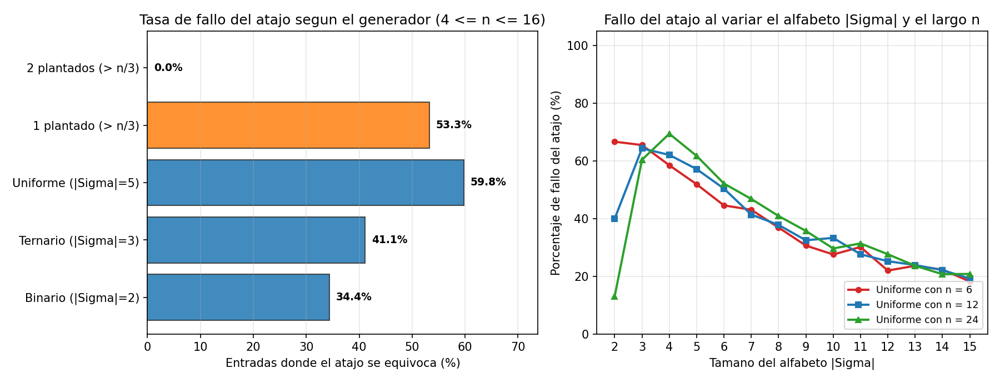

# Ejercicio 8 — Elementos con frecuencia mayor a $n/3$ (Boyer-Moore con dos candidatos)

## Planteamiento e idea de cancelación por tríos

Dado un arreglo $A[1..n]$ de elementos sobre los que únicamente podemos hacer comparaciones de igualdad ($x == y$, sin orden total ni hashing), queremos encontrar todos los elementos cuya frecuencia absoluta supere estrictamente $n/3$. Como tres elementos con más de $n/3$ apariciones cada uno sumarían más de $n$ posiciones, **a lo sumo pueden existir 2 elementos** que cumplan la condición (pudiendo haber $0$, $1$ o $2$). Buscamos un algoritmo en tiempo $O(n)$ y espacio adicional $O(1)$.

La intuición generaliza la cancelación por pares del voto mayoritario clásico:
- Si en el arreglo encontramos **tres elementos distintos entre sí** $\{x, y, z\}$ y los eliminamos simultáneamente (los tachamos formando un trío), la longitud restante baja a $n - 3$ y cualquier elemento $m$ que aparecía $f > n/3$ veces pierde como máximo una copia, quedándose con al menos $f - 1 > n/3 - 1 = (n - 3)/3$ apariciones.
- Por lo tanto, tachar tríos de elementos distintos preserva intacta la propiedad de superar un tercio del total. Si mantenemos a lo sumo **dos candidatos vivos** $(c_1, k_1)$ y $(c_2, k_2)$ con sus respectivas cuentas de copias aún no canceladas, cada vez que llega un elemento $x$ distinto de ambos candidatos vivos formamos un trío $\{c_1, c_2, x\}$ restando $1$ a $k_1$ y a $k_2$.

---

## Algoritmo en dos pasadas

```python
def primera_pasada(A):
    c1, k1, c2, k2 = None, 0, None, 0
    for x in A:
        if k1 > 0 and x == c1:
            k1 += 1
        elif k2 > 0 and x == c2:
            k2 += 1
        elif k1 == 0:
            c1, k1 = x, 1
        elif k2 == 0:
            c2, k2 = x, 1
        else:                      # x, c1 y c2 son distintos: se cancela un trio
            k1 -= 1
            k2 -= 1
    return [c for c, k in ((c1, k1), (c2, k2)) if k > 0]


def mas_de_un_tercio(A):           # segunda pasada obligatoria de verificacion
    candidatos = primera_pasada(A)
    return [c for c in candidatos if 3 * A.count(c) > len(A)]
```

**Detalle crucial en el orden de los condicionales:** Las dos primeras ramas comprueban si $x$ coincide con algún candidato activo **antes** de verificar si algún contador vale $0$. Si pusiéramos `if k1 == 0` primero, cuando $k_1 = 0$, $k_2 > 0$ y llegara un $x == c_2$, instalaríamos a $c_2$ también en $c_1$, violando que los dos candidatos vivos sean distintos y arruinando la cancelación en el `else`.

---

## El invariante reforzado y demostración de correctitud

Si intentáramos probar por inducción directa la frase *"todo elemento que aparece más de $i/3$ veces en $A[1..i]$ es uno de los candidatos actuales"*, el paso inductivo se atascaría porque un elemento puede no superar el tercio en $A[1..i]$ y sí superarlo en $A[1..i+1]$, sin que esa hipótesis dé cota alguna sobre cuántas copias suyas había antes.

Para que la inducción funcione hay que **reforzar el invariante** describiendo exactamente la partición que hace el algoritmo sobre el prefijo procesado:

> **Invariante reforzado:** Después de procesar el prefijo $A[1..i]$ ($0 \le i \le n$):
> 1. Si $k_1 > 0$ y $k_2 > 0$, entonces $c_1 \ne c_2$.
> 2. El multiconjunto de elementos de $A[1..i]$ se puede particionar exactamente en un conjunto de $t$ **tríos de elementos distintos dos a dos**, más $k_1$ copias de $c_1$ y $k_2$ copias de $c_2$ (en particular, $3t + k_1 + k_2 = i$).

- **Inicialización ($i = 0$):** Antes del bucle, el prefijo es vacío ($i = 0$), $k_1 = k_2 = 0$ y tenemos $t = 0$ tríos.Ambas partes del invariante se cumplen trivialmente.
- **Mantenimiento (de $i$ a $i + 1$ al leer $x = A[i + 1]$):** Supongamos que el invariante vale para $A[1..i]$. Analizamos las 5 ramas excluyentes del condicional:
  1. *Rama 1 ($k_1 > 0 \land x = c_1$):* Añadimos la nueva copia de $x$ al grupo de copias de $c_1$, que pasa a tener $k_1 + 1$. Los $t$ tríos y las copias de $c_2$ no cambian, y si $k_2 > 0$ se conserva $c_1 \ne c_2$.
  2. *Rama 2 ($k_2 > 0 \land x = c_2$):* Simétrico al caso anterior aumentando $k_2$ en $1$.
  3. *Rama 3 ($k_1 = 0$ y no se dio la Rama 2):* El prefijo $A[1..i]$ se partía en $t$ tríos más $k_2$ copias de $c_2$. Al asignar $c_1 \leftarrow x, k_1 \leftarrow 1$, $A[1..i+1]$ queda partido en esos mismos $t$ tríos, $1$ copia de $c_1 = x$ y $k_2$ copias de $c_2$. Además, si $k_2 > 0$, como la Rama 2 resultó falsa sabemos que $x \ne c_2$, luego $c_1 \ne c_2$.
  4. *Rama 4 ($k_2 = 0$, con $k_1 > 0$ y $x \ne c_1$):* Simétrico a la Rama 3 instalando $c_2 \leftarrow x, k_2 \leftarrow 1$ con $c_2 \ne c_1$.
  5. *Rama 5 (`else`):* Aquí $k_1 > 0$, $k_2 > 0$, $x \ne c_1$ y $x \ne c_2$. Por la parte 1 del invariante en el paso $i$, sabemos que $c_1 \ne c_2$; por consiguiente, **los tres elementos $\{c_1, c_2, x\}$ son distintos dos a dos**. Tomamos una copia de $c_1$, una copia de $c_2$ y el nuevo elemento $x$ para formar el trío número $t + 1$, y nos quedan $k_1 - 1$ copias de $c_1$ y $k_2 - 1$ copias de $c_2$, que es exactamente lo que actualizan las asignaciones `k1 -= 1` y `k2 -= 1`.
- **Conclusión (Teorema de los candidatos):** Al terminar el bucle ($i = n$), el arreglo completo $A[1..n]$ queda particionado en $t$ tríos de elementos distintos dos a dos, más $k_1$ copias de $c_1$ y $k_2$ copias de $c_2$, con $3t + k_1 + k_2 = n$.
  Sea $m$ cualquier elemento que **no** sea un candidato con contador positivo al final. Entonces $m$ no aparece entre las $k_1$ copias de $c_1$ ni entre las $k_2$ copias de $c_2$; todas sus apariciones en $A$ están dentro de los $t$ tríos. Como cada trío tiene tres elementos distintos, $m$ puede aparecer **a lo sumo 1 vez en cada trío**, luego su frecuencia total en $A$ satisface:
  $$\text{frec}(m) \le t = \frac{n - k_1 - k_2}{3} \le \frac{n}{3}.$$
  Tomando el contrarrecíproco: **todo elemento con frecuencia estrictamente mayor que $n/3$ es obligatoriamente uno de los candidatos con contador positivo al terminar la primera pasada**. La segunda pasada cuenta las apariciones exactas de esos (a lo sumo 2) candidatos y filtra los que realmente superan $n/3$. $\blacksquare$

### Complejidad, generalización a Misra-Gries y comparación con otros enfoques

El algoritmo hace dos recorridos lineales sobre $A$, realizando $O(n)$ comparaciones de igualdad y usando $O(1)$ variables escalares. Además, cualquier algoritmo determinista necesita leer $\Omega(n)$ posiciones en el peor caso (si dejara de inspeccionar alguna celda de un arreglo donde un elemento tiene exactamente $\lfloor n/3 \rfloor$ copias, esa celda podría contener la copia adicional que lo hace superar $n/3$).

El esquema que acabamos de demostrar para $k = 3$ (dos candidatos y cancelación de tríos) es el caso particular del **algoritmo de Misra-Gries (1982)** para hallar todos los elementos con frecuencia estrictamente mayor que $n/k$: manteniendo $k - 1$ pares `(candidato, contador)` y cancelando grupos de $k$ elementos distintos dos a dos, el invariante garantiza que el prefijo se particiona en $k$-tuplas de elementos distintos más las copias vivas de los $k - 1$ candidatos.

| Enfoque para hallar elementos con frecuencia $> n/3$ | Modelo de operaciones sobre elementos | Tiempo (peor caso / esperado) | Memoria auxiliar | Ventajas y limitaciones |
|---|---|---|---|---|
| **Boyer-Moore generalizado / Misra-Gries ($k=3$, este ejercicio)** | **Solo igualdad (`==`)** | **$\Theta(n)$ peor caso** (2 pasadas) | **$O(1)$ palabras** (2 candidatos, 2 contadores) | Óptimo en tiempo y espacio; funciona sobre tipos sin orden ni hash y en flujo de datos (*streaming*) |
| **Conteo con tabla hash (`Counter`)** | Igualdad + función hash | $\Theta(n)$ esperado ($\Theta(n^2)$ peor caso con colisiones) | **$\Theta(n)$ palabras** (hasta $n$ claves distintas) | Requiere memoria lineal en el número de elementos distintos |
| **Ordenamiento y barrido por tramos** | Orden total (`<`, `<=`) | **$\Theta(n \log n)$** | $O(1)$ o $O(n)$ | Exige que los elementos sean comparables por `<` y paga el factor $\log n$ de ordenar |
| **Muestreo aleatorio (*heavy hitters* aproximado)** | Solo igualdad (`==`) | Sublineal $O(\frac{1}{\varepsilon^2}\log \frac{1}{\delta})$ | $O(1/\varepsilon)$ | Solo da respuesta aproximada con margen $\pm \varepsilon n$; para respuesta exacta la cota inferior es $\Omega(n)$ |

---

## Traza paso a paso sobre un arreglo concreto

Sigamos la ejecución sobre $A = [\texttt{A, B, C, A, A, D, B, A, C}]$ de longitud $n = 9$ (donde buscamos frecuencias $> 9/3 = 3$; aquí `A` aparece $4$ veces, mientras que `B` y `C` aparecen $2$ veces y `D` aparece $1$ vez):

| Paso $i$ | $x = A[i]$ | Candidato 1 | Candidato 2 | Qué hace la iteración | Tríos de distintos formados hasta el paso $i$ |
|:---:|:---:|:---:|:---:|---|---:|
| $0$ | — | $(-, 0)$ | $(-, 0)$ | Estado inicial | ninguno |
| $1$ | `A` | $(\texttt{A}, 1)$ | $(-, 0)$ | Instala `A` en $c_1$ libre | ninguno |
| $2$ | `B` | $(\texttt{A}, 1)$ | $(\texttt{B}, 1)$ | Instala `B` en $c_2$ libre | ninguno |
| $3$ | `C` | $(-, 0)$ | $(-, 0)$ | **Cancela trío** $\{\texttt{A, B, C}\}$ | $\{\texttt{A, B, C}\}$ |
| $4$ | `A` | $(\texttt{A}, 1)$ | $(-, 0)$ | Instala `A` en $c_1$ libre | $\{\texttt{A, B, C}\}$ |
| $5$ | `A` | $(\texttt{A}, 2)$ | $(-, 0)$ | Incrementa cuenta de $c_1$ (`A`) | $\{\texttt{A, B, C}\}$ |
| $6$ | `D` | $(\texttt{A}, 2)$ | $(\texttt{D}, 1)$ | Instala `D` en $c_2$ libre | $\{\texttt{A, B, C}\}$ |
| $7$ | `B` | $(\texttt{A}, 1)$ | $(-, 0)$ | **Cancela trío** $\{\texttt{A, D, B}\}$ | $\{\texttt{A, B, C}\},\ \{\texttt{A, D, B}\}$ |
| $8$ | `A` | $(\texttt{A}, 2)$ | $(-, 0)$ | Incrementa cuenta de $c_1$ (`A`) | $\{\texttt{A, B, C}\},\ \{\texttt{A, D, B}\}$ |
| $9$ | `C` | $(\texttt{A}, 2)$ | $(\texttt{C}, 1)$ | Instala `C` en $c_2$ libre | $\{\texttt{A, B, C}\},\ \{\texttt{A, D, B}\}$ |

Al terminar el paso $9$, las $9$ posiciones del arreglo han quedado particionadas en $t = 2$ tríos ($\{\texttt{A, B, C}\}$ y $\{\texttt{A, D, B}\}$), más $2$ copias de `A` y $1$ copia de `C` ($3\cdot 2 + 2 + 1 = 9$). Notemos que:
- El **atajo sin segunda pasada** devolvería `['A', 'C']`, metiendo a `'C'` como falso positivo porque llegó en la última posición y nadie lo canceló.
- La **segunda pasada** verifica que `A` tiene $4 > 3$ apariciones y `C` solo tiene $2 \le 3$, devolviendo únicamente `['A']`.

---

## Análisis del atajo (sin segunda pasada) y generadores de prueba

Consideremos la versión incompleta que omite la verificación final:
```python
def candidatos_sin_verificar(A):
    return [c for c, k in primera_pasada(A)]
```

El teorema demostrado garantiza una inclusión en un solo sentido: $\text{SoluciónReal}(A) \subseteq \text{Atajo}(A)$. Es decir, el atajo **jamás tiene falsos negativos**, pero falla cada vez que algún candidato sobrevive con $k > 0$ sin superar realmente $n/3$ (**falso positivo**). El contraejemplo más corto es de tamaño $3$: en `A A B`, `A` ocupa el primer lugar con contador $2$ y `B` el segundo con contador $1$; no se forma ningún trío, y el atajo devuelve `[A, B]`, pero `B` aparece $1 \le 3/3$ veces. Con $n \le 2$ el atajo siempre acierta, porque todo elemento que aparece al menos una vez supera $n/3$. Otro contraejemplo, de tamaño $4$, es `A B C D`: los tres primeros forman el trío $\{\texttt{A, B, C}\}$ y `D` queda vivo con contador $1$, pero $1 \le 4/3$.

### ¿Por qué los generadores habituales sí atrapan este atajo?
1. **Generador binario ($|\Sigma| = 2$, solo símbolos `A` y `B`):**
   A diferencia del problema de mayoría $> n/2$ (donde en un arreglo binario casi siempre hay un elemento con $> n/2$), aquí **con solo 2 símbolos es imposible formar un trío de 3 elementos distintos**. Por lo tanto, la rama `else` no se ejecuta jamás: $c_1$ cuenta todas las `A` y $c_2$ cuenta todas las `B`. En cuanto ambos símbolos aparezcan al menos una vez y uno de ellos tenga $\le n/3$ apariciones (o cuando $n$ sea múltiplo de $3$ y empaten a $n/3$, o uno tenga $< n/3$), el atajo devuelve ambos símbolos y se equivoca.
2. **Generador con 1 solo elemento plantado ($> n/3$):**
   Si plantamos un único elemento $m_1$ con $\lfloor n/3 \rfloor + 1$ copias y rellenamos las $\approx 2n/3$ posiciones restantes al azar, $m_1$ ocupará uno de los dos asientos de candidato, pero **el segundo asiento $(c_2, k_2)$ queda libre para que cualquier símbolo residual sobreviva al final con contador positivo** sin llegar a $n/3$. Por eso plantar uno solo atrapa al atajo más de la mitad de las veces.

### El generador que NO atrapa al atajo: plantar dos elementos mayoritarios
Si el generador elige **dos elementos distintos** $m_1 \ne m_2$, planta $\lfloor n/3 \rfloor + 1$ copias de cada uno y rellena el resto al azar:
- Por el teorema de correctitud, tanto $m_1$ como $m_2$ tienen que terminar con contador estrictamente positivo en la primera pasada.
- Como el algoritmo solo tiene **dos asientos de candidato** (`c1` y `c2`), ambos asientos quedan ocupados obligatoriamente por $\{m_1, m_2\}$, sin dejar hueco para ningún falso positivo.
- Por tanto, $\text{Atajo}(A) = \{m_1, m_2\} = \text{SoluciónReal}(A)$ en el **$100\%$ de las instancias** de este generador ($0\%$ de fallos).

---

## Experimentos y visualización

En [ejercicio-08.py](ejercicio-08.py) verifiqué constructivamente el invariante en $23\,971$ prefijos comprobando en cada paso que los tríos cancelados tienen 3 elementos distintos y que junto con las copias vivas reconstruyen exactamente el prefijo (además de verificar la condición de partición en tríos sobre el multiconjunto restante). Luego medí el porcentaje de fallo sobre $4\,000$ arreglos por generador:



**Observaciones sobre la gráfica:**
- **Panel izquierdo (comparación de generadores de prueba):** El generador binario ($34.4\%$ de fallo), el ternario ($41.1\%$), el uniforme de 5 símbolos ($59.8\%$) y el de 1 elemento plantado ($53.3\%$) descubren de inmediato que al atajo le falta la segunda pasada. En cambio, el generador con **2 elementos plantados tiene exactamente $0.0\%$ de fallos**, ocultando por completo el bug porque satura los dos registros de candidatos con respuestas verdaderas.
- **Panel derecho (tasa de fallo en arreglos uniformes según $|\Sigma|$ y $n$):** A medida que crece el tamaño del alfabeto $|\Sigma|$ de $2$ a $15$ (y también al crecer el largo $n$ de $6$ a $24$), la probabilidad de que algún elemento supere realmente $n/3$ por puro azar cae hacia $0$, mientras que casi siempre sobrevive al menos un candidato con contador residual $k \ge 1$ al final del recorrido. Por eso las curvas suben rápidamente hacia el $90\%$-$100\%$ de fallos.
