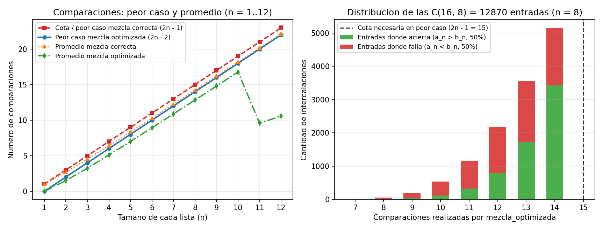

# Ejercicio 9 — Análisis de una mezcla "optimizada"

## Planteamiento y descripción del algoritmo

Supongamos que queremos mezclar dos listas ordenadas de longitud $n$, digamos $I = [a_1, a_2, \dots, a_n]$ con $a_1 \le a_2 \le \dots \le a_n$ y $D = [b_1, b_2, \dots, b_n]$ con $b_1 \le b_2 \le \dots \le b_n$, trabajando en el modelo de árbol de decisión por comparaciones.

Alguien propone una variante "optimizada" del procedimiento clásico de mezcla: en lugar de continuar comparando hasta que una de las dos listas se vacíe por completo, el bucle se detiene en cuanto a la primera lista $I$ le queda un único elemento ($a_n$), tras lo cual vuelca lo que resta de $D$ y coloca a $a_n$ al final de todo:

```python
def mezcla_optimizada(I, D):
    R, i, j = [], 0, 0
    while len(I) - i > 1 and j < len(D):
        if I[i] <= D[j]:
            R.append(I[i])
            i += 1
        else:
            R.append(D[j])
            j += 1
    if j < len(D):
        return R + D[j:] + I[i:]
    return R + I[i:]
```

Queremos determinar cuántas comparaciones realiza este algoritmo en el peor caso, decidir sin necesidad de ejecutarlo si puede ser correcto usando la cota inferior del problema de mezcla, y construir explícitamente mediante el adversario una entrada donde falle.

---

## Número de comparaciones en el peor caso

En cada iteración del bucle `while` se realiza exactamente una comparación (`I[i] <= D[j]`) y se avanza uno de los dos índices (`i` o `j`) en una unidad. La condición para entrar al bucle exige simultáneamente que en $I$ queden al menos 2 elementos (`i <= n - 2`) y que en $D$ quede al menos 1 elemento (`j <= n - 1`).

Analicemos qué ocurre en la **última comparación** antes de que el ciclo termine:

1. **El ciclo se detiene porque a $I$ le queda un solo elemento (`i` pasa de $n - 2$ a $n - 1$):**
   En este caso salieron exactamente $n - 1$ elementos de $I$ ($a_1, \dots, a_{n-1}$). Como para entrar a esa última iteración tenía que cumplirse `j < n`, antes de esa comparación habían salido a lo sumo $n - 1$ elementos de $D$, y en la última iteración el que salió fue $a_{n-1}$. Por tanto, el total de iteraciones es a lo sumo $(n - 1) + (n - 1) = 2n - 2$.
2. **El ciclo se detiene porque $D$ se vacía por completo (`j` pasa de $n - 1$ a $n$):**
   En este caso salieron los $n$ elementos de $D$. Como después de esa última iteración todavía se cumple `len(I) - i > 1`, de $I$ salieron a lo sumo $n - 2$ elementos. En total se hicieron a lo sumo $(n - 2) + n = 2n - 2$ comparaciones.

Esta cota superior se alcanza exactamente cuando la entrada satisface
$$b_1 < a_1 < b_2 < a_2 < \dots < b_{n-1} < a_{n-1} < b_n < a_n,$$
donde van saliendo alternadamente $b_1, a_1, b_2, a_2, \dots, b_{n-1}, a_{n-1}$, sumando exactamente $2(n - 1) = 2n - 2$ comparaciones antes de que a $I$ le quede solo $a_n$.

Por lo tanto, **el número de comparaciones en el peor caso es exactamente $2n - 2$**.

---

## Por qué sabemos que es incorrecto sin necesidad de probarlo

Por la cota inferior para la mezcla de dos listas ordenadas de tamaño $n$, sabemos que **cualquier** algoritmo basado en comparaciones que mezcle correctamente dos listas de largo $n$ necesita realizar al menos **$2n - 1$ comparaciones** en el peor caso (pues un adversario puede obligarlo a comparar todos los $2n - 1$ pares de elementos adyacentes de la cadena intercalada $a_1 < b_1 < a_2 < b_2 < \dots < a_n < b_n$).

Como `mezcla_optimizada` hace a lo sumo $2n - 2$ comparaciones en **todas** las entradas, nunca alcanza las $2n - 1$ comparaciones requeridas. Esto demuestra inmediatamente que el algoritmo **no puede ser correcto**: una cota inferior demostrada actúa como una barrera que ningún algoritmo correcto en ese modelo puede saltar.

---

## Construcción del contraejemplo mediante el adversario

Usemos la estrategia del adversario para encontrar la entrada donde se equivoca. El adversario mantiene como referencia la intercalación perfecta:
$$a_1 < b_1 < a_2 < b_2 < \dots < a_n < b_n.$$

Cuando ejecutamos `mezcla_optimizada` frente a estas respuestas, siempre se comparan las cabezas actuales de $I$ y $D$:
- En el paso 1 compara $(a_1, b_1)$ y gana $a_1$.
- En el paso 2 compara $(a_2, b_1)$ y gana $b_1$.
- Así sucesivamente, van saliendo $a_1, b_1, a_2, b_2, \dots, b_{n-2}, a_{n-1}$.

Los pares comparados a lo largo de toda la ejecución son únicamente:
$$(a_1, b_1),\ (b_1, a_2),\ (a_2, b_2),\ \dots,\ (b_{n-2}, a_{n-1}),\ (a_{n-1}, b_{n-1}),$$
lo que suma **$2n - 3$ comparaciones**. Justo al extraer $a_{n-1}$, a $I$ le queda un único elemento ($a_n$) y el bucle se detiene.

De los $2n - 1$ pares adyacentes de la cadena total, el algoritmo dejó **dos pares sin comparar**:
$$(b_{n-1}, a_n) \quad \text{y} \quad (a_n, b_n).$$

Si tomamos el par adyacente no comparado $(a_n, b_n)$, existen dos entradas válidas que son $100\%$ consistentes con todas las respuestas que dio el adversario:
1. **Entrada intercalada ($E_1$):** $a_1 < b_1 < \dots < b_{n-1} < a_n < b_n$ (donde el orden correcto termina en $\dots, b_{n-1}, a_n, b_n$).
2. **Entrada con el último par invertido ($E_2$):** $a_1 < b_1 < \dots < b_{n-1} < b_n < a_n$ (donde el orden correcto termina en $\dots, b_{n-1}, b_n, a_n$).

Como `mezcla_optimizada` nunca comparó $a_n$ con $b_n$, recibe exactamente la misma secuencia de respuestas en $E_1$ y en $E_2$, y en ambos casos devuelve `R + [b_{n-1}, b_n] + [a_n]`, poniendo siempre a $a_n$ al final. Por tanto, **se equivoca en $E_1$**.

### Traza paso a paso para $n = 3$

Tomemos el caso concreto $n = 3$ con la entrada intercalada $I = [1, 3, 5]$ y $D = [2, 4, 6]$, cuya cadena ordenada es $a_1=1 < b_1=2 < a_2=3 < b_2=4 < a_3=5 < b_3=6$:

| Iteración | Índices `(i, j)` | Comparación realizada | Resultado y elemento extraído | Salida parcial `R` | Resto de `I` | Resto de `D` |
|:---:|:---:|:---:|---|:---:|:---:|:---:|
| Inicio | `(0, 0)` | — | Condición: `len(I) - 0 = 3 > 1` y `0 < 3` | `[]` | `[1, 3, 5]` | `[2, 4, 6]` |
| 1 | `(0, 0)` | $a_1 \le b_1 \ (1 \le 2)$ | Verdadero $\to$ sale $1$ de $I$, `i = 1` | `[1]` | `[3, 5]` | `[2, 4, 6]` |
| 2 | `(1, 0)` | $a_2 \le b_1 \ (3 \le 2)$ | Falso $\to$ sale $2$ de $D$, `j = 1` | `[1, 2]` | `[3, 5]` | `[4, 6]` |
| 3 | `(1, 1)` | $a_2 \le b_2 \ (3 \le 4)$ | Verdadero $\to$ sale $3$ de $I$, `i = 2` | `[1, 2, 3]` | `[5]` | `[4, 6]` |
| Fin | `(2, 1)` | — | Falla `len(I) - i > 1` (queda solo `[5]` en `I`) | `[1, 2, 3] + [4, 6] + [5]` | — | — |

- **Pares de la cadena comparados (3 de 5):** $(a_1, b_1) = (1, 2)$, $(b_1, a_2) = (2, 3)$ y $(a_2, b_2) = (3, 4)$.
- **Pares adyacentes que quedaron sin comparar (2 de 5):** $(b_2, a_3) = (4, 5)$ y $(a_3, b_3) = (5, 6)$.
- **Salida devuelta por `mezcla_optimizada`:** `[1, 2, 3, 4, 6, 5]` (incorrecta, porque $5$ y $6$ quedan invertidos).

### Caracterización exacta de las entradas donde falla

Podemos caracterizar de forma cerrada todas las entradas donde el algoritmo se equivoca (suponiendo elementos distintos para fijar ideas):
- Si $a_n > b_n$, entonces $a_n$ es el máximo global de las dos listas. Además, como todos los elementos de $D$ son menores que $a_n$, si el bucle para porque a $I$ le queda solo $a_n$, colocar el resto de $D$ antes que $a_n$ es completamente válido; y si el bucle para porque $D$ se vació, también coloca el sufijo restante de $I$ en orden.
- Si $a_n < b_n$, como $a_{n-1} < a_n < b_n$, el elemento $b_n$ nunca puede salir de $D$ antes de que salga $a_{n-1}$ de $I$. Por lo tanto, el bucle **siempre** se detiene por la condición `len(I) - i == 1` cuando $b_n$ todavía sigue dentro de $D$, y al concatenar `D[j:] + [a_n]` coloca a $b_n$ antes que $a_n$, produciendo una salida desordenada.

En conclusión: **`mezcla_optimizada` falla si y solo si $a_n < b_n$**. Por simetría entre las dos listas, entre las $\binom{2n}{n}$ intercalaciones posibles con elementos distintos, el máximo global está en $D$ exactamente en la mitad de los casos, así que el algoritmo **falla en el $50\%$ de todas las entradas**.

### Clasificación de complejidad y comparación con variantes del problema de mezcla

Mezclar dos listas ordenadas es un problema en **P** de complejidad lineal $\Theta(n + m)$, pero cuya complejidad exacta de comparaciones cambia de manera muy interesante según la relación entre los tamaños $m$ y $n$ de las dos listas:

| Variante del problema de mezcla | Tamaños de las listas | Peor caso del algoritmo | Cota inferior exacta (comparaciones) | Observación teórica |
|---|---|---|---|---|
| **Mezcla lineal estándar (`merge`)** | $n$ y $n$ | **$2n - 1$** | **$2n - 1$** (adversario sobre cadena intercalada) | **Exactamente óptimo** para dos listas del mismo largo |
| **`mezcla_optimizada` (este ejercicio)** | $n$ y $n$ | $2n - 2$ | $2n - 1$ | Viola la cota inferior por 1 comparación y por eso **es incorrecto** ($50\%$ de fallos) |
| **Mezcla de 1 elemento contra $n$ (inserción binaria)** | $1$ y $n$ | **$\lceil \log_2(n+1) \rceil$** | **$\lceil \log_2(n+1) \rceil$** (teoría de la información) | Cuando una lista es muy corta, comparar linealmente en $O(n)$ deja de ser óptimo |
| **Mezcla de dos listas muy desiguales (Algoritmo de Hwang-Lin, 1972)** | $m \ll n$ | **$\Theta\!\left(m \log_2 \frac{n}{m}\right)$** | $\lceil \log_2 \binom{n+m}{m} \rceil = \Theta\!\left(m \log_2 \frac{n}{m}\right)$ | Combina saltos de tamaño $2^k$ con búsqueda binaria; cuando $m = n$ se reduce a la mezcla lineal de $2n - 1$ comparaciones |

---

## Verificación experimental y gráficas

En [ejercicio-09.py](ejercicio-09.py) implementé tanto `mezcla_optimizada` como la mezcla estándar correcta, verificando exhaustivamente todas las $\binom{2n}{n}$ intercalaciones para $n \in \{1, \dots, 10\}$:

```text
  n  entradas  peor_opt  prom_opt  peor_est   fallos  equiv_an<bn
  1         2         0      0.00         1    50.0%           si
  2         6         2      1.50         3    50.0%           si
  3        20         4      3.25         5    50.0%           si
  5       252         8      7.00         9    50.0%           si
  8     12870        14     12.83        15    50.0%           si
 10    184756        18     16.77        19    50.0%           si
```

En todos los tamaños se confirma que el peor caso de la versión "optimizada" es $2n - 2$ (una comparación por debajo de la cota $2n - 1$), que falla exactamente en el $50\%$ de las entradas, y que la condición $a_n < b_n$ caracteriza sin excepción los fallos.



**Observaciones sobre la gráfica:**
- **Panel izquierdo (peor caso y promedio para $n \in [1, 12]$):** La curva azul ($2n - 2$) corre paralela y siempre una unidad por debajo de la cota necesaria del peor caso ($2n - 1$, curva roja). Incluso en promedio (curvas verde y naranja), el "ahorro" de detenerse un paso antes en $I$ es de apenas una fracción de comparación, a cambio de romper la correctitud en la mitad de las entradas.
- **Panel derecho (distribución sobre las $\binom{16}{8} = 12\,870$ intercalaciones para $n = 8$):** Ninguna entrada alcanza la línea vertical de $2n - 1 = 15$ comparaciones. Además, se aprecia una asimetría muy clara: cuando el algoritmo hace pocas comparaciones (por ejemplo $7$ u $8$, porque $D$ se vacía muy rápido al ser todos sus elementos pequeños), acierta siempre (barras verdes, $a_n > b_n$); en cambio, todas las entradas donde $a_n < b_n$ (barras rojas) terminan deteniéndose prematuramente por agotarse $I$ hasta $a_n$, concentrando los fallos en la parte derecha del histograma (entre $7$ y $14$ comparaciones).
