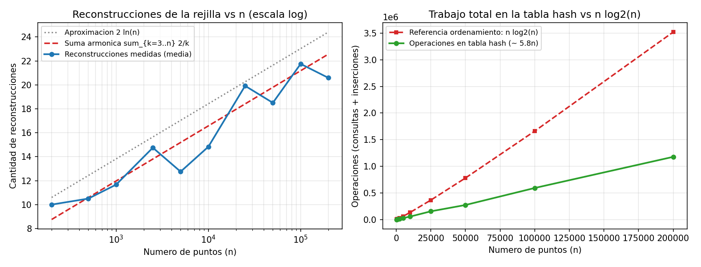

# Ejercicio 10 — Par más cercano en una dimensión

## Definición del problema y algoritmo por ordenamiento

Dado un arreglo de $n \ge 2$ números reales $x_1, x_2, \dots, x_n$ (donde puede haber valores repetidos), el problema del **par más cercano en una dimensión** consiste en calcular la menor distancia entre dos elementos de posiciones distintas:
$$\delta^* = \min_{1 \le i < j \le n} |x_i - x_j|.$$
Si existen dos elementos repetidos ($x_i = x_j$ con $i \ne j$), la respuesta es $\delta^* = 0$.

El algoritmo determinista clásico consiste en ordenar primero los números de menor a mayor, $y_1 \le y_2 \le \dots \le y_n$, y luego recorrer los pares adyacentes tomando $\min_{1 \le k < n} (y_{k+1} - y_k)$. Como en una lista ordenada el par más cercano siempre está formado por dos elementos consecutivos, el algoritmo es correcto y toma tiempo $O(n \log n)$ usando únicamente comparaciones y restas (polinomios de grado 1).

---

## Cota inferior $\Omega(n \log n)$ en árboles de decisión algebraicos

En el modelo de **árboles de decisión algebraicos**, cada nodo interno evalúa el signo ($< 0$, $= 0$, o $> 0$) de un polinomio de grado acotado en las variables de entrada $x_1, \dots, x_n$ y ramifica en tres hijos; el costo en el peor caso es la profundidad del árbol.

Por el teorema de Ben-Or (1983), sabemos que el problema de **distinción de elementos** (decidir si entre $n$ números reales $x_1, \dots, x_n$ todos son distintos o existe algún par $i \ne j$ con $x_i = x_j$) requiere profundidad $\Omega(n \log n)$ en cualquier árbol de decisión algebraico.

### Teorema: El par más cercano en 1D requiere $\Omega(n \log n)$ en árboles de decisión algebraicos.

**Demostración.** Reducimos distinción de elementos en tiempo $O(1)$ (de hecho, con $0$ operaciones en la transformación de la entrada) al par más cercano en 1D:

1. Dada una instancia $X = (x_1, \dots, x_n)$ de distinción de elementos, la pasamos **sin modificar** como entrada al algoritmo del par más cercano en 1D. (A diferencia del caso 2D, donde había que construir los puntos $(x_i, 0) \in \mathbb{R}^2$, en 1D ambos problemas reciben exactamente la misma tupla de $n$ reales).
2. Sea $\delta^* = \min_{i \ne j} |x_i - x_j|$ la respuesta del par más cercano. En cada hoja del árbol de decisión algebraico, dicho mínimo corresponde a la distancia entre algún par concreto $(x_i, x_j)$, cuyo valor al cuadrado o diferencia $x_i - x_j$ es un polinomio de grado 1 o 2 en la entrada.
3. Añadimos debajo de cada hoja un único nodo de decisión que consulta el signo de $x_i - x_j$:
   - Si $x_i - x_j = 0$, entonces $\delta^* = 0$, lo que ocurre si y solo si existen $i \ne j$ con $x_i = x_j$ (respondemos **NO** a distinción).
   - Si $x_i - x_j \ne 0$, entonces $\delta^* > 0$, lo que ocurre si y solo si todos los elementos son distintos (respondemos **SÍ** a distinción).

Si existiera un árbol de decisión algebraico de profundidad $T(n) = o(n \log n)$ para el par más cercano en 1D, la construcción anterior produciría un árbol de decisión algebraico para distinción de elementos de profundidad $T(n) + 1 = o(n \log n)$, contradiciendo la cota de Ben-Or. Por lo tanto, $T(n) = \Omega(n \log n)$. $\blacksquare$

Esto demuestra que, dentro del modelo de árboles de decisión algebraicos, ordenar y revisar consecutivos en $\Theta(n \log n)$ es asintóticamente óptimo.

---

## Cómo romper la cota cambiando de modelo: rejilla aleatoria en 1D

Para bajar de $\Omega(n \log n)$ a tiempo esperado $O(n)$ podemos adaptar el **algoritmo incremental aleatorizado con rejilla** (visto en clase para el plano).

¿Por qué este algoritmo no contradice la cota anterior? **No es por usar aleatoriedad** (pues la cota $\Omega(n \log n)$ de distinción de elementos sigue valiendo para árboles de decisión algebraicos aleatorizados), sino porque utiliza dos operaciones que **se salen del modelo algebraico** y pertenecen al modelo Word RAM / Real RAM con piso y direccionamiento indirecto:
1. **La función piso** $c = \lfloor x / \delta \rfloor$, que es escalonada (discontinua) y no puede expresarse como un polinomio de grado acotado.
2. **Direccionamiento indirecto en tablas hash**, que permite usar el entero $c$ calculado a partir de las coordenadas para indexar la memoria en $O(1)$ esperado.

### Adaptación de la rejilla de 2D a 1D

En el plano $\mathbb{R}^2$, las celdas se elegían de lado $\delta / 2$ (o $\delta / \sqrt{2}$) para garantizar que la diagonal del cuadrado fuera menor que $\delta$ y hubiera a lo sumo un punto por celda, revisando un entorno de $5 \times 5 = 25$ celdas.

En la recta $\mathbb{R}$ todo se simplifica:
- Dividimos la recta en intervalos semiabiertos de longitud $\delta$:
  $$C_k = [k\delta,\ (k+1)\delta), \qquad \text{donde } k = \lfloor x / \delta \rfloor \in \mathbb{Z}.$$
- Dos puntos cualesquiera dentro de la misma celda $C_k$ distan estrictamente menos que $\delta$. Por lo tanto, si $\delta$ es la distancia mínima entre los puntos ya insertados, **en cada celda $C_k$ hay a lo sumo un punto**.
- Cuando llega un nuevo punto $p$ que cae en la celda $c = \lfloor p / \delta \rfloor$, cualquier punto $q$ que esté a distancia $|p - q| < \delta$ verifica $|p/\delta - q/\delta| < 1$, lo que implica que sus partes enteras difieren a lo sumo en $1$:
  $$\lfloor q / \delta \rfloor \in \{c - 1,\ c,\ c + 1\}.$$
  Así, en lugar de $25$ celdas, **basta con consultar exactamente $3$ celdas vecinas**: $c - 1$, $c$ y $c + 1$.

```python
def rejilla_1d(xs):
    pts = list(xs)
    random.shuffle(pts)
    delta = abs(pts[0] - pts[1])
    if delta == 0:
        return 0.0
    rejilla = {math.floor(pts[0] / delta): pts[0], math.floor(pts[1] / delta): pts[1]}

    for i in range(2, len(pts)):
        p, antes = pts[i], delta
        c = math.floor(p / delta)
        for d in (-1, 0, 1):
            q = rejilla.get(c + d)
            if q is not None and abs(p - q) < delta:
                delta = abs(p - q)
        if delta == 0:
            return 0.0
        if delta < antes:
            rejilla = {math.floor(x / delta): x for x in pts[:i + 1]}
        else:
            rejilla[c] = p
    return delta
```

### Traza paso a paso sobre 7 puntos

Tomemos la secuencia de $7$ puntos `[10.0, 2.0, 7.5, 4.0, 3.2, 9.1, 3.5]` en ese orden de inserción para seguir cómo evoluciona $\delta$, qué tres celdas se consultan en cada paso y cuándo se reconstruye el diccionario:

| Paso | Punto $p$ | $\delta$ previo | Celdas consultadas $(c-1, c, c+1)$ | Vecinos hallados | ¿Mejora $\delta$? / Acción | Nuevo $\delta$ | Estado de la rejilla `{celda: punto}` |
|:---:|:---:|:---:|:---:|:---:|---|:---:|---|
| 1–2 | `10.0, 2.0` | — | — | — | Inicialización con los dos primeros puntos | `8.0` | `{1: 10.0, 0: 2.0}` |
| 3 | `7.5` | `8.0` | `(-1, 0, 1)` | `2.0` (en `0`), `10.0` (en `1`) | Sí: $|7.5 - 10.0| = 2.5 < 8.0$ $\to$ **Reconstruye** | `2.5` | `{4: 10.0, 0: 2.0, 3: 7.5}` |
| 4 | `4.0` | `2.5` | `(0, 1, 2)` | `2.0` (en `0`) | Sí: $|4.0 - 2.0| = 2.0 < 2.5$ $\to$ **Reconstruye** | `2.0` | `{5: 10.0, 1: 2.0, 3: 7.5, 2: 4.0}` |
| 5 | `3.2` | `2.0` | `(0, 1, 2)` | `2.0` (en `1`), `4.0` (en `2`) | Sí: $|3.2 - 4.0| = 0.8 < 2.0$ $\to$ **Reconstruye** | `0.8` | `{12: 10.0, 2: 2.0, 9: 7.5, 5: 4.0, 4: 3.2}` |
| 6 | `9.1` | `0.8` | `(10, 11, 12)` | `10.0` (en `12`) | No ($|9.1 - 10.0| = 0.9 \ge 0.8$) $\to$ **Inserta en `11`** | `0.8` | `{..., 11: 9.1}` |
| 7 | `3.5` | `0.8` | `(3, 4, 5)` | `3.2` (en `4`), `4.0` (en `5`) | Sí: $|3.5 - 3.2| = 0.3 < 0.8$ $\to$ **Reconstruye** | `0.3` | `{33: 10.0, 6: 2.0, 25: 7.5, 13: 4.0, 10: 3.2, 30: 9.1, 11: 3.5}` |

---

## Invariante de correctitud y costo esperado $O(n)$

### Invariante y correctitud
Al finalizar la iteración $k$ (habiendo procesado el prefijo $S_k = \{p_1, \dots, p_k\}$ con $k \ge 2$):
- **(I1)** $\delta = \min_{1 \le u < v \le k} |p_u - p_v| > 0$ (si fuera $0$, el algoritmo ya habría terminado devolviendo $0$).
- **(I2)** Cada celda $\lfloor x / \delta \rfloor$ contiene a lo sumo un punto de $S_k$, y `rejilla` almacena exactamente los $k$ puntos de $S_k$ indexados por su celda para el valor actual de $\delta$.

- **Inicialización ($k = 2$):** $\delta = |p_1 - p_2|$. Si $\delta = 0$ devuelve $0$ correctamente; si $\delta > 0$, como $|p_1 - p_2| = \delta$, sus cocientes $p_1/\delta$ y $p_2/\delta$ distan exactamente $1$, así que sus partes enteras son distintas y quedan en dos celdas diferentes.
- **Mantenimiento (paso $k$ a $k+1$):** Al llegar $p_{k+1}$, el nuevo mínimo es $\delta' = \min(\delta, \min_{j \le k} |p_{k+1} - p_j|)$. Si existe algún $p_j \in S_k$ con $|p_{k+1} - p_j| < \delta$, por la propiedad de la parte entera necesariamente $\lfloor p_j / \delta \rfloor \in \{c-1, c, c+1\}$ donde $c = \lfloor p_{k+1}/\delta \rfloor$. Como por (I2) cada celda tiene a lo sumo un punto de $S_k$, al revisar esas tres celdas encontramos todos los candidatos a menos de $\delta$ y calculamos exactamente $\delta'$. Si $\delta' < \delta$, reconstruimos el diccionario con paso $\delta'$, restableciendo (I2); si $\delta' = \delta$, entonces $p_{k+1}$ dista al menos $\delta$ de todo punto en $S_k$, su celda $c$ estaba vacía y la inserción simple `rejilla[c] = p_{k+1}` preserva (I2).
- **Conclusión:** Al terminar el bucle con $k = n$, $\delta$ es la distancia mínima de todo el conjunto.

### Análisis hacia atrás del tiempo esperado
Fijemos el subconjunto $S_k = \{p_1, \dots, p_k\}$ de los primeros $k$ puntos de la permutación aleatoria. Como todos los órdenes de $S_k$ son equiprobables, cualquiera de los $k$ elementos de $S_k$ tiene probabilidad $1/k$ de haber sido el último en insertarse ($p_k$).

En el paso $k$ hay que reconstruir la rejilla si y solo si $\delta(S_k) < \delta(S_{k-1})$, es decir, si al quitar $p_k$ la distancia mínima de $S_k$ aumenta estrictamente.Si $(a, b)$ es un par que realiza la distancia mínima en $S_k$, para que al quitar $p_k$ esa distancia mínima desaparezca es necesario que $p_k \in \{a, b\}$ (y si hubiera varios pares empatados a la distancia mínima, $p_k$ tendría que pertenecer a la intersección de todos ellos, que tiene a lo sumo 2 puntos). Por tanto:
$$\Pr[\text{reconstruir en el paso } k] \le \frac{2}{k}.$$

Por linealidad de la esperanza, el número esperado de reconstrucciones a lo largo de toda la ejecución es:
$$\mathbb{E}[\text{reconstrucciones}] \le \sum_{k=3}^{n} \frac{2}{k} = 2(H_n - 1{,}5) \le 2 \ln n.$$

Como el paso $k$ hace $3$ consultas a la tabla hash más $1$ inserción si no reconstruye (costo $O(1)$), o bien $k$ inserciones si reconstruye (costo $O(k)$), el número total esperado de operaciones en la tabla hash es:
$$\mathbb{E}[T(n)] \le 2 + \sum_{k=3}^{n} \left(4 + \frac{2}{k} \cdot k\right) = 2 + \sum_{k=3}^{n} 6 = 6n - 10 = \Theta(n).$$

### Clasificación de complejidad y comparación según el modelo y la dimensión $d$

Este ejercicio muestra cómo un mismo problema geométrico cambia de complejidad según el **modelo de cómputo** y según la **dimensión $d$ del espacio** ($\mathbb{R}^1, \mathbb{R}^2$ o $\mathbb{R}^d$):

| Problema y dimensión | Árbol de decisión algebraico (cota $\Omega$ y algoritmo óptimo) | Real RAM + función piso $\lfloor \cdot \rfloor$ + hashing (tiempo esperado) | Lado de celda y celdas vecinas a revisar | Qué pasa al subir la dimensión |
|---|---|---|---|---|
| **Distinción de elementos en $\mathbb{R}$** | **$\Theta(n \log n)$** (Teorema de Ben-Or, 1983) | **$O(n)$ esperado** (insertar en tabla hash) | $1$ celda por elemento | En el modelo algebraico es el problema base de las reducciones $\Omega(n \log n)$ |
| **Par más cercano en 1D ($\mathbb{R}^1$, este ejercicio)** | **$\Theta(n \log n)$** (ordenar y restar vecinos) | **$O(n)$ esperado** (rejilla 1D de paso $\delta$) | Lado $\delta$; **$3$ celdas vecinas** ($c-1, c, c+1$) | Reducción con $0$ operaciones desde distinción de elementos |
| **Par más cercano en 2D ($\mathbb{R}^2$)** | **$\Theta(n \log n)$** (divide y vencerás con franja) | **$O(n)$ esperado** (rejilla 2D de Rabin) | Lado $\delta/2$; **$5 \times 5 = 25$ celdas** (o $9$ con lado $\delta/\sqrt{2}$) | En 2D ya no existe un orden total, pero la constante geométrica sigue siendo pequeña |
| **Par más cercano en dimensión $d$ ($\mathbb{R}^d$)** | $O(n \log n)$ con constante $2^{O(d)}$ | $O(d \cdot 3^d \cdot n)$ esperado con lado $\delta/\sqrt{d}$ | Hasta **$(2\lceil\sqrt{d}\rceil+1)^d$ celdas** | **Maldición de la dimensionalidad:** para $d = \Theta(n)$ la constante exponencial en $d$ domina y se recurre a *Locality-Sensitive Hashing* (aproximado) |

---

## Experimentos y visualización

En [ejercicio-10.py](ejercicio-10.py) se verifica primero el algoritmo contra `por_ordenamiento` en $3\,000$ instancias aleatorias (incluyendo arreglos con repetidos) sin ningún fallo, y luego se mide el número medio de reconstrucciones y de operaciones en la tabla hash hasta $n = 200\,000$:

```text
        n  reconstrucciones (media)   sum_{k=3}^n 2/k     2 ln n   ops_hash / n
      200                     10.00              8.76      10.60           6.41
    1,000                     11.67             11.97      13.82           6.08
   10,000                     14.83             16.58      18.42           5.53
   50,000                     18.50             19.79      21.64           5.46
  200,000                     20.58             22.57      24.41           5.89
```



**Observaciones sobre la gráfica:**
- **Panel izquierdo (reconstrucciones vs. $n$ en escala logarítmica):** La cantidad media de reconstrucciones (curva azul) crece de forma logarítmica (se ve como una recta porque el eje horizontal está en escala logarítmica) y sigue de cerca la suma armónica teórica $\sum_{k=3}^n \frac{2}{k}$ (curva roja discontinua) y la cota $2 \ln n$ (línea punteada). Incluso con $200\,000$ puntos, la rejilla se reconstruye apenas unas $21$ veces.
- **Panel derecho (operaciones totales en la tabla hash vs. $n \log_2 n$):** Tal como predice la cota teórica ($4$ operaciones base por paso más $\frac{2}{k} \cdot k = 2$ operaciones amortizadas por reconstrucción, dando $\le 6n$), el trabajo total medido en la tabla hash es una recta de pendiente $\approx 5{,}8n$ (curva verde), muy por debajo del crecimiento superlineal $n \log_2 n$ del ordenamiento (curva roja).
