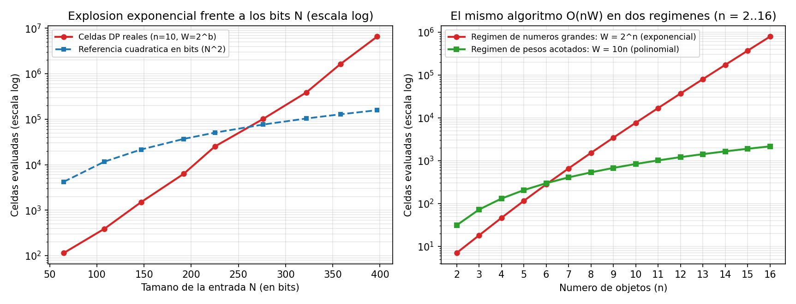

# Ejercicio 11 — ¿Es polinomial la mochila 0/1 en $O(nW)$?

## El problema de la mochila entera y su solución por programación dinámica

En el problema de la **mochila 0/1** recibimos como entrada $n$ objetos, cada uno con un peso entero positivo $w_i \in \mathbb{Z}^+$ y un valor entero positivo $v_i \in \mathbb{Z}^+$ ($i = 1, \dots, n$), además de una capacidad máxima $W \in \mathbb{Z}^+$. Buscamos un subconjunto de objetos $S \subseteq \{1, \dots, n\}$ tal que $\sum_{i \in S} w_i \le W$ y la suma de valores $\sum_{i \in S} v_i$ sea máxima.

La solución clásica por programación dinámica mantiene un arreglo `mejor[0..W]`, donde `mejor[c]` almacena el mayor valor alcanzable usando una capacidad a lo sumo $c$:

```python
def mochila(pesos, valores, W):
    mejor = [0] * (W + 1)
    for w, v in zip(pesos, valores):
        for c in range(W, w - 1, -1):
            mejor[c] = max(mejor[c], mejor[c - w] + v)
    return mejor[W]
```

Si todos los objetos tienen peso $w_i \le W$ (por ejemplo $w_i \le W/2$), el ciclo interno realiza $W - w_i + 1 = \Theta(W)$ iteraciones por cada uno de los $n$ objetos, dando un total de $\Theta(nW)$ operaciones y $\Theta(W)$ espacio en memoria.

---

## Tamaño real de la entrada en bits y por qué $O(nW)$ NO es polinomial

En teoría de la complejidad, un algoritmo es **polinomial** si su tiempo de ejecución está acotado por un polinomio $P(N)$ en la **longitud en bits de la representación de la entrada**, denotada por $N$.

Cuando escribimos los enteros de la entrada en binario (la codificación estándar), cada entero positivo $x$ ocupa $\lfloor \log_2 x \rfloor + 1 = \Theta(\log x)$ bits. Por tanto, el tamaño en bits de una instancia de la mochila es:
$$N = \sum_{i=1}^{n} \Big(\lceil \log_2(w_i + 1) \rceil + \lceil \log_2(v_i + 1) \rceil\Big) + \lceil \log_2(W + 1) \rceil = \Theta\!\left(\sum_{i=1}^{n} (\log w_i + \log v_i) + \log W\right).$$

En particular, la capacidad $W$ aporta únicamente $b = \lfloor \log_2 W \rfloor + 1$ bits al tamaño de la entrada, pero el valor numérico de $W$ está entre $2^{b-1}$ y $2^b - 1$.

### Demostración de que el algoritmo no es polinomial en $N$

Consideremos la familia de instancias en la que fijamos el número de objetos (o incluso tomamos cualquier $n \ge 1$) y elegimos $W = 2^b$, con pesos $w_i \in [2^{b-2}, 2^{b-1}]$ y valores $v_i \le 2^b$.
- El tamaño de la entrada en bits es $N = \Theta(n \cdot b)$.
- En cambio, el número de celdas que actualiza el algoritmo de programación dinámica es:
  $$T(n, W) = \sum_{i=1}^{n} (W - w_i + 1) \ge n \cdot \frac{W}{2} = \frac{n}{2} \cdot 2^b = \Theta\!\left(n \cdot 2^{\Theta(N/n)}\right).$$

Si mantenemos $n$ fijo (o si $b = \Theta(n)$), el tiempo de ejecución crece como **$2^{\Omega(N)}$**, que supera a cualquier polinomio $N^k$ cuando $b \to \infty$.

Por lo tanto, el algoritmo de programación dinámica en $O(nW)$ **no es polinomial**, sino **pseudopolinomial**: su costo es un polinomio en el **valor numérico** de los datos de entrada ($n$ y $W$), pero es **exponencial en la cantidad de bits** necesaria para escribir $W$.

*(Observación sobre el costo de las sumas: si además los valores $v_i$ tienen muchos bits, sumar `mejor[c - w] + v` no cuesta $O(1)$ operaciones elementales de bits sino $O(\log(\sum v_i)) \le O(N)$ bits, lo cual solo añade un factor polinomial extra a algo que ya es exponencial).*

---

## Ejemplo pequeño a mano: qué pasa al escalar los pesos por $2^k$

Para ver de manera concreta por qué el ancho de la tabla se dispara mientras los bits de la entrada apenas crecen, tomemos una instancia mínima de $n = 3$ objetos:
- **Instancia base ($k = 0$):** pesos $w = [2, 3, 4]$, valores $v = [3, 4, 5]$ y capacidad $W = 5$.
  - La tabla tiene columnas $c = 0, 1, 2, 3, 4, 5$:
    - Tras el objeto 1 ($w_1=2, v_1=3$): `mejor = [0, 0, 3, 3, 3, 3]` (evaluó $4$ celdas: $c=5,4,3,2$).
    - Tras el objeto 2 ($w_2=3, v_2=4$): `mejor = [0, 0, 3, 4, 4, 7]` (evaluó $3$ celdas: $c=5,4,3$).
    - Tras el objeto 3 ($w_3=4, v_3=5$): `mejor = [0, 0, 3, 4, 5, 7]` (evaluó $2$ celdas: $c=5,4$).
  - En total evaluó $4 + 3 + 2 = 9$ celdas y obtuvo el óptimo $7$ (objetos 1 y 2).

Ahora multipliquemos todos los pesos y la capacidad $W$ por $2^k$ (lo cual en binario equivale simplemente a **añadir $k$ ceros a la derecha** de cada peso y de $W$, sumando apenas $4k$ bits a toda la entrada):

| Factor $2^k$ | Pesos $[w_1, w_2, w_3]$ | Capacidad $W$ | Bits totales de entrada ($N$) | Celdas evaluadas por el DP | Valor óptimo |
|:---:|:---:|:---:|:---:|:---:|:---:|
| $2^0 = 1$ | $[2, 3, 4]$ | $5$ | $18$ bits | $9$ | $7$ |
| $2^3 = 8$ | $[16, 24, 32]$ | $40$ | $30$ bits ($+12$) | $51$ | $7$ |
| $2^6 = 64$ | $[128, 192, 256]$ | $320$ | $42$ bits ($+12$) | $387$ | $7$ |
| $2^9 = 512$ | $[1024, 1536, 2048]$ | $2\,560$ | $54$ bits ($+12$) | $3\,075$ | $7$ |
| $2^{12} = 4096$ | $[8192, 12288, 16384]$ | $20\,480$ | $66$ bits ($+12$) | $24\,579$ | $7$ |

El problema es combinatoriamente idéntico (el óptimo sigue siendo $7$), y cada fila añade solo $12$ bits a la entrada ($3$ bits en cada uno de los tres pesos y $3$ bits en $W$), pero el número de celdas recorridas por el ciclo interno **se multiplica por $8$ en cada escalón**.

---

## Paralelismo y diferencias con la prueba de primalidad por división

El fenómeno es exactamente el mismo que ocurre al probar si un entero $m$ es primo dividiendo por todos los enteros hasta $\sqrt{m}$:

| Aspecto | Primalidad por división de tentativa | Mochila 0/1 por programación dinámica |
|---|---|---|
| **Costo en función del valor numérico** | $\Theta(\sqrt{m})$ divisiones | $\Theta(nW)$ operaciones |
| **Tamaño de la entrada en bits** | $b = \lfloor \log_2 m \rfloor + 1$ bits | $N = \Theta(\sum (\log w_i + \log v_i) + \log W)$ bits |
| **Costo expresado en función de los bits** | $\Theta(2^{b/2})$ (exponencial en $b$) | $\Theta(n \cdot 2^b)$ donde $b = \log_2 W$ (exponencial en $b$) |
| **Por qué engaña a primera vista** | $\sqrt{m}$ parece sublineal porque se mira el valor $m$ en vez de sus dígitos $b$ | $nW$ parece cuadrático/bilineal porque se mira el valor $W$ en vez de sus bits $\log_2 W$ |

En ambos algoritmos, un bucle contador avanza de $1$ en $1$ hasta alcanzar la magnitud de un número que vino codificado en binario en la entrada ($\sqrt{m}$ o $W$). Como en binario sumar $1$ bit duplica el valor numérico posible, cualquier bucle que cuente de $1$ en $1$ hasta un valor de entrada tarda tiempo exponencial respecto a la longitud en bits de ese número.

**Diferencia fundamental entre los dos problemas:**
- Para **primalidad**, sí existen algoritmos verdaderamente polinomiales en el número de bits $b = \log_2 m$, como el test aleatorizado de Miller-Rabin en $\tilde{O}(b^3)$ o el algoritmo determinista AKS (Agrawal-Kayal-Saxena), por lo que Primalidad $\in \text{P}$.
- Para la **mochila 0/1**, en cambio, el problema de decisión es **NP-completo** (y el de optimización es **NP-difícil**). Por tanto, no se conoce ningún algoritmo que sea polinomial en $N$ (y no existirá a menos que $\text{P} = \text{NP}$). Sin embargo, el algoritmo pseudopolinomial en $O(nW)$ es muy útil en la práctica siempre que la capacidad $W$ sea moderada (por ejemplo, cuando $W = O(\text{poly}(n))$).

### Clasificación fina dentro de NP: débilmente NP-completo vs. fuertemente NP-completo

La existencia del algoritmo $O(nW)$ sitúa a la Mochila 0/1 dentro de los problemas **débilmente NP-completos**:

| Problema | ¿En qué clase está? | ¿Tiene algoritmo pseudopolinomial? | ¿Qué pasa si los números se codifican en unario? | ¿Admite esquema de aproximación FPTAS en $\text{poly}(n, 1/\varepsilon)$? |
|---|---|---|---|---|
| **Primalidad de un entero $m$** | **P** (polinomial en $\log m$) | Trivialmente sí ($O(\sqrt{m})$ por división) | En P | Exacto en tiempo polinomial (AKS / Miller-Rabin) |
| **Mochila 0/1 (este ejercicio) y Subset Sum** | **Débilmente NP-completo** | **Sí:** $O(nW)$ o $O(n \sum v_i)$ por programación dinámica | **Pasa a estar en P** (porque el tamaño en unario ya es $\Theta(W)$) | **Sí (FPTAS en $O(n^3/\varepsilon)$):** truncando los bits menos significativos de los valores $v_i$ |
| **Mochila fraccionaria (objetos divisibles)** | **P** ($\Theta(n \log n)$ o $\Theta(n)$ con mediana) | — | En P | Exacto mediante algoritmo goloso por densidad $v_i/w_i$ |
| **3-Partition / Bin Packing / Viajante (TSP)** | **Fuertemente NP-completo** | **No** (salvo que $\text{P} = \text{NP}$) | **Sigue siendo NP-completo** incluso con pesos pequeños en unario | **No** puede tener FPTAS (salvo que $\text{P} = \text{NP}$) |

---

## Experimentos y gráficas

En [ejercicio-11.py](ejercicio-11.py) medí las celdas evaluadas por `mochila` para $n = 10$ objetos cuando $W = 2^b$ crece de $b = 4$ a $b = 20$:

```text
   b    W = 2^b   bits de la entrada (N)   celdas actualizadas
   4         16                       65                   115
   8        256                      147                 1,510
  12      4,096                      225                25,114
  16     65,536                      322               388,268
  20  1,048,576                      397             6,537,574
```

Si extrapolamos a $n = 100$ objetos en un procesador que evalúe $10^9$ celdas por segundo:
- Con enteros de **$32$ bits** ($W = 2^{32}$, entrada de $\approx 6\,432$ bits): hace $4{,}29 \times 10^{11}$ operaciones ($\approx 7$ minutos).
- Con enteros de **$64$ bits** ($W = 2^{64}$, entrada de $\approx 12\,864$ bits): hace $1{,}84 \times 10^{21}$ operaciones (**$\approx 58\,500$ años**).
- Con enteros de **$128$ bits** ($W = 2^{128}$, entrada de $\approx 25\,728$ bits): hace $3{,}40 \times 10^{40}$ operaciones ($\approx 10^{24}$ años).



**Observaciones sobre la gráfica:**
- **Panel izquierdo (celdas evaluadas vs. bits de entrada $N$ en escala logarítmica):** En escala semilogarítmica, el trabajo real del DP cuando $W = 2^b$ (curva roja) forma una línea recta perfecta, que es la firma característica de una función exponencial $2^{\Theta(N)}$, separándose por varios órdenes de magnitud de una cota polinomial de referencia como $N^2$ (curva azul).
- **Panel derecho (dos regímenes para el mismo algoritmo $O(nW)$):** Aquí se ve claramente el significado de *pseudopolinomial*: cuando los pesos y la capacidad crecen polinomialmente con $n$ ($W = 10n$, curva verde), el algoritmo se comporta como un polinomio suave ($\Theta(n^2)$); pero cuando los números tienen $n$ bits ($W = 2^n$, curva roja), el mismo código exacto se vuelve exponencial ($\Theta(n 2^n)$).
