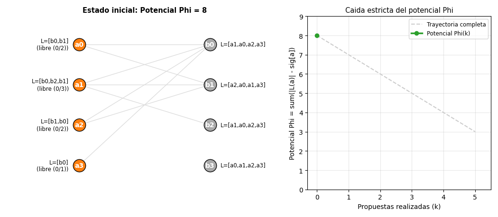
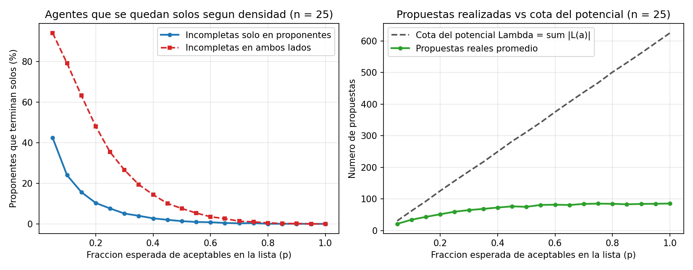

# Ejercicio 12 — Gale-Shapley con listas incompletas

## 1. De la intuición en un caso mínimo al planteamiento general

Antes de escribir definiciones formales, veamos qué cambia cuando un proponente no está dispuesto a emparejarse con cualquiera.

Imaginemos el caso más pequeño posible con $2$ proponentes ($a_0, a_1$) y $2$ receptores ($b_0, b_1$), donde:
- $a_0$ solo acepta a $b_0$: $L(a_0) = [b_0]$ (prefiere quedarse solo antes que ir con $b_1$).
- $a_1$ acepta a ambos: $L(a_1) = [b_0, b_1]$.
- $b_0$ prefiere a $a_1$ antes que a $a_0$: $L(b_0) = [a_1, a_0]$.

Si corremos la idea de Gale-Shapley aquí:
1. $a_0$ propone a $b_0$ y se comprometen temporalmente.
2. $a_1$ propone a su favorito $b_0$; como $b_0$ prefiere a $a_1$, acepta a $a_1$ y deja libre a $a_0$.
3. Ahora $a_0$ está libre, pero **su lista se acabó** ($b_1$ no está en $L(a_0)$).

De este ejemplo mínimo salen inmediatamente las tres cosas que tenemos que adaptar respecto al problema clásico de listas completas:
1. **El resultado ya no es un emparejamiento perfecto:** $a_0$ y $b_1$ se quedan solos, pero **no forman una pareja bloqueante**, porque para $a_0$ estar con $b_1$ es peor que estar solo.
2. **Qué significa "bloquear" cuando hay gente sola:** Por un lado, dos agentes nunca van a bloquear si uno no está en la lista del otro (el par debe ser mutuamente aceptable). Por otro lado, para un agente que quedó solo, cualquier candidato dentro de su lista es mejor que su situación actual ("estar solo" equivale a estar debajo del último lugar de su lista).
3. **Qué cuenta el potencial $\Phi$:** Ya no hay $n^2$ propuestas posibles, sino a lo sumo $\Lambda = \sum_a |L(a)|$ (en el ejemplo, $1 + 2 = 3$). Un proponente libre deja de actuar en cuanto agota su propia lista.

---

## 2. Formalización del problema y definición de estabilidad

Tenemos un conjunto de proponentes $A = \{a_1, \dots, a_p\}$ y un conjunto de receptores $B = \{b_1, \dots, b_r\}$ (donde $p$ y $r$ ni siquiera tienen por qué coincidir).
- Cada proponente $a \in A$ tiene una lista estrictamente ordenada $L(a) \subseteq B$ con los receptores que considera **aceptables**, de mejor a peor. Prefiere quedarse solo ($\bot$) antes que emparejarse con cualquier $b \notin L(a)$.
- De manera análoga, cada receptor $b \in B$ tiene una lista estricta $L(b) \subseteq A$ de proponentes aceptables. *(El enunciado literal, donde solo los proponentes recortan sus listas, es el caso particular en que $L(b) = A$ para todo $b \in B$; mantener $L(b)$ general nos permite cubrir a la vez el caso unilateral y el bilateral sin complicar la prueba).*

Diremos que un par $(a, b) \in A \times B$ es **aceptable** si $b \in L(a)$ y $a \in L(b)$.

- **Emparejamiento ($M$):** Es un subconjunto de pares aceptables disjuntos (cada agente aparece a lo sumo en un par de $M$). Si $x$ no pertenece a ningún par de $M$, decimos que $x$ queda **solo** y escribimos $M(x) = \bot$.
- **Pareja bloqueante (adaptada):** Un par $(a, b) \notin M$ es una pareja bloqueante de $M$ si cumple simultáneamente:
  1. **Aceptabilidad mutua:** $b \in L(a)$ y $a \in L(b)$.
  2. **Mejora para $a$:** $M(a) = \bot$ ($a$ está solo), o bien $a$ prefiere a $b$ antes que a su pareja actual $M(a)$.
  3. **Mejora para $b$:** $M(b) = \bot$ ($b$ está solo), o bien $b$ prefiere a $a$ antes que a su pareja actual $M(b)$.

Un emparejamiento $M$ es **estable** si todos sus pares son aceptables y no tiene ninguna pareja bloqueante.

---

## 3. Algoritmo adaptado y visualización paso a paso

En el algoritmo adaptado, mantenemos en la estructura `libres` únicamente a los proponentes que no tienen pareja **y todavía tienen candidatos por proponer en su lista** (`sig[a] < len(pref_a[a])`):

```python
while libres:
    a = libres.popleft()
    b = pref_a[a][sig[a]]
    sig[a] += 1
    actual = pareja_b[b]

    if a not in rango[b]:
        rechazado = a
    elif actual is None:
        pareja_b[b], rechazado = a, None
    elif rango[b][a] < rango[b][actual]:
        pareja_b[b], rechazado = a, actual
    else:
        rechazado = a

    if rechazado is not None and sig[rechazado] < len(pref_a[rechazado]):
        libres.append(rechazado)
```

*(Nota: si solo los proponentes tienen listas incompletas como dice literalmente el enunciado, todo $a$ está en `rango[b]`, por lo que la primera rama `if a not in rango[b]` nunca se activa).*

### Traza manual y animación sobre una instancia $4 \times 4$

Consideremos $4$ proponentes y $4$ receptores con las siguientes listas:
- **Proponentes (listas incompletas):**
  $L(a_0) = [b_0, b_1]$, $\quad L(a_1) = [b_0, b_2, b_1]$, $\quad L(a_2) = [b_1, b_0]$, $\quad L(a_3) = [b_0]$.
- **Receptores (listas completas):**
  $L(b_0) = [a_1, a_0, a_2, a_3]$, $\quad L(b_1) = [a_2, a_0, a_1, a_3]$, $\quad L(b_2) = [a_1, a_0, a_2, a_3]$, $\quad L(b_3) = [a_0, a_1, a_2, a_3]$.

El potencial inicial es la suma de los largos de las listas de los proponentes: $\Lambda = 2 + 3 + 2 + 1 = 8$.

| Paso | Propone | Receptor | Pareja previa de $b$ | Decisión de $b$ | Cola `libres` resultante | Potencial $\Phi$ |
|:---:|:---:|:---:|:---:|---|:---:|:---:|
| 0 | — | — | todos libres | Estado inicial | $[a_0, a_1, a_2, a_3]$ | $8$ |
| 1 | $a_0$ | $b_0$ | $\bot$ | $b_0$ está libre y acepta a $a_0$ | $[a_1, a_2, a_3]$ | $7$ |
| 2 | $a_1$ | $b_0$ | $a_0$ | $b_0$ prefiere a $a_1$ sobre $a_0$; $a_0$ vuelve a `libres` | $[a_2, a_3, a_0]$ | $6$ |
| 3 | $a_2$ | $b_1$ | $\bot$ | $b_1$ está libre y acepta a $a_2$ | $[a_3, a_0]$ | $5$ |
| 4 | $a_3$ | $b_0$ | $a_1$ | $b_0$ rechaza a $a_3$; **$a_3$ agotó su lista ($1/1$) y queda solo** | $[a_0]$ | $4$ |
| 5 | $a_0$ | $b_1$ | $a_2$ | $b_1$ rechaza a $a_0$; **$a_0$ agotó su lista ($2/2$) y queda solo** | $[\,]$ | $3$ |

Con [ejercicio-12.py](ejercicio-12.py) generé la siguiente animación paso a paso de esta misma traza, donde se ve a la izquierda el estado del grafo bipartito (en azul las parejas activas, en verde/rojo la propuesta del paso actual y en gris los agentes que agotaron su lista) y a la derecha cómo el potencial $\Phi$ baja exactamente en $1$ por cada propuesta:



---

## 4. Demostración formal de terminación, estabilidad y optimalidad

### 4.1. Potencial y terminación

Definimos el potencial $\Phi$ después de cada iteración como el número total de receptores aceptables a los que cada proponente todavía no ha propuesto:
$$\Phi = \sum_{a \in A} \big(|L(a)| - \text{sig}[a]\big).$$

1. **Inicio:** Al comenzar, $\text{sig}[a] = 0$ para todo $a \in A$, por lo que $\Phi_0 = \sum_{a \in A} |L(a)| = \Lambda$.
2. **Variación por paso:** En cada iteración del bucle `while`, el proponente extraído $a$ avanza `sig[a]` en $1$, mientras que el resto de los `sig` no cambia. Así, $\Delta \Phi = -1$.
3. **Cota inferior:** Un proponente $a$ solo puede entrar a `libres` si $\text{sig}[a] < |L(a)|$, por lo que nunca se incrementa `sig[a]` más allá de $|L(a)|$. Por tanto, cada término de la suma es $\ge 0$ y $\Phi \ge 0$ siempre.

Como $\Phi$ es un entero que empieza en $\Lambda$, baja de $1$ en $1$ y nunca es negativo, el bucle termina en **a lo sumo $\Lambda = \sum_{a \in A} |L(a)|$ iteraciones**.

### 4.2. Invariantes del ciclo

Durante toda la ejecución se mantienen tres invariantes sencillos:
- **(I1) Monotonía para los receptores:** Una vez que un receptor $b$ acepta una propuesta, nunca vuelve a quedar solo ($\bot$), y su pareja sucesiva solo puede mejorar según el orden de $L(b)$.
- **(I2) Orden de propuesta para los proponentes:** Cada proponente $a$ propone a los elementos de $L(a)$ en orden estricto desde el primero hasta `sig[a] - 1`, sin saltarse ninguno.
- **(I3) Racionalidad individual y condición de salida:** Todo par emparejado es aceptable, y cualquier proponente que no está en `libres` o bien está emparejado, o bien está solo y ha propuesto a toda su lista ($\text{sig}[a] = |L(a)|$).

### 4.3. Teorema de estabilidad

**Teorema 1.** *El emparejamiento $M$ devuelto por el algoritmo adaptado es estable, independientemente del orden en que se elijan los proponentes libres.*

**Idea intuitiva antes de la prueba:** Para que $(a, b)$ bloquee a $M$, $a$ tiene que preferir a $b$ sobre cómo terminó (ya sea que $a$ terminara peor emparejado o que terminara solo). Pero como $a$ propone en orden de preferencia y antes de rendirse y quedar solo recorre *toda* su lista, en ambos casos $a$ tuvo que haber llamado a la puerta de $b$ durante el algoritmo. Y si $a$ llamó a la puerta de $b$ y no terminaron juntos, es porque en ese momento (o después) $b$ consiguió a alguien que le gustaba más que $a$; como $b$ solo cambia para mejorar, al final $b$ tiene a alguien mejor que $a$ y jamás aceptaría bloquear con $a$.

**Demostración formal.** Supongamos por contradicción que existe una pareja bloqueante $(a, b) \notin M$. Por definición:
1. $b \in L(a)$ y $a \in L(b)$;
2. $M(a) = \bot$ o $a$ prefiere $b$ a $M(a)$;
3. $M(b) = \bot$ o $b$ prefiere $a$ a $M(b)$.

- **Afirmación 1 ($a$ le propuso a $b$):**
  - Si $M(a) = \bot$ ($a$ terminó solo), por el invariante (I3) al terminar `libres` vacía tenemos $\text{sig}[a] = |L(a)|$. Como $b \in L(a)$, $a$ le propuso a $b$.
  - Si $M(a) = b' \ne \bot$, por la condición 2 de bloqueo $a$ prefiere $b$ a $b'$, es decir, $b$ antecede a $b'$ en $L(a)$. Por (I2), antes de proponerle a $b'$, $a$ le propuso a $b$.
- **Afirmación 2 ($b$ termina con alguien que prefiere a $a$):**
  Consideremos el paso en que $a$ le propuso a $b$. Como $a \in L(b)$, $b$ no lo rechazó por inaceptable:
  - Si $b$ rechazó a $a$ en ese instante, fue porque ya estaba comprometido con un $a'$ tal que $b$ prefiere $a'$ a $a$.
  - Si $b$ aceptó a $a$ en ese instante, como al final $(a, b) \notin M$, en algún paso posterior $b$ tuvo que reemplazar a $a$ por otro proponente $a''$ al que prefiere sobre $a$.
  En ambos casos, a partir de cierto momento $b$ estuvo emparejado con alguien a quien prefiere estrictamente sobre $a$. Por el invariante (I1), al finalizar el algoritmo $b$ no está solo ($M(b) \ne \bot$) y prefiere su pareja final $M(b)$ a $a$ (o a lo sumo $M(b)$ es ese mismo candidato preferido). Esto contradice directamente la condición 3 de bloqueo. $\blacksquare$

### 4.4. Optimalidad para los proponentes y Teorema de los Hospitales Rurales

Diremos que $b$ es una **pareja válida** de $a$ si existe algún emparejamiento estable $M'$ con $(a, b) \in M'$.

**Teorema 2.** *En toda ejecución del algoritmo, ningún proponente es rechazado jamás por una pareja válida. En consecuencia, cada proponente obtiene su mejor pareja válida, o termina solo si y solo si queda solo en todos los emparejamientos estables.*

**Demostración.** Supongamos que ocurre algún rechazo de un proponente por una pareja válida y consideremos **el primer paso en el tiempo** en que esto sucede: $b$ rechaza a $a$ (al proponer o desplazándolo) por quedarse con otro proponente $a'$, existiendo un emparejamiento estable $M'$ con $(a, b) \in M'$.
- Como $(a, b) \in M'$, el par es aceptable, luego el rechazo no fue por inaceptabilidad sino porque **$b$ prefiere $a'$ a $a = M'(b)$**.
- Como $a'$ le propuso a $b$ y fue aceptado, el par $(a', b)$ también es mutuamente aceptable.
- ¿Cuál es la situación de $a'$ en el emparejamiento estable $M'$?
  - *Caso A ($a'$ está solo en $M'$):* Como $b \in L(a')$, $a'$ prefiere estar con $b$ antes que seguir solo en $M'$.
  - *Caso B ($a'$ está emparejado con $b' = M'(a')$ en $M'$):* Como el rechazo de $a$ por $b$ fue el **primero** hecho por una pareja válida en toda la ejecución, $a'$ todavía no pudo haber sido rechazado por su pareja válida $b'$. Por tanto, cuando $a'$ propuso a $b$, aún no había llegado a $b'$ en su lista $L(a')$, lo que implica que **$a'$ prefiere $b$ a $b' = M'(a')$**.

En ambos casos, $(a', b)$ cumple las tres condiciones de pareja bloqueante sobre $M'$, contradiciendo que $M'$ es estable. $\blacksquare$

> **Conexión con el Teorema de los Hospitales Rurales (McVitie-Wilson, 1970; Roth, 1986):** Del argumento anterior se desprende una propiedad estructural sorprendente que compruebo experimentalmente más abajo: **todos los emparejamientos estables de una instancia tienen exactamente el mismo número de parejas y dejan solos exactamente a los mismos proponentes y receptores**. Es decir, un hospital o residente que se queda sin plaza en Gale-Shapley también se queda sin plaza en *cualquier* otro emparejamiento estable.

---

## 5. Complejidad, cota mínima y comparación con problemas cercanos (P vs. NP-completo)

### 5.1. Complejidad temporal, espacial y cota mínima

Sea $m = \sum_{a \in A} |L(a)| + \sum_{b \in B} |L(b)|$ el tamaño total de las listas de entrada (el número de aristas dirigidas de aceptabilidad).
- **Preprocesamiento:** Para cada receptor $b$, construimos una tabla hash (o un arreglo indexado si conocemos los IDs $0 \dots p-1$) `rango[b]` que guarda la posición de cada $a \in L(b)$. Esto toma tiempo y memoria $\Theta\big(r + \sum_b |L(b)|\big)$.
- **Ciclo de propuestas:** Da a lo sumo $\Lambda = \sum_a |L(a)|$ iteraciones, y cada iteración realiza una consulta y actualización en $O(1)$.
- **Costo total:** Tiempo y espacio **$\Theta(p + r + m)$**, que es **lineal en el tamaño de la entrada**.
- **Cota mínima:** Cualquier algoritmo correcto necesita $\Omega(p + r + m)$ en el peor caso simplemente para inspeccionar las listas de preferencias (si deja sin leer una entrada al final de la lista de un proponente y de un receptor que quedaron solos, un adversario puede poner ahí al otro agente haciendo que formen una pareja bloqueante). Además, para listas de longitud $\Theta(n)$, el teorema de Ng y Hirschberg (1990) demuestra la cota inferior $\Omega(n^2)$ en el modelo de consultas a las preferencias. Por tanto, el algoritmo es **asintóticamente óptimo** y el problema pertenece a la clase **P**.

### 5.2. Comparación con variantes del problema de emparejamiento estable

Es muy instructivo comparar cómo pequeños cambios en la especificación mantienen el problema en **P** o lo disparan a **NP-completo**:

| Problema | Estructura del grafo | Preferencias | ¿Siempre existe estable? | ¿Mismo tamaño todos los estables? | Complejidad de hallar el óptimo / máximo |
|---|---|---|---|---|---|
| **Emparejamiento Estable clásico (SM)** | Bipartito ($n \times n$) | Listas completas, orden estricto | Sí (siempre perfecto, tamaño $n$) | Sí (todos tienen tamaño $n$) | **Polinomial ($\in \text{P}$)**, $\Theta(n^2)$ con Gale-Shapley |
| **Listas incompletas sin empates (SMI — este ejercicio)** | Bipartito ($p \times r$) | Listas incompletas, orden estricto | Sí (parcial, tamaño $\le \min(p,r)$) | **Sí** (Teorema de Hospitales Rurales) | **Polinomial ($\in \text{P}$)**, $\Theta(p + r + m)$ con Gale-Shapley adaptado |
| **Listas incompletas CON empates (`MAX-SMTI`)** | Bipartito ($p \times r$) | Listas incompletas **con empates** (indiferencias) | Sí (rompiendo empates arbitrariamente) | **No** (romper un empate mal puede dejar más gente sola) | **NP-difícil / NP-completo** (Manlove et al., 2002) maximizar el tamaño |
| **Compañeros de cuarto (*Stable Roommates*, SR)** | No bipartito (un solo grupo de $2n$) | Listas completas/incompletas, orden estricto | **No** (puede no existir ninguno) | Sí (cuando existen) | **Polinomial ($\in \text{P}$)**, $O(n^2)$ (algoritmo de Irving, 1985) |
| **Compañeros de cuarto con empates (`SRTI`)** | No bipartito | Con empates | No | No | **NP-completo** (Ronn, 1990) decidir si existe uno estable |

El contraste entre **SMI** (nuestro ejercicio, en **P**) y **MAX-SMTI** (**NP-completo**) es clave: mientras las listas sean estrictas, el Teorema de los Hospitales Rurales garantiza que todos los emparejamientos estables tienen el mismo cardinal, por lo que Gale-Shapley encuentra automáticamente el de tamaño máximo en tiempo lineal. En cuanto se permiten empates junto con listas incompletas, distintos desempates producen emparejamientos estables de distinto tamaño, y elegir cómo desempatar para minimizar la gente que queda sola se vuelve NP-difícil.

---

## 6. Experimentos, tiempos reales y análisis gráfico

En [ejercicio-12.py](ejercicio-12.py) implementé cuatro baterías de pruebas y mediciones:

1. **Invarianza respecto al orden de ejecución y estabilidad:** Sobre $2000$ instancias aleatorias con listas incompletas en uno y ambos lados, corrí el algoritmo usando cola FIFO, pila LIFO y selección aleatoria. En el $100\%$ de los casos las tres estrategias devolvieron exactamente el mismo emparejamiento y con $0$ parejas bloqueantes.
2. **Verificación por fuerza bruta de optimalidad y Hospitales Rurales:** En $200$ instancias de $4 \times 4$, enumeré todos los emparejamientos parciales posibles ($1 + 16 + 72 + 96 + 24 = 209$ por instancia) y filtré todos los estables, comprobando que:
   - Gale-Shapley siempre le da a cada proponente su mejor pareja válida; y
   - el conjunto de proponentes que quedan solos es idéntico en todos los emparejamientos estables de cada instancia.
3. **Escalabilidad y medición de tiempos reales por arista ($\Theta(m)$):** Midiendo el tiempo de reloj con `time.perf_counter()` al duplicar $n$ desde $50$ hasta $400$ (donde el número de aristas aceptables $m$ se multiplica por $4$ cada vez):

```text
     n    aristas m   propuestas  tiempo (ms)  ns / arista
    50         2970          264        0.665        223.8
   100        11991          651        1.346        112.2
   200        48087         1316        5.536        115.1
   400       192412         4565       23.740        123.4
```

Se ve claramente cómo el tiempo por arista de entrada (`ns / arista`) se mantiene constante alrededor de $115\text{--}123\text{ ns}$, confirmando empíricamente la complejidad lineal $\Theta(m)$.

4. **Barrido de densidad de las listas ($p \in [0.05, 1.0]$ para $n = 25$):**



**Qué nos dice la gráfica:**
- **Panel izquierdo (quiénes quedan solos):** Cuando solo los proponentes recortan sus listas (curva azul), hay una transición rápida: en cuanto cada proponente acepta al menos al $40\%$ de los receptores ($p \ge 0.4$, unos $10$ de $25$), casi nadie se queda solo. En cambio, cuando **ambos lados** tienen listas incompletas de densidad $p$ (curva roja), para que un par sea aceptable tienen que incluirse mutuamente (probabilidad $p^2$), por lo que con $p = 0.3$ la mitad de los proponentes se quedan solos.
- **Panel derecho (propuestas reales vs. cota del potencial $\Lambda$):** Para densidades muy bajas ($p \le 0.15$), la curva verde de propuestas reales va pegada a la recta punteada del potencial máximo $\Lambda = \sum |L(a)|$: casi todos los proponentes agotan su lista entera buscando pareja. A medida que las listas se alargan ($p \to 1$), el potencial máximo sube linealmente hasta $n^2 = 625$, pero el trabajo real del algoritmo se aplana cerca de $n \ln n \approx 80$ propuestas, porque los proponentes consiguen pareja en los primeros lugares de su lista sin gastar el potencial restante.
