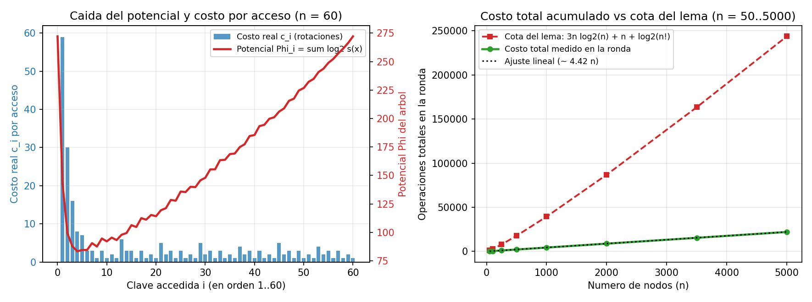

# Ejercicio 13 — Accesos secuenciales sobre un splay tree que empieza como camino

## Planteamiento del escenario

Partimos de un árbol biselado (*splay tree*) con las claves $1, 2, \dots, n$ dispuestas inicialmente formando un **camino izquierdo degenerado**: la clave $n$ está en la raíz, y para cada $k \in \{2, \dots, n\}$ el nodo $k-1$ es el hijo izquierdo de $k$. De este modo, el nodo $1$ se encuentra en el fondo a profundidad $n - 1$.

Sobre este árbol realizamos una ronda de $m = n$ accesos en orden creciente: buscamos y hacemos `splay` sucesivamente de las claves $1, 2, 3, \dots, n$. El costo real $c_i$ del $i$-ésimo acceso es el número de rotaciones realizadas por `splay(i)` (o $1$ si el nodo ya estaba en la raíz). Queremos acotar el costo total $\sum_{i=1}^n c_i$ usando el lema de acceso, compararlo con el costo real medido experimentalmente y analizar si la cota obtenida es ajustada.

---

## Cota superior mediante el lema de acceso

Para el análisis amortizado definimos para cada nodo $x$ el tamaño de su subárbol $s(x)$ y su rango $r(x) = \log_2 s(x)$, con la función de potencial global:
$$\Phi(T) = \sum_{x \in T} r(x) = \sum_{x \in T} \log_2 s(x).$$

Por el **lema de acceso**, el costo amortizado $\hat{c}_i = c_i + \Phi_i - \Phi_{i-1}$ de hacer `splay` de un nodo $x$ en un árbol cuya raíz es $t$ cumple:
$$\hat{c}_i \le 3\big(r(t) - r(x)\big) + 1 \le 3 \log_2 n + 1,$$
ya que en la raíz siempre se tiene $s(t) = n \implies r(t) = \log_2 n$, y para todo nodo $x$ se cumple $s(x) \ge 1 \implies r(x) \ge 0$.

Sumando sobre los $n$ accesos y telescopiando los potenciales:
$$\sum_{i=1}^{n} c_i = \sum_{i=1}^{n} \hat{c}_i + \Phi_0 - \Phi_n \le n(3 \log_2 n + 1) + \Phi_0 - \Phi_n.$$

Como $s(x) \ge 1$ para todo nodo en cualquier árbol, el potencial final cumple $\Phi_n \ge 0$. Por otro lado, en el camino inicial $T_0$, el subárbol colgado del nodo $k$ contiene exactamente a las claves $\{1, 2, \dots, k\}$, de modo que $s(k) = k$ y el potencial inicial vale exactamente:
$$\Phi_0 = \sum_{k=1}^{n} \log_2 k = \log_2(n!) \le n \log_2 n.$$

Sustituyendo ambos términos obtenemos la cota superior del lema de acceso para toda la ronda:
$$\sum_{i=1}^{n} c_i \le 3n \log_2 n + n + \log_2(n!) \le 4n \log_2 n + n = O(n \log n).$$

---

## Qué ocurre realmente en el primer acceso `splay(1)`

El primer acceso busca la clave $1$, que está a profundidad $n - 1$, y la sube hasta la raíz. Eso cuesta por sí solo $c_1 = n - 1$ rotaciones. ¿Cómo es posible que su costo amortizado $\hat{c}_1$ sea a lo sumo $3 \log_2 n + 1$? Porque ese trabajo queda pagado por la **caída masiva del potencial $\Phi$** que produce la serie de pasos `zig-zig`.

Veamos qué le hace `splay(1)` a la estructura del árbol (por ejemplo, para $n = 9$, donde $n - 1 = 8$ es par, así que se ejecutan $4$ pasos `zig-zig` seguidos subiendo a $1$ de dos en dos niveles):

```text
Antes de splay(1) (altura 8):        Después de splay(1) (altura 5):
            9                                    1
           /                                      \
          8                                        8
         /                                        / \
        7                                        6   9
       /                                        / \
      6                                        4   7
     /                                        / \
    5              --- 4 zig-zigs --->       2   5
   /                                          \
  4                                            3
 /
3
 \ (izq)
  ... -> 2 -> 1
```

En cada paso `zig-zig` sobre la terna $(1 \leftarrow 2k \leftarrow 2k+1)$, primero se rota la arista $(2k, 2k+1)$ y luego $(1, 2k)$. Como resultado:
1. La columna vertebral derecha bajo la nueva raíz $1$ pasa a estar formada solo por los nodos pares $8 \to 6 \to 4 \to 2$, **reduciendo la altura del árbol a casi la mitad**.
2. Los nodos impares ($3, 5, 7, 9$) quedan colgados como hojas a distancia $1$ de esa columna vertebral.
3. En consecuencia, cuando a continuación accedemos a $2, 3, 4, \dots$ en orden, cada clave sucesora ya se encuentra muy cerca de la raíz (dejada ahí por el `splay` inmediatamente anterior), por lo que casi todos los accesos restantes cuestan unas pocas rotaciones.

---

## Medición experimental y comparación con la cota

En [ejercicio-13.py](ejercicio-13.py) implementé el splay tree de forma iterativa (para no desbordar la pila de recursión en caminos de hasta $10^5$ nodos), verificando primero que la desigualdad del lema de acceso $c_i + \Phi_i - \Phi_{i-1} \le 3(\log_2 n - r(x)) + 1$ se cumple sin excepción en cada acceso individual, y midiendo luego el costo total de la ronda:

```text
      n  costo medido  por acceso  primer acceso  cota del lema  cota / medido
    100           416        4.16             99          2,618            6.3
   1000         4,374        4.37            999         39,427            9.0
  10000        44,112        4.41          9,999        527,090           11.9
 100000       441,426        4.41         99,999      6,599,596           15.0
```

**Comparación con lo que mide la sección 6 de la conferencia 4.** Allí se recorren las claves $1, \dots, n$ en orden **tres veces seguidas** desde el mismo camino inicial, y se compara splay con subir a la raíz. Corriendo ese mismo experimento con el código de la conferencia:

```text
     n   splay (por acceso)   subir a la raíz (por acceso)   log2 n
   100                 4.16                           50.5      6.6
   200                 4.20                          100.5      7.6
   400                 4.33                          200.5      8.6
   800                 4.36                          400.5      9.6
```

Las dos mediciones dicen lo mismo. Con splay el costo por acceso se queda en una constante cercana a $4{,}4$, tanto en una ronda (nuestra tabla) como en tres (la de la sección 6), y no crece con $n$ ni con $\log_2 n$. Subir a la raíz cuesta $n/2 + \tfrac12$ por acceso, $\Theta(n)$, porque después de cada acceso deja otro camino casi igual de largo. La cota del lema, $3\log_2 n + 1$ por acceso más $\Phi_0$, está por encima de las dos curvas de splay y crece con $\log n$. Eso confirma que no es ajustada para esta secuencia.

---

## ¿Es ajustada la cota?

**No, la cota no es asintóticamente ajustada para esta secuencia:** la cota del lema de acceso da $O(n \log n)$, mientras que el costo verdadero de la ronda es **$\Theta(n)$** (aproximadamente $4{,}41n$ rotaciones en total, es decir, un promedio constante de $\approx 4{,}41$ por acceso a pesar de que el primer acceso cuesta $n - 1$). En la tabla se ve cómo el cociente entre la cota y el valor real crece proporcionalmente a $\log n$ (subiendo en $\approx 3$ unidades cada vez que $n$ se multiplica por $10$).

### ¿Dónde pierde un factor $\log n$ la demostración con el lema de acceso?
Al acotar cada acceso individual por $\hat{c}_i \le 3\big(r(t) - r(x)\big) + 1 \le 3 \log_2 n + 1$, estamos suponiendo el peor escenario en cada paso: que el nodo buscado $x$ tiene un subárbol diminuto ($r(x) \approx 0$) **y al mismo tiempo** está muy profundo, gastando todo ese margen amortizado.

Sin embargo, en un recorrido secuencial $1, 2, \dots, n$:
- Justo después de hacer `splay(i)`, la clave $i$ está en la raíz y todas las claves mayores $\{i+1, \dots, n\}$ quedan en su subárbol derecho.
- La siguiente clave a buscar, $i + 1$, es el mínimo de ese subárbol derecho (el sucesor de $i$), que tras los `splay` previos queda a profundidad constante en promedio.
- Como $i + 1$ no tiene hijo izquierdo en el momento en que lo buscamos (pues todas las claves menores o iguales a $i$ quedaron a la izquierda de la raíz $i$), su subárbol puede ser pequeño ($r(i+1)$ pequeño), así que la fórmula $3(\log_2 n - r(x)) + 1$ nos permite cobrarle hasta $\approx 3 \log_2 n$ aunque en realidad estaba a profundidad $1$ o $2$ y además su `splay` apenas cambia el potencial.

Es decir, el lema de acceso con pesos uniformes $w(x) = 1$ es una garantía general válida para **cualquier** secuencia de $m$ accesos (y es ajustada para secuencias de peor caso que cuestan $\Theta(m \log n)$), pero es demasiado holgada para el recorrido en orden. El hecho de que acceder a $1, \dots, n$ en orden desde *cualquier* árbol inicial cueste $O(n)$ se conoce como el **Teorema de Acceso Secuencial** (Tarjan, 1985), cuya demostración requiere un argumento más fino que sumar $3 \log_2 n + 1$ por operación.

### Comparación del Splay Tree frente a otros árboles de búsqueda en accesos secuenciales y generales

| Estructura / Propiedad | Costo de 1 acceso en el peor caso | Costo de $m$ accesos arbitrarios | Costo de recorrer $1, \dots, n$ en orden ($m = n$) | ¿Cómo logra ese comportamiento? |
|---|---|---|---|---|
| **Árbol binario de búsqueda sin balancear (camino inicial)** | $\Theta(n)$ | $\Theta(mn)$ | **$\Theta(n^2)$** | No reestructura nunca el camino degenerado |
| **Árboles estrictamente balanceados (AVL / Rojo-Negro)** | **$\Theta(\log n)$ peor caso** | $\Theta(m \log n)$ | **$\Theta(n \log n)$** buscando desde la raíz | Mantiene altura $\Theta(\log n)$ siempre, pero no acerca a la raíz la zona recién visitada |
| **Splay Tree — Cota general del Lema de Acceso** | $\Theta(n)$ individual ($O(\log n)$ amortizado) | **$O((m + n)\log n)$** | Da la cota superior $O(n \log n)$ (**no ajustada** aquí) | Usa potencial uniforme $\Phi = \sum \log_2 s(x)$ sin aprovechar la localidad entre $i$ e $i+1$ |
| **Splay Tree — Costo real (Teorema de Acceso Secuencial y Dedo Dinámico)** | $\Theta(n)$ individual ($O(1)$ amortizado en orden) | $O\big(n + \sum_{k=1}^m \log_2(|i_k - i_{k-1}| + 1)\big)$ (Cole, 2000) | **$\Theta(n)$** ($\approx 4{,}41n$ rotaciones medidas) | Las rotaciones dobles (`zig-zig`) pliegan los caminos largos a la mitad y dejan al sucesor $i+1$ a profundidad constante |



**Observaciones sobre la gráfica:**
- **Panel izquierdo (ronda detallada para $n = 60$):** En el acceso $i = 1$, la barra azul del costo real se dispara hasta $c_1 = 59$ rotaciones, y simultáneamente la curva roja del potencial $\Phi$ cae en picado desde $\Phi_0 = \log_2(60!) \approx 272$ hasta $\approx 218$, absorbiendo el golpe. A partir de $i = 2$, los costos reales $c_i$ son barras muy bajas (entre $1$ y $9$ rotaciones) mientras el potencial oscila suavemente alrededor de $190$-$210$.
- **Panel derecho (costo acumulado vs. cota del lema para $n \in [50, 5000]$):** El costo total medido (curva verde) sigue fielmente la recta $\approx 4{,}42n$ (línea punteada), quedando muy por debajo de la curva $3n \log_2 n + n + \log_2(n!)$ (curva roja discontinua).
