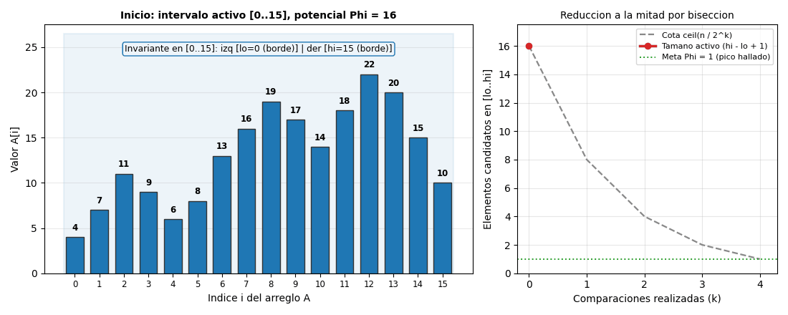
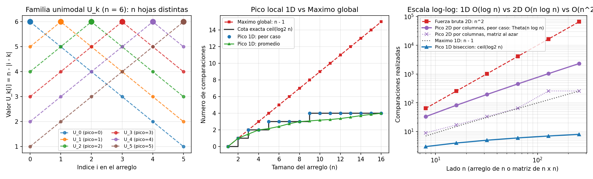

# Ejercicio 14 — Búsqueda de un pico: de la intuición en casos pequeños a la optimalidad exacta y su generalización a 2D

Para recorrer de principio a fin las cinco etapas del diseño y análisis de algoritmos (problema y modelo, diseño algorítmico, correctitud por invariante y potencial, análisis de complejidad y cota inferior que coincida), estudiamos el problema de **hallar un pico (máximo local) en un arreglo**, mostrando primero cómo nace la idea en casos pequeños de $n = 1, 2, 3, 4$ elementos, por qué falla el invariante ingenuo, cómo se demuestra que tanto el algoritmo como la cota inferior valen **exactamente $\lceil \log_2 n \rceil$ comparaciones**, y cómo se generaliza el mismo principio a matrices bidimensionales $n \times n$ (en $\Theta(n \log n)$ cortando solo por columnas, y en $\Theta(n)$ alternando filas y columnas) y a grafos generales (clase **PLS**).

> **Material didáctico interactivo incluido:**
> - **Laboratorio interactivo en navegador:** [ejercicio-14.html](ejercicio-14.html) (incluye simulador paso a paso con botón para *romper deliberadamente el invariante*, explorador del árbol de decisión sobre las entradas $U_k$ y simulador de la generalización a matrices 2D).
> - **Animación paso a paso:** `ejercicio-14-anim.gif` (incrustada en la sección 3).
> - **Código de verificación y benchmarks:** [ejercicio-14.py](ejercicio-14.py).

---

## 1. De los casos pequeños intuitivos a la especificación general

### 1.1. ¿Qué es un pico y qué pasa en $n = 1, 2, 3$?

En un arreglo $A[0..n-1]$, una posición $i$ es un **pico** si su valor no es menor que el de sus vecinos inmediatos:
$$\text{es\_pico}(A, i) \iff (i = 0 \lor A[i] \ge A[i-1]) \;\land\; (i = n - 1 \lor A[i] \ge A[i+1]).$$

Mirando primero los casos más pequeños a mano se entiende de inmediato por qué este problema es muy distinto de buscar el máximo global:

- **Caso $n = 1$ ($A = [a_0]$):** No tiene vecinos. La única posición $i = 0$ es siempre un pico con **$0$ comparaciones**.
- **Caso $n = 2$ ($A = [a_0, a_1]$):** Hacemos **$1$ comparación** (`A[0] < A[1]`):
  - Si $A[0] < A[1]$, entonces $i = 1$ le gana a su único vecino $A[0]$, luego $i = 1$ es pico.
  - Si $A[0] \ge A[1]$, entonces $i = 0$ es pico.
- **Caso $n = 4$ ($A = [a_0, a_1, a_2, a_3]$):** ¿Podemos resolverlo con solo **$2$ comparaciones** en vez de las $3$ que exige el máximo global?
  - Comparemos el par central: $A[1]$ contra $A[2]$.
  - Si $A[1] < A[2]$, entre la posición $1$ y la $2$ el arreglo **sube hacia la derecha** ($\nearrow$). Ahora miramos únicamente la mitad derecha $[2, 3]$: si $A[2] \ge A[3]$, como ya sabíamos que $A[2] > A[1]$, ¡$i = 2$ les gana a sus dos vecinos y es pico! Y si $A[2] < A[3]$, entonces la subida continúa hasta el borde derecho $i = 3$, que por no tener vecino a la derecha también es pico.

### 1.2. La intuición geométrica: dos pendientes encontradas ($\nearrow \dots \searrow$)

¿Por qué funcionó descartar la mitad izquierda en el caso $n = 4$ sin siquiera mirar $A[0]$?

Imaginemos los bordes externos del arreglo como si hubiera $-\infty$ antes de $A[0]$ y $-\infty$ después de $A[n-1]$:
- Al entrar al arreglo por la izquierda (de $-1$ a $0$), la altura **sube** ($\nearrow$).
- Al salir del arreglo por la derecha (de $n-1$ a $n$), la altura **baja** ($\searrow$).

Si entre la frontera izquierda y la frontera derecha empezamos subiendo ($\nearrow$) y terminamos bajando ($\searrow$), **en algún punto intermedio la subida tiene que convertirse en bajada**, y ese punto es obligatoriamente un pico. Cuando miramos la mitad del intervalo en $m$ y comparamos $A[m]$ con $A[m+1]$:
- Si $A[m] < A[m+1]$ ($\nearrow$), tenemos una flecha de subida entrando a $m+1$ y una flecha de bajada saliendo por $hi$: el subintervalo derecho $[m+1..hi]$ conserva el patrón $\nearrow \dots \searrow$.
- Si $A[m] \ge A[m+1]$ ($\searrow$), tenemos una flecha de subida entrando por $lo$ y una flecha de bajada saliendo de $m$: el subintervalo izquierdo $[lo..m]$ conserva el patrón $\nearrow \dots \searrow$.

---

## 2. El algoritmo y por qué falla el invariante ingenuo

El código resultante es una bisección limpia de diez líneas:

```python
def pico_1d(A):
    lo, hi = 0, len(A) - 1
    while lo < hi:
        m = (lo + hi) // 2
        if A[m] < A[m + 1]:
            lo = m + 1
        else:
            hi = m
    return lo
```

### 2.1. El intento de invariante que NO funciona (y su contraejemplo)

Cuando uno intenta demostrar `pico_1d` por primera vez, la tentación natural es escribir como invariante:
> *Invariante ingenuo (insuficiente):* "En el subarreglo $A[lo..hi]$ existe algún pico de $A[lo..hi]$".

Esa frase es trivialmente cierta (todo subarreglo no vacío tiene un máximo, que es pico *dentro del subarreglo*), **pero no sirve para demostrar que al llegar a $lo = hi$ esa posición sea un pico del arreglo completo $A$**.

Veámoslo con un contraejemplo concreto de $n = 8$ en forma de valle:
$$A = [14, 11, 7, 4, 6, 9, 13, 18].$$
En $m = 3$, tenemos $A[3] = 4 < A[4] = 6$ (sube hacia la derecha).
- Si por error nos quedáramos con la mitad izquierda $[0..3] = [14, 11, 7, 4]$ y luego con su mitad derecha $[2..3] = [7, 4]$, dentro de $[2..3]$ el elemento $A[2] = 7$ parece un pico local porque $7 \ge 4$, ¡pero en el arreglo original $A$ pierde contra su vecino izquierdo $A[1] = 11$!
- ¿Qué salió mal? Que al cortar sin respetar la dirección de la pendiente, **perdimos la garantía sobre los vecinos que quedaron justo afuera de la ventana $[lo..hi]$**. *(Puedes probar exactamente este contraejemplo con el botón rojo de [ejercicio-14.html](ejercicio-14.html)).*

---

## 3. Demostración formal: el invariante de fronteras y el potencial

Para que la inducción cierre sola, el invariante tiene que afirmar explícitamente que **en las dos fronteras del intervalo $[lo..hi]$ el arreglo apunta hacia adentro** ($\nearrow$ en $lo$ y $\searrow$ en $hi$):

> **Invariante de fronteras $(I)$:** Al comienzo de cada iteración se cumple $0 \le lo \le hi \le n - 1$, y además:
> 1. **Frontera izquierda ($\nearrow$):** $lo = 0 \;\lor\; A[lo - 1] < A[lo]$.
> 2. **Frontera derecha ($\searrow$):** $hi = n - 1 \;\lor\; A[hi] \ge A[hi + 1]$.

### Lema puente (del invariante de fronteras a la existencia de un pico global)
*Si el intervalo $[lo..hi]$ satisface el invariante $(I)$, entonces cualquier índice $k \in [lo..hi]$ donde se alcance el máximo del subarreglo $A[lo..hi]$ es un pico de todo el arreglo $A$.*

**Demostración.** Sea $k \in [lo..hi]$ tal que $A[k] \ge A[j]$ para todo $j \in [lo..hi]$. Comprobemos sus dos vecinos en $A$:
- **Vecino izquierdo ($k - 1$):**
  - Si $k > lo$, entonces $k - 1 \in [lo..hi]$, y como $A[k]$ es máximo en $[lo..hi]$, se cumple $A[k] \ge A[k-1]$.
  - Si $k = lo$, por la condición 1 del invariante $(I)$, o bien $lo = 0$ (no hay vecino izquierdo), o bien $A[lo - 1] < A[lo]$, es decir, $A[k] > A[k-1]$.
- **Vecino derecho ($k + 1$):**
  - Si $k < hi$, entonces $k + 1 \in [lo..hi]$, y por ser $A[k]$ máximo en $[lo..hi]$, se cumple $A[k] \ge A[k+1]$.
  - Si $k = hi$, por la condición 2 del invariante $(I)$, o bien $hi = n - 1$ (no hay vecino derecho), o bien $A[hi] \ge A[hi + 1]$, es decir, $A[k] \ge A[k+1]$.

Por tanto, $k$ es un pico de todo el arreglo $A$. $\blacksquare$

### Demostración de correctitud parcial y terminación
- **Inicialización:** Antes de entrar al `while`, $lo = 0$ y $hi = n - 1 \ge 0$. Las dos condiciones de frontera se cumplen por su primera cláusula ($lo = 0$ y $hi = n - 1$).
- **Mantenimiento:** Supongamos que $(I)$ vale al iniciar una iteración con $lo < hi$. Como $lo < hi$, el punto medio $m = \lfloor (lo + hi)/2 \rfloor$ cumple $lo \le m < m + 1 \le hi$.
  - *Rama `A[m] < A[m + 1]`:* El algoritmo actualiza $lo' = m + 1 \le hi$ y mantiene $hi' = hi$. La frontera derecha no cambió, y en la nueva frontera izquierda se cumple $A[lo' - 1] = A[m] < A[m + 1] = A[lo']$.
  - *Rama `A[m] >= A[m + 1]`:* El algoritmo mantiene $lo' = lo$ y actualiza $hi' = m \ge lo$. La frontera izquierda no cambió, y en la nueva frontera derecha se cumple $A[hi'] = A[m] \ge A[m + 1] = A[hi' + 1]$.
- **Conclusión:** Al terminar el bucle se tiene $lo = hi$. El único elemento del subarreglo $A[lo..lo]$ es trivialmente el máximo de $A[lo..lo]$; aplicando el Lema puente, la posición `lo` devuelta es un pico de $A$.
- **Terminación por potencial:** Definimos $\Phi = hi - lo + 1 \in \mathbb{Z}^+$ (la cantidad de candidatos en la ventana activa). En cada iteración con $\Phi = s \ge 2$, el nuevo tamaño pasa a ser $\lfloor s/2 \rfloor$ (rama derecha) o $\lceil s/2 \rceil$ (rama izquierda). Como para todo entero $s \ge 2$ se tiene $\lceil s/2 \rceil < s$, el potencial $\Phi$ disminuye estrictamente en cada paso y está acotado inferiormente por $1$, por lo que el algoritmo siempre termina. $\blacksquare$

### Traza paso a paso y animación

Sobre $A = [3, 5, 8, 6, 12, 15, 11, 4]$ ($n = 8$), la tabla siguiente muestra cómo se estrecha $[lo..hi]$ manteniendo las dos fronteras apuntando hacia adentro:

| Paso | Ventana $[lo..hi]$ | $\Phi$ | $m$ | Frontera izq. ($\nearrow$) | Frontera der. ($\searrow$) | Comparación central | Nueva ventana |
|:---:|:---:|:---:|:---:|---|---|---|:---:|
| 1 | $[0..7]$ | $8$ | $3$ | $lo = 0$ | $hi = 7$ | $A[3]=6 < A[4]=12$ ($\nearrow$) | $[4..7]$ |
| 2 | $[4..7]$ | $4$ | $5$ | $A[3]=6 < A[4]=12$ | $hi = 7$ | $A[5]=15 \ge A[6]=11$ ($\searrow$) | $[4..5]$ |
| 3 | $[4..5]$ | $2$ | $4$ | $A[3]=6 < A[4]=12$ | $A[5]=15 \ge A[6]=11$ | $A[4]=12 < A[5]=15$ ($\nearrow$) | $[5..5]$ |
| Fin | $[5..5]$ | $1$ | — | $A[4]=12 < A[5]=15$ | $A[5]=15 \ge A[6]=11$ | `lo == hi == 5` | Devuelve $i=5$ ($15$) |

Y en esta animación generada por [ejercicio-14.py](ejercicio-14.py) sobre un arreglo de $n = 16$ elementos se aprecia cómo cada comparación descarta exactamente la mitad de las barras y actualiza el recuadro de las condiciones de frontera hasta converger en $4 = \log_2 16$ pasos:



---

## 4. Complejidad exacta y cota inferior $\lceil \log_2 n \rceil$

### 4.1. Cota superior exacta
En cada iteración se hace **una sola comparación** (`A[m] < A[m + 1]`) y el tamaño del intervalo pasa de $s$ a a lo sumo $\lceil s/2 \rceil$. Usando la identidad $\big\lceil \lceil x/2 \rceil / 2 \big\rceil = \lceil x/4 \rceil$, tras $k$ comparaciones quedan a lo sumo:
$$s_k \le \left\lceil \frac{n}{2^k} \right\rceil \text{ candidatos.}$$
Para $k = \lceil \log_2 n \rceil$ tenemos $2^k \ge n \implies s_k \le 1$, por lo que el algoritmo hace **a lo sumo $\lceil \log_2 n \rceil$ comparaciones** en el peor caso, con tiempo $O(\log n)$ y memoria auxiliar $O(1)$.

### 4.2. Cota inferior: de $n = 2, 4$ al teorema general

Antes de la prueba general, veamos por qué ningún algoritmo puede bajar de $\lceil \log_2 n \rceil$ en $n = 4$:
Construyamos $4$ arreglos "montaña" (estrictamente unimodales), uno por cada posición $k \in \{0, 1, 2, 3\}$:
- $U_0 = [4, 3, 2, 1] \implies$ su **único** pico es $i = 0$.
- $U_1 = [3, 4, 3, 2] \implies$ su **único** pico es $i = 1$.
- $U_2 = [2, 3, 4, 3] \implies$ su **único** pico es $i = 2$.
- $U_3 = [1, 2, 3, 4] \implies$ su **único** pico es $i = 3$.

Si un algoritmo hiciera a lo sumo $1$ comparación en el peor caso, su árbol de decisión tendría a lo sumo $2^1 = 2$ hojas. Por el principio del palomar, entre las $4$ entradas $U_0, U_1, U_2, U_3$ habría al menos dos que caerían en la misma hoja y recibirían el mismo índice como respuesta, ¡pero como cada $U_k$ tiene un único pico distinto, el algoritmo se equivocaría en al menos una de ellas!

Generalizando este argumento a cualquier $n \ge 1$:

**Teorema.** *Todo algoritmo basado en comparaciones que encuentre un pico en arreglos de largo $n$ realiza en el peor caso al menos $\lceil \log_2 n \rceil$ comparaciones.*

**Demostración.** Para cada $k \in \{0, 1, \dots, n-1\}$, definimos el arreglo unimodal $U_k$ mediante:
$$U_k[i] = n - |i - k| \qquad (0 \le i < n).$$
1. **Unicidad del pico en $U_k$:** Para todo $i < k$ se cumple $U_k[i] < U_k[i+1]$ (su vecino derecho es mayor), y para todo $i > k$ se cumple $U_k[i] < U_k[i-1]$ (su vecino izquierdo es mayor). Luego el conjunto de picos de $U_k$ es exactamente $\{k\}$.
2. **Hojas distintas en el árbol de decisión:** En un árbol de decisión por comparaciones, cada hoja devuelve un índice fijo $r \in \{0, \dots, n-1\}$. Si dos instancias $U_k$ y $U_{k'}$ ($k \ne k'$) siguieran el mismo camino de respuestas hasta una misma hoja, el algoritmo devolvería el mismo índice $r$ para ambas, fallando al menos en una porque $\{k\} \cap \{k'\} = \emptyset$.
3. **Altura mínima:** Por tanto, el árbol binario de decisión debe poseer al menos $n$ hojas distintas (una para cada $U_k$). Como un árbol binario de altura $h$ tiene a lo sumo $2^h$ hojas:
   $$2^h \ge n \implies h \ge \lceil \log_2 n \rceil. \quad \blacksquare$$

*(Observación: incluso si el modelo permite comparaciones ternarias $<, =, >$, tomando $U'_k[i] = n - |i - k| - \frac{i}{2n}$ todos los elementos de $U'_k$ son distintos entre sí sin cambiar el orden entre ningún par de elementos que no empataban, por lo que la rama $=$ jamás se usa y el subárbol sigue siendo binario de altura $\ge \lceil \log_2 n \rceil$).*

**Conclusión de optimalidad:** La cota superior ($\le \lceil \log_2 n \rceil$) y la cota inferior ($\ge \lceil \log_2 n \rceil$) coinciden **exactamente**, sin perder ni una sola comparación.

---

## 5. Clasificación de complejidad, generalización a 2D y comparación con otros problemas

### 5.1. ¿En qué clase de complejidad está el problema?

- **En tiempo y espacio (Word RAM):** El problema no solo es **polinomial ($\in \text{P}$)**, sino **sublineal**: requiere leer únicamente $O(\log n)$ celdas de las $n$ de la entrada.
- **En teoría estructural de complejidad (TFNP y PLS):** A diferencia de los problemas de decisión (como SAT), aquí la solución **siempre existe** por un principio combinatorio (todo conjunto finito no vacío tiene un máximo). En complejidad computacional, estos problemas pertenecen a **TFNP** (*Total Function NP*) y, más específicamente, a la clase **PLS** (*Polynomial Local Search*, introducida por Johnson, Papadimitriou y Yannakakis en 1988), que modela los problemas donde se busca un óptimo local respecto a una función de vecindad.

### 5.2. Cómo se generaliza de 1D a matrices 2D ($n \times n$) y a grafos

¿Qué ocurre cuando aumentamos la dimensión del espacio donde buscamos el pico?

1. **En 2D (matriz $M$ de $n \times n$, con $N = n^2$ celdas):** Una celda $(f, c)$ es un pico 2D si es $\ge$ que sus hasta $4$ vecinos (arriba, abajo, izquierda y derecha).
   - La fuerza bruta recorre las $n^2$ celdas en $\Theta(n^2)$.
   - Pero podemos generalizar nuestro invariante 1D a **columnas enteras**: en el rango de columnas $[lo\_c .. hi\_c]$, tomamos la columna central $mid\_c$, buscamos el **máximo global de esa columna** en $n - 1$ comparaciones —llamémoslo $(f^*, mid\_c)$— y lo comparamos solo con sus dos vecinos horizontales $(f^*, mid\_c - 1)$ y $(f^*, mid\_c + 1)$:
     - Si es $\ge$ que ambos, como ya era el máximo de su columna, también es $\ge$ que sus vecinos de arriba y abajo: ¡hemos encontrado un pico 2D!
     - Si uno de los vecinos horizontales es mayor, pasamos a esa mitad de las columnas. Como en esa fila entramos subiendo por encima del máximo de toda la columna frontera $mid\_c$, el máximo global de la submatriz elegida no puede escapar por la columna $mid\_c$ y está garantizado que hay un pico 2D ahí.
   - **Complejidad en 2D:** En cada paso gastamos $\Theta(n)$ comparaciones para hallar el máximo de la columna central, pero solo dividimos a la mitad el número de **columnas**; el número de filas sigue siendo $n$:
     $$T(n, c) = T(n, c/2) + \Theta(n) \implies T(n, n) = \Theta(n \log n) = \Theta(\sqrt{N}\log N).$$
     El peor caso se alcanza con una matriz que crece hacia la derecha: el algoritmo sigue siempre por la mitad derecha y recorre unas $\log_2 n$ columnas enteras. Esta versión queda a un factor $\log n$ de la cota inferior $\Omega(n)$ de Llewellyn, Tovey y Trick (1989). Para alcanzarla hay que **alternar** el corte entre filas y columnas, de modo que en cada paso se reduzcan las dos dimensiones a la mitad: $T(n) = T(n/2) + O(n) = O(n)$. Esa versión no está implementada en el código.

2. **En grafos dados de forma implícita (PLS-completo):** Si el grafo viene escrito entero (explícito), basta recorrer sus vértices para encontrar un óptimo local, en tiempo lineal. La dificultad aparece cuando el espacio de soluciones es exponencial y solo se describe implícitamente, por ejemplo con un circuito que da los vecinos de cada solución, como el hipercubo de dimensión $d$ de las asignaciones de un problema. Ahí ya no hay un separador pequeño que partir, y encontrar un óptimo local es **PLS-completo** (tan difícil como cualquier problema de búsqueda local en tiempo polinomial, como hallar un equilibrio de Nash puro en juegos de congestión o un corte localmente óptimo en Max-Cut).

### 5.3. Tabla comparativa con problemas cercanos

| Problema | Precondición sobre la entrada | Propiedad buscada | Costo óptimo (comparaciones) | Técnica de cota inferior | Clase de complejidad |
|---|---|---|---|---|---|
| **Pico en arreglo 1D (este ejercicio)** | Ninguna (arreglo arbitrario) | Local ($A[i] \ge$ vecinos adyacentes) | **$\lceil \log_2 n \rceil = \Theta(\log n)$** | Árbol de decisión con las $n$ entradas unimodales $U_k$ | **P** (sublineal) / **PLS** en 1D |
| **Búsqueda binaria 1D** | **Arreglo ordenado** ($A[0] < \dots < A[n-1]$) | Global ($A[i] = x$ o hueco donde cae $x$) | **$\lceil \log_2(n+1) \rceil = \Theta(\log n)$** | Teoría de la información sobre los $n+1$ huecos | **P** (sublineal) |
| **Máximo global 1D** | Ninguna (arreglo arbitrario) | Global ($A[i] \ge A[j]$ para todo $j$) | **$n - 1 = \Theta(n)$** | Adversario: todo no-máximo debe perder al menos 1 comparación | **P** (lineal) |
| **Pico en matriz 2D ($n \times n$, $N=n^2$ celdas)** | Ninguna (matriz arbitraria) | Local ($M[f][c] \ge$ sus 4 vecinos) | **$\Theta(n) = \Theta(\sqrt{N})$** alternando filas y columnas; $\Theta(n \log n)$ con la versión por columnas de 5.2 | Adversario de separadores en rejilla (Llewellyn et al.) | **P** (sublineal en $N=n^2$) |
| **Óptimo local en grafos / Max-Cut local** | Grafo con pesos en aristas/nodos | Local (ningún vecino mejora el valor) | Polinomial solo si los pesos son pequeños; exponencial en general | Reducciones PLS (Schäffer y Yannakakis, 1991) | **PLS-completo** |

---

## 6. Verificación experimental y análisis de las gráficas

En [ejercicio-14.py](ejercicio-14.py) implementé tanto `pico_1d` como la generalización `pico_2d_divide_y_venceras` y ejecuté cuatro experimentos:

1. **Oráculo sobre $20\,000$ arreglos aleatorios con y sin repetidos:** $0$ fallos y siempre $\le \lceil \log_2 n \rceil$ comparaciones.
2. **Evaluación exhaustiva de todas las $n!$ permutaciones ($n \le 9$):**
   ```text
     n   peor caso (permutaciones)   promedio   ceil(log2 n)   maximo (n-1)
     1                           0       0.00              0              0
     2                           1       1.00              1              1
     3                           2       1.50              2              2
     4                           2       2.00              2              3
     5                           3       2.17              3              4
     8                           3       3.00              3              7
     9                           4       3.08              4              8
   ```
   Se observa una propiedad muy limpia: cuando $n = 2^k$ es potencia exacta de dos ($n = 1, 2, 4, 8$), en cada paso los dos subintervalos posibles tienen exactamente el mismo tamaño $2^{k-1}$, por lo que **todas las entradas hacen exactamente $k = \log_2 n$ comparaciones** (el promedio y el peor caso coinciden).
3. **Escalabilidad comparada entre 1D $\Theta(\log n)$, Máximo 1D $\Theta(n)$ y Pico 2D por columnas $\Theta(n \log n)$ vs. $n^2$:**
   ```text
        n   comp Pico 1D   comp Max 1D  Pico 2D al azar  Pico 2D peor caso  n log2 n   celdas n^2
        8              3             7                9                 33        24           64
       16              4            15               17                 82        64          256
       32              5            31               33                195       160         1024
       64              6            63               65                452       384         4096
      128              7           127              258               1029       896        16384
      256              8           255              257               2310      2048        65536
   ```
   En matrices al azar el algoritmo 2D suele parar en la primera o segunda columna que mira, y por eso hace unas $n$ comparaciones. Eso no es el peor caso. Con la matriz que crece hacia la derecha recorre unas $\log_2 n$ columnas enteras, y el costo sigue a $n \log_2 n$: $1029$ comparaciones para $n = 128$ y $2310$ para $n = 256$. Aun así son muchas menos que las $n^2$ celdas: para $256 \times 256$, $2310$ de $65\,536$, un $3{,}5\%$.



**Análisis de los tres paneles de la figura:**
- **Panel izquierdo (la familia unimodal $U_0, \dots, U_5$ para $n = 6$):** Visualiza la construcción del Teorema de cota inferior. Cada curva tiene forma de carpa con su única cima en $i = k$ (punto grande). Cualquier algoritmo correcto debe separar estas $n$ entradas en $n$ hojas distintas del árbol de decisión, de donde sale $h \ge \lceil \log_2 n \rceil$.
- **Panel central (Pico 1D vs. Máximo global para $n \in [1, 16]$):** Muestra cómo los puntos azules del peor caso experimental caen exactamente sobre los escalones de $\lceil \log_2 n \rceil$, mientras que la recta roja del máximo global ($n - 1$) se aleja linealmente porque certificar un máximo global exige derrotar a los otros $n - 1$ elementos.
- **Panel derecho (escala log-log: 1D vs. 2D por división y conquista vs. fuerza bruta 2D):** Muestra las tres pendientes en escala logarítmica al crecer el lado $n$ hasta $256$: la curva azul casi horizontal de `pico_1d` ($\Theta(\log n)$), la curva morada continua del peor caso de `pico_2d_divide_y_venceras` ($\Theta(n \log n)$, pendiente apenas mayor que $1$), la morada punteada de las matrices al azar (unas $n$ comparaciones), y la recta roja de pendiente $2$ de recorrer las $n^2$ celdas ($\Theta(n^2)$).

---

## Declaración de uso de herramientas de IA

De acuerdo con las normas del curso (Conferencia 1, sección 10), declaro que utilicé asistencia de IA **únicamente en dos aspectos de implementación y visualización**:

1. **Maquetación y programación del visualizador interactivo web ([`ejercicio-14.html`](ejercicio-14.html)):** construcción de la interfaz en HTML/CSS/JavaScript y dibujo en SVG del árbol de decisión y de los simuladores paso a paso en 1D y 2D.
2. **Código de graficación con `matplotlib` y arneses de pruebas automatizadas en los scripts `.py`:** generación de las figuras multipanel (`.png`), animaciones (`.gif`) y baterías de casos de prueba contra oráculos.

Todas las demostraciones de correctitud (invariantes y funciones de potencial), los análisis de complejidad, las cotas mínimas (por información, adversario y reducción) y el desarrollo teórico de los 14 ejercicios fueron realizados por mí.
