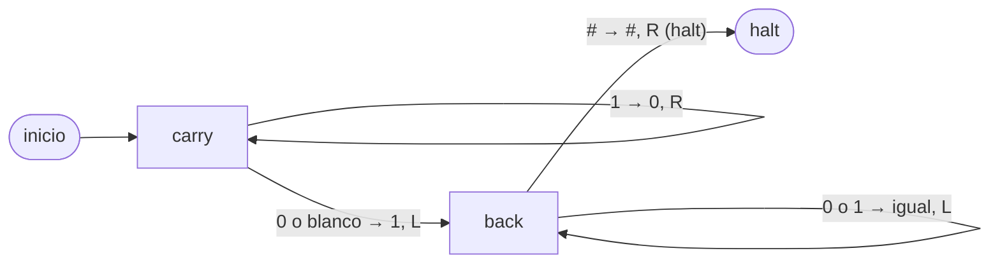

**Resumen:** Tome Φ = el doble del número de bits en 1 en la cinta. Un incremento cuyo acarreo atraviesa t unos cuesta exactamente 2t+2 pasos y cambia Φ en 2−2t, así que cada incremento tiene un costo amortizado exactamente 4. Por lo tanto, m incrementos desde 0 cuestan exactamente 4m − 2·s(m) ≤ 4m = O(m), donde s(m) es el número de bits en 1 de m. Un solo incremento de 2^k − 1 cuesta 2k+2 = Θ(log m). Cualquier máquina necesita al menos 3m − 2·s(m) pasos, así que el total es Θ(m) y las cotas superior e inferior coinciden salvo un factor de 4/3.

---

## 1. Enunciado formal

**Modelo.** Cinta única, infinita en ambas direcciones. Cada paso lee una celda, escribe una celda, mueve el cabezal una celda a la izquierda o a la derecha (sin «quedarse») y cambia de estado. Alfabeto $\Gamma=\{0,1,\#,\sqcup\}$, donde $\sqcup$ es blanco.

**Formato de entrada (little-endian).** La celda $-1$ contiene el marcador `#`. Las celdas $0,1,\dots,L-1$ contienen los bits $b_0 b_1\cdots b_{L-1}$, con $b_0$ el bit menos significativo. Todas las demás celdas son blancas, y el blanco se lee como 0. El cabezal está en la celda 0. El valor codificado es $n=\sum_i b_i 2^i$.

**Salida.** El mismo formato que codifica $n+1$, con el cabezal en la celda 0 y la máquina detenida.

**Afirmación.** Partiendo de $n=0$ (cinta con todo ceros, es decir, solo `#` y luego blancos), $m$ incrementos sucesivos toman $T(m)=O(m)$ pasos en total, aunque un incremento puede tomar $\Theta(\log m)$.

## 2. Algoritmo

Sea $t(n)$ el número de unos consecutivos al final de $n$ (de modo que $n=\ldots 0\,1^t$).

| Estado | Leer | Escribir | Mover | Siguiente |
|---|---|---|---|---|
| `carry` | 1 | 0 | R | `carry` |
| `carry` | 0 o $\sqcup$ | 1 | L | `back` |
| `back` | 0 o 1 | igual | L | `back` |
| `back` | `#` | `#` | R | `halt` |




El mismo algoritmo como Python válido, donde `tape_read(T, p)` devuelve el símbolo de la celda `p` (el blanco cuenta como '0') y `tape_write(T, p, s)` escribe el símbolo `s` en la celda `p`:


```python
def increment(T):
    p = 0
    while tape_read(T, p) == '1':
        tape_write(T, p, '0')
        p = p + 1
    tape_write(T, p, '1')
    p = p - 1
    while tape_read(T, p) != '#':
        p = p - 1
    p = p + 1
    return p
```

*Idea: la fase de acarreo convierte los unos finales en ceros y el primer 0 en 1, luego la fase de retorno camina a la izquierda hasta el marcador y retrocede a la celda 0.*

## 3. Correctitud

**La salida es correcta.** Escriba $n$ como $\ldots 0\,1^t$ en las celdas $t,t-1,\dots,0$. La fase de acarreo lee las celdas $0..t-1$ (todas 1) y convierte cada una en 0, luego lee la celda $t$ (0 o blanco), que existe porque la cinta es finita, y escribe 1. Las celdas por encima de $t$ no se tocan. El resultado es $\ldots 1\,0^t$, que es exactamente la representación binaria de $n+1$. La fase de retorno no escribe nada, y `#` nunca se sobrescribe, así que el formato se preserva.

**El cabezal termina en la celda 0.** La fase de retorno mueve a la izquierda una celda por paso hasta que lee `#`. El marcador está solo en la celda $-1$, así que el cabezal se detiene allí, y el paso final mueve a la derecha hasta la celda 0.

**Detención.** La fase de acarreo mueve a la derecha en cada paso y se detiene en la primera celda que no es 1. Esto ocurre a más tardar en la celda $t$, porque solo hay finitas celdas no blancas. La fase de retorno comienza en la celda $t-1$ (o en la celda $-1$ si $t=0$) y mueve a la izquierda en cada paso. Alcanza la celda $-1$ tras a lo sumo $t$ pasos. Por lo tanto, la máquina se detiene.

**Costo exacto.** Contando pasos:

- fase de acarreo: $t$ volteos más una escritura, así que $t+1$ pasos;
- fase de retorno: leer las celdas $t-1,\dots,0$ toma $t$ pasos, y la lectura de `#` toma uno más.

$$c(n)=(t+1)+t+1=2t(n)+2 .$$

Para $t=0$ la máquina escribe y luego lee `#` inmediatamente, lo cual son 2 pasos, y la fórmula coincide.

## 4. Complejidad mediante una función potencial

Sea $\Phi(T)=2\cdot(\text{número de celdas con 1 en la cinta})$. Entonces $\Phi\ge 0$ y $\Phi_0=0$ para la cinta con todo ceros.

Durante un incremento, $t$ unos se convierten en ceros y un cero se convierte en uno, así que
$$\Delta\Phi = 2(1-t).$$

El costo amortizado es
$$\hat c = c+\Delta\Phi=(2t+2)+(2-2t)=4 .$$

Sumando sobre $m$ incrementos, los términos del potencial se telescopan:
$$T(m)=\sum_{i=1}^{m}\hat c_i-\Phi_m+\Phi_0 = 4m-2\,s(m)\le 4m = O(m).$$

**Un solo incremento sigue siendo costoso.** Para $n=2^k-1$ tenemos $t=k$, así que el costo es $2k+2=\Theta(\log n)$. El potencial explica por qué esto no puede ocurrir a menudo. Un acarreo largo solo puede ocurrir después de que incrementos baratos anteriores hayan almacenado muchos unos, y el acarreo los gasta todos.
