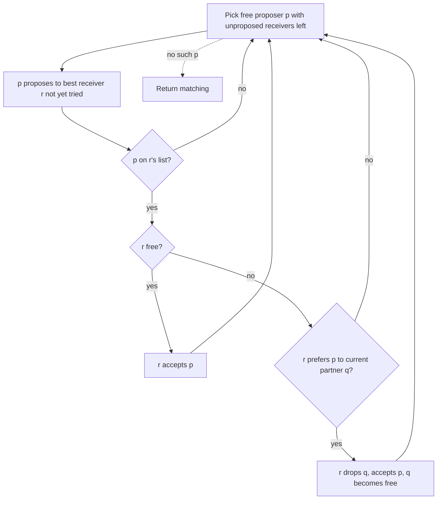

**Resumen**: Sí, el resultado sigue siendo estable. La adaptación es pequeña: una propuesta a un receptor que no listó al proponente siempre se rechaza, y la estabilidad se verifica solo sobre parejas aceptables. La función potencial pasa a ser el número de propuestas no realizadas, que disminuye exactamente en 1 por iteración. El algoritmo se detiene tras a lo sumo $m = \sum_p |L(p)| \le n^2$ iteraciones y se ejecuta en tiempo $O(n + m)$. El emparejamiento puede ser parcial.

---

## 1. Enunciado formal

Sea $P$ el conjunto de proponentes y $R$ el conjunto de receptores, con $|P| = |R| = n$.

- Cada proponente $p$ tiene una lista estrictamente ordenada $L(p) \subseteq R$ (mejor primero).
- Cada receptor $r$ tiene una lista estrictamente ordenada $L(r) \subseteq P$.
- Si los receptores rankean a todos, entonces $L(r) = P$ para todo $r$. Este es el caso del enunciado del problema, y el caso general de abajo lo contiene.

Una pareja $(p, r)$ es **aceptable** si $r \in L(p)$ y $p \in L(r)$.

Para un agente $x$ y candidatos $a, b$, escribimos $a \succ_x b$ si $x$ rankea a $a$ estrictamente por encima de $b$. Estar solo se escribe $\varnothing$.

- **Preferencia individual:** toda pareja listada es mejor que estar solo, y estar solo es mejor que cualquier agente no listado.
- **Emparejamiento:** un conjunto $M$ de parejas tal que cada agente está en a lo sumo una pareja, y toda pareja en $M$ es aceptable. Escribimos $M(x)=\varnothing$ si $x$ no tiene pareja. Un emparejamiento no necesita ser perfecto.

**Pareja bloqueante.** Una pareja $(p, r)$ bloquea a $M$ si se cumplen las tres condiciones:

1. $(p, r)$ es aceptable.
2. $M(p) = \varnothing$ o $r \succ_p M(p)$.
3. $M(r) = \varnothing$ o $p \succ_r M(r)$.

**Emparejamiento estable.** Un emparejamiento es estable si no tiene ninguna pareja bloqueante. La racionalidad individual (nadie queda emparejado con alguien no listado) está incorporada en la definición de emparejamiento, porque solo parejas aceptables pueden estar en $M$.

La diferencia con el caso de listas completas es la condición 1. Sin ella, una pareja no listada podría “bloquear” simplemente porque un agente preferiría estar con una pareja no listada antes que solo, y eso contradice la regla de preferencia.

**Entrada:** las listas $L(x)$ para todo $x \in P \cup R$.
**Salida:** un emparejamiento estable $M$.

---

## 2. Algoritmo

Preprocesamiento: para cada receptor $r$, construir un diccionario `rank[r]` con `rank[r][p]` igual a la posición de $p$ en $L(r)$. Las entradas faltantes se leen como $\infty$. Un rango menor es mejor.

```python
function STABLE_MATCHING(L, rank):
    for each p in P:
        next[p] = 1
        partner[p] = nobody
    for each r in R:
        partner[r] = nobody

    while there is a proposer p with partner[p] = nobody and next[p] <= length(L[p]):
        r = L[p][next[p]]
        next[p] = next[p] + 1

        if rank[r][p] = infinity:
            # r did not list p: reject, nothing changes
            continue_loop
        else if partner[r] = nobody:
            partner[r] = p
            partner[p] = r
        else if rank[r][p] < rank[r][partner[r]]:
            q = partner[r]
            partner[q] = nobody
            partner[r] = p
            partner[p] = r
        else:
            # r prefers her current partner: reject, nothing changes
            continue_loop

    return the set of pairs (p, partner[p]) with partner[p] != nobody
```



---

## 3. Correctitud

### 3.1 Función potencial y detención


Definimos

$$\Phi = \sum_{p \in P} \bigl( |L(p)| - \text{next}[p] + 1 \bigr),$$

que es el número de propuestas (proponente, receptor) todavía disponibles.

- Inicialmente $\Phi_0 = \sum_p |L(p)| = m \le n^2$.
- Cada iteración incrementa exactamente un `next[p]` en 1, así que $\Phi$ disminuye exactamente en 1. Esto vale en las tres ramas: rechazar por no listado, aceptar o reemplazar, y rechazar por peor rango.
- La condición del bucle requiere `next[p] <= length(L[p])`, así que ningún término se vuelve negativo. Por lo tanto, $\Phi \ge 0$ siempre.

Un entero no negativo que disminuye en 1 en cada iteración no puede decrecer indefinidamente, así que el bucle se ejecuta a lo sumo $m$ veces y **el algoritmo se detiene**.

### 3.2 Invariantes

*Esquema: tres hechos sobre cómo evolucionan las parejas, que son el motor de la prueba de estabilidad.*

- **(I1) Los proponentes avanzan hacia abajo por sus listas.** Cada $p$ propone en el orden de $L(p)$, nunca dos veces al mismo receptor.
- **(I2) Los receptores solo mejoran.** Una vez que $r$ tiene pareja, sigue teniéndola, y su pareja solo es reemplazada por alguien con un rango estrictamente mejor. Esto vale porque ella solo cambia de pareja en la tercera rama, donde $\text{rank}[r][p] < \text{rank}[r][\text{partner}[r]]$.
- **(I3) Validez del emparejamiento.** En todo momento cada agente tiene a lo sumo una pareja. Las actualizaciones del código mantienen `partner` simétrico, y el proponente descartado $q$ se resetea a `nobody`. Toda pareja creada tiene $\text{rank}[r][p] < \infty$ y $r \in L(p)$, así que toda pareja es aceptable.

Por lo tanto, la salida es un emparejamiento válido.

### 3.3 Estabilidad


**Afirmación.** El emparejamiento devuelto $M$ es estable.

**Prueba.** Supongamos por contradicción que $(p, r)$ bloquea a $M$. Por la condición 1, $r \in L(p)$ y $p \in L(r)$. Al terminar, la condición del bucle falla, así que $p$ o está emparejado o tiene $\text{next}[p] > |L(p)|$, es decir, propuso a todos los de su lista.

**Caso A: $p$ nunca propuso a $r$.**

- Si $p$ queda sin pareja al final, debió haber agotado su lista. Como $r \in L(p)$, propuso a $r$, una contradicción.
- Si $p$ está emparejado, entonces por la condición 2 tenemos $r \succ_p M(p)$. Por (I1) él propone en orden de lista, así que habría propuesto a $r$ antes de proponer a $M(p)$, una contradicción.

**Caso B: $p$ propuso a $r$ en algún momento.** Como $(p, r) \notin M$ por la definición de pareja bloqueante, $p$ no fue aceptado, o fue descartado después.

- Como $p \in L(r)$, la primera rama de rechazo (no listado) no se aplicó.
- Así que en algún momento $r$ o prefirió a su pareja actual $q$ antes que a $p$, o descartó a $p$ por alguien a quien prefiere. En ambos casos, justo después de ese momento $r$ está emparejada con alguien a quien rankea por encima de $p$.
- Por (I2), su pareja solo mejora a partir de entonces, así que $M(r) \ne \varnothing$ y $M(r) \succ_r p$. Esto contradice la condición 3.

Ambos casos son contradictorios, así que no existe ninguna pareja bloqueante. $\blacksquare$

**Respuesta a la pregunta:** sí, la salida es estable en el sentido de listas incompletas definido arriba. Nótese que también es *individualmente racional*, porque (I3) asegura que nadie queda emparejado con una pareja no listada.

### 3.4 Notas


- Con listas completas en ambos lados, la salida es perfecta. Con listas incompletas puede dejar a algunos agentes sin pareja, y ningún algoritmo puede evitarlo en general. Por ejemplo, si dos proponentes listan solo al mismo único receptor, uno de ellos debe quedar solo.
- La misma prueba muestra que el resultado es óptimo para los proponentes entre los emparejamientos estables, como en el caso completo. Además, por el teorema de los hospitales rurales, todo emparejamiento estable empareja exactamente al mismo conjunto de agentes, así que el número de agentes sin pareja es el mismo en todo emparejamiento estable. Cito ambos resultados sin volver a demostrarlos aquí.

---

## 4. Complejidad temporal


- A lo sumo $m$ iteraciones por la Sección 3.1.
- Cada iteración es $O(1)$: leer $L[p][\text{next}[p]]$, una consulta de diccionario para los rangos, y unas pocas asignaciones. Para encontrar un proponente libre en $O(1)$, mantener una cola (o pila) de proponentes libres. Un proponente se apila cuando queda libre y se desapila cuando se elige. Un proponente desapilado que todavía tiene propuestas restantes y es rechazado vuelve a entrar, y uno con la lista agotada no se vuelve a apilar.
- Construir `rank` cuesta $O\bigl(\sum_r |L(r)|\bigr) \le O(n^2)$, y la inicialización cuesta $O(n)$.

$$T(n, m) = O(n + m), \qquad m = \sum_{x \in P \cup R} |L(x)| \le 2n^2.$$

Peor caso: $O(n^2)$, lo mismo que en el caso completo. Es más rápido cuando las listas son cortas.

---

## 5. ¿Se puede hacer mejor?


La entrada tiene tamaño $\Theta(n + m)$, así que $O(n + m)$ es lineal en la entrada. En el caso de listas completas ($m = \Theta(n^2)$), Ng y Hirschberg (1990) probaron una cota inferior $\Omega(n^2)$ sobre el número de consultas que necesita cualquier algoritmo en el peor caso, así que $O(n^2)$ no puede mejorarse asintóticamente allí. 