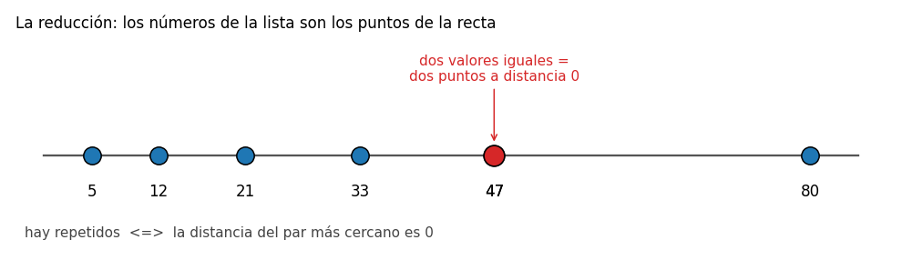
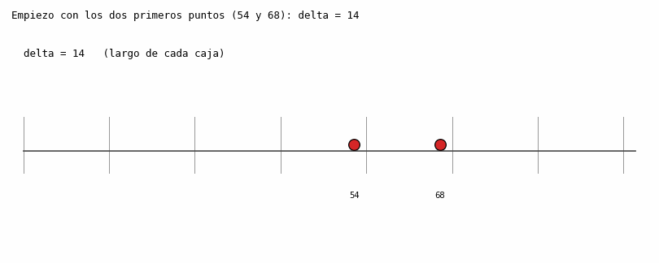

# Ejercicio 10: par más cercano en una dimensión

*El código del ejercicio está en `ejercicio-10.py`.*

> **Enunciado.** Par más cercano en una dimensión. Demuestra `Ω(n log n)` en árboles de decisión algebraicos por reducción desde distinción de elementos. Después indica qué algoritmo mejora la cota, en qué modelo lo hace y cómo se adapta a una dimensión.

---

## 1. El problema

**Entrada.** Una lista de `n` números reales `x1, ..., xn`.

**Salida.** Dos de ellos, `xi` y `xj` con `i ≠ j`, que minimicen la distancia `|xi - xj|`.

Antes de empezar hay que dejar claras algunas cosas:

- **Empates.** Si varios pares tienen la misma distancia mínima, se devuelve cualquiera.
- **Repetidos.** Como la entrada es una lista, puede tener dos valores iguales. Entonces la respuesta es un par a distancia 0. Esto es importante para la reducción de la sección 4.
- **Raíz cuadrada.** En una dimensión la distancia es solo `|xi - xj|`, así que no hace falta ninguna raíz.

**El modelo.** Para analizar todos los algoritmos hay que especificar primero el modelo de cálculo. Usaré el árbol de decisión algebraico: un árbol donde cada nodo interno comprueba el signo de un polinomio de grado acotado en los números de la entrada (negativo, cero o positivo) y se ramifica en tres opciones. Cada hoja produce una respuesta. El costo es la profundidad del árbol, es decir, el número de pruebas de signo en el peor caso. Este modelo permite comparar, sumar, restar y multiplicar, pero **no** permite calcular partes enteras ni usar un valor como dirección de memoria.

**Fuerza bruta.** Se revisan los `n(n-1)/2` pares y se conserva el mejor. El algoritmo es correcto porque revisa todas las posibilidades y cuesta `O(n²)`. Se puede usar para comprobar los otros algoritmos (`fuerza_bruta` en el `.py`).

---

## 2. Primer algoritmo: ordenar y mirar los vecinos

**La idea.** Si los números están ordenados en la recta, los valores más cercanos deben aparecer juntos en el orden. Por eso solo es necesario revisar los pares consecutivos. Primero se ordenan los valores, después se calculan los `n - 1` distancias entre vecinos y se conserva la menor.

```python
def ordenando(xs):
    ys = sorted(xs)
    mejor = (ys[1] - ys[0], (ys[0], ys[1]))
    for k in range(1, len(ys) - 1):
        if ys[k + 1] - ys[k] < mejor[0]:
            mejor = (ys[k + 1] - ys[k], (ys[k], ys[k + 1]))
    return mejor
```

**Correctitud.** Hay que ver que el par más cercano siempre se puede elegir entre vecinos.

*Lema.* Si `x1 ≤ x2 ≤ ... ≤ xn`, existe un par consecutivo que es el más cercano.

*Demostración.* Sea `(xi, xj)` con `i < j` un par más cercano, y supongamos que `j > i + 1`. Entonces `i < i + 1 < j`, y como la sucesión está ordenada, `xj - x(i+1) ≤ xj - xi`. Así que el par `(x(i+1), xj)` es al menos tan cercano, y es distinto de `(xi, xj)`. Repitiendo el argumento llegamos a un par consecutivo que sigue siendo mínimo. ∎

Por lo tanto, revisar solo los vecinos es suficiente.

**Costo.** Ordenar cuesta `O(n log n)` comparaciones y recorrer los `n - 1` huecos cuesta `O(n)`. En total `O(n log n)`, con memoria `O(n)` por la copia ordenada.

**¿Está dentro del modelo?** Sí. Ordenar consiste en hacer pruebas del signo de `xi - xj`. Además, comparar dos distancias entre vecinos equivale a comprobar el signo de `(x(k+1) - xk) - (x(l+1) - xl)`, que es un polinomio de grado 1. Por tanto, este algoritmo se puede representar como un árbol de decisión algebraico de profundidad `O(n log n)`.


---

## 3. Resultado conocido: distinción de elementos

Ya se conoce el siguiente resultado:

> Dados `n` números reales, decidir si dos de ellos son iguales requiere
> `Ω(n log n)` en el modelo de árboles de decisión algebraicos.

Este resultado se usará para obtener la cota inferior del problema del par más cercano.

## 4. La cota inferior `Ω(n log n)` por reducción

**Teorema.** Par más cercano en una dimensión requiere `Ω(n log n)` en árboles de decisión algebraicos.

**La idea.** La reducción es sencilla en una dimensión. Para comprobar si una lista tiene dos valores iguales, se pueden interpretar sus valores como puntos de la recta. Dos valores iguales representan el mismo punto y tienen distancia 0. Por tanto, hay valores repetidos si y solo si la distancia del par más cercano es 0.



*Figura 1. Los números de la lista son los puntos de la recta. Los dos `47` quedan a distancia 0.*

**Demostración.** Se parte de una entrada `x1, ..., xn` del problema de distinción de elementos y se usa directamente como entrada del problema del par más cercano. La transformación no requiere cálculos ni pruebas de signo. La distancia mínima es 0 si y solo si dos de los `xi` son iguales.

Supongamos que existiera un algoritmo para el par más cercano con profundidad `T(n) = o(n log n)`. El algoritmo devuelve un par `(xp, xq)`. Se puede añadir una prueba final del signo de `xp - xq`, que es un polinomio de grado 1. Si el signo es 0, hay dos valores iguales; en caso contrario, no. Así se obtendría un algoritmo para distinción de elementos de profundidad `T(n) + 1 = o(n log n)`, en contradicción con la cota conocida. ∎

**Conclusión.** El algoritmo de ordenar y revisar vecinos cuesta `O(n log n)` y la cota inferior es `Ω(n log n)`. Por tanto, en el modelo de árboles de decisión algebraicos **es óptimo**.

(La reducción muestra que un algoritmo rápido para el par más cercano permitiría resolver rápidamente distinción de elementos. En el `.py` se comprueba que los dos algoritmos responden correctamente si una lista tiene valores repetidos en 4000 casos.)

---

## 5. Un algoritmo que mejora la cota en otro modelo

Un algoritmo de par más cercano que cueste menos de `n log n` debe usar un modelo distinto al anterior. Existe uno: **el algoritmo aleatorio incremental con una rejilla**, similar al usado para el par más cercano en el plano. Su costo esperado es `O(n)`.

Este algoritmo usa operaciones que no están disponibles en el modelo de árboles de decisión algebraicos:

- **Calcula la parte entera.** Convierte un punto en el número de su caja con `⌊x / δ⌋`. La parte entera no es un polinomio ni es continua, así que un árbol de decisión algebraico no puede calcularla.
- **Usa ese número como dirección.** Va a buscar a una tabla hash la caja cuyo índice acaba de calcular. Un árbol de decisión no tiene direccionamiento indirecto: su única operación es ramificar según el signo de un polinomio.

El azar no es lo que permite mejorar la cota. Barajar los puntos sirve para que la rejilla se reconstruya pocas veces en promedio. Las operaciones que cambian el modelo son el cálculo de la parte entera y el acceso a la tabla.

Esto es parecido al ordenamiento por conteo. Ordenar enteros pequeños usando sus valores como índices no contradice la cota de los algoritmos de comparación, porque pertenece a otro modelo. En este caso también se están comparando dos modelos diferentes, y el segundo permite más operaciones.

---

## 6. Adaptación del algoritmo a una dimensión

**La idea.** Se insertan los puntos uno por uno, en un orden aleatorio, y se mantiene `δ`, la menor distancia entre los puntos insertados hasta el momento. La recta se divide en **cajas de longitud `δ`**. De esta forma:

- En cada caja hay a lo sumo un punto, porque dos puntos en la misma caja estarían a distancia menor que `δ`, y `δ` es justamente la mínima distancia entre los puntos insertados.
- Cuando llega un punto nuevo `p`, los puntos a distancia menor que `δ` de `p` solo pueden estar en la caja de `p` o en las dos vecinas. Por eso solo se revisan **3 cajas**. Como cada una tiene como máximo un punto, se realizan 3 consultas a la tabla: `O(1)`.

Si no hay ningún punto más cercano que `δ`, el valor de `δ` no cambia y `p` se guarda en su caja. Si aparece un punto más cercano, `δ` disminuye. En ese caso las cajas anteriores dejan de ser válidas y hay que **reconstruir la rejilla** con el nuevo valor de `δ`. Esta reconstrucción cuesta `O(i)` si ya se han insertado `i` puntos.

```python
def rejilla(xs, semilla=0):
    pts = list(xs)
    random.Random(semilla).shuffle(pts)
    delta = abs(pts[0] - pts[1])
    par = (pts[0], pts[1])
    if delta == 0:
        return 0, par                          # dos valores iguales
    tabla = {}
    for x in pts[:2]:
        tabla.setdefault(x // delta, []).append(x)
    for i in range(2, len(pts)):
        p = pts[i]
        c = p // delta                         # la parte entera: número de caja
        mejor, mejor_q = delta, None
        for dc in (-1, 0, 1):                  # las 3 cajas de alrededor
            for q in tabla.get(c + dc, ()):
                if abs(p - q) < mejor:
                    mejor, mejor_q = abs(p - q), q
        if mejor < delta:                      # delta bajó: reconstruir
            delta, par = mejor, (p, mejor_q)
            if delta == 0:
                return 0, par
            tabla = {}
            for x in pts[:i + 1]:
                tabla.setdefault(x // delta, []).append(x)
        else:
            tabla.setdefault(c, []).append(p)
    return delta, par
```

(En el `.py`, cada caja guarda una lista para evitar problemas de redondeo con números decimales. Según la demostración anterior, en condiciones ideales cada caja tiene como máximo un punto.)



*Figura 2. Inserción de 12 puntos en orden aleatorio. En azul aparecen los puntos ya insertados; en rojo, el mejor par hasta ese momento; en naranja, el punto nuevo. La zona celeste representa las 3 cajas que se consultan. Las líneas verticales son los bordes de las cajas, cuya longitud es `δ`.*

**Costo esperado.** Las inserciones sin reconstrucción cuestan `O(1)` cada una, así que en total `O(n)`. Todo depende de cuántas reconstrucciones haya.

*¿Cuántas veces se reconstruye?* Consideremos el paso en que se inserta el punto `i + 1`. Fijemos el conjunto `S = {p1, ..., p(i+1)}` sin tener en cuenta el orden de llegada. El par más cercano de `S` depende únicamente de sus puntos. El paso `i + 1` produce una reconstrucción si insertar `p(i+1)` hace disminuir `δ`; es decir, si `p(i+1)` es uno de los dos puntos del par más cercano. Como el orden de inserción es una permutación aleatoria, cada uno de los `i + 1` puntos tiene la misma probabilidad de ser el último. Entonces

```
Pr[reconstruir en el paso i+1]  ≤  2 / (i + 1)
```

Por linealidad de la esperanza, sumando sobre los pasos:

```
E[costo] = O(n) + Σ  (2 / (i+1)) · O(i)  =  O(n) + Σ O(1)  =  O(n)
```

El número esperado de reconstrucciones es del orden de `2 ln n`.

**Correctitud.** Se mantiene el invariante de que cada caja contiene como máximo un punto. Además, todo punto a distancia menor que `δ` del punto nuevo está en una de las 3 cajas consultadas: si `|q - p| < δ`, entonces `q/δ` y `p/δ` difieren en menos de 1, por lo que sus partes enteras difieren como máximo en 1. Por tanto, después de cada paso, `δ` es la distancia mínima entre los puntos insertados. Al final, es la distancia mínima de todos los puntos.

---

## 7. Comprobación con el código

**Correctitud de los algoritmos.** Se compararon los algoritmos de ordenamiento y de rejilla con la fuerza bruta en 3000 listas. La mitad de las listas contenía enteros distintos y la otra mitad, números reales. La longitud estaba entre 2 y 30. No se encontraron errores.

**Comprobación del costo.** En lugar de medir el tiempo, se contaron operaciones: comparaciones en el algoritmo que ordena, y consultas e inserciones en la tabla en el algoritmo de rejilla. Para cada `n`, la rejilla se ejecutó con 5 órdenes aleatorios y se calculó el promedio.

| n | comparaciones (ordenando) | comparaciones / n | operaciones de la tabla (rejilla) | operaciones / n | reconstrucciones | `2 ln n` |
|---|---|---|---|---|---|---|
| 1 000 | 9 631 | 9,6 | 4 593 | 4,6 | 9,8 | 13,8 |
| 10 000 | 129 845 | 13,0 | 42 308 | 4,2 | 11,0 | 18,4 |
| 100 000 | 1 629 041 | 16,3 | 407 445 | 4,1 | 15,2 | 23,0 |

Las comparaciones por elemento del algoritmo de ordenamiento **crecen** con `n` (9,6, 13,0, 16,3), debido al factor `log n`. Las operaciones por elemento de la rejilla **no crecen** (4,6, 4,2, 4,1), lo que coincide con el costo esperado `O(n)`. El número de reconstrucciones es algo menor que `2 ln n`, como se espera porque `2/(i+1)` era una cota superior.

**Diferencia entre el análisis y los tiempos.** Con un millón de números, ordenar y revisar vecinos tardó 0,6 s y la rejilla tardó 4,6 s. Esto se debe a que `sorted` de Python está implementado en C, mientras que la rejilla está implementada en Python. Por eso las constantes son diferentes. El análisis estudia el número de operaciones, no el tiempo exacto de cada una, y por eso la tabla cuenta operaciones.

---

## 8. Conclusión

El problema del par más cercano en una dimensión se resuelve ordenando los puntos y revisando solo los pares consecutivos, en `O(n log n)`. La correctitud se basa en que siempre existe un par más cercano formado por puntos consecutivos. La cota inferior se demuestra mediante una reducción desde distinción de elementos: hay valores repetidos si y solo si la distancia mínima es 0. Por tanto, un algoritmo de par más cercano con profundidad `o(n log n)` permitiría resolver distinción de elementos con la misma complejidad, lo que contradice la cota conocida. Así, ordenar es óptimo en el modelo de árboles de decisión algebraicos. En otro modelo, el algoritmo aleatorio incremental con rejilla tiene costo esperado `O(n)`. Divide la recta en cajas de longitud `δ`, consulta solo 3 cajas por cada punto nuevo y reconstruye la rejilla con probabilidad `2/(i+1)` en el paso `i + 1`. Puede hacer esto porque calcula la parte entera `⌊x/δ⌋` y la usa para acceder a una tabla hash. Estas operaciones no están permitidas en un árbol de decisión algebraico, por lo que no existe una contradicción.


