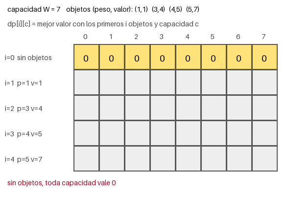
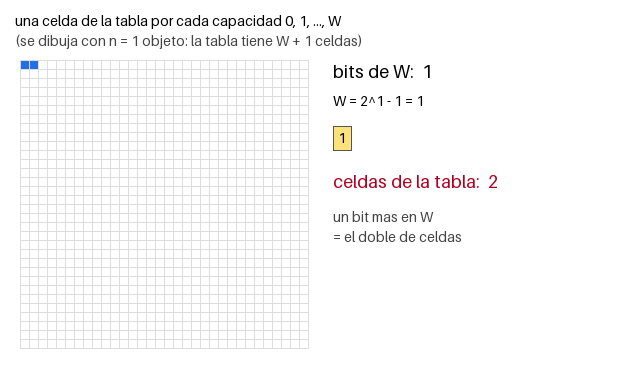

# Ejercicio 11: la mochila entera y el tamaño de la entrada en bits

**Enunciado.** La mochila entera se puede resolver con programación dinámica en $O(nW)$, donde $W$ es la capacidad de la mochila. Hay que medir el tamaño de la entrada en bits y decidir si este algoritmo es polinomial. También hay que compararlo con la prueba de primalidad por división.

El código está en `ejercicio-11.py`.

---

## 1. Problema y modelo

**Entrada.** $n$ objetos con pesos enteros $p_1, \dots, p_n$, valores enteros $v_1, \dots, v_n$ y una capacidad entera $W$.

**Salida.** El mayor valor total que se puede llevar sin superar la capacidad $W$. Cada objeto se puede usar como máximo una vez.

**Modelo.** Usamos el modelo RAM con palabras. Cada operación aritmética, comparación o acceso a una celda cuesta 1, siempre que los números que usamos quepan en una palabra. Los pesos, valores e índices cumplen esta condición. El tiempo es el número de operaciones.

---

## 2. Algoritmo

La idea es resolver primero problemas pequeños y usar esas respuestas para resolver problemas más grandes. Definimos

$$dp[i][c] = \text{mejor valor usando los primeros } i \text{ objetos y una capacidad } c.$$

Para calcular $dp[i][c]$, reviso el objeto $i$ y comparo dos opciones:

- **No llevarlo:** el mejor valor es $dp[i-1][c]$.
- **Llevarlo** (si $c \geq p_i$): el objeto ocupa $p_i$ de capacidad y deja $c-p_i$ para los objetos anteriores. El valor total es $dp[i-1][c-p_i]+v_i$.

Después elijo el mayor de los dos valores. Si no hay objetos, el valor es 0. La respuesta final es $dp[n][W]$.

```python
def mochila(pesos, valores, W):
    n = len(pesos)
    dp = [[0] * (W + 1) for _ in range(n + 1)]
    for i in range(1, n + 1):
        p, v = pesos[i - 1], valores[i - 1]
        for c in range(W + 1):
            dp[i][c] = dp[i - 1][c]                    # no lo llevo
            if c >= p and dp[i - 1][c - p] + v > dp[i][c]:
                dp[i][c] = dp[i - 1][c - p] + v        # lo llevo
    return dp[n][W]
```



*Figura 1. Pesos $(1, 3, 4, 5)$, valores $(1, 4, 5, 7)$ y $W = 7$. Cada cuadro representa una celda de la tabla. En el último cuadro, las celdas verdes muestran el camino de vuelta. Se llevan los objetos 2 y 3, con un valor total de 9.*

Tabla del ejemplo:

| | $c=0$ | 1 | 2 | 3 | 4 | 5 | 6 | 7 |
|---|--:|--:|--:|--:|--:|--:|--:|--:|
| $i=0$ | 0 | 0 | 0 | 0 | 0 | 0 | 0 | 0 |
| $i=1$ | 0 | 1 | 1 | 1 | 1 | 1 | 1 | 1 |
| $i=2$ | 0 | 1 | 1 | 4 | 5 | 5 | 5 | 5 |
| $i=3$ | 0 | 1 | 1 | 4 | 5 | 6 | 6 | 9 |
| $i=4$ | 0 | 1 | 1 | 4 | 5 | 7 | 8 | 9 |

---

## 3. Costo en función de $n$ y $W$

La tabla tiene $(n+1)(W+1)$ celdas. Cada celda se calcula haciendo una cantidad constante de operaciones: asignaciones, comparaciones y sumas. Por eso,

$$T(n, W) = \Theta(nW).$$

El programa cuenta las celdas que calcula y da exactamente $n(W+1)$ en todas las pruebas realizadas. En el ejemplo, el resultado es $4 \cdot 8 = 32$.

Al principio, $nW$ parece un buen costo porque es un polinomio. Sin embargo, todavía falta revisar en función de qué estamos hablando de un polinomio.

---

## 4. El tamaño de la entrada en bits

El costo debe compararse con el tamaño real de la entrada, es decir, con el número de bits que ocupa. Un número $k$ escrito en binario usa $\lfloor \log_2 k \rfloor + 1$ bits.

Sea $b$ el número de bits de $W$ y sea $\ell$ el número máximo de bits de un peso o un valor. Entonces la entrada ocupa

$$N = \Theta(n\ell + b) \text{ bits.}$$

Lo importante es la relación entre $W$ y $b$. Como $W$ tiene $b$ bits,

$$2^{b-1} \leq W \leq 2^b - 1.$$

Por lo tanto, $W$ crece de forma exponencial con respecto a $b$. Escribir $W$ solo necesita $b$ bits, pero el algoritmo hace trabajo proporcional a $W$:

$$T(n, W) = \Theta(nW) = n \cdot 2^{\Theta(b)}.$$



*Figura 2. Cada cuadro agrega un bit a $W$ y la tabla se duplica. Con 10 bits ya hay 1024 celdas, aunque la entrada solo aumentó en 10 bits.*

---

## 5. ¿Es polinomial?

**No.** Para verlo, usamos una familia sencilla de casos.

**Instancia $I_b$.** Hay un solo objeto de peso 1 y valor 1, y la capacidad es $W = 2^b - 1$.

- Tamaño de la entrada: $N = 1 + 1 + b = b + 2$ bits.
- Costo: la tabla tiene al menos $W+1 = 2^b$ celdas en una fila, y el algoritmo las calcula todas. Por tanto, $T \geq 2^b$.

Supongamos que el algoritmo fuera polinomial. Entonces existirían constantes $c$ y $k$ tales que $T \leq c \cdot N^k$. En ese caso,

$$2^b \leq c(b+2)^k$$

para todo $b$. Pero, cuando $b$ crece, $2^b$ aumenta mucho más rápido que cualquier polinomio:

$$\lim_{b \to \infty} \frac{(b+2)^k}{2^b} = 0.$$

Por eso, para algún valor grande de $b$, la desigualdad deja de cumplirse. Entonces, el algoritmo no es polinomial con respecto al tamaño de la entrada. Es exponencial en $b$. $\square$

Esto solo demuestra que **este algoritmo** no es polinomial. No demuestra que el problema no pueda tener otro algoritmo polinomial.

### ¿Qué sí se puede decir?

El costo $nW$ sí es polinomial en el valor de $W$ y en $n$, aunque no lo sea en el número de bits de $W$. A este tipo de algoritmo se le llama **pseudopolinomial**. Si la capacidad es pequeña, por ejemplo $W \leq N^2$, entonces $nW$ sí es polinomial en $N$.

### Qué pasa con números grandes

Se hizo una prueba con $n = 10$ objetos y $W = 2^b - 1$, que es el número más grande que usa $b$ bits. Las operaciones se duplican cada vez que se agrega un bit, y el tiempo también aumenta aproximadamente al doble:

| $b$ | $N$ (bits) | $W$ | operaciones | tiempo (s) | tiempo / anterior |
|---:|---:|---:|---:|---:|---:|
| 8 | 71 | 255 | 2 560 | 0.000 | |
| 10 | 73 | 1 023 | 10 240 | 0.001 | |
| 12 | 75 | 4 095 | 40 960 | 0.005 | |
| 14 | 77 | 16 383 | 163 840 | 0.021 | |
| 15 | 78 | 32 767 | 327 680 | 0.042 | 1.97 |
| 16 | 79 | 65 535 | 655 360 | 0.085 | 2.02 |
| 17 | 80 | 131 071 | 1 310 720 | 0.176 | 2.09 |

La entrada solo crece de 71 a 80 bits, pero el costo se multiplica por 512. Si el costo fuera polinomial en $N$, esto no ocurriría.

Con $n = 100$ objetos y una computadora que hace $10^9$ operaciones por segundo, se obtienen estos valores:

| bits de $W$ | operaciones | tiempo | memoria (una fila, 8 bytes por celda) |
|---:|---:|---:|---:|
| 20 | $1.05 \times 10^8$ | 0.105 s | 8 MB |
| 32 | $4.29 \times 10^{11}$ | 0.119 horas | 32 GB |
| 40 | $1.1 \times 10^{14}$ | 1.27 días | 8 TB |
| 50 | $1.13 \times 10^{17}$ | 3.57 años | 8 190 TB |
| 64 | $1.84 \times 10^{21}$ | 58 500 años | $1.34 \times 10^8$ TB |

Una capacidad de 64 bits cabe en una sola palabra de computadora, por lo que la entrada no parece muy grande. Aun así, el algoritmo tardaría demasiado y usaría más memoria de la disponible. Una computadora 1000 veces más rápida tampoco resolvería mucho: como $2^{10} \approx 1000$, solo permitiría agregar unos 10 bits a $W$.

---

## 6. ¿En qué se parece a la primalidad por división?

Los dos algoritmos tienen un ciclo que llega hasta un número dado en la entrada. Su costo es polinomial en el valor de ese número, pero exponencial en la cantidad de bits que lo representan:

| | primalidad por división | mochila (tabla) |
|---|---|---|
| número de la entrada | $m$ | $W$ |
| hasta dónde llega el ciclo | hasta $\sqrt{m}$ | hasta $W$ |
| bits del número | $b$ | $b$ |
| costo en función de $b$ | $\approx 2^{b/2}$ | $\approx n \cdot 2^b$ |
| costo en función del valor | $\sqrt{m}$ | $nW$ |
| al agregar 1 bit | se multiplica por $\sqrt{2}$ | se duplica |

En el programa se usó el número primo más grande menor que $2^b$ para la primalidad y $n=1$ para la mochila. Al agregar 2 bits, los resultados son:

| bits | divisiones (primalidad) | $\times$ cada 2 bits | celdas (mochila, $n=1$) | $\times$ cada 2 bits |
|---:|---:|---:|---:|---:|
| 10 | 30 | | 1 024 | |
| 14 | 126 | 2.03 | 16 384 | 4.00 |
| 20 | 1 022 | 2.00 | 1 048 576 | 4.00 |
| 26 | 8 190 | 2.00 | 67 108 864 | 4.00 |
| 30 | 32 766 | 2.00 | 1 073 741 824 | 4.00 |

La prueba de primalidad se multiplica por 2 cada 2 bits, es decir, por $\sqrt{2}$ por cada bit. La mochila se multiplica por 4 cada 2 bits, es decir, por 2 por cada bit. Aunque crecen a ritmos distintos, los dos algoritmos son exponenciales en el número de bits.

El error que se debe evitar es mirar solo $nW$ o $\sqrt{m}$ y pensar que son costos pequeños. El tamaño de la entrada depende de $\log W$ o $\log m$, no del valor completo de esos números.

---

## 7. Conclusiones

- **Algoritmo:** se usa una tabla $dp[i][c]$. Para cada objeto se decide si se lleva o no, y se conserva la mejor opción.
- **Costo:** $\Theta(nW)$ tiempo y $(n+1)(W+1)$ celdas.
- **Tamaño de la entrada:** $N = \Theta(n\ell + b)$ bits, donde $b = \lfloor \log_2 W \rfloor + 1$ y $2^{b-1} \leq W < 2^b$.
- **¿Es polinomial?** No. Con $n=1$, el costo es al menos $2^b$ y $N=b+2$. Es pseudopolinomial: polinomial en el valor de $W$, pero exponencial en sus bits.
- **Parecido con la primalidad:** en los dos casos el ciclo llega hasta un número de la entrada. Agregar un bit multiplica el trabajo por una constante: por $\sqrt{2}$ en la primalidad y por 2 en la mochila.

### Verificación en el código

El comando `python ejercicio-11.py` prueba 600 casos aleatorios. Comprueba que la tabla, la versión de una sola fila y la fuerza bruta dan el mismo valor. También revisa que la solución recuperada no supere $W$, que tenga el valor correcto y que el número de operaciones sea exactamente $n(W+1)$. Además, genera las tablas de las secciones 5 y 6 y las dos animaciones.
