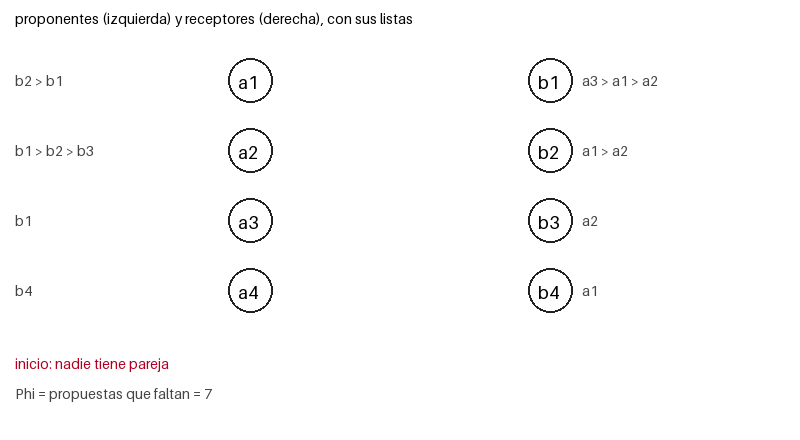

# Ejercicio 12: emparejamiento estable con listas incompletas

**Enunciado.** Gale-Shapley con listas incompletas: cada proponente lista solo a algunos receptores, y prefiere quedarse solo antes que con uno que no listó. Adaptar el algoritmo, su potencial y la definición de pareja bloqueante. ¿Sigue siendo estable el resultado? Demostrarlo.

El código está en `ejercicio-12.py`.

---

## 1. Problema y definiciones adaptadas

Hay $n$ proponentes $a_1, \dots, a_n$ y $n$ receptores $b_1, \dots, b_n$. Cada persona tiene una lista **estricta** (sin empates) y **posiblemente incompleta** con algunas personas del otro lado, ordenada de la más a la menos preferida. Para ser general, dejo que los receptores también tengan listas incompletas. Si los receptores listan a todos, es justo el caso del enunciado.

**Preferencias.** Una persona prefiere $x$ a $y$ si $x$ aparece antes que $y$ en su lista. Además:

- prefiere cualquier persona de su lista a quedarse sola,
- prefiere quedarse sola a cualquier persona que no listó.

**Par aceptable.** $(a, b)$ es aceptable si $a$ lista a $b$ **y** $b$ lista a $a$. Es el único tipo de par que nadie rechaza de antemano.

**Emparejamiento.** Un conjunto $M$ de pares aceptables en el que cada persona aparece a lo sumo una vez. Escribo $M(a)$ para la pareja de $a$, o "solo" si no tiene. **Ya no tiene por qué ser perfecto:** hay gente que se queda sola.

**Pareja bloqueante (adaptada).** Un par aceptable $(a, b)$ que no está en $M$ es bloqueante si

- $a$ prefiere $b$ a su situación en $M$ (su pareja, o estar solo), y
- $b$ prefiere $a$ a su situación en $M$ (su pareja, o estar sola).

Lo que cambia respecto a listas completas es que "su situación" incluye **estar solo**: una persona sola preferiría cualquier pareja aceptable. Y solo se consideran pares aceptables.

**Estable.** $M$ es estable si no tiene parejas bloqueantes.

---

## 2. Algoritmo

La idea es la misma de siempre: los proponentes proponen de su favorito hacia abajo, y cada receptor se queda con la mejor propuesta que ha recibido hasta ahora, sin comprometerse del todo. Solo hay tres cosas nuevas:

1. Un proponente solo le propone a receptores **de su lista**.
2. Un receptor **rechaza** a quien no lista.
3. Antes era imposible que a un proponente se le acabara la lista; ahora puede pasar. Si le propuso a todos los de su lista y todos lo rechazaron, **se queda solo** para siempre.

> Mientras haya un proponente libre al que todavía le quede algún receptor de su lista sin proponerle, ese proponente le propone al mejor receptor de su lista al que todavía no le ha propuesto. El receptor:
> - lo rechaza si no lo lista;
> - lo acepta si está libre;
> - lo acepta (y deja libre a su pareja anterior) si ya tiene pareja pero prefiere al nuevo;
> - si no, lo rechaza.

El algoritmo sigue siendo no determinista: no dice cuál proponente libre actúa primero, y todo lo que se demuestre tiene que valer para cualquier elección.

```python
def gale_shapley_incompleto(pref_a, pref_b):
    rango = [{a: lugar for lugar, a in enumerate(l)} for l in pref_b]   # rango[b][a]
    siguiente = [0] * len(pref_a)            # a quien le propone a continuacion
    pareja_de_b = [None] * len(pref_b)
    libres = deque(a for a in range(len(pref_a)) if pref_a[a])   # libres con opciones
    while libres:
        a = libres.popleft()
        b = pref_a[a][siguiente[a]]
        siguiente[a] += 1
        actual = pareja_de_b[b]
        if a not in rango[b]:                # b no lista a a
            rechazado = a
        elif actual is None:                 # b esta libre
            pareja_de_b[b], rechazado = a, None
        elif rango[b][a] < rango[b][actual]: # b prefiere a a su pareja
            pareja_de_b[b], rechazado = a, actual
        else:
            rechazado = a
        if rechazado is not None and siguiente[rechazado] < len(pref_a[rechazado]):
            libres.append(rechazado)         # si no le quedan opciones, se queda solo
    ...
```

### Un ejemplo

| proponente | lista | receptor | lista |
|---|---|---|---|
| $a_1$ | $b_2 > b_1$ | $b_1$ | $a_3 > a_1 > a_2$ |
| $a_2$ | $b_1 > b_2 > b_3$ | $b_2$ | $a_1 > a_2$ |
| $a_3$ | $b_1$ | $b_3$ | $a_2$ |
| $a_4$ | $b_4$ | $b_4$ | $a_1$ |

Fíjate en que $b_4$ no lista a $a_4$, y que $a_1$ no lista a $b_4$. Entonces $a_4$ y $b_4$ no se pueden emparejar con nadie más.



*Figura 1. Las líneas azules son las parejas tentativas. La flecha de cada cuadro es la propuesta del paso (verde si se acepta, roja si se rechaza). Las celdas grises son proponentes que se quedaron solos.*

| paso | proponente | receptor | tenía | resultado | $\Phi$ antes |
|---:|:---:|:---:|:---:|:---|---:|
| 1 | $a_1$ | $b_2$ | – | acepta | 7 |
| 2 | $a_2$ | $b_1$ | – | acepta | 6 |
| 3 | $a_3$ | $b_1$ | $a_2$ | cambia ($a_2$ queda libre) | 5 |
| 4 | $a_4$ | $b_4$ | – | $b_4$ no lo lista, rechaza | 4 |
| 5 | $a_2$ | $b_2$ | $a_1$ | rechaza | 3 |
| 6 | $a_2$ | $b_3$ | – | acepta | 2 |

Resultado: $a_1 - b_2$, $a_2 - b_3$, $a_3 - b_1$, y $a_4$ y $b_4$ solos. En el paso 4, a $a_4$ se le acabó la lista y se queda solo. Se hicieron 6 propuestas, de 7 posibles: $a_1$ nunca tuvo que proponerle a $b_1$.

---

## 3. El resultado es un emparejamiento válido

**Lema 1.** Al terminar, el resultado es un emparejamiento: cada persona aparece a lo sumo una vez y todos los pares son aceptables.

**Demostración.** Se lee del código.

- Un receptor guarda una sola pareja, así que aparece a lo sumo una vez.
- Un proponente solo propone cuando está libre, y solo ocupa un receptor cuando este lo acepta. Deja de ocuparlo solamente cuando lo desplazan, y en ese momento vuelve a estar libre. Entonces ocupa a lo sumo un receptor.
- Todos los pares son aceptables: $a$ solo propone a receptores de su lista, y $b$ solo acepta a quien lista. $\square$

Tres hechos de una línea (se demuestran leyendo el código) que se usan después:

- **(I1)** Un receptor, una vez que tiene pareja, no vuelve a estar solo, y su pareja solo mejora: cambia únicamente por alguien a quien prefiere.
- **(I2)** Un proponente propone en el orden de su lista, de la mejor opción a la peor.
- **(I3)** Un proponente solo termina solo si le propuso a **todos** los de su lista: únicamente deja el conjunto de libres cuando se le acaba la lista.

---

## 4. Terminación: el potencial adaptado

Antes el potencial contaba los pares (proponente, receptor) a los que todavía no se había propuesto. Ahora solo existen los pares de la lista del proponente:

$$\Phi = \sum_{a} \big(|L_a| - \text{siguiente}[a]\big) = \text{número de pares } (a, b) \text{ con } b \in L_a \text{ a los que } a \text{ todavía no les propuso}.$$

- **Valor inicial:** $\Phi_0 = L = \sum_a |L_a| \leq n^2$.
- **Cada vuelta es exactamente una propuesta,** y nunca se repite porque `siguiente[a]` solo avanza. Entonces $\Phi$ baja exactamente 1.
- **$\Phi \geq 1$ al comenzar cada vuelta:** el algoritmo solo continúa si hay un proponente libre al que le queda algún receptor, o sea con $|L_a| - \text{siguiente}[a] \geq 1$. Entonces $\Phi$ nunca queda negativo.

Como $\Phi$ es un entero no negativo que baja en cada vuelta, el ciclo termina, y el valor inicial acota las vueltas: **a lo sumo $L \leq n^2$ propuestas.**

Con listas completas había que hacer una segunda demostración, por contradicción, de que a ningún proponente se le acababa la lista (que el resultado era perfecto). **Aquí no hace falta:** que se le acabe la lista es una salida normal, y el proponente se queda solo. Lo que sí hace falta es que sea estable, y eso se ve a continuación.

---

## 5. Estabilidad

**Teorema.** El emparejamiento $M$ que devuelve el algoritmo adaptado es estable, para cualquier orden de ejecución.

**Demostración.** Por contradicción. Por el lema 1, $M$ es un emparejamiento. Supongamos que $(a, b)$ es una pareja bloqueante: es un par aceptable, no están emparejados entre sí, $a$ prefiere $b$ a su situación en $M$, y $b$ prefiere $a$ a su situación en $M$.

**Paso 1: $a$ le propuso a $b$ en algún momento.** Hay dos casos:

- Si $a$ terminó con una pareja $M(a) = b' \neq b$, como $a$ prefiere $b$ a $b'$, en su lista $b$ aparece antes que $b'$. Por (I2), $a$ propone en orden y llegó a $b'$, así que le propuso a $b$ antes.
- Si $a$ terminó solo, por (I3) le propuso a todos los de su lista, y $b$ está en ella.

**Paso 2: cuando $a$ le propuso a $b$, este no lo rechazó por no listarlo,** porque el par es aceptable y $b$ lista a $a$. Después de esa propuesta, $b$ queda con una pareja que prefiere a $a$, o con $a$ mismo:

- si $b$ aceptó, su pareja es $a$;
- si rechazó, es porque ya tenía una pareja que prefería a $a$.

Por (I1), desde ese momento $b$ **nunca vuelve a estar sola** y su pareja solo mejora. Entonces al final $b$ tiene una pareja $M(b)$, y $M(b) = a$ o $b$ prefiere $M(b)$ a $a$.

**Paso 3: contradicción.** $M(b) = a$ es imposible, porque $a$ y $b$ no están emparejados. Luego $b$ prefiere $M(b)$ a $a$. Pero por ser bloqueante, $b$ prefiere $a$ a su situación en $M$, que es $M(b)$. Las dos cosas a la vez contradicen que las listas son estrictas. $\square$

**Corolario.** Toda instancia con listas incompletas (y estrictas) tiene un emparejamiento estable. El algoritmo es la demostración de existencia.

El caso del enunciado, en que solo los proponentes tienen listas incompletas, es un caso particular: los receptores listan a todos, así que el rechazo "no lo lista" nunca ocurre, y el resto de la demostración no cambia.

---

## 6. Costo

Con una tabla `rango[b][a]` (la lista de cada receptor invertida) y un puntero `siguiente[a]`, cada vuelta cuesta $O(1)$. Construir las tablas cuesta lo que miden las listas. Entonces:

- **Tiempo:** $O(L_A + L_B)$, donde $L_A$ y $L_B$ son las longitudes totales de las listas de los proponentes y los receptores. En el peor caso es $O(n^2)$.
- **Memoria:** $O(L_A + L_B)$.

El tamaño de la entrada son las propias listas, así que el algoritmo es lineal en el tamaño de la entrada.

---

## 7. Qué pasa si se adapta mal

Las tres adaptaciones no son un detalle. Cada una, si se omite, rompe algo, y el programa lo muestra con el mismo ejemplo.

| adaptación omitida | qué pasa |
|---|---|
| **Definición de pareja bloqueante que ignora a los solos** (solo mira a quienes ya tienen pareja) | Da por "estable" al emparejamiento vacío: en las 998 instancias aleatorias que tenían algún par aceptable, la definición ingenua aceptó el vacío. La definición correcta encuentra en el ejemplo 6 parejas bloqueantes en el emparejamiento vacío. |
| **No retirar al proponente al que se le acaba la lista** | Se vuelve a sacar de la cola con `siguiente[a]` igual al largo de su lista, y el programa falla con `IndexError`. En términos del potencial: $\Phi$ se pasaría de 0. |
| **El receptor no rechaza a quien no lista** | $b_4$ acepta a $a_4$, y el resultado contiene un par que no es aceptable ($b_4$ prefiere estar sola). El resultado deja de ser un emparejamiento válido. |

---

## 8. Resumen y verificación

- **Algoritmo:** proponer solo dentro de la lista, que el receptor rechace a quien no lista, y que quien agota su lista se quede solo.
- **Pareja bloqueante:** un par aceptable (mutuamente listado) donde ambos prefieren al otro a su situación actual, incluyendo estar solos.
- **Potencial:** $\Phi$ = pares (proponente, receptor de su lista) a los que todavía no se propuso. Baja 1 por propuesta, empieza en $L \leq n^2$.
- **Estabilidad:** sí se mantiene, con la misma demostración por contradicción. Lo nuevo es que el receptor termina con pareja (nunca queda sola después de recibir una propuesta aceptable), y que si $a$ termina solo es porque ya le propuso a todos.
- **Lo que se pierde:** el resultado ya no es perfecto en general.

`python ejercicio-12.py` comprueba, con los `assert` del potencial y de los invariantes dentro del algoritmo:

- las 625 instancias posibles con 2 proponentes y 2 receptores, con 3 estrategias cada una (1 875 ejecuciones): todas válidas y sin parejas bloqueantes;
- instancias aleatorias con listas de distinto largo, con 3 estrategias de ejecución cada una:

| $n$ | instancias | parejas bloqueantes | propuestas (promedio) | $L$ (promedio) | proponentes solos (promedio) |
|---:|---:|---:|---:|---:|---:|
| 3 | 600 | 0 | 3.6 | 5.6 | 1.16 |
| 6 | 400 | 0 | 10.8 | 22.4 | 1.79 |
| 10 | 200 | 0 | 24.7 | 62.6 | 1.97 |
| 30 | 40 | 0 | 127.9 | 509.2 | 3.10 |

- con listas completas el resultado es perfecto en 300 de 300 instancias, como antes.

Esto no reemplaza la demostración, pero es el experimento que conviene correr antes de intentarla.
