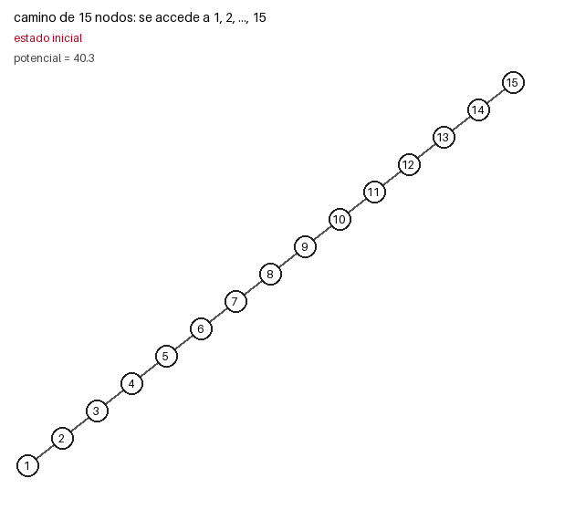
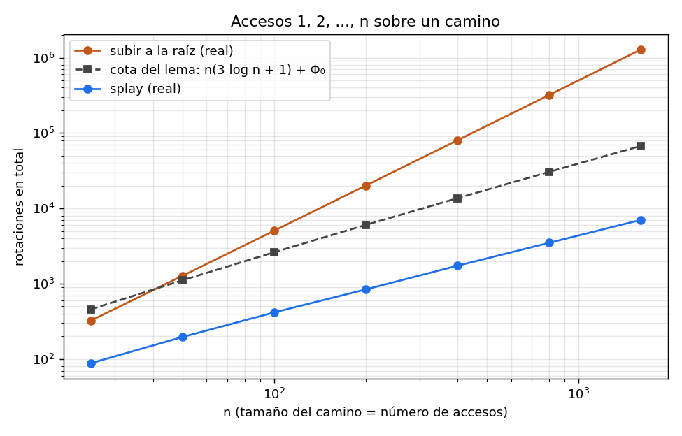

# Ejercicio 13

*El código está en `ejercicio-13.py`.*

> **Enunciado.** En un splay tree que empieza como un camino de `n` nodos se accede a las claves en orden. Se acota el costo total con el lema de acceso y la cuenta de la suma, y se compara el resultado con las mediciones para comprobar si la cota resulta ajustada.

---

## 1. El problema

**El árbol inicial.** Un camino de `n` nodos: la clave `n` está en la raíz y cada clave es hija izquierda de la siguiente. Es el peor árbol de partida, porque la clave `1` queda en el fondo, a profundidad `n - 1`.

**La secuencia.** Se hacen `n` accesos, a las claves `1, 2, 3, ..., n`, en ese orden.

**El costo.** Cada acceso busca la clave y después reorganiza el árbol. El costo de un acceso es el número de rotaciones que hace falta para subir el nodo a la raíz, y 1 si ya es la raíz.

**Objetivo.** Obtener una cota del costo total de los `n` accesos usando el lema de acceso y compararla con el comportamiento observado en la práctica.

---

## 2. El algoritmo: splay

**La idea.** Si un elemento se usa, conviene que quede arriba. La idea simple es subirlo a la raíz con rotaciones simples, una por nivel. El splay sube el nodo `x` a la raíz de dos niveles en dos, mirando la forma del camino (`y` es el padre de `x` y `z` es el abuelo):

- **zig:** `y` es la raíz. Una rotación.
- **zig-zig:** `x` e `y` son hijos del mismo lado. Se rota **primero el padre** `y` con el abuelo `z`, y después `x` con `y`.
- **zig-zag:** `x` e `y` son hijos de lados distintos. Se rota `x` dos veces.

Zig y zig-zag hacen las mismas rotaciones que subir a la raíz. La única diferencia está en el zig-zig, en el orden de las dos rotaciones. Ese orden va a importar mucho.

```python
def splay(x):
    rotaciones = 0
    while x.padre:
        p, g = x.padre, x.padre.padre
        if g is None:                               # zig
            rotar(x); rotaciones += 1
        elif (g.izq is p) == (p.izq is x):          # zig-zig: primero el padre
            rotar(p); rotar(x); rotaciones += 2
        else:                                       # zig-zag
            rotar(x); rotar(x); rotaciones += 2
    return rotaciones
```

La animación muestra el camino de 15 nodos mientras se accede a `1, 2, ..., 15`. En amarillo está el nodo al que se accede.



*Figura 1. Accesos en orden sobre un camino de 15 nodos. El primer acceso (la clave 1, que está en el fondo) cuesta 14 rotaciones, pero deja el árbol mucho menos profundo, y los siguientes accesos cuestan muy poco.*

---

## 3. El potencial y el lema de acceso

Para cada nodo `v`, sea `s(v)` el número de nodos de su subárbol (contándose a sí mismo) y `r(v) = log₂ s(v)` su rango. El **potencial** del árbol es la suma de los rangos:

```
Φ = Σ r(v)
```

Mide una deuda: un camino de `n` nodos tiene rangos `log₂ 1, log₂ 2, ..., log₂ n`, que suman `log₂ n!`, así que el potencial es alto justo cuando los accesos van a ser caros. Un árbol balanceado tiene potencial mucho menor.

**Lema de acceso.** El costo amortizado de hacer splay de un nodo `x` en un árbol de raíz `t` es a lo sumo `3 (r(t) - r(x)) + 1`, donde el costo amortizado es el costo real más lo que cambia el potencial:

```
costo amortizado = costo real + Φ(después) - Φ(antes)
```

En un árbol de `n` nodos el rango de la raíz es `log₂ n`, así que cada acceso cuesta amortizado a lo sumo `3 (log₂ n - r(x)) + 1`. Como `r(x) ≥ 0`, es a lo sumo `3 log₂ n + 1`. Uso el lema tal cual, sin demostrarlo de nuevo.

---

## 4. Cota del costo total

Sea `c_i` el costo real del acceso `i`, y `ĉ_i` su costo amortizado. Sumando los `n` accesos, los términos del potencial se telescopian:

```
Σ c_i  =  Σ ĉ_i  +  Φ₀  -  Φₙ
```

donde `Φ₀` es el potencial inicial y `Φₙ` el final.

Para relacionar el costo real total con la suma de los costos amortizados, el potencial tendría que terminar al menos donde empezó (`Φₙ ≥ Φ₀`). Aquí no se cumple, porque el árbol empieza como un camino y `Φ₀` es altísimo. Por eso se paga `Φ₀` aparte, una sola vez, y se usa que `Φₙ ≥ 0` (todos los rangos son `≥ 0`):

```
Σ c_i  ≤  Σ ĉ_i + Φ₀  ≤  n (3 log₂ n + 1) + Φ₀
```

Para el camino, `Φ₀ = log₂ n! ≤ n log₂ n`. Entonces:

```
costo total  ≤  n (3 log₂ n + 1) + log₂ n!  ≤  n (4 log₂ n + 1)  =  O(n log n)
```

Por acceso, eso es `O(log n)` amortizado. Esta es la cota del lema.

---

## 5. Resultados de las mediciones

En `ejercicio-13.py` corrí la secuencia `1, 2, ..., n`, y en cada acceso comprobé con un `assert` que el costo amortizado cumple el lema. No falló nunca. También comprobé que la suma telescópica es exacta (`real = amortizados + Φ₀ - Φₙ`).

**Traza con n = 15.** La columna `cota_i` es `3 (log₂ 15 - r(x_i)) + 1`.

| i | costo real | `r(x_i)` | `cota_i` | amortizado | potencial |
|---|---|---|---|---|---|
| 1 | 14 | 0,00 | 12,72 | -3,04 | 23,21 |
| 2 | 7 | 1,00 | 9,72 | 1,65 | 17,85 |
| 3 | 4 | 0,00 | 12,72 | 5,20 | 19,05 |
| 4 | 2 | 3,00 | 3,72 | 0,46 | 17,51 |
| 5 | 4 | 0,00 | 12,72 | 6,38 | 19,89 |
| 6 | 2 | 2,58 | 4,97 | 1,58 | 19,48 |
| 7 | 3 | 0,00 | 12,72 | 5,90 | 22,38 |
| 8 | 1 | 3,00 | 3,72 | 0,81 | 22,18 |
| 9 | 3 | 0,00 | 12,72 | 6,51 | 25,70 |
| 10 | 1 | 2,58 | 4,97 | 1,58 | 26,28 |
| 11 | 2 | 0,00 | 12,72 | 5,00 | 29,28 |
| 12 | 1 | 2,00 | 6,72 | 2,46 | 30,74 |
| 13 | 2 | 0,00 | 12,72 | 5,00 | 33,74 |
| 14 | 1 | 1,00 | 9,72 | 3,70 | 36,44 |
| 15 | 1 | 0,00 | 12,72 | 4,81 | 40,25 |

El potencial inicial es `40,25 = log₂ 15!` y el final también es `40,25`. El costo real total es 48, igual a la suma de los amortizados (48,00) más `Φ₀ - Φₙ = 0`.

Cosas que se ven en la traza:

- El primer acceso es carísimo (14 rotaciones, el camino entero), pero el potencial cae de 40,25 a 23,21. Por eso su costo amortizado es negativo (-3,04): pagó la deuda que tenía el árbol.
- Después de eso, los accesos cuestan 7, 4, 2, 4, 2, 3, 1, 3, 1, 2, 1, 2, 1, 1: poco, y cada vez menos.
- En los accesos impares el nodo es una hoja (`r = 0`), y el lema los deja cobrar hasta 12,72, aunque en la práctica cuestan entre 1 y 4.

**Tabla para `n` más grandes.**

| n | costo real | real / n | cota del lema | cota / n | cota fina | cota fina / (n log₂ n) | subir a la raíz | n²/2 |
|---|---|---|---|---|---|---|---|---|
| 50 | 196 | 3,92 | 1111 | 22,2 | 634 | 2,25 | 1274 | 1250 |
| 100 | 416 | 4,16 | 2618 | 26,2 | 1442 | 2,17 | 5049 | 5000 |
| 200 | 840 | 4,20 | 6032 | 30,2 | 3240 | 2,12 | 20099 | 20000 |
| 400 | 1732 | 4,33 | 13659 | 34,1 | 7211 | 2,09 | 80199 | 80000 |

- *cota del lema* es `n (3 log₂ n + 1) + log₂ n!`.
- *cota fina* es `Σ (3 (log₂ n - r(x_i)) + 1) + Φ₀ - Φₙ`, usando el rango real `r(x_i)` de cada acceso en vez de decir `r(x) ≥ 0`. En este experimento el árbol final vuelve a ser un camino con el mismo potencial que al principio (lo comprobé con `n = 400`), así que `Φ₀ - Φₙ = 0`.
- *subir a la raíz* es la heurística con rotaciones simples, sobre la misma secuencia.

**Para n más grandes todavía**, solo contando rotaciones:

| n | costo real | real / n | `log₂ n` | cota del lema / costo real |
|---|---|---|---|---|
| 800 | 3490 | 4,36 | 9,6 | 8,7 |
| 1600 | 7024 | 4,39 | 10,6 | 9,6 |
| 3200 | 14100 | 4,41 | 11,6 | 10,5 |
| 6400 | 28216 | 4,41 | 12,6 | 11,4 |

También medí el costo por acceso recorriendo las claves en orden varias veces seguidas (porque el árbol vuelve a ser un camino al terminar cada ronda, se repite el mismo patrón):

| n | splay, 1 ronda | splay, 3 rondas | subir a la raíz, 3 rondas | `log₂ n` |
|---|---|---|---|---|
| 100 | 4,16 | 4,16 | 50,5 | 6,6 |
| 200 | 4,20 | 4,20 | 100,5 | 7,6 |
| 400 | 4,33 | 4,33 | 200,5 | 8,6 |
| 800 | 4,36 | 4,36 | 400,5 | 9,6 |



*Figura 2. Costo total de los accesos `1, 2, ..., n` en ejes logarítmicos. El splay (azul) crece casi como `n`. La cota del lema (gris) crece como `n log n`. Subir a la raíz (naranja) crece como `n²`.*

---

## 6. Ajuste de la cota

La cota del lema es `O(n log n)`, mientras que las mediciones muestran un crecimiento lineal:

- El costo real por acceso se queda en unas 4,4 rotaciones aunque `n` pase de 100 a 6400. Entonces el costo total crece como `n`, no como `n log n`. Esto lo veo en la medición, no lo demuestro con el lema, porque el lema solo da `O(log n)` por acceso.
- La cota del lema, dividida por el costo real, sube cada vez que `n` se duplica (8,7; 9,6; 10,5; 11,4). El hueco entre la cota y la realidad crece como `log n`.
- Aun usando la cota fina (con el `r(x_i)` real y `Φ₀ - Φₙ = 0`), sigue siendo del orden de `n log n`: la columna `cota fina / (n log₂ n)` se queda cerca de 2, o sea, no baja a cero. Eso pasa porque en muchos accesos el nodo es una hoja, con `r = 0` (en la traza de `n = 15` son todos los impares), y el lema le cobra `3 log₂ n + 1` aunque cueste muy poco.

**Razón por la que no es ajustada.** El lema es una garantía que vale para cualquier secuencia de accesos, así que no puede aprovechar que esta secuencia es "amable": acceder en orden hace que el splay vaya dejando el árbol cada vez más chato. El costo del primer acceso es grande (`n - 1`), pero ese costo se paga con la caída del potencial, y desde ahí todos los accesos son baratos.

**La cota también permite detectar la heurística menos eficiente.** Subir a la raíz con rotaciones simples cuesta unos `n²/2` en total sobre esta secuencia (1274 con `n = 50`). La cota del lema para `n = 50` es 1111, así que subir a la raíz viola la cota. Esto coincide con la demostración: la cuenta del lema solo cierra si en el caso zig-zig se rota primero el padre. Subir a la raíz es correcto (el árbol sigue siendo de búsqueda), pero no tiene la misma garantía.

---

## 7. Conclusión

Empezando desde un camino de `n` nodos y accediendo a las claves `1, ..., n` en orden, el lema de acceso da que cada acceso cuesta amortizado a lo sumo `3 log₂ n + 1`. Al sumar, los potenciales se telescopian, pero como el potencial no termina por encima de donde empezó (empieza en `log₂ n!`, que es de orden `n log n`) hay que pagar `Φ₀` aparte, una sola vez. El resultado es que el costo total es a lo sumo `n (3 log₂ n + 1) + log₂ n! ≤ n (4 log₂ n + 1)`, o sea `O(n log n)`. En el código comprobé el lema paso a paso y la suma telescópica, y medí que el costo real es de unas 4,4 rotaciones por acceso, es decir, lineal en total. Entonces la cota no es ajustada: queda lejos y el hueco crece como `log n`, porque el lema vale para cualquier secuencia y no sabe que esta es una de las amables. Lo que sí hace la cota es detectar a subir a la raíz, que cuesta del orden de `n²` y la rompe.

