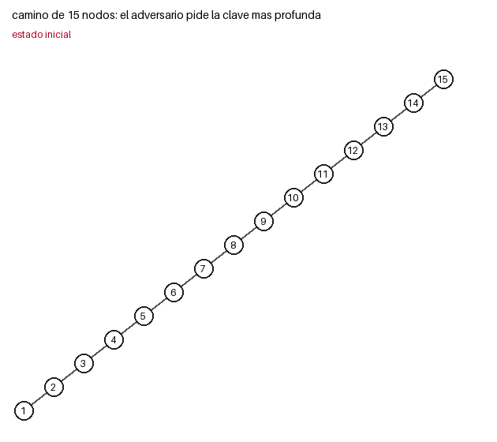
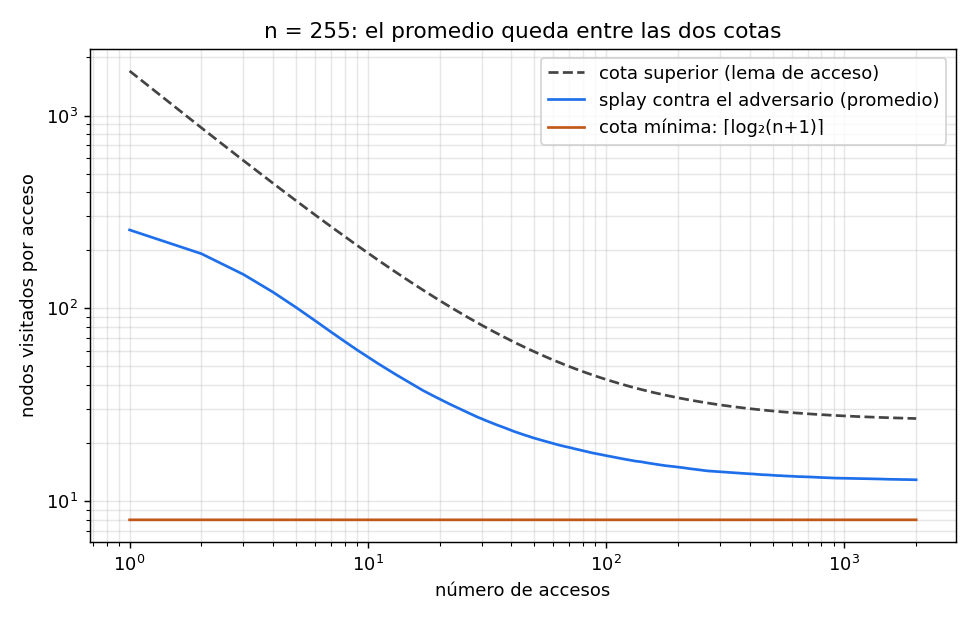
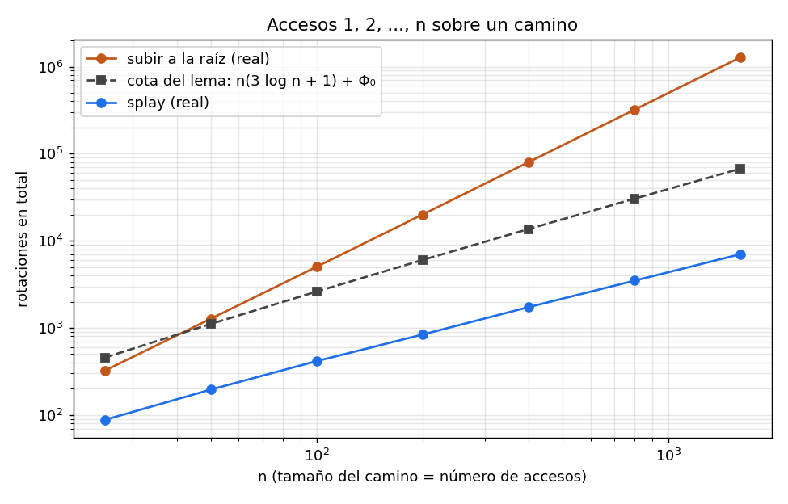

# Ejercicio 14:

**Enunciado.** Escoger un problema que no hayamos visto, recorrer el ciclo completo (problema, algoritmo, correctitud, costo y cota mínima) y conseguir que el algoritmo y la cota mínima coincidan.

**Problema elegido.** Un árbol binario de búsqueda con las claves $1, \dots, n$ que empieza como un camino, y una secuencia de $m$ accesos. ¿Cuánto cuesta atenderlos en el peor caso? Acceder a las claves $1, 2, \dots, n$ en orden es una secuencia particular de esta familia; la sección 7 vuelve sobre ella.

El código está en `ejercicio-14.py`.

---

## 1. Problema y modelo

**Entrada.** El árbol inicial es el camino con $n$ en la raíz y cada clave hija izquierda de la siguiente. Después llegan $m$ accesos, cada uno a una clave $k \in \{1, \dots, n\}$. Suponemos $n \geq 1$ y $m \geq 1$.

**Qué puede hacer un algoritmo.** Para atender un acceso baja desde la raíz comparando, y después puede reorganizar el árbol con rotaciones. Lo único que exigimos es que siga siendo un árbol de búsqueda con las mismas claves.

**Costo.** Buscar una clave a profundidad $d$ visita $d + 1$ nodos. Cada rotación cuesta 1, por lo que un acceso que hace splay con $d$ rotaciones cuesta

$$ (d+1)+d = 2d+1. $$

**Peor caso.** Se mide sobre las secuencias de accesos: queremos el costo de la peor secuencia de $m$ accesos.

---

## 2. Algoritmo: el splay tree

**La idea.** Si una clave se usa, conviene que quede arriba. Una primera idea es subirla a la raíz con rotaciones simples, una por nivel, pero eso no alcanza (ver sección 6). La corrección es subirla de dos en dos niveles, mirando la forma del camino:

- **zig:** el padre es la raíz. Una rotación.
- **zig-zig:** $x$ y su padre son hijos del mismo lado. Se rota **primero el padre** con el abuelo y después $x$ con el padre.
- **zig-zag:** $x$ y su padre son hijos de lados distintos. Se rota $x$ dos veces.

La diferencia con las rotaciones simples está solo en el orden de las dos rotaciones del zig-zig. Ese orden hace que el camino recorrido se reduzca aproximadamente a la mitad.

```python
def splay(x):
    rotaciones = 0
    while x.padre:
        p = x.padre
        g = p.padre
        if g is None:                               # zig
            rotar(x); rotaciones += 1
        elif (g.izq is p) == (p.izq is x):          # zig-zig: primero el padre
            rotar(p); rotar(x); rotaciones += 2
        else:                                       # zig-zag
            rotar(x); rotar(x); rotaciones += 2
    return rotaciones
```



*Figura 1. Los primeros accesos de la secuencia que mejor le sienta al adversario: siempre pide la clave más profunda (en rojo). Después del splay, esa clave queda en la raíz (en amarillo).*

---

## 3. Correctitud

**Especificación.**

- Precondición: el árbol es de búsqueda y tiene las claves $1, \dots, n$. El camino lo cumple.
- Postcondición de un acceso a $k$: el árbol sigue siendo de búsqueda con las mismas claves, y $k$ es la raíz.

**Invariante.** El recorrido en orden del árbol es $1, 2, \dots, n$.

- Inicialización: es verdad antes de empezar, por la precondición.
Mantenimiento: el splay es una secuencia de rotaciones, así que basta ver que una rotación conserva el recorrido en orden. Si $x$ es hijo izquierdo de $p$, con subárboles $A, B$ de $x$ y $C$ de $p$, el orden antes es $A\,x\,B\,p\,C$. Después de rotar, $x$ queda como raíz con hijo izquierdo $A$ e hijo derecho $p$ con subárboles $B$ y $C$, y el orden es otra vez $A\,x\,B\,p\,C$. El caso simétrico es igual.

Conclusión: el ciclo termina cuando `x.padre` es vacío, o sea cuando $x$ es la raíz. Como el orden en orden no cambió, el árbol sigue siendo de búsqueda.

**Terminación.** Usamos como medida la profundidad de $x$. Cada vuelta del ciclo la reduce en 1 (zig) o en 2 (zig-zig y zig-zag), y la profundidad siempre es un entero no negativo. Por tanto, el ciclo termina. Además, cada rotación sube a $x$ un nivel, así que un acceso que empieza a profundidad $d$ hace exactamente $d$ rotaciones.

Correctitud parcial más terminación da la correctitud total. 

El programa comprueba todo esto con `assert`: en 18 000 accesos sobre 300 árboles aleatorios, la clave termina en la raíz, el recorrido en orden no cambia, la profundidad de $x$ baja en cada paso y las rotaciones son exactamente la profundidad.

---

## 4. Costo: la cota superior

**Potencial.** Para cada nodo $v$ sea $s(v)$ el tamaño de su subárbol y $r(v) = \log_2 s(v)$ su rango. Sea $\Phi(T) = \sum_v r(v)$. En el camino inicial se tiene $\Phi_0=\log_2(n!)$, y siempre $\Phi(T)\geq0$.

**Lema de acceso.** El costo amortizado medido en rotaciones de hacer splay de $x$ en un árbol de $n$ nodos cumple

$$\text{costo real} + \Delta\Phi \;\leq\; 3\big(\log_2 n - r(x)\big) + 1 \;\leq\; 3\log_2 n + 1.$$

Para verlo, sea $r'(v)$ el rango después de una vuelta del splay. En un zig solo cambia el rango del nodo accedido y el de su padre. Como el nodo accedido queda en la raíz, se obtiene

$$1+\Delta\Phi\leq 1+3\big(r'(x)-r(x)\big).$$

En un zig-zig o en un zig-zag se hacen dos rotaciones. Al comparar los tres subárboles que intervienen, y usar que

$$\log_2 a+\log_2 b=\log_2(ab),$$

se obtiene

$$2+\Delta\Phi\leq 3\big(r'(x)-r(x)\big).$$

En ambos casos, después de la vuelta se cumple $r'(x)\leq\log_2 n$. Sumando las vueltas, los términos intermedios de los rangos se cancelan y queda la desigualdad del lema. La demostración vale para cualquier árbol y cualquier clave accedida.

**Sumando $m$ accesos.** Las diferencias del potencial se telescopian:

$$\sum \text{rotaciones} \;\leq\; m(3\log_2 n + 1) + \Phi_0 - \Phi_{\text{final}} \;\leq\; m(3\log_2 n + 1) + \log_2 n!,$$

porque $\Phi_{\text{final}} \geq 0$ y $\Phi_0 = \sum_{k=1}^{n} \log_2 k = \log_2 n!$, ya que en el camino los tamaños de los subárboles son $1, 2, \dots, n$.

**Del número de rotaciones al costo.** Si $R$ es el número total de rotaciones, el número total de nodos visitados es $R+m$, porque cada acceso a profundidad $d$ visita $d+1$ nodos. Por tanto, el costo total es

$$\text{costo total}=2R+m.$$

Usando la cota anterior:

$$\boxed{\;\text{costo total} \;\leq\; 2\Big(m(3\log_2 n + 1) + \log_2 n!\Big)+m\;}$$

Como $\log_2 n! \leq n\log_2 n$, para $m \geq n$ y $n\geq2$ esto es a lo sumo

$$2m(4\log_2 n+1)+m=O(m\log n).$$

---

## 5. ¿Se puede mejor? La cota mínima

La pregunta ahora es por cualquier algoritmo: cualquier regla para mantener un árbol de búsqueda con las claves $1, \dots, n$, que puede reorganizar el árbol como quiera después de cada acceso, incluso gratis. Solo contamos los nodos visitados al buscar.

**Idea del adversario.** Conoce el algoritmo y ve el árbol en cada momento. En cada acceso pide la clave más profunda.

**Lema.** Un árbol binario de altura $h$ tiene a lo sumo $2^{h+1} - 1$ nodos.

*Demostración.* Por inducción sobre $h$. Con $h = 0$ es una sola hoja: $1 = 2^1 - 1$. Si $h > 0$, la raíz tiene a lo sumo dos subárboles de altura a lo sumo $h - 1$, cada uno con a lo sumo $2^h - 1$ nodos. En total hay a lo sumo $1 + 2(2^h - 1) = 2^{h+1} - 1$. $\square$

**Consecuencia.** Un árbol con $n$ nodos cumple $n \leq 2^{h+1} - 1$, o sea $h + 1 \geq \log_2(n+1)$. Como $h+1$ es entero, la clave más profunda necesita visitar al menos $\lceil \log_2(n+1) \rceil$ nodos.

**Teorema.** Para todo algoritmo determinista y todo $m\geq1$ existe una secuencia de $m$ accesos cuyo costo de búsqueda es al menos

$$n + (m-1)\lceil \log_2(n+1) \rceil.$$

*Demostración.* El adversario simula el algoritmo, que es determinista, y arma la secuencia paso a paso.

- Primer acceso: el árbol inicial es el camino, que tiene una clave a profundidad $n - 1$ (la clave 1). El adversario la pide y la búsqueda visita $n$ nodos. Esto vale para cualquier algoritmo, porque todos empiezan en el mismo camino.
- Accesos siguientes: el árbol, sea cual sea, tiene $n$ nodos. El adversario pide su clave más profunda y la búsqueda visita al menos $\lceil \log_2(n+1) \rceil$ nodos.

Sumando, queda la cota. 
No se necesita suponer cómo se reorganiza el árbol después de cada acceso. La cota sigue siendo válida aunque las reorganizaciones fueran gratis, y por eso también es una cota para el costo total del modelo original.

---

## 6. Los dos extremos tienen el mismo orden

Para $m \geq n$ y $n\geq2$:

$$n+(m-1)\lceil \log_2(n+1) \rceil
\;\leq\; \text{costo del peor caso} \;\leq\;
2\Big(m(3\log_2 n+1)+\log_2 n!\Big)+m.$$

La cota inferior y la superior son $\Theta(m\log n)$ cuando $m\geq n$ y $n\geq2$. Por tanto, el costo del problema en el peor caso es $\Theta(m\log n)$, y el splay alcanza ese orden asintótico.



*Figura 2. Nodos visitados por acceso (promedio acumulado) del splay contra el adversario, con $n = 255$ y 2 000 accesos. La curva queda entre la cota mínima y una cota superior para las visitas. La parte inicial de esa cota baja porque el costo de $\Phi_0$ se reparte entre más accesos.*

Medido en el programa, con el adversario jugando contra el splay y $m = 4n$:

| $n$ | $m$ | nodos visitados | cota mínima | visitados / mínima | costo total | cota superior | total / superior |
|---:|---:|---:|---:|---:|---:|---:|---:|
| 63 | 252 | 2 479 | 1 569 | 1.58 | 4 706 | 10 374 | 0.45 |
| 255 | 1 020 | 13 397 | 8 407 | 1.59 | 25 774 | 55 337 | 0.47 |
| 511 | 2 044 | 30 286 | 18 898 | 1.60 | 58 528 | 124 206 | 0.47 |

El splay visita aproximadamente 1.6 veces lo que obliga la cota mínima en estos experimentos. Esto es compatible con que las dos cotas tengan el mismo orden asintótico. El programa también comprueba el lema de acceso en cada acceso de la secuencia adversaria ($n = 63$, $m = 400$).

**Por qué importa el orden del zig-zig.** Contra el mismo adversario, la heurística de subir a la raíz con rotaciones simples visita 21.8 nodos por acceso con $n = 63$ y 76.7 con $n = 255$, en vez de $\log_2(n+1) = 6$ y $8$. Crece con $n$, no con $\log n$: no cumple el lema ni se acerca a la cota mínima.

**Límite de lo que se logró.** Para $m<n$, estas dos demostraciones no producen la misma expresión asintótica, porque la cota superior conserva el término inicial $\log_2(n!)=O(n\log n)$. Por eso la conclusión $\Theta(m\log n)$ se formula para $m\geq n$.

---

## 7. ¿Qué pasa con la secuencia $1, 2, \dots, n$?

Es una de las secuencias de esta familia. La cota superior da $O(n \log n)$ para ella, pero la medida es otra:

| $n$ | rotaciones reales | real / $n$ | cota del lema | cota / real |
|---:|---:|---:|---:|---:|
| 100 | 416 | 4.16 | 2 618 | 6.3 |
| 400 | 1 732 | 4.33 | 13 659 | 7.9 |
| 1 600 | 7 024 | 4.39 | 67 419 | 9.6 |
| 6 400 | 28 216 | 4.41 | 320 857 | 11.4 |



*Figura 3. Costo total de acceder a $1, \dots, n$ en orden. El splay crece con pendiente 1, la cota del lema crece un poco más rápido, y subir a la raíz crece con pendiente 2.*

Para esta secuencia la cota no es ajustada: el costo real es aproximadamente $4.4\,n$, y la cota es un factor $\log n$ más grande (la columna "cota / real" crece casi como $\log_2 n$). No hay contradicción con la sección 6: las cotas se comparan para el peor caso, mientras que la secuencia en orden puede ser más fácil.

Lo que no demostré es que la secuencia en orden cueste $\Theta(n)$: eso es lo que muestra la tabla (el cociente se estabiliza cerca de 4.4), pero no una demostración. El lema de acceso solo da $O(n \log n)$ para ella.

---

## 8.Conclusiones
- Problema: un árbol de búsqueda que empieza como camino de $n$ nodos y $m$ accesos. ¿Cuánto cuesta en el peor caso?
- Algoritmo: splay, que sube la clave accedida a la raíz de dos en dos niveles, con el orden zig-zig que reduce el camino a la mitad.
- Correctitud: invariante (el orden en orden no cambia) y medida de terminación (la profundidad de $x$ baja).
- Cota superior: por el lema de acceso, el costo total es a lo sumo $2\big(m(3\log_2 n + 1) + \log_2 n!\big)+m$, que es $O(m\log n)$ si $m \geq n$ y $n\geq2$.
- Cota mínima: un adversario que pide siempre la clave más profunda obliga a cualquier algoritmo a pagar al menos $n + (m-1)\lceil\log_2(n+1)\rceil$.
- Mismo orden asintótico: $\Theta(m \log n)$ para $m \geq n$ y $n\geq2$. En la prueba realizada, el splay visita 1.6 veces la cota mínima.
- Secuencia en orden: la cota no es ajustada para ella, que cuesta aproximadamente $4.4\,n$.

Con `python ejercicio-14.py` se comprueban la correctitud, el lema de acceso y las dos cotas.