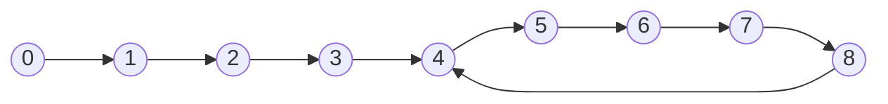
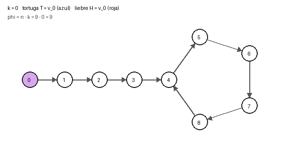

# Tema 1 · Ejercicio 5: detección de ciclos (Floyd)

**Enunciado.** Detección de ciclos en una lista enlazada con dos punteros que avanzan a velocidades 1 y 2. Demostrar que se encuentran si y solo si hay un ciclo (con un invariante) y que el algoritmo termina (con un potencial). Dar el costo.

---

## 1. Problema

**Entrada.** La cabeza de una lista enlazada. Cada nodo tiene un campo `siguiente` que es otro nodo o `None`. La lista puede ser vacía.

**Notación.** Sea $v_0$ la cabeza y $v_{i+1} = v_i.\text{siguiente}$. Si algún $v_i$ es `None`, todos los siguientes también lo son y decimos que la sucesión se acabó.

**Postcondición.** El algoritmo devuelve `True` si y solo si hay ciclo, es decir, si $v_i \neq$ `None` para todo $i$.

**Forma de la lista.** Si hay ciclo, sea $\mu$ la cantidad de nodos de la cola (los que están antes del ciclo) y $\lambda$ el largo del ciclo. Sea $n$ la cantidad de nodos distintos alcanzables desde la cabeza; si hay ciclo, $n = \mu + \lambda$.

**Modelo.** RAM: seguir un puntero y comparar dos referencias cuestan 1.



*Figura 1. Ejemplo con $\mu = 4$ y $\lambda = 5$.*

---

## 2. Algoritmo

La tortuga `t` avanza un nodo por vuelta y la liebre `h` avanza dos.

```python
def floyd(cabeza):
    t = h = cabeza
    while h is not None and h.siguiente is not None:
        t = t.siguiente
        h = h.siguiente.siguiente
        if t is h:
            return True
    return False
```



*Figura 2. Cada cuadro es una vuelta. T (azul) está en $v_k$ y H (roja) en $v_{2k}$. Se encuentran en el nodo 5.*

Traza sobre el ejemplo de la figura 1:

| $k$ | $T = v_k$ | $H = v_{2k}$ | $\Phi = n - k$ |
|---:|---:|---:|---:|
| 0 | 0 | 0 | 9 |
| 1 | 1 | 2 | 8 |
| 2 | 2 | 4 | 7 |
| 3 | 3 | 6 | 6 |
| 4 | 4 | 8 | 5 |
| 5 | 5 | 5 | 4 |

---

## 3. Correctitud parcial


**Invariante.** Después de $k$ vueltas, `t` $= v_k$ y `h` $= v_{2k}$.

**Inicialización.** Con $k = 0$, `t = h = cabeza` $= v_0 = v_{2\cdot 0}$.

**Mantenimiento.** Supongamos que el invariante vale para $k$ y que se cumple la guarda, o sea $v_{2k} \neq$ `None` y $v_{2k+1} \neq$ `None`. La vuelta hace:
- `t = t.siguiente`, que da $v_{k+1}$.
- `h = h.siguiente.siguiente`, que da $v_{2k+2}$.

Luego el invariante vale para $k+1$.

**Conclusión.** Hay dos formas de salir del ciclo:
1. Devuelve `True` en la vuelta $k \ge 1$. Por el invariante, `t is h` significa $v_k = v_{2k}$ con $k \geq 1$. Entonces desde $v_k$ se llega otra vez a $v_k$ en $k$ pasos, así que la sucesión no se acaba nunca y hay ciclo.
2. Devuelve `False` porque la guarda falla. Entonces $v_{2k}$ o $v_{2k+1}$ es `None`, la sucesión se acabó y no hay ciclo.

Esto prueba que si devuelve `True` hay ciclo. Y si no hay ciclo, nunca puede devolver `True`, así que devuelve `False`.

**Falta el recíproco: si hay ciclo, devuelve `True`.** Supongamos que hay ciclo y sea $K = \max(\mu, 1)$. Desde la vuelta $K$ los dos punteros están dentro del ciclo: $v_K$ porque $K \geq \mu$, y $v_{2K}$ porque $2K \geq K \geq \mu$. Para $k \geq K$ sea $e_k$ la distancia que le falta a la liebre $v_{2k}$ para llegar a la tortuga $v_k$ avanzando por el ciclo. Es un entero con $0 \leq e_k \leq \lambda - 1$.

- Si $e_k = 0$, entonces $v_k = v_{2k}$, o sea `t is h`. Como $k \geq 1$, el algoritmo ya devolvió `True`.
- Si $e_k \geq 1$, en la vuelta siguiente la liebre avanza 2 nodos y la tortuga 1, ambos por el ciclo, así que la liebre se acerca exactamente 1. Como $e_k - 1 \geq 0$ no se pasa de la tortuga, y queda $e_{k+1} = e_k - 1$.

Entonces $e_k$ es un entero no negativo que baja 1 en cada vuelta. Llega a 0 en a lo sumo $e_K \leq \lambda - 1$ vueltas más, o sea en alguna vuelta

$$k \leq K + \lambda - 1 \leq n$$

(si $\mu \geq 1$ da $\mu + \lambda - 1 < n$, y si $\mu = 0$ da $\lambda = n$). Por el invariante, el algoritmo devuelve `True` en esa vuelta o antes. En el ejemplo, $K = 4$, la liebre está en el nodo 8 y la tortuga en el 4, así que $e_4 = 1$ (de 8 se llega a 4 en un paso). Luego $e_5 = 0$, que coincide con la traza.

Por lo tanto `floyd(cabeza)` devuelve `True` si y solo si hay ciclo. $\square$

---

## 4. Terminación

Definimos el potencial $\Phi_k = n - k$, donde $k$ es la cantidad de vueltas hechas.

- $\Phi$ baja exactamente 1 por vuelta, porque $k$ sube 1.
- $\Phi \geq 1$ al comenzar cada vuelta:
  - Sin ciclo, la guarda exige $v_{2k+1} \neq$ `None`, o sea $2k + 1 < n$, de donde $k < n$.
  - Con ciclo, si se va a hacer la vuelta $k+1$ es porque todavía no se encontraron, y por el recíproco se encuentran en una vuelta $k_e \leq n$, así que $k < k_e \leq n$.

Como $\Phi$ es un entero no negativo que baja en cada vuelta, no puede bajar para siempre y el ciclo termina. Además el valor inicial acota las vueltas: a lo sumo $n/2$ sin ciclo y a lo sumo $n$ con ciclo.

Como tenemos correctitud parcial y terminación, el algoritmo es **totalmente correcto**. $\square$

---

## 5. Costo

Cada vuelta hace una cantidad constante de pasos de puntero y una comparación, o sea $O(1)$, y hay a lo sumo $n$ vueltas.

- **Tiempo:** $O(n)$.
- **Memoria:** $O(1)$, porque solo guardamos dos punteros.

---


## 7. C0nclusiones

- **Invariante:** después de $k$ vueltas, `t` $= v_k$ y `h` $= v_{2k}$.
- **Correctitud parcial:** devuelve `True` si y solo si hay ciclo. El recíproco sale de un segundo potencial, la distancia $e_k$ de la liebre a la tortuga dentro del ciclo, que baja 1 por vuelta.
- **Terminación:** el potencial $\Phi = n - k$ baja en 1 por vuelta, así que termina.
- **Costo:** $O(n)$ en tiempo y $O(1)$ en memoria.

Con `ejercicio-5.py` comprobé el invariante y el potencial con `assert` en 961 listas ($\mu, \lambda \leq 30$) sin fallos, y también que $e_k$ baja exactamente 1 por vuelta y que el encuentro ocurre en una vuelta $k \leq n$. Esto no sustituye la demostración, pero es el experimento que conviene correr antes de intentarla.
