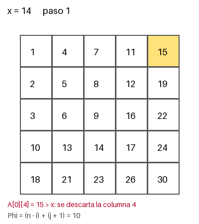

# Tema 1 · Ejercicio 6: búsqueda en una matriz con filas y columnas ordenadas

**Enunciado.** Una matriz $n \times n$ tiene filas y columnas ordenadas de forma creciente. Diseñar un algoritmo que decida si contiene un valor $x$ en $O(n)$ comparaciones, demostrar su correctitud con un invariante y demostrar con un adversario que no se puede en $o(n)$.

El código está en `ejercicio-6.py`.

---

## 1. Problema y modelo

**Entrada.** Una matriz $A$ de $n \times n$ y un valor $x$. Cada fila crece de izquierda a derecha y cada columna de arriba hacia abajo (vale en sentido amplio o estricto).

**Precondición.** $A[i][j] \leq A[i][j+1]$ y $A[i][j] \leq A[i+1][j]$ para todo índice válido.

**Postcondición.** Devuelve `True` si y solo si $x$ aparece en $A$.

**Modelo.** Es el modelo de comparaciones, igual que en la búsqueda binaria: el algoritmo solo compara $x$ con una entrada $A[i][j]$ y la respuesta es $<$, $=$ o $>$. El costo es el número de comparaciones. La cota que demostremos vale en este modelo.

Matriz de ejemplo ($n = 5$):

| | | | | |
|--:|--:|--:|--:|--:|
| 1 | 4 | 7 | 11 | 15 |
| 2 | 5 | 8 | 12 | 19 |
| 3 | 6 | 9 | 16 | 22 |
| 10 | 13 | 14 | 17 | 24 |
| 18 | 21 | 23 | 26 | 30 |

---

## 2. Algoritmo

Empezamos en la esquina superior derecha. Si $A[i][j] > x$, lo que está debajo de $A[i][j]$ en su columna es aún mayor, así que se descarta la columna. Si $A[i][j] < x$, lo que está a su izquierda en su fila es aún menor, así que se descarta la fila. Cada comparación elimina una fila o una columna.

```python
def buscar(n, cmp):
    # cmp(i, j) devuelve -1, 0, +1 segun A[i][j] <, =, > x
    i, j = 0, n - 1
    while i < n and j >= 0:
        r = cmp(i, j)
        if r == 0:
            return True
        if r > 0:        # A[i][j] > x: sobra la columna j
            j -= 1
        else:            # A[i][j] < x: sobra la fila i
            i += 1
    return False
```



*Figura 1. Búsqueda de $x = 14$. Las celdas grises están descartadas. Se encuentra en el paso 6.*

| paso | $(i, j)$ | $A[i][j]$ | resultado | $\Phi = (n-i) + (j+1)$ |
|---:|:---:|---:|:---:|---:|
| 1 | (0, 4) | 15 | $>$ | 10 |
| 2 | (0, 3) | 11 | $<$ | 9 |
| 3 | (1, 3) | 12 | $<$ | 8 |
| 4 | (2, 3) | 16 | $>$ | 7 |
| 5 | (2, 2) | 9 | $<$ | 6 |
| 6 | (3, 2) | 14 | $=$ | 5 |

---

## 3. Correctitud parcial: el invariante

**Invariante.** Al comenzar cada vuelta, si $x$ está en $A$, entonces está en la submatriz de las filas $i, \dots, n-1$ y las columnas $0, \dots, j$.

**Inicialización.** Con $i = 0$ y $j = n-1$ la submatriz es toda $A$.

**Mantenimiento.** Supongamos que el invariante vale al comenzar una vuelta y que $A[i][j] \neq x$. Hay dos casos, uno por rama del `if`:

- Si $A[i][j] > x$: para toda fila $r \geq i$, como las columnas crecen, $A[r][j] \geq A[i][j] > x$. Entonces $x$ no está en la columna $j$ (filas $i, \dots, n-1$). Si $x$ estaba en la submatriz, está en las columnas $0, \dots, j-1$, que es lo que queda después de `j -= 1`.
- Si $A[i][j] < x$: para toda columna $c \leq j$, como las filas crecen, $A[i][c] \leq A[i][j] < x$. Entonces $x$ no está en la fila $i$ (columnas $0, \dots, j$). Si estaba en la submatriz, está en las filas $i+1, \dots, n-1$, que es lo que queda después de `i += 1`.

En los dos casos el invariante vale al comenzar la vuelta siguiente.

**Conclusión.** Hay dos formas de salir:
1. Devuelve `True`: es porque $A[i][j] = x$, así que $x$ está en $A$.
2. Sale porque $i = n$ o $j < 0$: la submatriz es vacía. Por el invariante, si $x$ estuviera en $A$ estaría en una submatriz vacía, lo cual es imposible. Entonces $x$ no está y `False` es correcto.

Por lo tanto el algoritmo devuelve `True` si y solo si $x$ está en $A$. 

---

## 4. Terminación: el potencial

El potencial es una cantidad entera no negativa que baja en cada vuelta. Tomamos

$$\Phi = (n - i) + (j + 1),$$

la cantidad de filas más la cantidad de columnas que quedan en la submatriz.

- Al principio $\Phi = 2n$.
- En cada vuelta que no devuelve, o $i$ sube 1 o $j$ baja 1, así que $\Phi$ baja exactamente 1.
- La vuelta solo se ejecuta si $i \leq n-1$ y $j \geq 0$, o sea si $n - i \geq 1$ y $j + 1 \geq 1$. Entonces $\Phi \geq 2$ al comenzar cada vuelta.

Como no puede bajar para siempre, el ciclo termina, y el valor inicial acota el número de vueltas: $\Phi$ va de $2n$ a lo sumo hasta 2, así que hay a lo sumo $2n - 1$ vueltas.

Correctitud parcial más terminación da la **correctitud total**. 

---

## 5. Costo

Cada vuelta hace exactamente una comparación, y hay a lo sumo $2n - 1$ vueltas. Entonces

$$\text{comparaciones} \leq 2n - 1 = O(n),$$

con $O(1)$ de memoria extra.

---

## 6. Cota mínima: no se puede en $o(n)$

### 6.1 Por qué la información no alcanza

El argumento de información cuenta salidas: un árbol de decisión de altura $h$ tiene a lo sumo $2^h$ hojas (lema 1), y un algoritmo necesita una hoja por cada salida distinta que debe poder dar. Aquí hay solo dos salidas, `True` y `False`, así que se obtiene $\lceil \log_2 2 \rceil = 1$. Cuando la salida es pequeña pero el trabajo para justificarla es grande, la información se queda corta, como pasa con el máximo. Hace falta un adversario.

### 6.2 El adversario

Un adversario es un oponente que contesta de forma consistente: en todo momento existe al menos una entrada que daría todas las respuestas dadas. Si el algoritmo termina y quedan dos entradas consistentes con salidas correctas distintas, se equivocó en una. Para fijar sus respuestas, el adversario puede contestar "como si la entrada fuera" una entrada concreta del problema. Elegimos una matriz concreta $M_0$ y respondemos como si la entrada fuera $M_0$.

Sea $x = 3(n-1)$. La **antidiagonal** son las $n$ celdas con $i + j = n - 1$.

- **$M_0$:** $M_0[i][j] = 3(i+j)$ fuera de la antidiagonal, y $M_0[i][j] = x - 1$ en la antidiagonal. **No contiene $x$.**
- **$M_1^{(c)}$:** igual a $M_0$, salvo que la celda $c$ de la antidiagonal vale $x$. **Contiene $x$.**

Ejemplo con $n = 5$ ($x = 12$), con la antidiagonal en negrita:

| | | | | |
|--:|--:|--:|--:|--:|
| 0 | 3 | 6 | 9 | **11** |
| 3 | 6 | 9 | **11** | 15 |
| 6 | 9 | **11** | 15 | 18 |
| 9 | **11** | 15 | 18 | 21 |
| **11** | 15 | 18 | 21 | 24 |

Respondemos como $M_0$: las celdas con $i + j < n - 1$ son menores que $x$, las de $i + j > n - 1$ son mayores, y las de la antidiagonal son menores ($x - 1$). Es consistente porque $M_0$ existe y da todas las respuestas.

### 6.3 La demostración

El esquema es: supongamos que el algoritmo termina sin haber comparado cierta celda, cambiemos su valor, y veamos que las respuestas son las mismas pero la salida correcta cambió.

**Afirmación.** Todo algoritmo correcto, ejecutado sobre $M_0$, compara $x$ con las $n$ celdas de la antidiagonal. En particular hace al menos $n$ comparaciones.

**Demostración.** Supongamos que un algoritmo termina sin haber comparado $x$ con una celda $c$ de la antidiagonal. Cambiemos el valor de $c$ de $x - 1$ a $x$, y obtenemos $M_1^{(c)}$.

- **La matriz sigue ordenada.** Los vecinos de $c$ a su izquierda y arriba están en la diagonal $i + j = n - 2$ y valen $x - 3$. Los vecinos de $c$ a su derecha y abajo están en la diagonal $i + j = n$ y valen $x + 3$. Como $x - 3 < x < x + 3$, el valor $x$ en $c$ respeta el orden de su fila y de su columna. Dos celdas distintas de la antidiagonal nunca comparten fila ni columna, así que cambiar solo $c$ no afecta a las demás.
- **Todas las comparaciones dan la misma respuesta.** Las dos matrices solo difieren en $c$, y ninguna comparación involucró a $c$.
- **Pero la salida correcta cambió.** En $M_0$ no está $x$ y en $M_1^{(c)}$ sí.

El algoritmo da la misma salida para las dos entradas, así que se equivoca en una. Por tanto compara las $n$ celdas de la antidiagonal. $\square$

### 6.4 Conclusión de la cota

Todo algoritmo necesita al menos $n$ comparaciones en el peor caso, así que ninguno puede ser $o(n)$. Con el costo de la sección 5:

$$n \leq \text{costo en el peor caso} \leq 2n - 1,$$

o sea $\Theta(n)$, y el algoritmo es óptimo en el modelo de comparaciones.

### 6.5 Verificación en el código

`ejercicio-6.py` corre `buscar` contra $M_0$ y también un algoritmo `apurado` que se rinde a las $n - 1$ comparaciones:

| $n$ | comparaciones de `buscar` | celdas de la antidiagonal vistas | `apurado` (se rinde a las $n-1$) | se equivoca en |
|---:|---:|---:|---:|:---:|
| 3 | 5 | 3 | 2 | $M_1$ (tiene $x$) |
| 5 | 9 | 5 | 4 | $M_1$ (tiene $x$) |
| 8 | 15 | 8 | 7 | $M_1$ (tiene $x$) |
| 16 | 31 | 16 | 15 | $M_1$ (tiene $x$) |
| 32 | 63 | 32 | 31 | $M_1$ (tiene $x$) |

`buscar` hace exactamente $2n - 1$ comparaciones sobre $M_0$ y mira las $n$ celdas de la antidiagonal, como dice la afirmación. `apurado` deja celdas sin preguntar. El programa construye $M_1$, comprueba que las dos matrices son válidas y que `apurado` da la misma respuesta, así que se equivoca. Un algoritmo que hace menos trabajo que una cota demostrada está mal, y la cota lo detecta sin pruebas al azar.

---

## 7. Resumen

- **Algoritmo:** búsqueda en escalera desde la esquina superior derecha. Cada comparación descarta una fila o una columna.
- **Invariante:** si $x$ está en $A$, está en las filas $i, \dots, n-1$ y columnas $0, \dots, j$.
- **Potencial:** $\Phi = (n-i) + (j+1)$ baja 1 por vuelta, con $\Phi_0 = 2n$.
- **Costo:** a lo sumo $2n - 1$ comparaciones, $O(n)$, con $O(1)$ de memoria.
- **Cota mínima:** la información no alcanza (dos salidas). El adversario responde como $M_0$, y si el algoritmo deja una celda de la antidiagonal sin comparar, no distingue $M_0$ de $M_1^{(c)}$. Entonces necesita al menos $n$ comparaciones, así que no se puede en $o(n)$.


