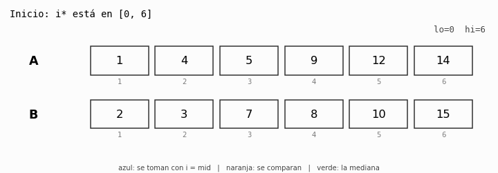
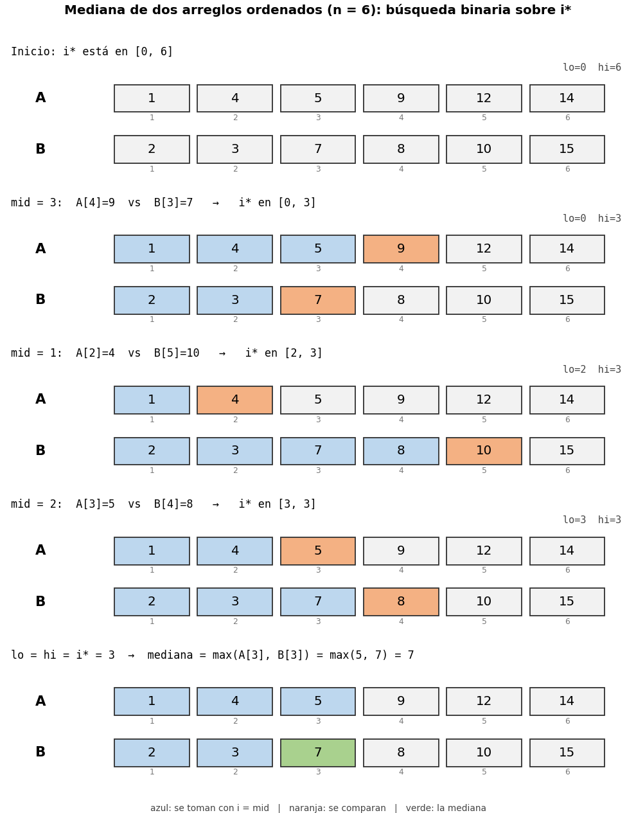

# Ejercicio 7


> Enunciado. Mediana de dos arreglos ordenados de largo `n`: el `n`-ésimo menor de los `2n` elementos. Diseña un algoritmo `O(log n)`, demuestra su correctitud y da la cota de información.


---

## 1. Problema 

**Entrada.** Dos arreglos A[1..n] y B[1..n], cada uno ordenado de forma no decreciente. Esa es la precondición.

**Salida.** La posición del n-ésimo menor del multiconjunto formado por los 2n elementos. Es decir, sorted(A + B)[n] contando desde 1 (la mediana inferior).

**Modelo.** Comparaciones: sobre los valores solo se puede preguntar `x ≤ y`. Con los índices se puede hacer cualquier cuenta gratis. El costo es el número de preguntas.

Conviene dejar claras las precisiones que casi nunca se dan:

- **Empates.** Puede haber valores repetidos, dentro de un arreglo y entre los dos. El *valor* de la mediana es único, pero para razonar necesito un orden total estricto. Lo fijo así: se ordenan los `2n` elementos por valor, y **si hay empate gana `A`** (va antes), y dentro de un mismo arreglo manda el índice. Como `A` y `B` ya están ordenados, cada uno aparece creciente en este orden.
- **Qué es la salida.** Un algoritmo de comparaciones nunca ve los valores, así que su salida es una *posición*: `A[k]` o `B[k]`.

**Fuerza bruta (el oráculo).** Mezclar `A` y `B` y quedarse con el elemento `n`. Es correcto por agotamiento y cuesta `n` comparaciones, que es lineal. Sirve de oráculo en las pruebas (`oraculo` en el `.py`). La pregunta es la de siempre: ¿se puede mejor? Sí, con `O(log n)`.

---


Los `n` menores de los `2n` forman un conjunto `S`. Como `A` está ordenado, `S` contiene un **prefijo** de `A`, y lo mismo pasa con `B`:

```
S = A[1..i*]  ∪  B[1..n-i*]        (i* elementos de A, n-i* de B)
```

La mediana es el **mayor** elemento de `S`, o sea el mayor entre `A[i*]` y `B[n-i*]`. Entonces todo el problema se reduce a hallar un solo número, `i*`, que está en `{0, 1, ..., n}`. Hay `n + 1` candidatos.

Esto es la misma situación que la búsqueda binaria sobre un arreglo ordenado: `n + 1` huecos y una comparación que parte el rango por la mitad. La pregunta es qué comparación me dice "`i*` está a la izquierda o a la derecha de `mid`". Si pruebo `i = mid`, tomo `mid` elementos de `A` y `n - mid` de `B`. Miro el primero de `A` que dejé afuera, `A[mid+1]`, y el último de `B` que tomé, `B[n-mid]`. Si `A[mid+1] ≤ B[n-mid]`, el que dejé afuera es menor que uno que tomé (no debería haber quedado afuera), así que hay que tomar más de `A`. Si no, el corte ya toma demasiado de `A`, y hay que tomar menos.

```
   A:  [ A1 A2 ... A_mid ]  A_(mid+1) ...       tomo mid de A
   B:  [ B1 ... B_(n-mid) ] B_(n-mid+1) ...     y n-mid de B
                ^ ultimo de B que tomo
   se comparan  A_(mid+1) (primero de A que dejo)  vs  B_(n-mid) (ultimo de B que tomo)
```



*Figura 1. El algoritmo sobre `A = [1,4,5,9,12,14]`, `B = [2,3,7,8,10,15]`. En azul, lo que se toma con `i = mid`; en naranja, los dos elementos que se comparan; en verde, la mediana. (También está `mediana_animacion.svg`, que se anima en el navegador.)*



*Figura 2. Los mismos pasos, uno debajo del otro.*

---

## 2. Algoritmo

```python
def mediana(A, B, cuenta):
    n = len(A)
    lo, hi = 0, n                       # invariante: lo <= i* <= hi
    while lo < hi:                      # potencial: hi - lo
        mid = (lo + hi) // 2            # mid < hi, por tanto mid < n
        cuenta[0] += 1
        if A[mid+1] <= B[n-mid]:        # (indices desde 1)
            lo = mid + 1                # A[mid+1] es de los n menores
        else:
            hi = mid                    # A[mid+1] no lo es
    i = lo                              # lo == hi == i*
    if i == 0: return B[n]
    if i == n: return A[n]
    cuenta[0] += 1
    return max(A[i], B[n-i])            # una comparacion final
```

(El `.py` devuelve la posición `('A', k)` o `('B', k)` y usa índices desde 1 con funciones `a(k)` y `b(k)` para que se parezca a la demostración.)

**Traza sobre el ejemplo** (`n = 6`, la mediana es 7):

| vuelta | lo | hi | mid | comparación | resultado | nuevo rango de `i*` |
|---|---|---|---|---|---|---|
| 1 | 0 | 6 | 3 | `A[4]=9 ≤ B[3]=7` | no | `[0, 3]` |
| 2 | 0 | 3 | 1 | `A[2]=4 ≤ B[5]=10` | sí | `[2, 3]` |
| 3 | 2 | 3 | 2 | `A[3]=5 ≤ B[4]=8` | sí | `[3, 3]` |
| fin | 3 | 3 | | `A[3]=5` vs `B[3]=7` | | mediana = `B[3]` = **7** |

Son 4 comparaciones (3 del ciclo y la final). Más abajo veremos que la cota de información para `n = 6` es 4, así que aquí el algoritmo es exactamente óptimo.

---

## 3. Correctitud

**Especificación.** Precondición: `A` y `B` ordenados, de largo `n ≥ 1`. Postcondición: devuelve el `n`-ésimo menor de los `2n`. Hay que demostrar correctitud parcial (invariante) y terminación (potencial), por separado.

### Definición de `i*` y un hecho útil

Sea `S` el conjunto de los `n` menores en el orden total de la sección 1, e `i* = |S ∩ A|`. Como `A` y `B` son crecientes en ese orden, `S ∩ A = A[1..i*]` y `S ∩ B = B[1..n-i*]`.

**Hecho (posición).** Un elemento está en `S` si y solo si tiene a lo sumo `n - 1` elementos antes que él en el orden total. Si tengo `n` o más elementos antes, está en la posición `n + 1` o peor, y no está en `S`.

### Invariante

> **I(lo, hi):** `lo ≤ i* ≤ hi`.

Es "lo que queremos al final" ya escrito como afirmación sobre el estado. Aquí el invariante natural **sí** es inductivo, y no hace falta reforzarlo.

**Inicialización.** Con `lo = 0` y `hi = n`, `i* ∈ [0, n]` porque `i*` cuenta elementos de un arreglo de largo `n`.

**Mantenimiento.** Supongamos `I(lo, hi)` con `lo < hi` y sea `mid = ⌊(lo + hi)/2⌋`. Como `mid < hi ≤ n`, existen `A[mid+1]` y `B[n-mid]` (porque `n - mid ≥ 1`). Llamo `i = mid` y `j = n - mid`, así que `i + j = n`. Hay dos casos, uno por rama del `if`:

- **Caso `A[i+1] ≤ B[j]`** (el algoritmo hace `lo = mid + 1`). Por el orden total, `A[i+1]` va antes que `B[j]`. Los elementos que están antes o en `B[j]` incluyen `A[1..i+1]` y `B[1..j]`, es decir `(i+1) + j = n + 1` elementos. Entonces `B[j]` tiene `n` o más antes de él y, por el hecho de posición, **`B[j] ∉ S`**. Luego `S ∩ B ⊆ B[1..j-1]`, o sea `n - i* ≤ j - 1 = n - i - 1`, lo que da `i* ≥ i + 1 = mid + 1`. Con `lo' = mid + 1`, se cumple `lo' ≤ i* ≤ hi`.

- **Caso `A[i+1] > B[j]`** (el algoritmo hace `hi = mid`). Aquí `B[j]` va antes que `A[i+1]`, y como `B` es creciente también `B[1..j]` van antes. Antes de `A[i+1]` están entonces `A[1..i]` y `B[1..j]`, es decir `i + j = n` elementos. Por el hecho de posición, **`A[i+1] ∉ S`**. Como `S ∩ A` es un prefijo de `A`, eso significa `i* ≤ i = mid`. Con `hi' = mid`, se cumple `lo ≤ i* ≤ hi'`.

En los dos casos el invariante se mantiene.

**Conclusión.** Al salir del ciclo, `lo ≥ hi`, y el invariante da `lo ≤ i* ≤ hi`, así que `lo = hi = i*`. Entonces `S = A[1..i*] ∪ B[1..n-i*]` y la mediana es el mayor de `S`, que es el mayor entre los últimos elementos de cada prefijo:

- si `i = 0`, `S = B[1..n]` y la mediana es `B[n]`;
- si `i = n`, `S = A[1..n]` y la mediana es `A[n]`;
- si no, es `max(A[i], B[n-i])`, que cuesta una comparación más.

Esto demuestra la correctitud parcial. ∎

### Terminación (potencial)

Sea `Φ = hi - lo`, un entero que arranca en `n` y que, mientras `lo < hi`, es positivo.

- Si `lo = mid + 1`: `Φ` baja en `mid + 1 - lo ≥ 1`.
- Si `hi = mid`: `Φ` baja en `hi - mid ≥ 1`, porque `mid < hi`.

`Φ` es entero no negativo y baja en cada vuelta, así que el ciclo termina. Como el ciclo se detiene cuando `Φ = 0`, la terminación está demostrada. ∎

**Un error que el potencial atrapa.** Si en la primera rama se escribe `lo = mid` en lugar de `lo = mid + 1`, el potencial deja de bajar. Con `A = [1,2]`, `B = [3,4]`: `lo = 0`, `hi = 2`, `mid = 1`, `A[2]=2 ≤ B[1]=3` da `lo = 1`; en la siguiente vuelta `mid = 1` otra vez, y `lo = 1` otra vez, para siempre. El `.py` lo reproduce con un tope de vueltas.

---

## 4. Costo

**Tiempo.** Cada vuelta hace una comparación y `O(1)` operaciones con índices. Cuento cuántas vueltas hay. Sea `s = hi - lo + 1` el número de candidatos para `i*`. Empieza en `n + 1`. Un cálculo con `mid = lo + ⌊(s-1)/2⌋` da que después de cada vuelta quedan a lo sumo `⌈s/2⌉` candidatos:

- con `hi = mid` quedan `mid - lo + 1 = ⌈s/2⌉`;
- con `lo = mid + 1` quedan `hi - mid = ⌊s/2⌋`.

Hasta llegar a `s = 1` hacen falta a lo sumo `⌈log₂(n + 1)⌉` vueltas. Con la comparación final:

```
comparaciones ≤ ⌈log₂(n + 1)⌉ + 1        →   O(log n)
```

**Memoria.** `O(1)`: `lo`, `hi`, `mid`.

**Medición exacta.** El `.py` corre el algoritmo sobre **todas** las formas de repartir `1..2n` entre `A` y `B`, para `n ≤ 8`, y mide el peor caso:

| n | entradas | peor caso | `⌈log₂(n+1)⌉ + 1` | `⌈log₂ 2n⌉` (cota) | salidas distintas |
|---|---|---|---|---|---|
| 1 | 2 | 1 | 2 | 1 | 2 (= 2n) |
| 2 | 6 | 3 | 3 | 2 | 4 (= 2n) |
| 3 | 20 | 3 | 3 | 3 | 6 (= 2n) |
| 4 | 70 | 4 | 4 | 3 | 8 (= 2n) |
| 5 | 252 | 4 | 4 | 4 | 10 (= 2n) |
| 6 | 924 | 4 | 4 | 4 | 12 (= 2n) |
| 7 | 3432 | 4 | 4 | 4 | 14 (= 2n) |
| 8 | 12870 | 5 | 5 | 4 | 16 (= 2n) |

El peor caso medido coincide con la fórmula (salvo `n = 1`, donde nunca hace falta la comparación final). Y la última columna anticipa la sección siguiente.

---

## 5. Cota mínima

**Modelo:** comparaciones. Un algoritmo es un árbol de decisión binario (`x ≤ y`: sí o no), cada hoja es una salida y el costo en el peor caso es la altura.

Uso el argumento de información, en tres pasos como la cota de ordenamiento.

**Paso 1: un árbol bajo tiene pocas hojas.** *Lema.* Un árbol binario de altura `h` tiene a lo sumo `2^h` hojas. Cada nodo tiene a lo sumo dos hijos, así que cada nivel tiene a lo sumo el doble de nodos que el anterior: el nivel `h` tiene a lo sumo `2^h`. (Por inducción sobre `h`: con `h = 0` es una sola hoja, `1 = 2^0`; si `h > 0`, la raíz tiene a lo sumo dos subárboles de altura a lo sumo `h-1`, cada uno con a lo sumo `2^(h-1)` hojas, en total a lo sumo `2^h`.)

**Paso 2: hacen falta `2n` hojas.**

*Lema.* Para cada una de las `2n` posiciones `A[1..n]`, `B[1..n]` existe una entrada (con valores distintos) en la que esa posición es la mediana.

*Demostración.* Para `A[k]`: pongo en `B` los `n - k` menores valores de todos, después los `k` valores siguientes en `A[1..k]`, y el resto, en cualquier orden creciente, después. Entonces antes de `A[k]` hay `n - k` elementos de `B` y `k - 1` de `A`, que son `n - 1`, así que `A[k]` es el `n`-ésimo menor. Para `B[k]` es simétrico, intercambiando los papeles. Los dos arreglos quedan ordenados. ∎

Ahora el argumento clave: la salida depende solo de la hoja, porque el algoritmo nunca ve los valores, solo las respuestas. Con valores distintos la respuesta correcta es **una sola posición**. Entonces dos entradas cuya mediana está en posiciones distintas tienen que acabar en hojas distintas. Por el lema hay `2n` posiciones posibles, así que el árbol tiene al menos `2n` hojas. Basta contar salidas distintas.

**Paso 3: juntarlo.** Por el paso 1, un árbol de altura `h` tiene a lo sumo `2^h` hojas. Por el paso 2 tiene al menos `2n`. Entonces `2^h ≥ 2n`, es decir:

```
h  ≥  ⌈log₂ 2n⌉  =  ⌈log₂ n⌉ + 1
```

**Teorema.** Todo algoritmo de comparaciones que halla la mediana de dos arreglos ordenados de largo `n` hace, en el peor caso, al menos `⌈log₂ 2n⌉ = ⌈log₂ n⌉ + 1` comparaciones. ∎

En la tabla de la sección 5 se ve que el `.py` verifica el paso 2: para cada `n ≤ 8`, las salidas distintas que aparecen son exactamente `2n`.

### Comparación con el algoritmo

- Algoritmo: `⌈log₂(n + 1)⌉ + 1`.
- Cota: `⌈log₂ n⌉ + 1`.

Si `n` **no** es potencia de 2, `⌈log₂(n+1)⌉ = ⌈log₂ n⌉` y las dos expresiones **coinciden**: el algoritmo es exactamente óptimo (en la tabla: `n = 3, 5, 6, 7`). Si `n` es potencia de 2, el algoritmo hace una comparación más que la cota (`n = 2, 4, 8`). En todos los casos la distancia es **a lo sumo 1**. Las dos cotas son `Θ(log n)`, así que el problema cuesta `Θ(log n)` en el modelo de comparaciones y el algoritmo es óptimo salvo, a lo sumo, una comparación.

La información cuenta salidas, y aquí eso alcanza: como la salida tiene `2n` valores posibles, ya da el orden correcto `log n` y no hace falta otra herramienta.


---


**Conclusión.** El algoritmo es óptimo en el modelo de comparaciones, salvo a lo sumo una comparación, y el problema cuesta `Θ(log n)`.
