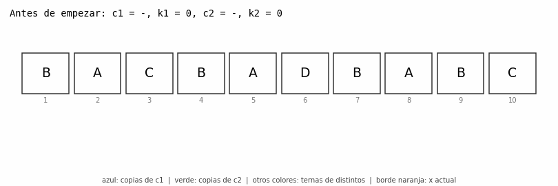
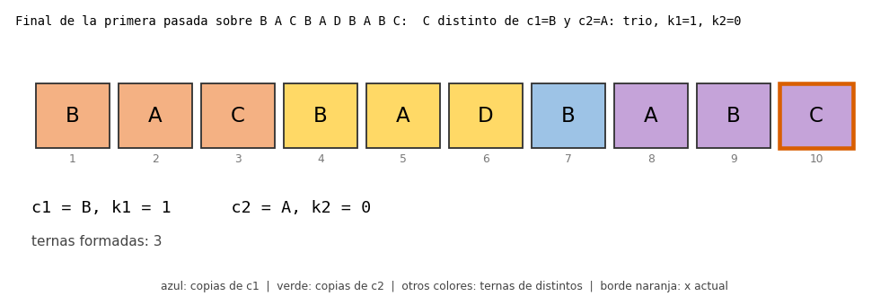

# Ejercicio 8


> **Enunciado.** Generaliza Boyer-Moore con dos candidatos, enuncia el invariante reforzado y demuéstralo. Después escribe la versión que devuelve los candidatos con contador positivo sin verificarlos, y busca un generador de pruebas que no la atrape. Cuidado: el análogo del generador binario sí la atrapa.

---

## 1. El problema

**Entrada.** Un arreglo `A` de `n` elementos que solo se pueden comparar por igualdad. No hay un orden entre ellos, así que no se puede ordenar, y tampoco queremos usar una tabla hash.

**Salida.** Todos los elementos que aparecen más de `n/3` veces. Si no hay ninguno, la lista vacía.

**Cuántos pueden ser.** A lo sumo dos. Si hubiera tres elementos distintos con más de `n/3` apariciones cada uno, entre los tres sumarían más de `n` y no caben en el arreglo. Por eso el algoritmo va a guardar dos candidatos.

**Lo que queremos.** Tiempo `O(n)` y memoria extra `O(1)`, o sea, un número fijo de variables sin importar `n`.

**Soluciones que salen primero.** Contar las apariciones de cada elemento con un `Counter` (o con un hash) funciona, pero gasta memoria `O(n)`. Sin hash habría que comparar cada elemento con todos los demás, que son `O(n²)` comparaciones. Eso sí sirve como oráculo para probar el algoritmo: cuenta todo y se queda con los que pasan `3 * cuenta > n`.

---

## 2. Idea intuitiva

En Boyer-Moore con un candidato la idea era cancelar: si tacho dos elementos distintos, la mayoría sigue siendo mayoría. Aquí cancelo de a tres.

Si tacho tres elementos distintos entre sí, un elemento `x` que aparecía más de `n/3` veces pierde a lo sumo una copia, porque en un grupo de tres distintos hay a lo sumo una copia de `x`. Después de tachar quedan `n - 3` elementos y `x` tiene más de `n/3 - 1 = (n-3)/3` apariciones, así que sigue pasando el umbral del arreglo más chico. Puedo seguir tachando grupos de tres distintos hasta que no quede ninguno, y lo que sobrevive son copias de a lo sumo dos valores. Si había un elemento frecuente, tiene que estar entre esos dos.

Lo hice a mano con `B A C B A D B A B C` (`n = 10`, hay que tener más de 3,33, o sea 4 apariciones o más):

- tacho `B A C`,
- tacho `B A D`,
- tacho `A B C`,
- sobrevive una `B`.

Y `B` aparece 4 veces de 10. El algoritmo hace lo mismo sin guardar los grupos tachados: solo recuerda dos candidatos y cuántas copias de cada uno sobreviven.

---

## 3. El algoritmo

Guardo dos candidatos `c1` y `c2`, con contadores `k1` y `k2`. Recorro el arreglo una vez y para cada `x` miro en este orden:

1. Si `x == c1`, sube `k1`.
2. Si no, si `x == c2`, sube `k2`.
3. Si no, si `k1 == 0`, `x` pasa a ser `c1` y `k1 = 1`.
4. Si no, si `k2 == 0`, `x` pasa a ser `c2` y `k2 = 1`.
5. Si no, `x` es distinto de los dos candidatos y los dos contadores son positivos. Se cancela el grupo `(x, c1, c2)` y bajan los dos contadores.

Después hay una segunda pasada que cuenta cada candidato y comprueba que de verdad pasa de `n/3`.

```python
def mas_de_un_tercio(A):
    c1, k1 = object(), 0        # valores especiales, distintos entre sí
    c2, k2 = object(), 0
    for x in A:                 # primera pasada: cancelar
        if x == c1:
            k1 += 1
        elif x == c2:
            k2 += 1
        elif k1 == 0:
            c1, k1 = x, 1
        elif k2 == 0:
            c2, k2 = x, 1
        else:
            k1 -= 1
            k2 -= 1
    # segunda pasada: verificar
    return [c for c in (c1, c2) if 3 * A.count(c) > len(A)]
```

El orden de los `if` importa. Primero se pregunta por `c1` y `c2`, y solo después por los contadores en cero. Esto se usa en la demostración.

**Traza** sobre `B A C B A D B A B C`:

| i | x | c1 | k1 | c2 | k2 | qué pasó |
|---|---|----|----|----|----|----------|
| 1 | B | B | 1 | – | 0 | `k1 = 0`: B pasa a ser `c1` |
| 2 | A | B | 1 | A | 1 | `k2 = 0`: A pasa a ser `c2` |
| 3 | C | B | 0 | A | 0 | se cancela (C, B, A) |
| 4 | B | B | 1 | A | 0 | `x = c1`: sube `k1` |
| 5 | A | B | 1 | A | 1 | `x = c2`: sube `k2` |
| 6 | D | B | 0 | A | 0 | se cancela (D, B, A) |
| 7 | B | B | 1 | A | 0 | `x = c1` |
| 8 | A | B | 1 | A | 1 | `x = c2` |
| 9 | B | B | 2 | A | 1 | `x = c1` |
| 10 | C | B | 1 | A | 0 | se cancela (C, B, A) |

Al final los candidatos son `B` con contador 1 y `A` con contador 0. En la segunda pasada, `B` aparece 4 veces y `4 * 3 = 12 > 10`, así que se queda. `A` aparece 3 veces y `9 > 10` es falso, así que se descarta. El resultado es `[B]`.



*Figura 1. La primera pasada paso a paso. Azul: copias de `c1`. Verde: copias de `c2`. Los otros colores son los grupos de tres que se van cancelando. El borde naranja marca el `x` actual.*



*Figura 2. El estado al terminar la primera pasada: tres grupos cancelados (naranja, amarillo y violeta) y una sola `B` que sobrevive (azul), que es lo que marca `k1 = 1`.*

---

## 4. Correctitud

Hay que demostrar dos cosas por separado: que si el algoritmo termina, la salida es la correcta (correctitud parcial), y que termina (terminación). La parcial va con un invariante y la terminación con un potencial.


#### El invariante
Es la idea de cancelar de la sección 2, escrita como afirmación sobre el estado. Después de procesar el prefijo `A[1..i]`:

- **(I1)** el prefijo se puede partir en grupos de tres elementos distintos entre sí, más `k1` copias de `c1`, más `k2` copias de `c2`.
- **(I2)** `c1 ≠ c2`.

(I2) parece un detalle, pero hace falta para que `(x, c1, c2)` sea de verdad un grupo de tres elementos distintos en el caso 5. En el código, los dos valores especiales del principio (`object()`) son distintos entre sí, así que (I2) vale desde el comienzo.

**Inicialización.** Antes de la primera vuelta el prefijo está vacío y `k1 = k2 = 0`: cero grupos y cero copias. Los dos valores especiales son distintos, así que (I2) también vale.

**Mantenimiento.** Supongamos que (I1) e (I2) valen para `A[1..i]` y procesemos `x = A[i+1]`. Hay cinco casos, uno por cada rama del `if`:

- **Caso 1, `x == c1`.** `k1` sube en 1 y `x` es una copia más de `c1`. La partición nueva es la anterior más esa copia. (I2) no cambia.
- **Caso 2, `x == c2`** (y `x ≠ c1`, porque si no habríamos entrado por el caso 1). Igual que el anterior: `k2` sube y `x` es una copia más de `c2`.
- **Caso 3, `x ≠ c1`, `x ≠ c2` y `k1 == 0`.** Antes no había copias de `c1` en la partición. Ahora `c1` pasa a ser `x` con `k1 = 1`, así que la partición es la anterior más una copia del nuevo `c1`. Para (I2): el nuevo `c1` es `x`, que es distinto de `c2` porque estamos en este caso.
- **Caso 4, `x ≠ c1`, `x ≠ c2`, `k1 > 0` y `k2 == 0`.** Es igual al caso 3 pero con `c2`. El nuevo `c2` es `x`, que es distinto de `c1`.
- **Caso 5, `x ≠ c1`, `x ≠ c2`, `k1 > 0` y `k2 > 0`.** Saco de la partición una copia de `c1` y una de `c2` (existen porque los dos contadores son positivos) y con `x` armo el grupo `{x, c1, c2}`. Son tres elementos distintos entre sí: `x ≠ c1`, `x ≠ c2`, y `c1 ≠ c2` por (I2). Los dos contadores bajan en 1, que es lo que hace el código. Queda un grupo más y `k1 - 1`, `k2 - 1` copias.

En los cinco casos se mantienen (I1) e (I2).

**Conclusión.** Al terminar la primera pasada, el arreglo entero se parte en `t` grupos de tres distintos, más `k1` copias de `c1` y `k2` copias de `c2`. Entonces

```
n = 3t + k1 + k2,    y por tanto    t ≤ n/3
```

**Teorema.** Si `x` aparece más de `n/3` veces, entonces `x` es `c1` o `c2`, y su contador es positivo.

*Demostración.* Por contradicción. Supongamos que `x` no es ni `c1` ni `c2`. Entonces todas sus copias están dentro de los grupos de tres, y como los tres elementos de un grupo son distintos, hay a lo sumo una copia de `x` por grupo. Así que `x` aparece a lo sumo `t ≤ n/3` veces, que contradice que aparecía más de `n/3`. Si `x` es `c1` pero `k1 = 0`, no hay copias sueltas de `x` y pasa lo mismo: aparece a lo sumo `t ≤ n/3` veces. Contradicción. Lo mismo vale para `c2`. ∎

Guardo la forma exacta de esta frase, con su "si", porque la sección 6 depende de ella. La segunda pasada completa el algoritmo: los únicos candidatos posibles son `c1` y `c2`, y se verifican contando. Entonces el algoritmo devuelve exactamente los elementos con más de `n/3` apariciones. Esto demuestra la correctitud parcial. ∎

### Terminación

La primera pasada es un `for` sobre una lista finita. El potencial es `n - i`, un entero no negativo que baja en 1 en cada vuelta y llega a 0. La segunda pasada es igual (cada `count` recorre `A` una vez). Entonces el algoritmo termina. ∎

### Comprobación con el código

Además de la demostración, corrí el algoritmo de dos pasadas contra el oráculo en todas las entradas de largo 1 a 8 sobre cuatro símbolos (`A`, `B`, `C`, `D`), que son 87 380 arreglos, y no hubo ningún fallo. Esto no reemplaza a la demostración, porque no cubre todos los largos ni todos los alfabetos, pero sirve para confirmar que lo que implementé es lo que pensé.

---

## 5. Costo

En la primera pasada se hacen a lo sumo dos comparaciones por igualdad por elemento (`x == c1` y `x == c2`) y unas pocas operaciones más. La segunda pasada hace dos conteos. En total son tres recorridos de `A`, o sea tiempo `O(n)`.

La memoria extra es `O(1)`: `c1`, `k1`, `c2`, `k2` y el contador que se usa al verificar cada candidato. No se usa ningún orden entre los elementos ni tabla hash, solo igualdad.

---

## 6. Devolver los candidatos con contador positivo

La segunda pasada parece un desperdicio. Al final, los contadores dicen cuántas copias de cada candidato sobrevivieron, y es tentador devolver `c1` si `k1 > 0` y `c2` si `k2 > 0`, y ahorrarse la verificación.

```python
def mas_de_un_tercio_atajo(A):
    c1, k1, c2, k2 = primera_pasada(A)
    return [c for c, k in ((c1, k1), (c2, k2)) if k > 0]
```

**La mitad del atajo es correcta.** El teorema de la sección 4 dice que si `x` es frecuente, entonces es `c1` o `c2` y su contador es positivo. Así que el atajo nunca se deja afuera un elemento frecuente. Lo comprobé en las 87 380 entradas de antes.

**Lo falso es el recíproco:** que el contador sea positivo no quiere decir que el elemento pase de `n/3`. El contraejemplo más chico es `A B C D`:

- `A` pasa a ser `c1` y `B` pasa a ser `c2`.
- `C` es distinto de los dos y los dos contadores son positivos, así que se cancela el grupo y los dos contadores bajan a 0.
- `D` pasa a ser `c1` con `k1 = 1`.

El atajo devuelve `[D]`. Pero `n/3 = 1,33` y `D` aparece una sola vez, así que la respuesta correcta es la lista vacía.

**Cómo se ve este error en las pruebas.** Probé el atajo con seis generadores distintos, 4000 arreglos de largo entre 1 y 15 para cada uno, y lo comparé con el oráculo:

| generador | el atajo se equivoca | las dos pasadas se equivocan |
|---|---|---|
| mayoría plantada (más de `n/3` copias de un símbolo y el resto al azar entre 5 símbolos) | 47,4 % | 0 % |
| binario al azar | 35,2 % | 0 % |
| 3 símbolos al azar | 36,9 % | 0 % |
| 5 símbolos al azar | 49,5 % | 0 % |
| un solo símbolo repetido | **0 %** | 0 % |
| dos símbolos, los dos con más de `n/3` apariciones | **0 %** | 0 % |

**Los generadores que no lo atrapan** son los dos últimos. La razón sale de la demostración. El atajo se equivoca cuando devuelve un elemento con contador positivo que no pasa de `n/3` apariciones, un elemento "raro" que logró sobrevivir. Si el generador solo produce arreglos donde todos los símbolos que hay son frecuentes, no existe ningún elemento raro. Todo lo que devuelve el atajo está en el arreglo y es frecuente, así que es correcto. Y por la mitad buena del teorema, no se deja ninguno afuera. Por eso estos dos generadores no se pueden distinguir del algoritmo correcto. (En el de dos símbolos frecuentes, con `n < 4` no caben dos símbolos que pasen de `n/3` cada uno, así que para esos largos devuelve un solo símbolo repetido.)

**El generador binario sí lo atrapa.** Con un solo candidato el binario no atrapaba el atajo, porque con dos símbolos "contador positivo" era lo mismo que "ser mayoría". Aquí eso ya no pasa: con dos candidatos, un símbolo puede quedar con contador positivo teniendo pocas copias. Por ejemplo `A A A B` (`n = 4`): `A` es `c1` con `k1 = 3`, y `B` pasa a ser `c2` con `k2 = 1`. El atajo devuelve `[A, B]`, pero `B` aparece una vez y `n/3 = 1,33`. De hecho el binario al azar lo atrapa el 35 % de las veces. La mayoría plantada tampoco lo salva (47 %), porque el ruido deja elementos raros con contador positivo.

**Lo que aprendí de esto.** La conclusión del teorema empieza con "si algún elemento aparece más de `n/3` veces", y lo que esa hipótesis no cubre es justo lo que el atajo hace mal: los arreglos donde sobrevive un elemento raro. Leer la hipótesis de un teorema es leer la lista de casos que hay que probar. Los generadores buenos son los que hacen arreglos con elementos raros, y la segunda pasada no sobra.

---

## 7. Conclusión

El problema pide los elementos que aparecen más de `n/3` veces en un arreglo donde solo se puede comparar por igualdad, con tiempo `O(n)` y memoria `O(1)`. Generalicé Boyer-Moore a dos candidatos: se cancelan grupos de tres elementos distintos y una segunda pasada verifica a los dos candidatos. El primer invariante que se me ocurrió no era inductivo, así que lo reforcé: el prefijo se parte en grupos de tres elementos distintos más `k1` copias de `c1` y `k2` copias de `c2`, con `c1 ≠ c2`. Con eso se demuestra que si un elemento pasa de `n/3`, es uno de los candidatos y su contador es positivo. La terminación sale del potencial `n - i`, y el costo son tres recorridos del arreglo, o sea `O(n)` con memoria `O(1)`. La versión que devuelve los candidatos con contador positivo sin verificar es incorrecta, como muestra `A B C D`, aunque pasa todas las pruebas con generadores donde cada símbolo presente es frecuente. El generador binario al azar sí la atrapa, y la demostración explica por qué: el teorema solo habla de los elementos frecuentes, y el atajo falla con los raros.

