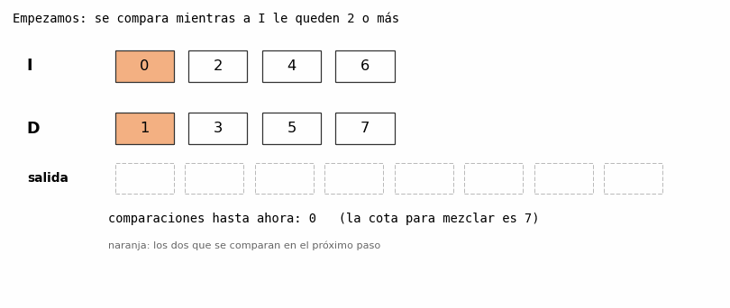
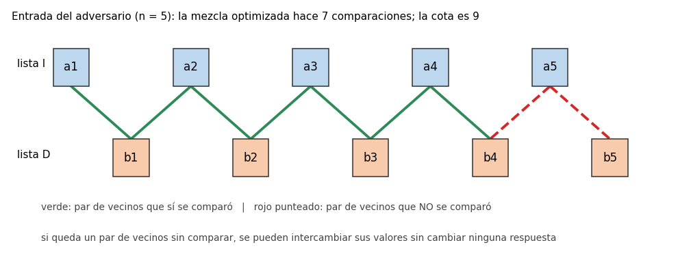
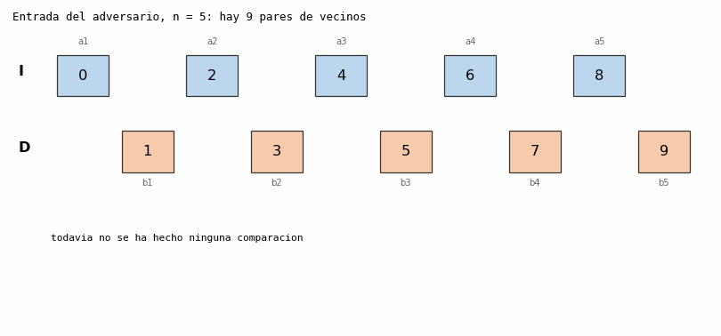

# Ejercicio 9

*El código del algoritmo está en `ejercicio-9.py`.*

> Enunciado. Una mezcla "optimizada" de dos listas ordenadas de largo `n` deja de comparar cuando a la primera lista le queda un solo elemento, y lo pone al final. Cuenta cuántas comparaciones hace en el peor caso. Sin probarla, usa la cota de mezclar para decidir si es correcta, y construye con el adversario la entrada en la que falla.

---

## 1. El problema

Entrada. Dos listas `I` y `D`, cada una ordenada y de largo `n`. Para razonar supongo que todos los valores son distintos.

Salida. Una sola lista ordenada con los `2n` elementos.

Modelo. Comparaciones. Sobre los valores solo se puede preguntar `x <= y`, y el costo es el número de preguntas. Con los índices se puede hacer cualquier cuenta sin costo.

---

## 2. Las dos mezclas

Esta es la mezcla normal. Compara mientras las dos listas tengan elementos, y cuando una se acaba, copia lo que queda de la otra.

```python
def mezclar(I, D):
    R, i, j = [], 0, 0
    while i < len(I) and j < len(D):
        if I[i] <= D[j]:
            R.append(I[i]); i += 1
        else:
            R.append(D[j]); j += 1
    return R + I[i:] + D[j:]
```

Y esta es la "optimizada". Cambia la condición del ciclo para que pare cuando a `I` le queda un solo elemento, y ese elemento lo pone al final.

```python
def mezclar_optimizada(I, D):
    R, i, j = [], 0, 0
    while len(I) - i > 1 and j < len(D):      # antes: i < len(I)
        if I[i] <= D[j]:
            R.append(I[i]); i += 1
        else:
            R.append(D[j]); j += 1
    return R + D[j:] + I[i:]                  # lo que queda de I va al final
```

La idea de la "optimización" es ahorrarse una comparación: si a `I` le queda un solo elemento, parece que da igual compararlo o ponerlo al final.

---

## 3. Cuántas comparaciones hace en el peor caso

Lo que se sabe de la mezcla normal. Cada comparación manda un elemento a la salida, y el último sale sin comparar. Entonces hace a lo sumo `2n - 1` comparaciones.

La optimizada hace a lo sumo `2n - 2`. En cada vuelta se hace una comparación y sale un elemento, así que al terminar el ciclo, las comparaciones hechas son `i + j`, que es la cantidad de elementos que ya salieron. El ciclo para por una de dos razones:

- A `I` le quedó un solo elemento (`i = n - 1`). La última comparación sacó un elemento de `I`, y se hizo con `j < n`, o sea `j ≤ n - 1`. Entonces `i + j ≤ (n - 1) + (n - 1) = 2n - 2`.
- Se acabó `D` (`j = n`). La última comparación sacó un elemento de `D`. Antes de hacerla, el ciclo exigía que a `I` le quedaran al menos 2 elementos, o sea `i ≤ n - 2`, y `j = n - 1`. Entonces `i + j ≤ (n - 2) + n = 2n - 2`.

Se alcanza. Con la entrada `b1 < a1 < b2 < a2 < ... < bn < an` (la lista `D` va primero en el orden), cada comparación saca un elemento y se alternan `b1, a1, b2, a2, ...`. Después de `2n - 2` comparaciones han salido `a1, ..., a(n-1)` y `b1, ..., b(n-1)`. Ahí a `I` le queda solo `an` y el ciclo para. Son exactamente `2n - 2`.

Así que en el peor caso la optimizada hace `2n - 2` comparaciones, una menos que la mezcla normal. En el código lo medí mirando todas las entradas posibles para `n` de 1 a 7 y siempre da `2n - 2`.

---

## 4. ¿Es correcta? Sin probarla

Hay un teorema sobre mezclar: mezclar dos listas ordenadas de largo `n` necesita `2n - 1` comparaciones en el peor caso, y esto vale para cualquier algoritmo de comparaciones, no solo para la mezcla normal.

La optimizada hace a lo sumo `2n - 2` en todas las entradas, que es menos que `2n - 1`. Como la cota es una cota inferior para el peor caso, ningún algoritmo correcto puede garantizar un peor caso menor que `2n - 1`. Por tanto, la mezcla optimizada es incorrecta, y esto se puede saber sin mirar el código ni correrlo. La cota no dice que toda entrada necesite `2n - 1` comparaciones: en algunas entradas la mezcla puede terminar antes porque ya se sabe cuál es el resto. Lo que no se puede hacer es ahorrar una comparación en todos los casos y seguir siendo correcto.

Ahora hay que mostrar una entrada donde se equivoque. Para eso hay que recordar de dónde sale la cota.

---

## 5. La entrada en la que falla (la del adversario)

Cómo se demuestra la cota. Se usa un adversario que contesta como si la entrada fuera la intercalada perfecta:

```
a1 < b1 < a2 < b2 < ... < an < bn
```

En esa cadena hay `2n - 1` pares de vecinos, y cada par tiene un elemento de cada lista. Si un algoritmo termina sin haber comparado un par de vecinos, por ejemplo `x` y `y`, se intercambian los valores de `x` y `y`. Las dos listas siguen ordenadas, porque `x` e `y` son vecinos en la cadena y no hay nada entre ellos. Todas las comparaciones que el algoritmo hizo dan las mismas respuestas, porque ninguna involucraba a los dos a la vez. Pero la salida correcta cambió. El algoritmo da la misma salida para las dos entradas, así que se equivoca en una. Por eso hay que comparar los `2n - 1` pares.

La entrada que construyo. Es la misma: `I = [0, 2, 4, ..., 2n-2]` y `D = [1, 3, 5, ..., 2n-1]`. Como la optimizada hace menos de `2n - 1` comparaciones, tiene que dejar pares de vecinos sin comparar.

Con n = 2: `I = [0, 2]`, `D = [1, 3]`.

- Compara `0` con `1`: sale el `0`, y a `I` le queda un solo elemento (el `2`).
- El ciclo para. Se agrega lo que queda de `D` (`1, 3`) y después el `2`.
- La salida es `[0, 1, 3, 2]`, pero la correcta es `[0, 1, 2, 3]`. Mal.

Con n = 4 (es la que se ve en la animación): `I = [0, 2, 4, 6]` y `D = [1, 3, 5, 7]`. Hace 5 comparaciones (la cota es 7), la salida es `[0, 1, 2, 3, 4, 5, 7, 6]` y la correcta es `[0, 1, 2, 3, 4, 5, 6, 7]`. El `6` se puso al final sin compararlo con el `7`.



*Figura 1. La mezcla optimizada sobre la entrada del adversario con `n = 4`. En naranja, los elementos que se comparan en el paso siguiente. Cuando a `I` le queda un solo elemento (el `6`), lo pone al final sin compararlo y los dos últimos quedan mal (rojo).*

Qué pares quedan sin comparar. Con `n = 5` el código dice que la optimizada hace 7 comparaciones, los 9 pares de vecinos son `(0,1), (1,2), ..., (8,9)` y quedan sin comparar `(7, 8)` y `(8,9)`.



*Figura 2. La cadena del adversario con `n = 5`. En verde, los pares de vecinos que la optimizada sí comparó. En rojo punteado, los que no comparó.*



*Figura 3. Con `n = 5`: se van encendiendo en verde los pares de vecinos que la optimizada compara, quedan dos en rojo sin comparar, se intercambian los valores `7` y `8`, y se ve que el algoritmo hace lo mismo con las dos entradas.*

Para usar el argumento del adversario, intercambio los valores `7` y `8`: queda `I = [0, 2, 4, 6, 7]` y `D = [1, 3, 5, 8, 9]`, las dos ordenadas. Las 7 comparaciones que hizo la optimizada dan las mismas respuestas en las dos entradas, así que hace exactamente lo mismo. Las salidas son:

```
entrada original:    [0, 1, 2, 3, 4, 5, 6, 7, 9, 8]   (la correcta es [0, 1, 2, 3, 4, 5, 6, 7, 8, 9])
entrada intercambiada: [0, 1, 2, 3, 4, 5, 6, 8, 9, 7]   (la correcta es [0, 1, 2, 3, 4, 5, 6, 7, 8, 9])
```

El algoritmo no vio ninguna diferencia entre las dos entradas, así que se equivoca. En este caso se equivoca en las dos.

---

## 6. Comprobación con el código

Corrí las dos mezclas sobre todas las formas de repartir los números `1..2n` entre `I` y `D`, para `n` de 1 a 7. La mezcla normal siempre da el resultado correcto y su peor caso es `2n - 1`.

| n | entradas | peor caso de la optimizada | `2n - 2` | entradas donde se equivoca | `C(2n-1, n)` |
|---|---|---|---|---|---|
| 1 | 2 | 0 | 0 | 1 | 1 |
| 2 | 6 | 2 | 2 | 3 | 3 |
| 3 | 20 | 4 | 4 | 10 | 10 |
| 4 | 70 | 6 | 6 | 35 | 35 |
| 5 | 252 | 8 | 8 | 126 | 126 |
| 6 | 924 | 10 | 10 | 462 | 462 |
| 7 | 3432 | 12 | 12 | 1716 | 1716 |

Lo que se ve es que se equivoca justo en la mitad de las entradas. Mirando los casos, la optimizada falla exactamente cuando el mayor de los `2n` elementos está en la segunda lista, o sea cuando `an < bn`. Esto tiene sentido: si `an < bn`, el elemento `bn` nunca sale antes que `an`, así que el ciclo siempre para con `D` todavía sin vaciar. Entonces `an` termina puesto después de `bn`, y está mal. Si en cambio `an > bn`, poner `an` al final es justo lo que hay que hacer. (Para cada `n` el código comprueba que la lista de entradas donde falla es exactamente esa.)

Cuánto lo ven las pruebas. También probé la optimizada con cuatro generadores distintos, 4000 casos cada uno:

| generador | la optimizada se equivoca |
|---|---|
| listas al azar | 50,9 % |
| el mayor siempre en la primera lista | 0 % |
| el mayor siempre en la segunda lista | 100 % |
| intercalada (la del adversario) | 100 % |

Este error se ve fácil con pruebas al azar, porque falla casi la mitad de las veces. Pero hay un generador que no lo atrapa nunca: el que siempre pone el elemento más grande en la primera lista. En ese caso `an > bn` y la optimizada da siempre la respuesta correcta. De todas formas, la cota ya había detectado el error antes de correr cualquier prueba.

El programa se puede corregir, pero no manteniendo esa optimización. Hay que volver a comparar mientras queden elementos en las dos listas:

```python
while i < len(I) and j < len(D):
```

La comparación que se quiso ahorrar es justo la que decide cuál de los dos últimos elementos va antes. La mezcla normal es correcta y óptima en el peor caso: nunca hace más de `2n - 1` comparaciones y la cota demuestra que no se puede garantizar una cantidad menor.

---

## 7. Conclusión

La mezcla optimizada para cuando a la primera lista le queda un solo elemento y lo pone al final. En el peor caso hace `2n - 2` comparaciones: el ciclo hace una comparación por cada elemento que sale y para antes de decidir el orden de los últimos elementos. Eso es una menos que la cota inferior de `2n - 1` para el peor caso de mezclar, así que no puede ser correcta en todas las entradas. Para construir una entrada en que falla usé la del adversario, la intercalada `a1 < b1 < a2 < b2 < ... < an < bn`: la optimizada deja sin comparar al menos un par de vecinos y entonces se pueden intercambiar esos valores sin que el algoritmo se entere. Con `n = 2` queda `I = [0, 2]` y `D = [1, 3]`, y la salida es `[0, 1, 3, 2]`. La mezcla normal, en cambio, sí es correcta y alcanza la cota óptima en el peor caso.

