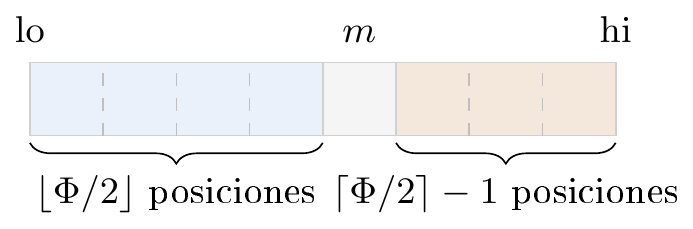
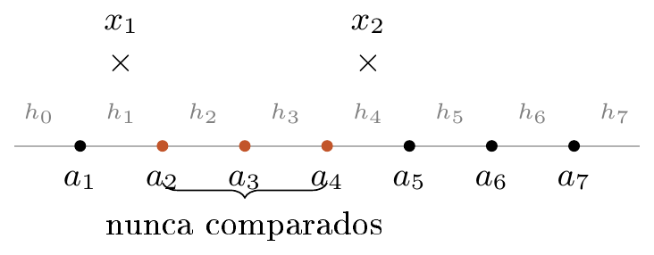
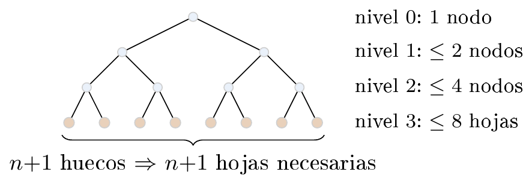

# Ejercicio 2 — Invariante, potencial y cota de información de la búsqueda binaria

**Dificultad:** ★   **Conferencias:** C3 (Correctitud), C5 (Cotas mínimas)

## Enunciado

> Da el invariante y el potencial de la búsqueda binaria, y la cota de información que la hace óptima.

Las tres piezas — invariante, potencial y cota de información — casi nunca aparecen juntas, con sus
tres demostraciones completas, sobre el mismo algoritmo. Eso es lo que arma este ejercicio.

## 1. El problema

**Búsqueda.** Dado un arreglo ordenado $a_1<a_2<\dots<a_n$ y un valor $x$, decidir si $x\in A$ y, si
está, dar su posición. Modelo: comparaciones de tres vías ($x<a_i$, $x=a_i$, $x>a_i$).

El pseudocódigo usa índices desde $0$ y representa la ventana activa como el intervalo semiabierto
$A[\mathrm{lo}:\mathrm{hi})$; por eso el arreglo completo corresponde a $A[0:n)$.

El código real y ejecutable (el que generó todas las verificaciones de este documento) vive en
`verif.py`, en esta carpeta; aquí va solo el pseudocódigo del algoritmo:

```text
funcion busqueda_binaria(A, x):
    lo ← 0,  hi ← n       // invariante: si x esta, esta en A[lo:hi)
    mientras lo < hi:
        m ← ⌊(lo + hi) / 2⌋
        si A[m] = x: devolver ("esta", m)
        sino si x < A[m]: hi ← m
        sino: lo ← m + 1
    devolver ("hueco", lo)
```

## 2. Invariante (correctitud parcial)

> **Invariante**
>
> Antes de cada vuelta del ciclo: *si $x\in A$, entonces $x\in A[\mathrm{lo}:\mathrm{hi})$.*

**Inicialización.** $\mathrm{lo}=0,\ \mathrm{hi}=n$: el intervalo es el arreglo entero, la afirmación
es trivial.

**Mantenimiento.** Supongamos el invariante antes de una vuelta, con $\mathrm{lo}<\mathrm{hi}$ (si no,
el ciclo ya terminó). Sea $m=\lfloor(\mathrm{lo}+\mathrm{hi})/2\rfloor$.

- Si $x=A[m]$: se devuelve de inmediato, correcto.
- Si $x<A[m]$: como $A$ está ordenado, si $x\in A$ tiene que estar en una posición $<m$, es decir en
  $A[\mathrm{lo}:m)$. El nuevo $\mathrm{hi}=m$ preserva el invariante.
- Si $x>A[m]$: simétricamente, si $x\in A$ está en $A[m{+}1:\mathrm{hi})$. El nuevo $\mathrm{lo}=m{+}1$
  preserva el invariante.

**Conclusión.** El ciclo termina cuando $\mathrm{lo}=\mathrm{hi}$, es decir cuando $A[\mathrm{lo}:\mathrm{hi})=\varnothing$.
Por el invariante, si $x$ estuviera en $A$ tendría que estar en el conjunto vacío — imposible. Así que
$x\notin A$, y devolver `("hueco", lo)` es correcto.

## 3. Potencial (terminación)

El invariante de la sección anterior ya fija las variables relevantes del estado: $\mathrm{lo}$ y
$\mathrm{hi}$, con la *ventana* $A[\mathrm{lo}:\mathrm{hi})$ como la región donde $x$ todavía puede
estar. Demostrar terminación exige una cantidad entera no negativa que decrezca en cada vuelta; construida
sobre esas mismas dos variables, la candidata natural es el tamaño de esa ventana, que llega a cero
exactamente cuando el ciclo se detiene ($\mathrm{hi}=\mathrm{lo}$). El potencial no introduce ninguna
variable nueva: resulta de medir directamente lo que el invariante ya describe.

> **Potencial**
>
> $\Phi = \mathrm{hi}-\mathrm{lo}$, un entero $\geq 0$.

En cada vuelta, $m$ cumple $\mathrm{lo}\le m<\mathrm{hi}$ (es una posición de la ventana
cuando $\mathrm{hi}>\mathrm{lo}$), así que el nuevo intervalo es siempre **estrictamente más chico**:
o bien $\mathrm{hi}'=m<\mathrm{hi}$, o bien $\mathrm{lo}'=m{+}1>\mathrm{lo}$. Como $\Phi\ge 0$ no puede bajar
para siempre, el ciclo termina.

Más preciso: $\Phi$ no solo baja, se **parte a la mitad** (con redondeo). Como $m=\lfloor(\mathrm{lo}+\mathrm{hi})/2\rfloor=\mathrm{lo}+\lfloor\Phi/2\rfloor$, la posición $m$ divide la ventana en tres partes: $\lfloor\Phi/2\rfloor$ posiciones a la izquierda, la propia posición $m$ (que se consulta y se descarta), y las
$\Phi-\lfloor\Phi/2\rfloor-1=\lceil\Phi/2\rceil-1$ posiciones restantes a la derecha. El nuevo $\Phi'$ es exactamente el tamaño de la mitad que sobrevive:

$$
\begin{aligned}
\text{si } \mathrm{hi} \text{ baja (queda la izquierda):} &\quad \Phi'=m-\mathrm{lo}=\left\lfloor\Phi/2\right\rfloor; \\
\text{si } \mathrm{lo} \text{ sube (queda la derecha):} &\quad \Phi'=\mathrm{hi}-m-1=\left\lceil\Phi/2\right\rceil-1.
\end{aligned}
$$



 La posición $m$ (gris) se consulta y se descarta. Sobrevive la izquierda, de tamaño
$\lfloor\Phi/2\rfloor$ (llega exacto a $\lceil\Phi/2\rceil$ cuando $\Phi$ es par), o la derecha, de tamaño
$\lceil\Phi/2\rceil-1$ (siempre estrictamente menor que $\lceil\Phi/2\rceil$) — para cualquier $\Phi$.

En ambos casos $\Phi'\le\lfloor\Phi/2\rfloor$ (el lado izquierdo da exactamente $\lfloor\Phi/2\rfloor$; el
derecho, $\lceil\Phi/2\rceil-1\le\lfloor\Phi/2\rfloor$), así que tras $t$ vueltas $\Phi\le\lfloor\Phi_0/2^t\rfloor$,
que vale 0 en cuanto $2^t>\Phi_0$: $\Phi$ llega a 0 en a lo sumo $\lceil\log_2(\Phi_0{+}1)\rceil$ vueltas — de
donde sale directamente el costo $O(\log n)$, sin necesitar ningún argumento adicional.

**Verificación.** La demostración de arriba ya deja esto fuera de duda; se corrió de todas formas como
chequeo empírico adicional (en `verif.py`), simulando la búsqueda sobre cientos de arreglos y de
valores de $x$ (dentro y fuera del arreglo) y registrando $\Phi$ en cada vuelta, para confirmar que
*nunca* deja de bajar estrictamente ni se vuelve negativo:

```text
fallos del potencial (deberia ser 0): 0
```

## 4. Cota de información: por qué ceil(log2(n+1)) y no log2 n

Aquí hay una trampa que C5 §3 señala explícitamente: con tres respuestas posibles por comparación
($<,=,>$), un árbol de decisión ingenuo tiene ramificación 3, y el Lema 1 adaptado a tres ramas solo daría
$\log_3(\cdot)$, un resultado más débil. Para conseguir $\log_2$ hay que mirar **solo** las ejecuciones
donde $x\notin A$: ahí ninguna comparación puede responder “=”, así que esa parte del árbol es binaria de
verdad.

> **Los huecos**
>
> Si $x\notin A$, cae en exactamente uno de los $n{+}1$ **huecos**: antes de $a_1$, entre $a_i$ y
> $a_{i+1}$ para $i=1,\dots,n{-}1$, o después de $a_n$.

El diagrama siguiente (C5 §3, Figuras 5–6) muestra el mismo caso que usa la demostración del lema: $x_1$ y
$x_2$ caen en huecos distintos ($h_1$ y $h_4$), y entre ellos quedan elementos reales ($a_2,a_3,a_4$) que
ninguna de las dos ejecuciones compara jamás.



 $x_1\in h_1$, $x_2\in h_4$: si llegaran a la misma hoja, ninguna de las dos ejecuciones
comparó con $a_2$, $a_3$ ni $a_4$ — así que tomar $x=a_3$ (el testigo del argumento) recorre ese mismo
camino y la hoja dice “no está”, aunque $a_3$ sí esté en $A$.

> **Lema (C5, §3)**
>
> Si $x_1$ y $x_2$ caen en huecos distintos, un algoritmo correcto los lleva a hojas distintas.

*Demostración.* Sea $x_1$ en un hueco a la izquierda del de $x_2$, y supongamos que los dos terminan
en la misma hoja. Entre sus huecos hay al menos un
elemento real $a_i$, con $x_1<a_i<x_2$. El algoritmo nunca compara con ese $a_i$ en ninguna de las dos
ejecuciones (si lo hiciera, $x_1$ recibiría “$<$” y $x_2$ recibiría “$>$”, caminos distintos de
inmediato). Entonces, tomando $x=a_i$: en cada comparación que el algoritmo hace (con un elemento a la
izquierda de ambos huecos o a la derecha de ambos), $x=a_i$ recibe la misma respuesta que $x_1$ y que $x_2$.
Así que $x=a_i$ recorre el mismo camino que los dos y llega a la misma hoja que ellos. Pero en esa hoja el
algoritmo dice “no está” (es la hoja de $x_1$ o de $x_2$, ninguno de los dos está en $A$) — y sin
embargo $a_i$ sí está en $A$. Contradicción. $\square$

**Consecuencia.** Los $n{+}1$ huecos necesitan $n{+}1$ hojas distintas, todas en la parte binaria del
árbol (las ramas $<$ y $>$). Por el Lema 1 (C5 §3, un árbol binario de altura $h$ tiene a lo sumo $2^h$
hojas), la altura de esa parte del árbol es al menos $\lceil\log_2(n{+}1)\rceil$. Y la altura de esa parte
es una cota inferior de la altura del árbol completo (es una subparte de él).

El Lema 1 en sí (C5 §3, Figura 2) es la observación de que cada nivel de un árbol binario tiene a lo sumo
el doble de nodos que el anterior:



Para que las $n{+}1$ hojas naranjas quepan, hace falta $2^h\ge n{+}1$, es decir $h\ge\log_2(n{+}1)$ — y
como $h$ es un entero, $h\ge\lceil\log_2(n{+}1)\rceil$. Por lo tanto:

> **Teorema**
>
> Todo algoritmo del modelo de comparaciones necesita, en el peor caso, al menos
> $\lceil\log_2(n{+}1)\rceil$ comparaciones para decidir si $x\in A$.

Y la búsqueda binaria **alcanza** exactamente esa cota: cada comparación parte por la mitad el rango
donde $x$ todavía podría estar (sección 3), así que tras $\lceil\log_2(n{+}1)\rceil$ comparaciones queda un
solo hueco posible. Verificado exhaustivamente (probando los $n+1$ huecos reales para cada $n$ de la tabla, contando el
peor caso exacto de comparaciones):

```text
     n  max comparaciones   techo(log2(n+1))
     1                  1                  1
     2                  2                  2
     3                  2                  2
     4                  3                  3
     7                  3                  3
     8                  4                  4
    15                  4                  4
    16                  5                  5
   100                  7                  7
  1000                 10                 10
1000000                 20                 20
```

Coinciden **exactamente** para todo $n$ probado: la búsqueda binaria es óptima, no solo asintóticamente
sino con la constante exacta.

> **Respuesta a la pregunta del enunciado**
>
> - **Invariante:** si $x\in A$, entonces $x\in A[\mathrm{lo}:\mathrm{hi})$ — da la correctitud
>   parcial (sección 2).
> - **Potencial:** $\Phi=\mathrm{hi}-\mathrm{lo}$, que se parte a la mitad en cada vuelta — da la
>   terminación en $O(\log n)$ (sección 3).
> - **Cota de información:** $\lceil\log_2(n{+}1)\rceil$, contando los $n{+}1$ huecos entre
>   elementos — y la búsqueda binaria la alcanza exactamente, con la misma constante (sección 4).

## Errores que hay que vigilar

> - **Usar $\log_2 n$ en vez de $\lceil\log_2(n{+}1)\rceil$.** Son iguales en el término principal,
>   pero ni siquiera redondeando coinciden siempre: para $n=2^k$, $\lceil\log_2 n\rceil=k$ y hacen falta $k{+}1$
>   comparaciones (en la tabla, $n=8$ necesita 4, no 3). $n{+}1$ cuenta huecos (hay $n{+}1$ de ellos), no
>   elementos.
> - **Aplicar el Lema 1 con base 3** (porque la comparación tiene tres resultados). Es exactamente
>   la trampa de la sección 4. Con 3 ramas por nodo, un árbol de altura $h$ tiene a lo sumo $3^h$ hojas, y la
>   cota que sale sería más débil ($\log_3(n{+}1)$), y además **incorrecta** como cota ajustada, porque
>   ningún algoritmo real explota la rama “=” en más de una hoja por ejecución (una vez que compara y
>   encuentra el elemento, termina: la rama “=” no sigue ramificando). El argumento correcto restringe la
>   atención a las ejecuciones donde nunca se usa esa rama.
> - **Confundir el potencial $\Phi=\mathrm{hi}-\mathrm{lo}$ con el invariante.** Son dos
>   demostraciones distintas con propósitos distintos: el invariante da correctitud *parcial* (si
>   termina, la respuesta es correcta); el potencial da *terminación* (el ciclo sí termina, y en cuántas
>   vueltas). Hace falta demostrar las dos para tener correctitud total.
