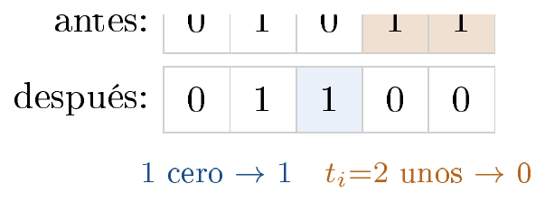

# Ejercicio 4 — El contador binario en una máquina de Turing

**Dificultad:** ★★   **Conferencias:** C1 (Eficiencia y modelos de cómputo),
C4 (Análisis amortizado)

## Enunciado

> El contador binario en una máquina de Turing, del ejercicio 7 de la conferencia 1. Demuestra con un
> potencial que $m$ incrementos desde 0 cuestan $O(m)$ pasos en total, aunque uno solo pueda costar
> $\Theta(\log m)$. Es la pregunta que la conferencia 1 dejó abierta.

C1 §3 plantea la máquina de Turing como modelo en el que *acceder a la celda $i$ cuesta $i$ pasos*; su
ejercicio 7 pide diseñar la máquina que suma 1 a un contador binario, con el cabezal empezando y terminando
en el bit menos significativo. Este ejercicio retoma exactamente esa máquina y le aplica la herramienta que
C1 todavía no tenía disponible: el potencial de C4.

## 1. La máquina y el costo de un incremento

El contador vive en la cinta como una cadena de bits, con el cabezal apoyado en el bit menos significativo.
Incrementar en binario es: caminar hacia los bits más significativos (hacia la izquierda en la figura de
abajo, que los dibuja en orden de lectura normal) volteando 1's a 0 mientras se encuentren, hasta
encontrar un 0 (voltearlo a 1 y parar), y después **volver** al bit menos significativo (el enunciado
exige terminar donde empezó).

Sea $t_i$ el número de **unos consecutivos** que hay al final del valor $i-1$ (antes del $i$-ésimo
incremento) — la cantidad de “acarreos” que ese incremento produce. El cabezal recorre $t_i$ posiciones
con un 1 (las voltea a 0), una posición más con un 0 (la voltea a 1), y después recorre esas mismas
$t_i+1$ posiciones de vuelta. El costo real del incremento $i$ en la máquina de Turing es

$$
c_i = 2(t_i+1).
$$



 Ejemplo con $v=01011_2=11$: los $t_i=2$ unos finales (naranja) se voltean a 0, y el primer
cero que encuentran (azul) se voltea a 1, dando $v+1=01100_2=12$.

**Por qué un incremento siempre termina.** La cinta es infinita (C1 §3) y, por convención estándar, sus
celdas sin usar están en blanco (se leen como 0) más allá de cualquier bit que el contador haya usado hasta
el momento. Así que caminando hacia los bits más significativos siempre se encuentra un 0 donde detenerse — a lo sumo tras $t_i+1$ pasos,
una cantidad finita en cualquier momento dado — y el recorrido de vuelta es igual de finito. Un
incremento individual termina siempre, aunque pueda necesitar una celda más de las que el contador había
usado hasta ahí (es justo lo que pasa al pasar de $11\cdots1$ a $100\cdots0$).

**El peor incremento individual es $\Theta(\log m)$.** Un incremento con $t_i=k$ ocurre siempre que el
valor antes de incrementar termina en $k$ unos; el caso extremo es $2^k-1 = \underbrace{11\cdots1}_{k}$
(todos unos). El valor antes del incremento $i$ es $i-1<m$ y, si termina en $t_i$ unos, es al menos
$2^{t_i}-1$; luego $2^{t_i}\le m$, es decir $t_i\le\log_2 m$ en todos los incrementos. Y con
$k=\lfloor\log_2 m\rfloor$ el incremento de $2^k-1$ a $2^k$ (el número $2^k\le m$) ocurre dentro de los $m$ y
cuesta $2(k+1)$. Verificado exactamente:

```text
v = 2^4-1 = 15:       trailing_ones = 4  (=k), costo de ESE incremento = 10
v = 2^8-1 = 255:      trailing_ones = 8  (=k), costo de ESE incremento = 18
v = 2^12-1 = 4095:    trailing_ones = 12 (=k), costo de ESE incremento = 26
v = 2^16-1 = 65535:   trailing_ones = 16 (=k), costo de ESE incremento = 34
v = 2^20-1 = 1048575: trailing_ones = 20 (=k), costo de ESE incremento = 42
```

Esto es justo lo que el enunciado advierte: *un* incremento puede costar $\Theta(\log m)$. A
continuación: la sección 2 construye el potencial que permite acotar el costo de $m$ incrementos
**seguidos**, desde 0.

## 2. El potencial: peso de Hamming

El costo del incremento $i$ medido en bits volteados, $C_i$, tiene una parte fija (1 bit que se enciende) y
una parte variable que puede crecer hasta $\log_2 m$ ($t_i$ bits que se apagan): $C_i=t_i+1$ (el costo
físico en la cinta es $c_i=2C_i$, como se usa en la sección 3). Sin más herramienta que esto, la única cota
disponible es multiplicar el peor caso por $m$, es decir $O(m\log m)$ — la cota floja que se señala en
“Errores que hay que vigilar” al final de este documento. Para ajustarla a $O(m)$ hace falta encontrar una
función de potencial $\Phi$ tal que el costo amortizado $\hat C_i=C_i+\Delta\Phi_i$ sea $O(1)$ para
**todo** $i$, sin excepciones; si eso se logra, sumar sobre los $m$ incrementos es inmediato por
telescopación (C4 §2), sin tener que razonar incremento por incremento sobre cuándo ocurren los acarreos
caros.

Como $C_i=t_i+1$ tiene un término fijo y uno variable, para que $\hat C_i$ sea constante hace falta que
$\Delta\Phi_i$ cancele exactamente la parte que varía: se necesita $\Delta\Phi_i$ del orden de $-t_i$. Esto
convierte la búsqueda en una pregunta concreta sobre el *mecanismo* del incremento, no sobre la
fórmula: ¿qué cantidad baja en $t_i$ y sube en una cantidad fija cada vez que la máquina apaga $t_i$ unos y
enciende uno nuevo? La respuesta está en la propia definición del mecanismo — apagar un uno es, por
definición, hacer bajar en 1 la cuenta de unos del valor, y encenderlo es hacerla subir en 1 — así que la
cantidad con exactamente esa dinámica, sin ajustes ni términos adicionales, es el número de unos que tiene
el valor en ese momento.

Falta comprobar que esa elección cumple las condiciones generales que el método exige (C4 §2): $\Phi$ debe
ser un entero $\ge 0$ en todo momento, idealmente con $\Phi_0$ mínimo, para que la telescopación final no
deje residuos difíciles de acotar. El número de unos de un valor binario es, trivialmente, un entero $\ge
0$, y como el contador arranca en todo-ceros, $\Phi_0=0$ exactamente. Con esto, el candidato queda fijado:

> **Potencial**
>
> $\Phi(v) =$ número de bits en 1 del valor $v$ (el *peso de Hamming*, también llamado
> `popcount`).

Esta es exactamente la misma clase de herramienta que la cola con dos pilas de C4 §2: una cantidad que sube
en las operaciones baratas y baja en las caras, y que mide una **deuda** — aquí, cuántos unos quedan
“listos para voltearse a 0 gratis la próxima vez”.

**Verificación de la construcción.** El incremento $i$ voltea los $t_i$ unos finales a 0 (pierde $t_i$
unos) y voltea un 0 a 1 (gana un uno), así que, tal como se buscaba,

$$
\Delta\Phi_i \;=\; \Phi(i)-\Phi(i-1) \;=\; 1-t_i.
$$

Verificado exactamente, paso a paso, sobre 200,000 incrementos consecutivos:

```text
verificando Delta(Phi) = 1 - t_i exactamente, paso a paso, para m=200000:
fallos (deberia ser 0): 0
```

## 3. El argumento amortizado

Es más limpio separar el conteo en dos monedas, “bits volteados” y “pasos de la máquina”: primero se acota el número de **bits volteados**, después se traduce a pasos de
Turing.

**Bits volteados.** Se toma el costo “lógico” $C_i = t_i+1$ (la cantidad de bits que cambian en el
incremento $i$; el costo físico en la cinta es $c_i=2C_i$, el factor 2 es por la vuelta). El costo
amortizado con el potencial de Hamming es

$$
\hat C_i \;=\; C_i + \Delta\Phi_i \;=\; (t_i+1) + (1-t_i) \;=\; 2,
$$

**constante**, para todo $i$. Sumando sobre $m$ incrementos, con $\Phi_0=0$ y $\Phi_m\ge 0$ siempre
(C4 §2, “el paso que todo el mundo olvida”):

$$
\sum_{i=1}^m C_i \;=\; \sum_{i=1}^m \hat C_i \;-\;(\Phi_m-\Phi_0) \;\le\; 2m - \Phi_m \;\le\; 2m.
$$

> **Teorema**
>
> $m$ incrementos desde 0 voltean en total a lo sumo $2m$ bits, aunque un incremento individual pueda
> voltear $\Theta(\log m)$.

**Pasando a pasos de Turing.** El costo físico es $c_i=2C_i$ exactamente (ida y vuelta), así que

$$
\sum_{i=1}^m c_i \;=\; 2\sum_{i=1}^m C_i \;\le\; 4m \;=\; O(m).
$$

> **Corolario (lo que pedía el ejercicio)**
>
> $m$ incrementos consecutivos desde 0, en la máquina de Turing que suma 1 con el cabezal volviendo al bit
> menos significativo, cuestan $O(m)$ pasos **en total** — es decir, $O(1)$ amortizado por incremento.

**Verificación.** El corolario de arriba ya garantiza este resultado; se ejecutó de todas formas como
chequeo empírico adicional, simulando los incrementos (contando exactamente $t_i$ y sumando el costo
$2(t_i{+}1)$ en cada paso, sin simular la cinta celda por celda) para $m$ creciente, y midiendo el costo
total y el costo promedio por incremento:

```text
        m   pasos TM   TM/m   cota 4m  peor op  log2 m
       10         36  3.600        40        8    3.32
      100        394  3.940       400       14    6.64
     1000       3988  3.988      4000       20    9.97
    10000      39990  3.999     40000       28   13.29
   100000     399988  4.000    400000       34   16.61
  1000000    3999986  4.000   4000000       40   19.93
```

(“pasos TM” es el costo físico total $\sum c_i$; “TM/m” su promedio por incremento; “cota 4m” es
$4m$, la cota del corolario para los pasos físicos (la de bits volteados, $2m$, la comprueba con un
`assert` el propio `verif.py`); “peor op” es el costo del incremento más caro
encontrado; $\log_2 m$ se incluye solo como referencia de cuán rápido crecería si el peor caso se repitiera
siempre.)

El costo promedio por incremento converge a **4** (dos veces la cota amortizada de bits
volteados, $2\times 2=4$, por el factor de ida-y-vuelta) — ni se acerca a $\log_2 m$, pese a que el
*peor* incremento individual sí crece como $\log_2 m$ (última columna, para comparar). Esa brecha
entre “el peor caso de una operación” y “el promedio de la secuencia” es exactamente el punto de la
conferencia 4.

> **Respuesta a la pregunta del enunciado**
>
> - **Potencial:** $\Phi(v)=$ peso de Hamming de $v$ (número de unos), que baja en $t_i$ y sube en 1
>   con cada incremento (sección 2).
> - **Costo amortizado:** constante ($\hat C_i=2$ en bits volteados, $4$ en pasos físicos de la
>   cinta), aunque un incremento individual pueda costar $\Theta(\log m)$ (sección 3).
> - **Total para $m$ incrementos:** $O(m)$ pasos, por telescopación del potencial — la respuesta
>   exacta que el ejercicio 7 de la conferencia 1 dejó pendiente.

## Errores que hay que vigilar

> - **Multiplicar el peor incremento por $m$.** Es el error más tentador: “cada incremento puede
>   costar $\Theta(\log m)$, entonces $m$ incrementos cuestan $O(m\log m)$”. Es una cota válida pero no
>   ajustada (sobreestima por un factor $\log m$), exactamente el mismo tipo de error que analizar un arreglo
>   dinámico “$n$ `append` cuestan $O(n^2)$” mirando solo el peor caso de `append` sin
>   considerar que los `append` caros son raros (C4 §1).
> - **Usar el peso de Hamming del valor *final* en vez de trabajar incremento a incremento.**
>   El argumento no es “$\Phi_m$ es pequeño, listo”; $\Phi_m$ puede ser del orden de $\log_2 m$ (si $m$ tiene
>   muchos unos, como $m=2^k-1$) y por sí solo no acota nada. Lo que hace el trabajo es la **telescopación**: la suma de
>   $\hat C_i$ es fácil de acotar operación por operación, y son los términos $\Phi_i$ intermedios los que se
>   cancelan en cadena, dejando solo $\Phi_m-\Phi_0$ en la cuenta final.
> - **Olvidar el factor 2 de la vuelta.** Si el ejercicio pidiera el costo de *un barrido sin
>   volver* (como una cinta que simplemente avanza y se queda donde terminó), el costo sería $t_i+1$, no
>   $2(t_i+1)$, y la cota final sería $2m$ en vez de $4m$ — el orden $O(m)$ no cambia, solo la constante,
>   pero una demostración que no distingue los dos casos está describiendo una máquina distinta de la que pide
>   el enunciado (que exige terminar en el bit menos significativo).
