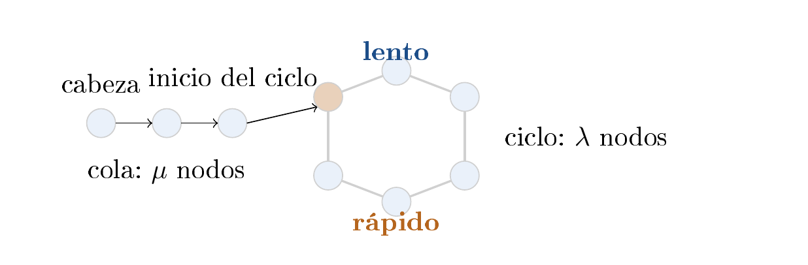
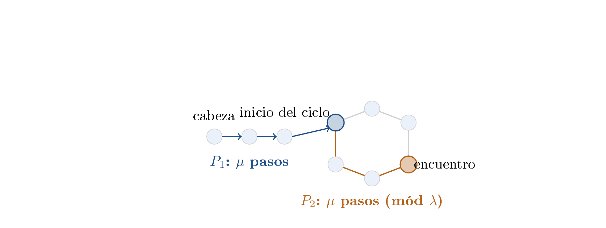

# Ejercicio 5 — Detección de ciclos de Floyd

**Dificultad:** ★★   **Conferencias:** C3 (Correctitud)

## Enunciado

> Detección de ciclos en una lista enlazada con dos punteros que avanzan a velocidades 1 y 2 (algoritmo de
> Floyd). Demuestra que se encuentran si y solo si hay un ciclo, con un invariante, y que termina, con un
> potencial. Da el costo.

## 1. El problema y el algoritmo

Una lista enlazada puede ser una cola de $\mu\ge 0$ nodos seguida de un ciclo de $\lambda\ge 0$ nodos
($\lambda=0$ significa que no hay ciclo). Dos punteros, `lento` y `rápido`, arrancan en la
cabeza; en cada vuelta `lento` avanza un nodo y `rápido` avanza dos.



 Forma general de la lista: una cola de $\mu$ nodos seguida de un ciclo de $\lambda$ nodos.
Una vez que ambos punteros entran al ciclo (flechas = sentido de avance), siguen dando vueltas en él para
siempre; el potencial de la sección 2 mide cuánto le falta a `rápido`, módulo $\lambda$, para
alcanzar a `lento`.

**Especificación (C3 §1).** Precondición: la entrada es una lista de este tipo — una cola finita de
$\mu$ nodos seguida, opcionalmente, de un ciclo finito de $\lambda$ nodos; no se asume de antemano si
$\lambda=0$ o no, eso es justamente lo que el algoritmo tiene que decidir. Postcondición: el algoritmo
devuelve verdadero si y solo si $\lambda>0$ (existe un ciclo).

El código real y ejecutable vive en `verif.py`, en esta carpeta; aquí va el pseudocódigo:

```text
funcion floyd(cabeza):
    lento ← rapido ← cabeza
    mientras rapido ≠ nulo y rapido.sig ≠ nulo:
        lento ← lento.sig
        rapido ← rapido.sig.sig
        si lento es rapido:
            devolver verdadero       // hay ciclo
    devolver falso                    // rapido llego al final: no hay ciclo
```

## 2. Correctitud: por qué se encuentran si y solo si hay un ciclo

La demostración tiene dos direcciones, cada una con su propia herramienta.

### Sin ciclo $\Rightarrow$ nunca se encuentran (invariante)

El objetivo es mostrar que, si la lista no tiene ciclo, `lento` y `rápido` jamás apuntan al
mismo nodo mientras el algoritmo corre. Como ambos arrancan juntos en la cabeza y avanzan a velocidades
distintas, la cantidad natural para comparar en cada instante es la posición de cada uno respecto a la
cabeza: si se logra mostrar que `rápido` está siempre estrictamente más adelante que `lento`,
y que en una lista sin ciclo posiciones distintas corresponden siempre a nodos distintos, la conclusión es
inmediata — no pueden coincidir. Esta es una afirmación sobre *todas* las vueltas del ciclo
`while`, así que se demuestra, como cualquier invariante, por inducción en el número de vueltas
(C3 §1).

> **Invariante**
>
> Mientras ambos punteros sigan siendo válidos (ninguno es `None`), después de $t\ge 1$ vueltas,
> $\mathrm{pos}(\text{rápido}) = 2t = 2\cdot\mathrm{pos}(\mathrm{lento}) > \mathrm{pos}(\mathrm{lento})$,
> donde $\mathrm{pos}(x)$ es el número de pasos que el puntero $x$ lleva dados desde la cabeza (en una lista
> sin ciclo, la distancia de su nodo a la cabeza).

Es inmediato por inducción en $t$ (cada vuelta suma 1 a la posición de `lento` y 2 a la de
`rápido`). Si la lista **no tiene ciclo**, cada posición corresponde a un nodo distinto (es una
secuencia simple, sin repeticiones), así que $\mathrm{pos}(\text{rápido})>\mathrm{pos}(\mathrm{lento})$
implica `rápido` $\ne$ `lento` en todo momento en que ambos existan. Por lo tanto, si no hay
ciclo, los punteros jamás coinciden antes de que `rápido` llegue al final (`None`), y el
algoritmo termina correctamente reportando “no hay ciclo”.

### Con ciclo $\Rightarrow$ sí se encuentran (potencial)

El objetivo ahora es el recíproco: si hay un ciclo, garantizar no solo que los punteros se encuentran, sino
que lo hacen en una cantidad acotada de vueltas (si no, “se encuentran” sería una afirmación vacía, cierta
recién en el infinito). Una vez que ambos punteros están dentro del ciclo, lo que pasó antes de entrar ya no
importa — lo único relevante es la diferencia entre sus posiciones dentro del ciclo, módulo $\lambda$.
Como en cada vuelta `rápido` gana exactamente una posición más que `lento`, esa diferencia se actualiza
como $\Phi'\equiv\Phi-1\pmod\lambda$. Mientras no haya encuentro, el valor de $\Phi$ es positivo y
disminuye estrictamente hasta llegar a 0, que es exactamente la condición de “están en el mismo nodo”.

Una vez que `lento` entra al ciclo (tras $\mu$ pasos), su posición *dentro del ciclo* es
$(\mathrm{pos}(\mathrm{lento})-\mu)\bmod\lambda$; lo mismo para `rápido` en cuanto entra (lo hace
igual o antes, por ser más veloz). Se define el potencial

> **Potencial**
>
> $\Phi = \big(\mathrm{pos}(\mathrm{lento})-\mathrm{pos}(\text{rápido})\big) \bmod \lambda$, una vez que
> ambos punteros están dentro del ciclo.

En cada vuelta conjunta, $\mathrm{pos}(\mathrm{lento})$ sube 1 y $\mathrm{pos}(\text{rápido})$ sube 2, así
que $\Phi'\equiv\Phi-1\pmod\lambda$. Mientras no haya encuentro, $\Phi>0$; por tanto, si $\Phi>1$,
el nuevo valor es $\Phi-1$, y si $\Phi=1$, el siguiente valor es 0 y los punteros se encuentran.
Así, $\Phi$ decrece estrictamente como entero hasta la condición terminal $\Phi=0$, sin confundir esa
disminución con una vuelta modular. Si $\mu=0$, ambos punteros empiezan en el mismo nodo, pero el código
comprueba la igualdad después del primer avance; ese caso también queda cubierto por la cota de a lo sumo
$\lambda$ vueltas y por la fórmula exacta de la sección 3.

**Verificado exactamente**, calculando $\Phi$ con los nodos reales antes y después de cada paso
conjunto (una vez que ambos punteros están en el ciclo), sobre 500 listas aleatorias:

```text
verificando que Phi decrece en 1 (mod lam) en cada paso conjunto, una vez ambos en el ciclo:
fallos del potencial (deberia ser 0): 0
```

## 3. Costo

**Terminación.** El ciclo `while` tiene dos maneras de cortar, y cada una necesita su propio
argumento de terminación (C3 §1) — ninguna es automática solo porque la condición de corte existe.

- **Sin ciclo:** la lista es una secuencia finita de $\mu$ nodos terminada en `None`.
  `rápido` avanza 2 nodos por vuelta, así que la cantidad de nodos que le quedan por recorrer hasta
  `None` es un entero no negativo que baja exactamente en 2 en cada vuelta (el ciclo `while` solo
  corre mientras le queden al menos dos nodos por delante) — un potencial trivial que acota la terminación en
  a lo sumo $\lfloor\mu/2\rfloor$ vueltas.
- **Con ciclo:** `lento` entra al ciclo en $\mu$ pasos, y una vez ahí, el potencial de la
  sección 2 garantiza el encuentro en a lo sumo $\lambda$ vueltas más. Además, en una lista con ciclo ningún
  nodo tiene sucesor nulo, así que la condición del `while` nunca falla: la única salida es el encuentro,
  y el algoritmo devuelve verdadero.

En ambos casos el algoritmo termina, en a lo sumo $\mu+\lambda$ vueltas, es decir $O(n)$ con
$n=\mu+\lambda$ el tamaño de la lista. **Tiempo:** $O(n)$. **Memoria:** $O(1)$ — dos punteros,
sin estructuras auxiliares. Esta es, de hecho, la razón de ser del algoritmo: detectar un ciclo guardando
los nodos visitados en un conjunto también cuesta $O(n)$ tiempo, pero $O(n)$ **memoria**; Floyd logra
lo mismo en memoria constante.

**Verificación.** Sobre 3000 listas aleatorias (con y sin ciclo, $\mu,\lambda$ variados):

```text
casos probados: 3000
fallos de deteccion (hay_ciclo correcto, deberia ser 0): 0
fallos de la cota pasos <= mu+lam (deberia ser 0): 0
```

**Curiosidad: la cota exacta, no solo una cota superior.** El mismo argumento de la sección 2
determina el número *exacto* de vueltas hasta el encuentro, no solo que son a lo sumo $\mu+\lambda$.

*Demostración.* Para $t<\mu$ no hay encuentro posible: si además $2t<\mu$, ambas posiciones son
índices de la cola, y $\mathrm{pos}(\mathrm{lento})=t\ne 2t=\mathrm{pos}(\text{rápido})$ porque $t\ge1$; si en
cambio $2t\ge\mu$, `lento` está en la cola (índice $<\mu$) y `rápido` ya en el ciclo (índice
$\ge\mu$), rangos disjuntos. En ningún caso coinciden. Para $t\ge\mu$ (de donde $2t\ge\mu$ también), ambos
punteros están dentro del ciclo, y por la sección 2, $\mathrm{pos}(\mathrm{lento})\equiv
\mathrm{pos}(\text{rápido})\pmod\lambda$ exactamente cuando $t\equiv0\pmod\lambda$. Juntando las dos partes,
el conjunto de vueltas en las que el encuentro es posible es $\{t\ge\mu:t\equiv0\pmod\lambda\}$, y su primer
elemento (ajustando a $t\ge1$ para cubrir el caso $\mu=0$) es el primer múltiplo de $\lambda$ que es
$\ge\max(\mu,1)$:

$$
t^\ast \;=\; \lambda\left\lceil\frac{\max(\mu,1)}{\lambda}\right\rceil \qquad(\lambda>0). \qquad\square
$$

No cambia la complejidad: sigue siendo $\Theta(n)$ con la cota floja o con esta fórmula exacta. Verificado
contra la simulación real, sobre 5000 listas aleatorias:

```text
verificando la formula exacta t* = lam * ceil(max(mu,1)/lam) contra la simulacion real:
casos: 5000, fallos (deberia ser 0): 0
```

## Bono: encontrar *dónde* empieza el ciclo

El algoritmo tal como se pide solo responde sí/no. La aplicación real (por ejemplo, en el recolector de
basura de un lenguaje, o para depurar una estructura de datos corrupta) casi siempre necesita además el
nodo *donde empieza* el ciclo. La segunda fase clásica de Floyd lo hace con álgebra modular.

> **Segunda fase**
>
> Al encontrarse, se deja un puntero $P_1$ en la cabeza y otro $P_2$ en el nodo de encuentro, y se avanzan
> **ambos de a un paso**. Donde se vuelven a encontrar es exactamente el inicio del ciclo.



 $P_1$ arranca en la cabeza y camina $\mu$ pasos, llegando exactamente al inicio del ciclo.
$P_2$ arranca en el nodo de encuentro — en el dibujo, con $\mu=3$ y $\lambda=6$, a
$(-\mu)\bmod\lambda=3$ nodos del inicio del ciclo — y camina también $\mu$ pasos, medidos módulo
$\lambda$ dentro del ciclo (dando la vuelta tantas veces como haga falta). La demostración de álgebra modular
que sigue garantiza que, tras esos $\mu$ pasos, los dos están en el mismo nodo: el inicio del ciclo.

*Demostración.* Sea $s$ el número de pasos que dio `lento` hasta el encuentro; `rápido`
dio $2s$. Como el encuentro ocurre dentro del ciclo, la identidad del nodo solo depende de la posición
módulo $\lambda$: $(s-\mu)\equiv(2s-\mu)\pmod\lambda$, es decir $s\equiv 0\pmod\lambda$. Así que $s=k\lambda$
para algún entero $k\ge 1$, y el nodo de encuentro tiene, dentro del ciclo, el desplazamiento
$(s-\mu)\bmod\lambda=(-\mu)\bmod\lambda$ respecto al inicio del ciclo.

Ahora se avanza $P_1$ (desde la cabeza) $\mu$ pasos: llega exactamente al inicio del ciclo (desplazamiento 0,
por definición de $\mu$). Se avanza $P_2$ (desde el encuentro, desplazamiento $(-\mu)\bmod\lambda$) también
$\mu$ pasos: su nuevo desplazamiento es $\big((-\mu)\bmod\lambda + \mu\big)\bmod\lambda = 0$. Los dos
terminan con el mismo desplazamiento, 0, es decir, **en el mismo nodo**: el inicio del ciclo.
Antes de esos $\mu$ pasos no pueden coincidir: $P_1$ sigue en la cola mientras $P_2$ está siempre dentro del
ciclo, y la cola y el ciclo no comparten nodos. Así que el *primer* encuentro de $P_1$ y $P_2$ ocurre
exactamente en el inicio del ciclo. $\square$

```text
fallos al encontrar el inicio exacto del ciclo (deberia ser 0): 0
```

> **Respuesta a la pregunta del enunciado**
>
> - **Invariante (sin ciclo $\Rightarrow$ nunca se encuentran):** mientras ambos punteros sean
>   válidos, $\mathrm{pos}(\text{rápido})=2\cdot\mathrm{pos}(\mathrm{lento})>\mathrm{pos}(\mathrm{lento})$; en
>   una lista sin ciclo, posiciones distintas son nodos distintos, así que jamás coinciden (sección 2).
> - **Potencial (con ciclo $\Rightarrow$ sí se encuentran):** mientras no haya encuentro,
>   $\Phi=(\mathrm{pos}(\mathrm{lento})-\mathrm{pos}(\text{rápido}))\bmod\lambda$ disminuye estrictamente
>   en cada vuelta; al llegar a 0, los punteros coinciden, a lo sumo dentro de $\lambda$ vueltas (sección 2).
> - **Costo:** $O(n)$ tiempo con $n=\mu+\lambda$, terminación acotada explícitamente en los dos casos
>   (con y sin ciclo); $O(1)$ memoria extra, a diferencia de guardar nodos visitados en un conjunto (sección 3).

## Errores que hay que vigilar

> - **Comparar *valores* en vez de *identidad de nodos*.** Si la lista tiene valores
>   repetidos (dos nodos distintos con el mismo dato), comparar `lento.valor == rapido.valor` da falsos
>   positivos sin que haya ciclo real. El algoritmo necesita comparar **identidad** (`is`, o
>   comparar direcciones/referencias), no contenido.
> - **Avanzar `rápido` antes de comprobar que `rápido.sig` no es `None`.** La
>   condición del ciclo tiene que chequear *ambos* pasos de `rápido` antes de darlos
>   (`rapido is not None and rapido.sig is not None`); revisar solo `rapido is not None` y luego
>   acceder a `rapido.sig.sig` puede lanzar una excepción de atributo nulo en una lista acíclica de
>   longitud impar.
> - **Pensar que el potencial garantiza encontrarse *apenas* entra el más lento al ciclo.** El
>   potencial solo garantiza encontrarse dentro de $\lambda$ vueltas *después* de que ambos ya están en el
>   ciclo — no inmediatamente. El encuentro real ocurre en
>   la vuelta $t^\ast=\lambda\lceil\max(\mu,1)/\lambda\rceil$ de la sección 3: nunca antes de la vuelta $\mu$,
>   y puede tardar hasta $\mu+\lambda$ (por ejemplo, con $\mu=0$ tarda exactamente $\lambda$).
