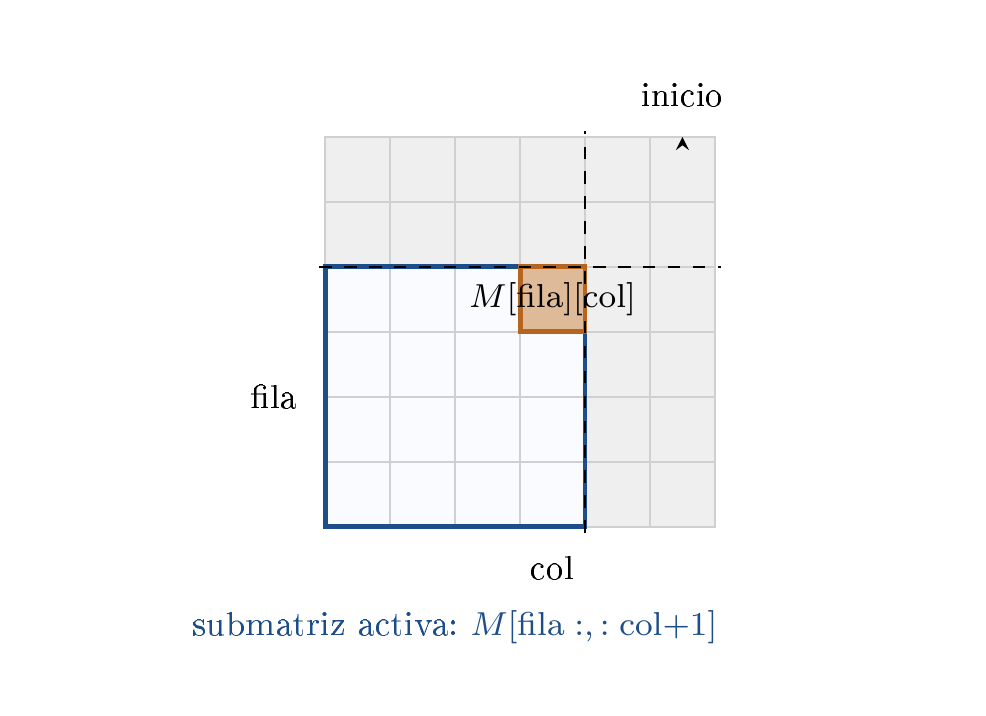

# Ejercicio 6 — Búsqueda en una matriz ordenada

**Dificultad:** ★★   **Conferencias:** C3 (Correctitud), C5 (Cotas mínimas)

## Enunciado

> Una matriz $n\times n$ tiene filas y columnas ordenadas de forma creciente. Diseña un algoritmo que decida
> si contiene un valor $x$ en $O(n)$ comparaciones, demuestra su correctitud con un invariante, y demuestra
> con un adversario que no se puede en $o(n)$.

## 1. El algoritmo: recorrido en escalera

La pregunta de diseño es: ¿desde qué celda una sola comparación alcanza para descartar una fila *o*
una columna entera, con certeza? En la esquina superior izquierda, los dos vecinos relevantes (derecha y
abajo) son ambos mayores que la celda actual; en la inferior derecha, ambos son menores. Ahí una
comparación no decide hacia dónde moverse. Las esquinas que sí sirven son las que tienen un vecino mayor y
uno menor en las dos direcciones relevantes: la **superior derecha** (abajo es mayor, a la izquierda es
menor) o, simétricamente, la inferior izquierda.

Empezamos entonces en la esquina **superior derecha**. En cada paso, comparamos el valor ahí con $x$:
si es igual, encontrado; si es mayor, todo lo que está debajo en esa columna es aún mayor (la columna crece
hacia abajo), así que esa columna entera queda descartada y nos movemos una columna a la izquierda; si es
menor, todo lo que está a la izquierda en esa fila es aún menor, así que esa fila entera queda descartada y
nos movemos una fila hacia abajo.

**Especificación (C3 §1).** Precondición: $M$ es $n\times n$ con filas y columnas estrictamente
crecientes. Postcondición: devuelve verdadero si y solo si $x$ aparece en alguna celda de $M$.

El código real y ejecutable vive en `verif.py`, en esta carpeta; aquí va el pseudocódigo:

```text
funcion buscar_staircase(M, x):
    n ← longitud(M)
    fila, col ← 0, n-1
    mientras 0 ≤ fila < n y 0 ≤ col < n:
        v ← M[fila][col]
        si v = x:
            devolver verdadero
        sino si v > x:
            col ← col - 1        // descarta la columna entera
        sino:
            fila ← fila + 1      // descarta la fila entera
    devolver falso
```

## 2. Correctitud

En cada paso el algoritmo descarta una fila o una columna completa, nunca una celda suelta — así que lo
natural para seguirle la pista a la correctitud no es ninguna celda en particular, sino la región del
tablero que todavía **no** se descartó. Esa región es siempre un rectángulo: todas las filas desde
$\mathrm{fila}$ hacia abajo, cruzadas con todas las columnas hasta $\mathrm{col}$ hacia la izquierda. El
invariante entonces es la afirmación de que, si $x$ está en algún lado, tiene que estar ahí adentro.



En gris, lo ya descartado (filas por encima de $\mathrm{fila}$, columnas a la derecha de
$\mathrm{col}$). En celeste, la submatriz activa, donde el invariante garantiza que $x$ tiene que estar si
es que está en algún lado. La celda naranja es la próxima que se compara.

> **Invariante**
>
> En cualquier momento, *si $x$ está en $M$, está en la submatriz $M[\mathrm{fila}:,\,:\mathrm{col}{+}1]$*
> (filas $\ge\mathrm{fila}$, columnas $\le\mathrm{col}$).

**Inicialización.** $\mathrm{fila}=0,\ \mathrm{col}=n{-}1$: la submatriz es $M$ entera, trivial.

**Mantenimiento.** Si $M[\mathrm{fila}][\mathrm{col}]>x$: para cualquier fila $i\ge\mathrm{fila}$,
$M[i][\mathrm{col}]\ge M[\mathrm{fila}][\mathrm{col}]>x$ (la columna crece hacia abajo), así que ninguna
celda de la columna $\mathrm{col}$ dentro de la submatriz puede ser $x$. Eliminarla (mover
$\mathrm{col}\mathrel{-}=1$) preserva el invariante. Si $M[\mathrm{fila}][\mathrm{col}]<x$: simétricamente,
para cualquier columna $j\le\mathrm{col}$, $M[\mathrm{fila}][j]\le M[\mathrm{fila}][\mathrm{col}]<x$ (la fila
crece hacia la derecha), así que la fila $\mathrm{fila}$ entera queda descartada.

**Correctitud parcial.** Si el ciclo termina sin haber encontrado $x$, es porque
$\mathrm{fila}=n$ o $\mathrm{col}=-1$, es decir, la submatriz vigente es vacía. Por el invariante, si $x$
estuviera en $M$ tendría que estar en ese conjunto vacío — imposible. Reportar “no está” es correcto.

**Terminación.** Cada vuelta del ciclo o bien sube $\mathrm{fila}$ en 1 o baja $\mathrm{col}$ en 1,
nunca ninguna de las dos cosas al mismo tiempo ni ninguna otra combinación. La cantidad
$(n-1-\mathrm{col})+\mathrm{fila}$ es un entero no negativo que empieza en 0 y sube exactamente 1 en cada
vuelta; como $\mathrm{fila}$ no puede superar $n$ ni $\mathrm{col}$ bajar de $-1$, esta cantidad está acotada
por $2n-1$, así que el ciclo termina en a lo sumo $2n-1$ vueltas. Correctitud parcial más terminación dan la
**correctitud total** (C3 §1).

## 3. Costo: a lo sumo 2n-1 comparaciones

El argumento de terminación de la sección 2 ya cuenta exactamente esto: cada comparación sube
$\mathrm{fila}$ o baja $\mathrm{col}$, nunca las dos ni ninguna otra cosa, y esa cantidad está acotada por
$2n-1$. Así que el algoritmo hace a lo sumo $2n-1=O(n)$ comparaciones — no es una cota nueva, es la misma
cuenta de la terminación, leída como costo en vez de como número de vueltas.

**Verificación de correctitud**, contra fuerza bruta, sobre matrices aleatorias (construidas con
incrementos positivos acumulados en cada fila y columna, para garantizar monotonía):

```text
pruebas: 30145, fallos (deberia ser 0): 0
```

**La cota $2n-1$ se alcanza exactamente**, con la matriz $M[i][j]=i+j$ (claramente creciente en filas
y columnas) buscando $x=n-\tfrac12$ — un valor que cae justo en el “hueco” entre la antidiagonal
$i+j=n{-}1$ y la siguiente, $i+j=n$, forzando que el camino recorra la antidiagonal entera:

```text
      n   comparaciones con x=n-0.5   2n-1
      2                            3      3
      3                            5      5
     10                           19     19
     50                           99     99
   1000                         1999   1999
```

Coincide exactamente para todo $n$ probado.

## 4. Cota mínima: Omega(n) con un adversario

Hay que mostrar que ningún algoritmo correcto (no solo este) puede resolver el problema en $o(n)$
comparaciones.

> **Las celdas de la antidiagonal son mutuamente independientes**
>
> Las $n$ celdas $(0,n{-}1),(1,n{-}2),\dots,(n{-}1,0)$ no se restringen entre sí: para cualesquiera $i<i'$,
> ni $(i,n{-}1{-}i)$ domina a $(i',n{-}1{-}i')$ ni al revés (una tiene menor fila pero mayor columna que la
> otra). Cambiar el valor de **una sola** de ellas, dejándolo estrictamente entre sus vecinos directos
> (arriba, abajo, izquierda, derecha), preserva la monotonía de filas y columnas de **toda** la matriz,
> sin tocar ninguna otra celda — en particular, sin tocar ninguna otra celda de la antidiagonal.

**Verificado directamente**, modificando cada una de las $n=6$ celdas de la antidiagonal, una por vez,
a un valor intermedio entre sus vecinos, y comprobando que la matriz sigue siendo válida y que ninguna otra
celda de la antidiagonal cambió:

```text
celdas de la antidiagonal: [(0,5),(1,4),(2,3),(3,2),(4,1),(5,0)]
fallos del argumento de independencia (deberia ser 0): 0
```

**El argumento adversario.** Fijemos cualquier matriz base válida que **no** contenga a $x$
(por ejemplo, $M[i][j]=2(i+j)$, que solo toma valores pares, y tomemos $x$ impar). Supongamos que un
algoritmo correcto consulta menos de $n$ celdas de la antidiagonal — digamos que nunca consulta la celda
$(i_0,n{-}1{-}i_0)$. Por la independencia de arriba, podemos modificar *solo* esa celda y ponerle el
valor $x$, obteniendo una matriz $M'$ igual de válida, en la que $x$ **sí** está. Como el algoritmo
nunca consultó esa celda, su ejecución sobre $M$ y sobre $M'$ hace exactamente las mismas comparaciones y
recibe las mismas respuestas (las demás celdas no cambiaron) — así que da la **misma** salida en
ambos casos. Pero la respuesta correcta es distinta ($x\notin M$, $x\in M'$). El algoritmo se equivoca en
una de las dos. Por lo tanto, todo algoritmo correcto debe consultar las $n$ celdas de la antidiagonal (o un
conjunto que las determine), lo que fuerza

> **Teorema**
>
> Ningún algoritmo de comparaciones decide “$x\in M$?” en $o(n)$ en el peor caso.

Combinado con la sección 3: el algoritmo de la escalera es **óptimo** hasta constantes, y la antidiagonal
que aparece en la demostración de la cota mínima es *exactamente* la que el ejemplo ajustado de la
sección 3 ($M[i][j]=i+j$, $x=n{-}\tfrac12$) usa para forzar el peor caso — no es casualidad: la misma
estructura (la antidiagonal) es a la vez lo que hace falta recorrer para encontrar $x$ y lo que un
adversario puede usar para esconderlo.

> **Respuesta a la pregunta del enunciado**
>
> - **Algoritmo:** recorrido en escalera desde la esquina superior derecha, descartando una fila o
>   columna completa por comparación; $O(n)$ comparaciones (sección 1 y 3).
> - **Invariante:** si $x$ está en $M$, está en la submatriz $M[\mathrm{fila}:,\,:\mathrm{col}{+}1]$
>   que todavía no se descartó; correctitud parcial más terminación (acotada en $2n-1$ vueltas) dan la
>   correctitud total (sección 2).
> - **Cota mínima:** $\Omega(n)$ por un adversario sobre las $n$ celdas de la antidiagonal, mutuamente
>   independientes — ocultar $x$ en cualquiera no consultada da una matriz indistinguible con respuesta
>   distinta (sección 4). El algoritmo de la sección 1 es óptimo hasta constantes.

## Errores que hay que vigilar

> - **Empezar en la esquina superior izquierda o inferior derecha.** Ahí *ambos* vecinos
>   relevantes (derecha y abajo, o izquierda y arriba) son mayores (o ambos menores) que la celda actual, así
>   que una sola comparación no permite descartar una fila *o* una columna completa con certeza: si
>   $M[0][0]<x$, no se sabe si avanzar en fila o en columna (las dos direcciones aumentan el valor), y el
>   algoritmo degenera en explorar un árbol, no un camino. Las esquinas que funcionan son las que tienen
>   **un vecino mayor y uno menor** en las dos direcciones relevantes: superior derecha (vecino de abajo
>   mayor, de la izquierda menor) o inferior izquierda (simétrico).
> - **Creer que la cota $\Omega(n)$ prohíbe $o(n)$ incluso en casos especiales.** La cota es sobre el
>   **peor caso** y el modelo de **comparaciones**. Si la matriz tiene estructura adicional conocida
>   (por ejemplo, valores enteros acotados), se puede hacer mejor usando los valores como índices en vez de
>   compararlos — otra vez la regla de C2 §10: toda cota mínima viene con su modelo.
> - **Confundir esta cota con $O(\log n)$ de la búsqueda binaria 1D.** Es tentador pensar “una
>   matriz ordenada debería buscarse en $O(\log n)$”, pero las filas y columnas ordenadas **no** dan un
>   único orden total sobre los $n^2$ elementos (como señala C2 §3 sobre el calentamiento en 1D: en el plano no
>   hay ningún orden total con la propiedad de cercanía). Aquí ni siquiera hay $\log(n^2)=2\log n$: la cota real
>   es $\Theta(n)$, polinomialmente peor que logarítmica.
