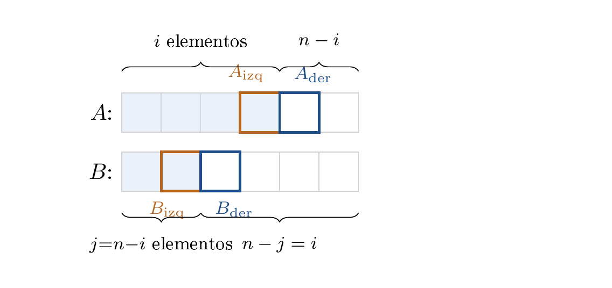
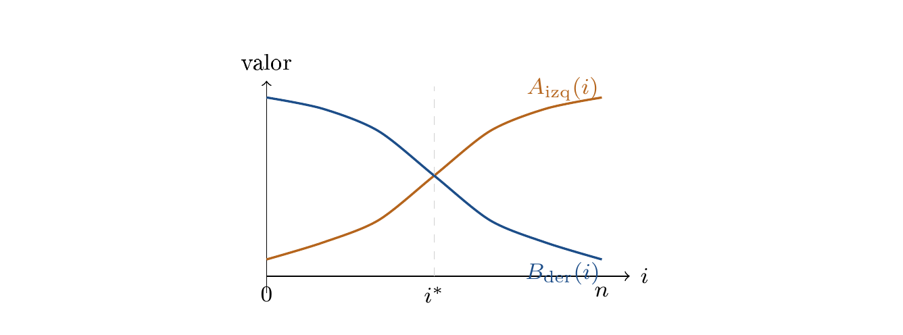

# Ejercicio 7 — Mediana de dos arreglos ordenados

**Dificultad:** ★★★   **Conferencias:** C2 (El oficio algorítmico),
C3 (Correctitud), C5 (Cotas mínimas)

## Enunciado

> Mediana de dos arreglos ordenados de largo $n$: el $n$-ésimo menor de los $2n$ elementos. Diseña un
> algoritmo $O(\log n)$, demuestra su correctitud y da la cota de información.

## 1. El algoritmo: búsqueda binaria sobre la partición

Mezclar $A$ y $B$ enteros y mirar la posición $n$ resuelve el problema, pero cuesta $\Theta(n)$; para bajar a
$O(\log n)$ hace falta evitar mirar la mayoría de los $2n$ elementos.

Pensemos en dónde va a quedar el $n$-ésimo menor: a su izquierda (incluyéndolo) tienen que quedar
exactamente $n$ elementos — la “mitad baja” — repartidos entre $A$ y $B$. Esos dos repartos no son
independientes: si $i$ de esos $n$ elementos vienen de $A$, los otros $j=n-i$ tienen que venir de $B$,
porque juntos suman $n$. Esa es la observación que reduce el problema: en vez de llevar la cuenta por
separado de cuántos elementos de $A$ y cuántos de $B$ quedan a la izquierda, alcanza con un solo número,
$i$ — el otro, $j$, sale gratis de la relación $i+j=n$. Y una vez fijado $i$ (y por lo tanto $j$), la
respuesta no depende de cómo estén entrelazados los demás elementos: sale de mirar únicamente los cuatro
elementos que quedan justo en la frontera de cada arreglo ($A_{\mathrm{izq}}, A_{\mathrm{der}},
B_{\mathrm{izq}}, B_{\mathrm{der}}$).

Esto convierte el problema de “encontrar un valor entre $2n$ posibles” en “encontrar un índice
$i\in\{0,\dots,n\}$” — $n+1$ posibilidades en vez de $2n$. Y ese índice tiene además un comportamiento
particular: a medida que $i$ crece, $A_{\mathrm{izq}}$ (el mayor elemento que $A$ aporta a la mitad baja)
nunca puede bajar, porque $A$ está ordenado; y $B_{\mathrm{der}}$ (el menor elemento que $B$ deja en la
mitad alta) nunca puede subir, porque $j=n-i$ baja y eso corre la frontera de $B$ hacia atrás. Dicho de otra
forma, la condición que separa “$i$ demasiado chico” de “$i$ demasiado grande” es monótona: cierta de
un lado, falsa del otro. Es una propiedad útil sobre la que se vuelve, con más cuidado, en la sección 2.



 División genérica de $A$ y $B$ en una mitad baja (celeste: $i$ elementos de $A$ más
$j=n-i$ de $B$) y una mitad alta (blanco). Las cuatro celdas frontera —$A_{\mathrm{izq}}$,
$A_{\mathrm{der}}$, $B_{\mathrm{izq}}$, $B_{\mathrm{der}}$— son las únicas que el algoritmo compara en
cada paso.

Para ver por qué alcanza con esas cuatro celdas, ayuda mirar qué pasa si de verdad se mezclaran $A$ y $B$
— cosa que el algoritmo **nunca hace**, pero que sirve para entender el lema de la sección 2.
**Ejemplo concreto:** $A=(1,4,6,9)$, $B=(2,3,7,8)$, $n=4$. La partición válida es $i=j=2$, con
$A_{\mathrm{izq}}=4$, $A_{\mathrm{der}}=6$, $B_{\mathrm{izq}}=3$, $B_{\mathrm{der}}=7$.


 La unión $A\cup B$ mezclada y ordenada de verdad (fila de abajo, con la letra de origen de
cada valor). $B_{\mathrm{izq}}{=}3$ y $A_{\mathrm{izq}}{=}4$ son los dos candidatos a “último de la mitad
baja”; como $4>3$, es $A_{\mathrm{izq}}$ quien queda justo en el corte — $B_{\mathrm{izq}}$ se queda dos
lugares antes. Simétricamente, $A_{\mathrm{der}}{=}6$ gana a $B_{\mathrm{der}}{=}7$ y queda justo después
del corte. Por eso el lema necesita la cadena completa de desigualdades y no alcanza con mirar solo el
elemento que quedó pegado al corte: el otro candidato, aunque no toque el corte, también tiene que estar del
lado correcto.

**Especificación (C3 §1).** Precondición: $A$ y $B$ están ordenados de forma creciente y tienen el
mismo largo $n\ge 1$. Postcondición: devuelve el $n$-ésimo menor (1-indexado) de $A\cup B$.

El código real y ejecutable vive en `verif.py`, en esta carpeta; aquí va el pseudocódigo:

```text
funcion n_esimo_menor(A, B):
    n ← longitud(A)
    lo, hi ← 0, n
    mientras verdadero:
        i ← (lo+hi) div 2        // i elementos de A en la mitad baja
        j ← n - i                 // n-i elementos de B en la mitad baja
        Aizq  ← A[i-1] si i > 0 sino -∞
        Ader  ← A[i]   si i < n sino ∞
        Bizq  ← B[j-1] si j > 0 sino -∞
        Bder  ← B[j]   si j < n sino ∞
        si Aizq ≤ Bder y Bizq ≤ Ader:      // particion valida
            devolver max(Aizq, Bizq)
        sino si Aizq > Bder:
            hi ← i - 1                        // tomamos de mas de A
        sino:
            lo ← i + 1                        // tomamos de menos de A
```

## 2. Correctitud

Como en todo argumento de este tipo (C3 §1), correctitud total = correctitud parcial + terminación, y acá
conviene separarlas desde el arranque porque cada una se apoya en una herramienta distinta. La correctitud
parcial responde “si el ciclo corta, ¿la respuesta es la correcta?”, y se parte a su vez en dos preguntas:
qué significa que una partición sea “válida” (el lema del cruce), y por qué existe una partición así para
que el ciclo tenga algo que encontrar (la existencia, por monotonía). La terminación responde, por separado,
“¿el ciclo corta alguna vez?”, y se resuelve con el mismo potencial de cualquier búsqueda binaria: el
rango $[\mathrm{lo},\mathrm{hi}]$ se parte por la mitad en cada vuelta.

### Correctitud parcial (I): el lema del cruce

El algoritmo termina devolviendo $\max(A_{\mathrm{izq}},B_{\mathrm{izq}})$ apenas encuentra una partición que
cumple $A_{\mathrm{izq}}\le B_{\mathrm{der}}$ y $B_{\mathrm{izq}}\le A_{\mathrm{der}}$ — pero hace falta
justificar por qué esa condición, puntual sobre solo cuatro elementos, garantiza algo sobre los $2n$
elementos enteros. La idea es que esas cuatro desigualdades son exactamente las que hacen falta para que
**ningún** elemento de la mitad baja (los $i$ de $A$ y $j$ de $B$ elegidos) sea mayor que ningún
elemento de la mitad alta: si eso vale, la mitad baja es forzosamente el conjunto de los $n$ menores de todo
$A\cup B$, sin importar cómo estén entrelazados por dentro.

> **Lema del cruce**
>
> Si $A_{\mathrm{izq}}\le B_{\mathrm{der}}$ y $B_{\mathrm{izq}}\le A_{\mathrm{der}}$, entonces todo elemento
> de $A[0..i{-}1]\cup B[0..j{-}1]$ (la “mitad baja”, $n$ elementos) es $\le$ todo elemento de
> $A[i..n{-}1]\cup B[j..n{-}1]$ (la “mitad alta”, también $n$ elementos).

*Demostración.* Sea $a\in A[0..i{-}1]$ y $b\in B[j..n{-}1]$: $a\le A_{\mathrm{izq}}$ (por ser $A$
creciente) $\le B_{\mathrm{der}}\le b$ (por ser $B$ creciente). Sea $a'\in A[i..n{-}1]$ y
$b'\in B[0..j{-}1]$: simétricamente, $b'\le B_{\mathrm{izq}}\le A_{\mathrm{der}}\le a'$. Las comparaciones
dentro de un mismo arreglo son triviales (está ordenado). $\square$

Como la mitad baja (exactamente $n$ elementos) es $\le$ toda la mitad alta, la mitad baja es **el
conjunto de los $n$ menores** de $A\cup B$, y su máximo, $\max(A_{\mathrm{izq}},B_{\mathrm{izq}})$, es el
$n$-ésimo menor — la respuesta que el algoritmo devuelve.

**Verificado** sobre 2000 pares de arreglos aleatorios, comprobando que, con la partición que encuentra
el algoritmo, el máximo de la mitad baja nunca supera al mínimo de la mitad alta:

```text
fallos del lema de cruce (max(izq) <= min(der), deberia ser 0): 0
```

### Correctitud parcial (II) y terminación: existe una partición válida, y la búsqueda binaria la
encuentra

El lema del cruce dice qué pasa *si* se encuentra una partición válida; falta mostrar que existe una, y
que el algoritmo efectivamente llega a ella (y no se queda dando vueltas). Como la búsqueda es binaria sobre
$i$, lo que hace falta es exactamente lo que toda búsqueda binaria necesita: que las condiciones de frontera
sean **monótonas** en $i$.

**Existencia (monotonía).** Fijemos $i\in\{0,\dots,n\}$ y $j=n-i$, y llamemos $P(i)$ a la condición
“$A_{\mathrm{izq}}\le B_{\mathrm{der}}$” y $Q(i)$ a “$B_{\mathrm{izq}}\le A_{\mathrm{der}}$”; una partición
es válida cuando valen las dos. Al aumentar $i$ en 1 (un elemento más de $A$, uno menos de $B$),
$A_{\mathrm{izq}}(i)$ es **no decreciente** en $i$ ($A$ es creciente), y $B_{\mathrm{der}}(i)=B[n-i]$ es
**no creciente** en $i$ (porque $j=n-i$ baja). Así que $P$ es monótona: si vale para $i$, vale para
todo $i'<i$; y vale en $i=0$ (ahí $A_{\mathrm{izq}}=-\infty$). Por el mismo argumento con los papeles
cambiados, $Q$ es monótona en la dirección contraria: si vale para $i$, vale para todo $i'>i$; y vale en
$i=n$ (ahí $B_{\mathrm{izq}}=-\infty$). Sea $i_0$ el menor $i$ para el que vale $Q$. Si $i_0=0$, vale
también $P(0)$ y $i_0$ es válida. Si $i_0>0$, $Q(i_0-1)$ es falsa, es decir,
$B[n-i_0]>A[i_0-1]$, que es exactamente $P(i_0)$ (pues $A_{\mathrm{izq}}(i_0)=A[i_0-1]$ y
$B_{\mathrm{der}}(i_0)=B[n-i_0]$). En los dos casos $i_0$ es una partición válida: existe al menos una.



 $A_{\mathrm{izq}}(i)$ nunca baja, $B_{\mathrm{der}}(i)$ nunca sube. En el caso dibujado se cruzan en
$i^\ast$: para $i<i^\ast$, “$A_{\mathrm{izq}}\le B_{\mathrm{der}}$” es cierta; para $i>i^\ast$, falsa
— esa es la monotonía que la búsqueda binaria necesita, dibujada en general, sin números concretos. Con
empates puede haber varios índices válidos consecutivos, pero todos devuelven el mismo $n$-ésimo menor.

**Terminación.** La búsqueda binaria mueve $\mathrm{hi}=i{-}1$ cuando $A_{\mathrm{izq}}>B_{\mathrm{der}}$
(cuando $i$ es demasiado grande). Si esa condición no se cumple pero la partición aún no es válida, entonces
$B_{\mathrm{izq}}>A_{\mathrm{der}}$ y $i$ es demasiado pequeño, por lo que mueve $\mathrm{lo}=i{+}1$.
Así, cada actualización descarta una mitad del rango de candidatos. Con el potencial $\Phi=\mathrm{hi}-\mathrm{lo}$,
que disminuye estrictamente en cada actualización y queda finalmente en $-1$ cuando el rango se vacía, el
ciclo termina habiendo encontrado una partición válida. Correctitud
parcial (el lema del cruce más la existencia) más terminación dan la **correctitud total** (C3 §1).


 Ejemplo con $n=6$: se prueba el candidato del medio, $i=3$ (naranja). Si da “demasiado
grande”, la monotonía garantiza que $4,5,6$ también lo son — se descartan sin probarlos, igual que $3$.
Quedan $\{0,1,2\}$: el rango de candidatos para $i$ se parte por la mitad en cada vuelta, de ahí sale
$\Phi=\mathrm{hi}-\mathrm{lo}$ y la cota $O(\log n)$.

## 3. Costo

Cada vuelta hace $O(1)$ comparaciones y trabajo, y el rango $[\mathrm{lo},\mathrm{hi}]$ (de tamaño $n{+}1$)
se parte por la mitad en cada vuelta — el mismo potencial de la búsqueda binaria. Costo: $O(\log n)$.

**Verificación de correctitud** contra fuerza bruta (ordenar y tomar el elemento en la posición
$n{-}1$), sobre arreglos de tamaños $1$ a $5000$:

```text
pruebas: 270, fallos (deberia ser 0): 0
```

**Número de iteraciones**, comparado con $\lceil\log_2(n{+}1)\rceil$:

```text
     n   iteraciones (peor de 30 pruebas)   techo(log2(n+1))
     1                                  2                  1
     2                                  2                  2
     3                                  3                  2
     5                                  3                  3
    10                                  4                  4
    50                                  6                  6
   200                                  8                  8
  1000                                 10                 10
  5000                                 13                 13
100000                                 17                 17
1000000                                 20                 20
```

Para $n$ chico hay una o dos iteraciones de más (overhead de esta implementación concreta, que no está
optimizada al límite); para $n$ grande el crecimiento es $\Theta(\log n)$ con la constante exacta de la
cota, confirmando $O(\log n)$.

## 4. Cota de información: Omega(log n)

Para acotar cualquier algoritmo de comparaciones (no solo el de la sección 1), C5 §3 enseña a mirar cuántas
respuestas distintas puede llegar a dar el algoritmo: un árbol de decisión con $h$ niveles tiene a lo sumo
$2^h$ hojas, así que si el problema tiene $k$ respuestas posibles, hace falta $h\ge\log_2 k$. La pregunta
entonces es: ¿cuántas respuestas distintas puede tener este problema?

> **Observación clave**
>
> La **identidad** del $n$-ésimo menor — es decir, cuántos elementos de $A$ hay entre los $n$ menores
> — solo puede tomar $n{+}1$ valores: $i=0,1,\dots,n$.

A diferencia de mezclar dos listas completas (C5 §6, que necesita distinguir $\binom{2n}{n}$
entrelazados posibles y cuesta $2n{-}1$), aquí la salida que se pide es mucho más pobre: un solo número
(el valor del $n$-ésimo menor), determinado por un solo parámetro $i\in\{0,\dots,n\}$. Esto sugiere, y
resulta ser, una cota mucho más baja que lineal.

> **Teorema**
>
> Todo algoritmo de comparaciones necesita, en el peor caso, $\Omega(\log n)$ comparaciones para encontrar el
> $n$-ésimo menor de $A\cup B$.

*Demostración.* Trabajamos con preguntas binarias del tipo $u\le v$, como las que usa el algoritmo. El árbol
de decisión no enumera las entradas —hay infinitas—, sino las secuencias de respuestas: cada nodo interno es
una pregunta y cada hoja es una respuesta final. Para forzar que el árbol no pueda ser bajo, basta exhibir
muchas entradas que el algoritmo esté obligado a distinguir entre sí.

Construimos explícitamente $n+1$ instancias con respuestas distintas. Sean
$L_r=-2n+r$ para $0\le r\le n-2$ y $H_r=n+r$ para $1\le r\le n$; los rangos vacíos se omiten.
Para $i=0$, tomamos
$A_0=(H_1,\dots,H_n)$ y $B_0=(L_0,\dots,L_{n-2},0)$. Para $1\le i\le n$, tomamos
\[
A_i=(L_0,\dots,L_{i-2},\,i,\,H_1,\dots,H_{n-i}),\qquad
B_i=(L_{i-1},\dots,L_{n-2},\,H_1,\dots,H_i).
\]
Cada arreglo está ordenado y, en la unión, los primeros $n-1$ valores son los $L_r$, el siguiente es $i$,
y todos los valores $H_r$ son mayores. Por tanto, el $n$-ésimo menor de $A_i\cup B_i$ es exactamente
$i$, y la partición correcta usa exactamente $i$ elementos de $A$.

Fijado un algoritmo arbitrario, estas $n+1$ instancias recorren su árbol de decisión y cada una termina en
alguna hoja. Si dos instancias $A_i,B_i$ y $A_{i'},B_{i'}$ con $i\ne i'$ llevaran a la **misma hoja**,
el algoritmo daría la misma respuesta a las dos — pero la respuesta correcta depende de $i$, así que al
menos una estaría mal. Como el algoritmo tiene que ser correcto siempre, esto no puede pasar: las $n+1$
instancias necesitan $n+1$ hojas distintas.

Por el Lema 1 de C5 §3, un árbol binario de altura $h$ tiene a lo sumo $2^h$ hojas. Como el árbol necesita
al menos $n+1$ hojas, $2^h\ge n+1$, y despejando, la altura del árbol — el costo del algoritmo en el peor
caso — es al menos $h\ge\lceil\log_2(n{+}1)\rceil$. Nótese que $n+1$ y $h$ son cosas distintas: $n+1$ es
cuántas respuestas posibles tiene el *problema*, $h$ es cuántas comparaciones hace el *algoritmo*
— la desigualdad $2^h\ge n+1$ es el puente que convierte lo primero en una cota sobre lo segundo. Como el
algoritmo era arbitrario, la cota vale para cualquiera. $\square$


 Ejemplo con $n=3$ ($n{+}1=4$ instancias): cada instancia de referencia $i=0,1,2,3$ tiene que
terminar en una hoja distinta del árbol de decisión — si dos cayeran en la misma hoja, el algoritmo daría
la misma respuesta a dos instancias con respuesta correcta distinta. Con $h=2$ niveles alcanzan exactamente
$2^2=4$ hojas, una por instancia; en general, $2^h\ge n+1 \Rightarrow h\ge\log_2(n+1)$.

El algoritmo de la sección 1 alcanza esta cota hasta una constante, así que es óptimo en el modelo de
comparaciones.

> **Respuesta a la pregunta del enunciado**
>
> - **Algoritmo:** búsqueda binaria sobre $i$ (cuántos elementos de $A$ van en la mitad baja), no
>   sobre los valores; cada paso mira 4 elementos frontera. $O(\log n)$ (secciones 1 y 3).
> - **Correctitud:** el lema del cruce da la correctitud parcial (partición válida $\Rightarrow$
>   respuesta correcta); la monotonía de las condiciones de frontera da la existencia de esa partición, y el
>   potencial $\Phi=\mathrm{hi}-\mathrm{lo}$ da la terminación (sección 2).
> - **Cota de información:** $\Omega(\log n)$ porque la respuesta solo puede tomar $n+1$ valores
>   posibles ($i=0,\dots,n$), vía un adversario sobre $n+1$ instancias de referencia y el Lema 1 de C5 §3. El
>   algoritmo de la sección 1 es óptimo hasta constantes (sección 4).

## Errores que hay que vigilar

> - **Buscar en el arreglo más largo primero sin ajustar los índices.** Cuando $A$ y $B$ tienen
>   tamaños distintos (variante más general que la pedida aquí, con $|A|=m\ne n=|B|$), hay que buscar binariamente
>   sobre el arreglo **más chico** y calcular $j$ a partir de $i$ y $k$ (la posición buscada) con cuidado
>   de los límites ($i$ no puede exceder $|A|$ ni hacer que $j$ sea negativo o mayor que $|B|$); mezclar los
>   roles de $A$ y $B$ a mitad del algoritmo es la fuente más común de errores de implementación de este
>   problema.
> - **Pensar que es necesario fusionar (mezclar) las dos listas para encontrar el $n$-ésimo
>   menor.** Mezclar cuesta $\Theta(n)$ y de hecho **sí** resuelve el problema, pero es exponencialmente
>   más lento que necesario: la sección 4 demuestra que $O(\log n)$ basta, porque la pregunta tiene muchas menos
>   respuestas posibles ($n{+}1$) que la mezcla completa ($\binom{2n}{n}$ entrelazados). Confundir “resuelve el
>   problema” con “resuelve el problema de forma óptima” es exactamente la distinción que abre la
>   conferencia 2 (la quinta pregunta, ¿se puede hacer mejor?, no es retórica).
> - **Usar $-\infty$/$+\infty$ reales (como `float('inf')`) en una implementación que
>   después hace aritmética con esos valores.** Para comparar sirven perfecto; para calcular (por ejemplo, la
>   mediana promediando dos valores "izquierda" cuando $2n$ es par) hay que tener cuidado de que nunca se
>   promedie un $\pm\infty$ con un número finito, lo que requiere que $i,j$ estén siempre estrictamente dentro
>   de rango en el punto final — una fuente de errores de borde clásica en este problema.
