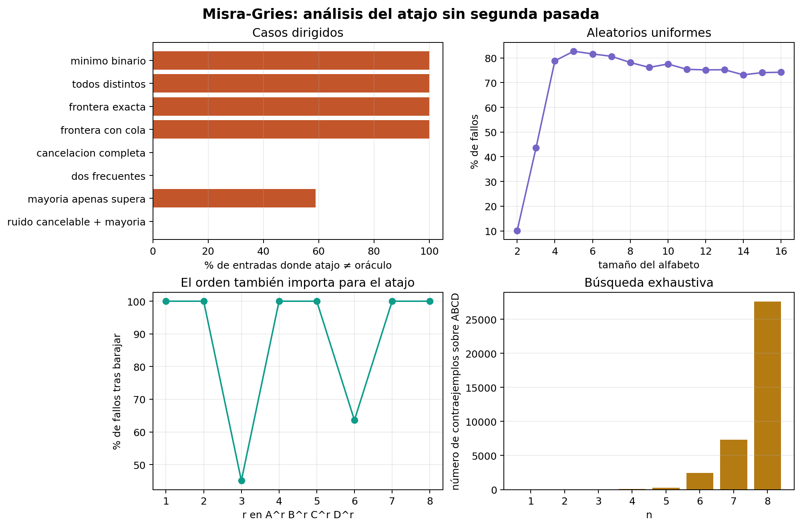

# Ejercicio 8 — El elemento que aparece más de n/3 veces

**Dificultad:** ★★   **Conferencias:** C3 (Correctitud)

## Enunciado

> El elemento que aparece más de $n/3$ veces. Generaliza Boyer-Moore con dos candidatos, enuncia el
> invariante reforzado y demuéstralo. Después escribe la versión que devuelve los candidatos con contador
> positivo sin verificarlos, y busca un generador de pruebas que no la atrape. Cuidado: el análogo del
> generador binario de la conferencia 3 sí la atrapa.

Es la generalización de Boyer-Moore (C3 §3–5) conocida como el algoritmo de **Misra y Gries**
(1982). Puede haber a lo sumo **dos** elementos con más de $n/3$ apariciones (si hubiera tres, sus
apariciones solas sumarían más de $n$), así que hacen falta dos candidatos y dos contadores en vez de uno.

**Especificación (C3 §1).** Precondición: $A$ es un arreglo de $n\ge 0$ elementos. Postcondición:
devuelve exactamente los elementos $c$ tales que el número real de apariciones de $c$ en $A$ es mayor que
$n/3$.

## 1. El algoritmo

La idea es recorrer el arreglo manteniendo dos candidatos posibles. Si aparece un tercer valor distinto
cuando ambos candidatos tienen contador positivo, se cancela una copia de cada uno de los tres valores.
Como cada cancelación elimina tres elementos distintos, ningún elemento que aparezca más de $n/3$ veces
puede desaparecer por completo de los candidatos.

```python
def misra_gries(A):
    """Dos candidatos, dos contadores. Primera pasada: cancelacion.
    Segunda pasada: verificacion real."""
    cand1 = cand2 = None
    c1 = c2 = 0
    for x in A:
        if c1 > 0 and x == cand1:
            c1 += 1
        elif c2 > 0 and x == cand2:
            c2 += 1
        elif c1 == 0:
            cand1, c1 = x, 1
        elif c2 == 0:
            cand2, c2 = x, 1
        else:
            c1 -= 1
            c2 -= 1
    # segunda pasada: verificar de verdad
    n = len(A)
    resultado = []
    for cand in (cand1, cand2):
        if cand is not None and A.count(cand) > n / 3:
            resultado.append(cand)
    return sorted(set(resultado)), (cand1, c1, cand2, c2)
```

La rama `else` es la generalización de la cancelación de Boyer-Moore: en vez de cancelar una pareja
de distintos, cancela un **trío** de distintos ($x$, cand1 y cand2, que son tres valores distintos en
ese momento).

## 2. Correctitud

La correctitud se demuestra con un invariante reforzado, igual que en Boyer-Moore, pero sustituyendo las
parejas de elementos distintos por tríos de elementos distintos.

### Correctitud parcial

### Invariante reforzado

> **Invariante**
>
> Después de procesar el prefijo $A[1..i]$: el prefijo se puede partir en **tríos de elementos
> distintos**, más $c_1$ copias de `cand1`, más $c_2$ copias de `cand2` (con
> `cand1`$\ne$`cand2` siempre que $c_1>0$ y $c_2>0$ a la vez).

Es, letra por letra, la generalización de parejas a tríos del invariante de Boyer-Moore (C3 §4).

**Inicialización.** Prefijo vacío, $c_1=c_2=0$: cero tríos, cero copias.

**Mantenimiento.** Supongamos el invariante para $A[1..i]$ y procesemos $x=A[i{+}1]$, con cinco casos
(uno por rama del `if`):

- $x=\texttt{cand1}$ con $c_1>0$: $c_1$ sube en 1, y $x$ se suma como una copia más de `cand1`.
  La partición nueva es la misma, más esa copia.
- $x=\texttt{cand2}$ con $c_2>0$: simétrico.
- $c_1=0$: el prefijo era solo tríos (y quizás copias de `cand2`); $x$ pasa a ser
  `cand1` con $c_1=1$. La partición nueva es la misma más una copia de `cand1`.
- $c_2=0$ (y $c_1>0$, $x\ne\texttt{cand1}$): simétrico con `cand2`.
- Si ninguna de las anteriores aplica ($c_1>0$, $c_2>0$, $x\ne\texttt{cand1}$, $x\ne\texttt{cand2}$):
  tomamos una copia de `cand1`, una de `cand2` y el propio $x$ — tres valores distintos, por
  hipótesis — y los agrupamos en un trío nuevo. Quedan $c_1{-}1$ copias de `cand1` y $c_2{-}1$ de
  `cand2`, que es exactamente lo que el código deja en los contadores.

**Conclusión.** Al terminar, $A$ entero se parte en $t$ tríos más $c_1$ copias de `cand1` más
$c_2$ copias de `cand2`, con $n=3t+c_1+c_2$.

> **Teorema**
>
> Si un elemento $m$ aparece más de $n/3$ veces en $A$, entonces $m\in\{\texttt{cand1},\texttt{cand2}\}$ al
> terminar.

*Demostración.* Supongamos que $m$ no es ninguno de los dos candidatos finales. Entonces todas las
apariciones de $m$ están dentro de los $t$ tríos (cada trío tiene elementos distintos, así que a lo sumo una
copia de $m$ por trío): $m$ aparece a lo sumo $t$ veces. Como $n=3t+c_1+c_2\ge 3t$, tenemos $t\le n/3$, así
que $m$ aparece a lo sumo $n/3$ veces — contradice que aparece *más* de $n/3$ veces. $\square$

### Terminación

La primera pasada es un ciclo `for` sobre un arreglo finito de longitud $n$. Si $i$ denota la
cantidad de elementos ya procesados, el potencial de terminación

$$
\Phi=n-i
$$

es un entero no negativo. Antes de cada vuelta, si quedan elementos, $\Phi>0$; cada vuelta procesa
exactamente un elemento y reduce $\Phi$ en 1. Por tanto, después de $n$ vueltas el ciclo termina.

La segunda pasada también termina: recorre como máximo los dos candidatos finales y cada llamada a
`A.count` recorre un arreglo finito. Así, terminan tanto la fase de candidatos como la fase de
verificación.

### Correctitud total

La salida cumple la postcondición en las dos direcciones. Por un lado, todo elemento que el código devuelve
ha sido contado en la segunda pasada y satisface realmente `A.count(c) > n/3`; no hay falsos positivos.
Por otro lado, si un elemento $m$ aparece más de $n/3$ veces, el teorema anterior garantiza que $m$ está
entre `cand1` y `cand2` al terminar. La segunda pasada lo cuenta y lo incluye; no hay falsos
negativos. Correctitud parcial más terminación dan la **correctitud total**, exactamente como en C3 §1.

**Verificado** comparando la versión con segunda pasada contra un oráculo de fuerza bruta (contar con
`Counter`), sobre 5000 arreglos aleatorios:

```text
version con 2 pasadas vs oraculo: 5000 pruebas, fallos (deberia ser 0): 0
```

## 3. Costo

La primera pasada procesa cada elemento una vez y la segunda pasada verifica como máximo dos candidatos,
por lo que el tiempo total es $O(n)$. Solo se guardan dos candidatos y dos contadores, así que la memoria
adicional es $O(1)$.

## 4. El atajo (sin segunda pasada) y por qué falla

```python
def misra_gries_atajo(A):
    """Version sin segunda pasada: devuelve los candidatos con contador positivo, sin verificar."""
    cand1 = cand2 = None
    c1 = c2 = 0
    for x in A:
        if c1 > 0 and x == cand1:
            c1 += 1
        elif c2 > 0 and x == cand2:
            c2 += 1
        elif c1 == 0:
            cand1, c1 = x, 1
        elif c2 == 0:
            cand2, c2 = x, 1
        else:
            c1 -= 1
            c2 -= 1
    res = []
    if c1 > 0:
        res.append(cand1)
    if c2 > 0:
        res.append(cand2)
    return sorted(set(res))
```

El teorema de la sección 2 dice que un elemento con más de $n/3$ apariciones **tiene que** terminar de
candidato — pero no dice lo contrario: un candidato con contador positivo **no tiene por qué** haber
aparecido más de $n/3$ veces. El contraejemplo más simple posible usa solo **dos símbolos**:

```text
contraejemplo A + 99*B:
  atajo (sin verificar) dice: ['A', 'B']
  respuesta correcta (oraculo): ['B']
  'A' aparece 1 vez; n/3 = 33.3 -> 1 NO es > n/3, A no deberia calificar
```

¿Por qué pasa esto con tan pocos símbolos? Con `A` y `B` únicamente: el primer `A` se
vuelve `cand1`; el primer `B` se vuelve `cand2` (porque $c_2=0$ en ese momento); y de
ahí en adelante, **todos** los `B` siguientes incrementan `c2` directamente (coinciden
con `cand2`), porque con solo dos símbolos en todo el arreglo, la rama `else` (que cancela un
trío) **nunca se activa**: nunca aparece un tercer valor distinto que dispare la cancelación. El
resultado es una cuenta directa sin cancelaciones, y `cand1` queda contaminado con un valor que
apareció una sola vez y nunca fue desafiado.

## 5. Los generadores: uno que no lo atrapa y el binario que sí

### Un generador que no atrapa el atajo

El enunciado pide observar que una batería de pruebas también puede pasar por alto el error. Para construirla,
tomamos un entero $r\ge1$ y generamos

$$
(B,C,D)^r,\; A^{\,2r+1}.
$$

Cada bloque $(B,C,D)$ se cancela completo como un trío de elementos distintos. Después queda solo $A$ como
candidato, y como

$$
n=3r+(2r+1)=5r+1,\qquad 2r+1>\frac{5r+1}{3},
$$

la salida del atajo coincide con la respuesta correcta: únicamente $A$. Este generador contiene ruido y una
mayoría real, pero no produce falsos positivos; por eso no atrapa el error.

```text
generador ruido cancelable + mayoria: 2000 pruebas, fallos (deberia ser 0): 0
```

### El generador binario sí lo atrapa

En C3 §5, con el atajo de Boyer-Moore (un candidato, un contador), un alfabeto **binario** nunca
encuentra fallos: ahí se demuestra (ejercicio 3 de esa conferencia) que con dos símbolos el contador final
es *exactamente* la diferencia entre las dos cuentas, y esa diferencia es positiva si y solo si hay
mayoría real — una coincidencia algebraica específica del caso de un solo contador. Aquí, con
**dos** contadores, esa coincidencia **no se repite**: como acabamos de ver, un alfabeto de solo
2 símbolos ya alcanza para que la rama de cancelación se quede inactiva y el atajo falle.

**Batería de pruebas, igual que C3 §5**, midiendo el % de arreglos aleatorios (tamaño variable) en
los que el atajo discrepa del oráculo, por tamaño de alfabeto:

```text
  alfabeto  % fallos del atajo (vs oraculo)
         2                           13.38%
         3                           44.18%
         4                           71.13%
         5                           75.32%
```

Contraste directo con la tabla de C3 §5 (Boyer-Moore): ahí, **binario** y **mayoría plantada**
daban 0.0% de fallos, y recién con 3 símbolos aparecía un 34%. Aquí, con **un contador más**,
el generador binario ya es suficiente — el “análogo del generador binario” que advierte el enunciado
sí atrapa el error, justo al revés que en Boyer-Moore.

## 6. Batería ampliada de generadores y análisis

Para no depender de un único contraejemplo, se implementó una batería con casos dirigidos, familias
parametrizadas y una búsqueda exhaustiva. Cada entrada se compara con el oráculo que cuenta las apariciones
reales; por tanto, “fallo” significa exactamente que el atajo devuelve una lista distinta de la correcta.

| **Generador** | **Forma de la entrada** | **Qué pone a prueba** |
|---|---|---|
| Mínimo binario | `ABB` | Contraejemplo mínimo: el atajo conserva la A, aunque solo aparece una vez. |
| Todos distintos | `ABCD` | No existe ningún elemento válido; comprueba falsos positivos residuales. |
| Frontera exacta | `A²B²C²D²` | Todos quedan en la frontera: $2=n/4<n/3$ y ninguno debe salir. |
| Frontera con cola | `ABCABC DDD` | La D aparece exactamente $n/3$ veces, así que la desigualdad estricta importa. |
| Cancelación completa | $(ABC)^r$ | Fuerza cancelaciones de tríos sin dejar una mayoría real. |
| Dos frecuentes | `A⁵B⁵CD` | Comprueba que la salida puede contener dos elementos válidos. |
| Mayoría apenas supera | $\lfloor n/3\rfloor+1$ copias de A y ruido B–F, barajado | Prueba el umbral estricto y la sensibilidad a la posición. |
| Orden adversario | multiconjunto $A^rB^rC^rD^r$, barajado | Mantiene las frecuencias y cambia solo el orden; mide si el atajo depende de la secuencia. |
| Distribución sesgada | A, B, C, D, E con pesos $0.62,0.16,0.10,0.07,0.05$ | Simula una señal dominante mezclada con ruido de varias categorías. |
| Ruido cancelable + mayoría | $(BCD)^rA^{2r+1}$ | Familia que contiene una mayoría real pero, deliberadamente, no atrapa el fallo. |

Además, el generador exhaustivo recorre todos los arreglos sobre $\{A,B,C,D\}$ para cada $n\le8$.
Encuentra el primer contraejemplo en $n=3$: `AAB`. En ese tamaño hay 36 fallos entre las 64
entradas posibles. Esta búsqueda es útil porque no depende de una semilla aleatoria ni de una intuición
particular sobre el orden de los símbolos.

La siguiente salida resume la batería dirigida ejecutada por `verif.py`. Las familias grandes usan
semillas fijas, de modo que los porcentajes son reproducibles:

```text
                   generador    casos     fallos
              minimo binario        1    100.00%
             todos distintos        1    100.00%
             frontera exacta        1    100.00%
           frontera con cola        1    100.00%
        cancelacion completa      100      0.00%
              dos frecuentes        1      0.00%
       mayoria apenas supera       78     58.97%
            orden adversario     2000     88.60%
        distribucion sesgada     2000     74.45%
  ruido cancelable + mayoria     2000      0.00%
```



*Figura 1. Análisis reproducible de los generadores. Las barras comparan el atajo con el oráculo; las curvas
estudian el tamaño del alfabeto, el orden de un mismo multiconjunto y el número de fallos exhaustivos.*

La lectura importante es doble. Primero, el generador $(BCD)^rA^{2r+1}$ tiene 0% de fallos porque las
cancelaciones eliminan únicamente ruido y dejan una mayoría verdadera. Segundo, cambiar el orden o ampliar
el alfabeto puede elevar mucho la tasa de falsos positivos del atajo, aunque la distribución de frecuencias
sea parecida. Ninguno de estos experimentos sustituye la prueba de correctitud: sirven para encontrar
contraejemplos y para comprobar que la segunda pasada no es un detalle opcional.

## Curiosidad: el patrón general n/k

> **Generalización de Misra-Gries**
>
> La misma idea se extiende de forma natural: para encontrar todos los elementos que aparecen
> *más de* $n/k$ veces, con $k\ge2$, se mantienen como máximo $k-1$ candidatos y sus contadores.

El número $k-1$ no es arbitrario. No pueden existir $k$ elementos distintos con más de $n/k$ apariciones,
porque sus apariciones sumarían más de $n$. Por eso basta reservar un lugar para cada posible elemento
frecuente salvo uno: si aparecen $k-1$ candidatos y llega un valor nuevo distinto de todos, se puede
cancelar una copia de cada candidato junto con ese nuevo valor.

La versión general conserva la misma estructura:

- si $x$ coincide con un candidato, se incrementa su contador;
- si hay un contador vacío, $x$ ocupa ese lugar con contador 1;
- si todos los contadores están ocupados y $x$ es distinto de todos, se decrementan los $k-1$
  contadores. Conceptualmente se cancela un grupo de $k$ elementos distintos: $x$ más una copia de cada
  candidato.

El invariante también se generaliza. Después de procesar $i$ elementos, el prefijo se puede partir en
$t$ grupos de $k$ elementos distintos, más las copias residuales de los candidatos:

$$
i=kt+\sum_{j=1}^{k-1}c_j.
$$

Si un elemento $m$ no terminara como candidato, aparecería como máximo una vez en cada grupo cancelado,
de modo que tendría a lo sumo $t\le n/k$ apariciones. Por tanto, cualquier elemento con más de $n/k$
apariciones tiene que sobrevivir como candidato. Igual que en el ejercicio 8, hace falta una segunda pasada
para verificar las apariciones reales: ser candidato es necesario, pero no suficiente.

Para $k$ fijo, el tiempo es $O(n)$ y la memoria adicional es $O(1)$ respecto de $n$. Si $k$ forma parte
de la entrada, la implementación directa cuesta $O(nk)$ tiempo y $O(k)$ memoria. Boyer-Moore es el caso
$k=2$ (un candidato y cancelación de parejas), mientras que este ejercicio es el caso $k=3$ (dos candidatos
y cancelación de tríos).

> **Respuesta a la pregunta del enunciado**
>
> - **Algoritmo:** Misra-Gries mantiene dos candidatos y dos contadores; cuando aparece un tercer
>   valor distinto con ambos contadores positivos, cancela un trío de elementos distintos.
> - **Correctitud:** el invariante divide el prefijo procesado en tríos de elementos distintos y
>   copias no canceladas de los dos candidatos. Por eso todo elemento con más de $n/3$ apariciones debe terminar
>   como candidato.
> - **Costo:** la primera pasada encuentra los candidatos y la segunda verifica sus apariciones
>   reales. El tiempo total es $O(n)$ y la memoria adicional es $O(1)$.
> - **Atajo:** devolver directamente los candidatos con contador positivo es incorrecto. La entrada
>   formada por una `A` y 99 `B` ya lo demuestra, y el generador binario encuentra este tipo de
>   fallos. Además, una batería con ruido agrupado en tríos cancelables puede no encontrar ninguno.

## Errores que hay que vigilar

> - **Generalizar la intuición de Boyer-Moore sin volver a verificarla.** “Con pocos símbolos el
>   atajo es seguro” es cierto para *un* contador y falso para *dos*. La única forma confiable de
>   saberlo es, como aquí, construir el contraejemplo o correr la batería de pruebas — no asumir que una
>   propiedad se extiende de $k=2$ a $k=3$ candidatos sin más.
> - **Olvidar que el teorema es de una sola dirección.** “Más de $n/3$ apariciones $\Rightarrow$
>   es candidato” no es lo mismo que “es candidato $\Rightarrow$ más de $n/3$ apariciones”. Exactamente la
>   misma estructura de error que el atajo de Boyer-Moore (C3 §5): *leer la hipótesis de un teorema es
>   leer la lista de casos que hay que probar*, y aquí la hipótesis (“más de $n/3$”) solo cubre una dirección.
> - **Pensar que la segunda pasada es opcional “casi siempre”.** La tabla de la sección 5 muestra
>   que, lejos de ser un caso raro, el atajo falla en más de una de cada diez entradas incluso con el alfabeto
>   más pequeño posible. No es un error marginal: es un algoritmo genuinamente incorrecto.
