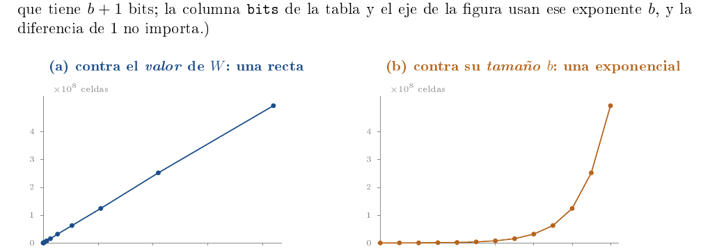
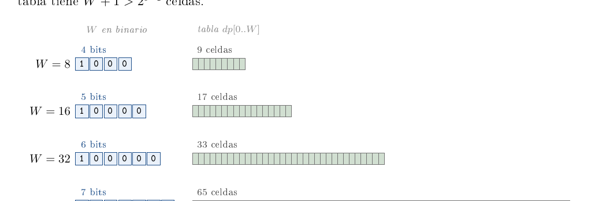

# Ejercicio 11 — La mochila entera y la pseudopolinomialidad

**Dificultad:** ★★   **Conferencias:** C1 (Eficiencia y modelos de cómputo);
método de C2 §1 y correctitud de C3

## Enunciado

> La mochila entera se resuelve con programación dinámica en $O(nW)$, donde $W$ es la capacidad (lo vieron
> en Estructuras de Datos). Mide el tamaño de la entrada en bits, como en la sección 8 de la conferencia 1.
> ¿Es polinomial ese algoritmo? ¿En qué se parece a la primalidad por división?

## El camino

Seguimos el ciclo de C2 §1 — problema, algoritmo, correctitud, costo, ¿se puede hacer mejor? — sobre un
solo ejemplo. Cada paso termina anunciando el siguiente, que resuelve lo que quedó pendiente, hasta llegar a lo que
queremos demostrar:

> **Lo que queremos demostrar**
>
> La mochila con tabla de $O(nW)$ es **pseudopolinomial**: lineal en el *valor* de $W$ y exponencial
> en su *tamaño* $b=\log_2W$. Y tiene la misma forma que la primalidad por división.

| **§** | **Pregunta que se responde** | **Y lo que queda por resolver** |
|---|---|---|
| 1 | ¿Cuál es el problema? | los algoritmos mejores que mirar los $2^n$ subconjuntos |
| 2 | ¿Qué algoritmo lo resuelve? | su correctitud |
| 3 | ¿Es correcto? (invariante, C3) | su costo |
| 4 | ¿Cuánto cuesta? Contar celdas | en qué es polinomial ese costo |
| 5 | Medir en bits (C1 §8) | si se puede *demostrar* que no es polinomial |
| 6 | La demostración: una instancia mínima | de dónde viene el nombre |
| 7 | Pseudopolinomial = contar en unario | lo que el modelo RAM no cobra |
| 8 | Memoria y máquinas más rápidas (C1 §6, §7) | si se puede hacer mejor con *cualquier* algoritmo |
| 9 | La quinta pregunta y la primalidad (C2 §8) | — |

## 1. Pregunta 1: ¿cuál es el problema?

C2 §2 pide enunciar con precisión la entrada, la salida y los casos raros.

**Mochila 0/1.** *Entrada:* $n$ objetos con pesos $w_1,\dots,w_n$ y valores $v_1,\dots,v_n$ (enteros
positivos) y una capacidad entera $W\ge0$. *Salida:* el mayor valor total de un subconjunto de peso total
$\le W$. (El subconjunto mismo sale rastreando la tabla del §2.) *Casos raros:* un objeto con $w_i>W$
nunca cabe; si hay empates, cualquier óptimo sirve; con $W=0$ la respuesta es $0$.

Hay un detalle que parece menor y es el centro del ejercicio: $W$ **no es una cantidad de cosas**. Es
un *número* que viene escrito en la entrada, junto a los pesos y los valores.

**El ejemplo que usaremos en todo el ejercicio:** cuatro objetos $(w,v)=(2,3),(3,4),(4,5),(5,6)$ y
$W=8$. El óptimo es llevar los objetos 2 y 4 (peso 8, valor 10). La fuerza bruta mira los $2^n$
subconjuntos y es el oráculo de C2 §4: son 16 aquí y $2^{40}\approx10^{12}$ con 40 objetos, así que no sirve.
**A continuación:** la sección 2 propone un algoritmo que evita mirar los $2^n$ subconjuntos: una tabla indexada por capacidades.

## 2. Pregunta 2: ¿qué algoritmo lo resuelve?

### El diseño: subproblemas y una recurrencia

La idea es resolver muchos subproblemas pequeños y reutilizarlos, en vez de mirar subconjuntos enteros. Para
$0\le i\le n$ y cada capacidad entera $c\ge0$ sea

$$
f(i,c)\;=\;\max\Bigl\{\;\sum_{k\in S}v_k\;:\;S\subseteq\{1,\dots,i\},\ \sum_{k\in S}w_k\le c\;\Bigr\},
$$

el mejor valor que se logra usando solo los primeros $i$ objetos con capacidad $c$ (el conjunto vacío es
siempre factible, así que $f\ge0$). Lo que se pide es $f(n,W)$.

> **Lema 1 (recurrencia)**
>
> $f(0,c)=0$. Para $i\ge1$: si $c<w_i$, entonces $f(i,c)=f(i-1,c)$; si $c\ge w_i$, entonces
> $f(i,c)=\max\bigl(f(i-1,c),\ f(i-1,c-w_i)+v_i\bigr)$.

*Demostración.* Sea $S\subseteq\{1,\dots,i\}$ factible para la capacidad $c$. Hay dos casos.
Si $i\notin S$, entonces $S\subseteq\{1,\dots,i-1\}$ y su valor es $\le f(i-1,c)$; recíprocamente, todo
subconjunto de $\{1,\dots,i-1\}$ factible para $c$ lo es también como subconjunto de $\{1,\dots,i\}$, de modo
que $f(i-1,c)$ se alcanza. Si $i\in S$ (lo cual exige $w_i\le c$), entonces $S\setminus\{i\}\subseteq
\{1,\dots,i-1\}$ tiene peso $\le c-w_i$, luego el valor de $S$ es $v_i+\mathrm{valor}(S\setminus\{i\})\le
v_i+f(i-1,c-w_i)$; recíprocamente, si $T$ es óptimo para $(i-1,\,c-w_i)$ entonces $T\cup\{i\}$ pesa $\le c$ y
vale $v_i+f(i-1,c-w_i)$. El máximo sobre los dos casos es $f(i,c)$. Si $c<w_i$ el segundo caso no existe.
$\square$

### El algoritmo, con sus dos ciclos

La fila $f(i,\cdot)$ solo depende de la fila $f(i-1,\cdot)$, así que basta **un** arreglo $dp[0..W]$ que se
actualiza en el lugar. El algoritmo tiene dos ciclos `for` anidados:

- el **ciclo externo** da una vuelta por objeto, $i=1,2,\dots,n$; llamamos *ronda $i$* a todo lo
  que ocurre durante la vuelta $i$ del ciclo externo;
- el **ciclo interno** recorre, dentro de la ronda $i$, las capacidades $j=W,\,W-1,\,\dots,\,w_i$ *de
  mayor a menor* (si $w_i>W$ no da ninguna vuelta), y en cada vuelta actualiza una sola celda, $dp[j]$.

Al ciclo interno de este orden lo llamamos *descendente*; el *ascendente* recorre $j=w_i,\dots,W$ y es
una variante que aparecerá más abajo. Cada vuelta del ciclo interno lee $dp[j]$ y $dp[j-w_i]$ y deja en
$dp[j]$ el mayor de los dos valores $dp[j]$ y $dp[j-w_i]+v_i$: llevar o no llevar el objeto $i$.

```python
def mochila_dp(pesos, valores, W):
    """dp[j] = mejor valor con capacidad j. Devuelve (valor, celdas actualizadas)."""
    dp = [0] * (W + 1)
    celdas = 0
    for w_i, v_i in zip(pesos, valores):
        for j in range(W, w_i - 1, -1):          # de W hacia abajo: cada objeto una vez
            celdas += 1
            if dp[j - w_i] + v_i > dp[j]:
                dp[j] = dp[j - w_i] + v_i
    return dp[W], celdas
```

Con el ejemplo, la tabla va así (cada fila es $dp$ tras terminar una ronda):

```text
objetos (peso, valor): (2,3)  (3,4)  (4,5)  (5,6)   capacidad W = 8
fuerza bruta (2^4 = 16 subconjuntos): mejor valor 10, con los objetos [2, 4]
dp[j] para j = 0..8, tras cada objeto (ciclo interno descendente):
  inicio          0  0  0  0  0  0  0  0  0
  objeto 1 (2,3)  0  0  3  3  3  3  3  3  3
  objeto 2 (3,4)  0  0  3  4  4  7  7  7  7
  objeto 3 (4,5)  0  0  3  4  5  7  8  9  9
  objeto 4 (5,6)  0  0  3  4  5  7  8  9 10
resultado: dp[8] = 10  (celdas actualizadas: 22)
```

Por ejemplo, la fila del objeto 2 dice que con capacidad 5 y los dos primeros objetos se logra 7 (llevar
ambos). El algoritmo actualiza el arreglo *en el lugar*, y un error en el orden de esas actualizaciones no
se ve a simple vista. **A continuación:** la sección 3 demuestra que es correcto, con un invariante que además explica por qué importa el sentido del ciclo interno.

## 3. Pregunta 3: ¿es correcto?

### La especificación (C3 §1)

*Precondición:* $n\ge0$; los $w_i$ y $v_i$ son enteros positivos; $W\ge0$ es entero.
*Postcondición:* el algoritmo devuelve $dp[W]=f(n,W)$.
Como en C3, la demostración son dos demostraciones separadas: **correctitud parcial** (si el algoritmo
termina, la salida cumple la postcondición) y **terminación**; la correctitud total es la suma.

### Correctitud parcial: un invariante para cada ciclo

Un invariante tiene que ser *inductivo*, no solo verdadero (C3 §4). Aquí hace falta uno por ciclo, y el
del ciclo interno es la versión *reforzada* del externo: el externo, por sí solo, no basta para
demostrar la ronda, porque durante ella el arreglo mezcla celdas ya actualizadas con otras que todavía deben
guardar el valor viejo.

> **Invariante externo $I_{ext}(i)$, para $0\le i\le n$**
>
> Tras $i$ vueltas del ciclo externo, $dp[c]=f(i,c)$ para todo $c\in[0,W]$.

> **Invariante interno $I_{int}(i,j)$, durante la ronda $i$**
>
> Cuando el ciclo interno está por procesar la capacidad $j$ (es decir, ya procesó las capacidades $>j$), para
> todo $c\in[0,W]$:
>

$$
\begin{aligned}
  dp[c]&=f(i,c)   &&\text{si } c>j, \quad\text{(celdas ya actualizadas en esta ronda)}\\
  dp[c]&=f(i-1,c) &&\text{si } c\le j,\quad\text{(celdas aún sin tocar)}
\end{aligned}
$$

**Ciclo interno.**

- *Inicialización.* Al empezar la ronda $i$ se tiene $j=W$: no hay celdas $c>W$, y todas las
  $c\le W$ valen $f(i-1,c)$ por $I_{ext}(i-1)$. Luego vale $I_{int}(i,W)$.
- *Mantenimiento.* Supongamos $I_{int}(i,j)$ con $j\ge w_i$ y ejecutemos la vuelta $j$. Lee $dp[j]$,
  que vale $f(i-1,j)$ porque $j\le j$ (sin tocar), y lee $dp[j-w_i]$: como $w_i\ge1$, el índice $j-w_i$ es
  $<j$, así que también está sin tocar y vale $f(i-1,j-w_i)$. Deja en $dp[j]$ el valor
  $\max\bigl(f(i-1,j),\,f(i-1,j-w_i)+v_i\bigr)$, que es $f(i,j)$ por el Lema 1 ($j\ge w_i$). Ninguna otra celda
  cambia; luego ahora las celdas $\ge j$ valen $f(i,\cdot)$ y las $<j$ siguen valiendo $f(i-1,\cdot)$: es
  $I_{int}(i,j-1)$.
- *Conclusión.* Al terminar el ciclo interno quedó procesado todo $c\ge w_i$ (o ninguno, si
  $w_i>W$), y las celdas restantes $c\le\min(W,w_i-1)$ valen $f(i-1,c)$. Pero para $c<w_i$ el Lema 1 da
  $f(i-1,c)=f(i,c)$. Entonces $dp[c]=f(i,c)$ para todo $c$: vale $I_{ext}(i)$.

**Ciclo externo.**

- *Inicialización* ($i=0$). $dp$ es el arreglo nulo y $f(0,c)=0$.
- *Mantenimiento.* Si vale $I_{ext}(i-1)$, la ronda $i$ cumple la inicialización, el mantenimiento y la
  conclusión del ciclo interno de arriba, y deja $I_{ext}(i)$.
- *Conclusión.* Al terminar el ciclo externo $i=n$, y $I_{ext}(n)$ da $dp[W]=f(n,W)$: la
  postcondición.

**El sentido descendente se usa en un solo lugar:** para afirmar que $dp[j-w_i]$ está *sin tocar*.
En el orden descendente las celdas tocadas en la ronda son las de índice $>j$, y $j-w_i<j$.

### Terminación: el potencial (C3 §1)

Ambos ciclos son `for` sobre rangos finitos. En una ronda con $w_i\le W$, el potencial interno
$\Phi_{int}=j-w_i+1$ es no negativo, baja en $1$ en cada vuelta y empieza en $W-w_i+1$; si $w_i>W$,
el rango está vacío y la ronda hace cero vueltas. En el ciclo externo, $\Phi_{ext}=n-i$ baja en $1$
por vuelta. Luego el algoritmo termina, y con la correctitud parcial es **totalmente correcto**.

### Un invariante también se puede ejecutar (C3 §4)

C3 comprueba el invariante en cada paso con una versión *vigilada* del algoritmo. Hacemos lo mismo con
los dos invariantes, contra una tabla $f$ calculada enumerando subconjuntos, que es un oráculo independiente
del algoritmo (C2 §4):

```python
def mochila_vigilada(pesos, valores, W, f, ascendente=False):
    """El algoritmo, comprobando los dos invariantes en cada vuelta.
    f[i][c] = optimo de los primeros i objetos con capacidad c.
    Devuelve (vueltas, primer fallo interno, rondas con fallo externo)."""
    dp = [0] * (W + 1)
    vueltas, primer, fallos_ext = 0, None, 0
    for i, (w_i, v_i) in enumerate(zip(pesos, valores), start=1):
        rango = range(w_i, W + 1) if ascendente else range(W, w_i - 1, -1)
        tocadas = set()
        for j in rango:
            if dp[j - w_i] + v_i > dp[j]:
                dp[j] = dp[j - w_i] + v_i
            tocadas.add(j)
            vueltas += 1
            # invariante interno: celdas tocadas = f(i, .), las demas = f(i-1, .)
            esperado = [f[i][c] if c in tocadas else f[i - 1][c] for c in range(W + 1)]
            if primer is None and dp != esperado:
                primer = (i, j)
        if dp != f[i]:                       # invariante externo: dp = f(i, .)
            fallos_ext += 1
    return vueltas, primer, fallos_ext
```

Probar contra entradas aleatorias verifica que implementamos lo que pensamos, no que pensamos bien (C2 §7);
lo que sí aporta esto es ejecutar, vuelta a vuelta, *los invariantes de la demostración*. (Los dos bloques de
salida de esta sección reagrupan por tema líneas literales de la sección «2. correctitud» de la salida de
`verif.py`, donde van intercaladas.)

```text
ciclo descendente contra fuerza bruta: 2000 instancias, fallos (deberia ser 0): 0
numpy contra ciclo descendente: 2000 instancias, fallos (deberia ser 0): 0
celdas actualizadas = suma de (W - w_i + 1): coincide en 2000 de 2000 instancias
invariantes ejecutados (ciclo descendente): 148373 vueltas, 9845 rondas
   violaciones de algun invariante (deberia ser 0): 0
```

### Qué falla con el ciclo interno ascendente: el primer fallo (C3 §1)

Con $j=w_i,\dots,W$ las celdas tocadas pasan a ser las de índice *menor* que $j$, y la lectura
$dp[j-w_i]$ deja de estar sin tocar cuando $j-w_i\ge w_i$, es decir, cuando $j\ge2w_i$. Para $j<2w_i$ el
índice $j-w_i<w_i$ nunca fue modificado (el ciclo ascendente empieza en $w_i$) y el argumento sigue valiendo;
**el primer momento en que puede fallar el mantenimiento es $j=2w_i$**. Desde ahí $dp[j-w_i]$ puede valer
ya $f(i,j-w_i)$, que incluye al objeto $i$, y el algoritmo le suma otra vez $v_i$: usa el objeto dos veces. Lo
que calcula entonces es la *mochila no acotada* (cada objeto se puede llevar cualquier número de veces).
En el ejemplo, para el objeto 1 ($w=2$, $v=3$) el ciclo ascendente da $dp[4]=dp[2]+3=6$, dos copias, aunque
$f(1,4)=3$. Y no es un caso raro:

```text
ciclo ASCENDENTE: resultado distinto del correcto en 1635 de 2000 instancias
ejemplo: el ascendente da dp[8] = 12 (4 copias del objeto 1); el correcto, 10
ciclo ascendente: el invariante interno falla en 1675 de 2000 instancias
   y el primer fallo ocurre en j >= 2*w_i en 1675 de 1675
ciclo ascendente = mochila no acotada: coincide en 2000 de 2000 instancias
ejemplo, ciclo ascendente, tras el objeto 1: dp = 0 0 3 3 6 6 9 9 12
   primer fallo del invariante: objeto 1, j = 4 (dp[4] = 6, pero f(1,4) = 3)
```

El invariante es más sensible que el resultado final: falla en 1675 instancias, pero el resultado cambia solo
en 1635; en las otras 40 el error queda tapado por casualidad en el valor de $dp[W]$ y solo el invariante lo ve.
**A continuación:** la sección 4 cuenta cuánto cuesta el algoritmo correcto.

## 4. Pregunta 4: ¿cuánto cuesta?

Contamos celdas, que es lo que el algoritmo hace de verdad. Cada objeto con $w_i\le W$ actualiza $W-w_i+1$
celdas, así que

$$
\text{celdas}\;=\;\sum_{i:\,w_i\le W} (W-w_i+1)\;\le\; nW,
  \qquad
  \text{memoria}\;=\;W+1\ \text{celdas}.
$$

Es decir, **tiempo $\Theta(nW)$ en el peor caso y memoria $\Theta(W)$** (con todos los pesos iguales a $1$ se
actualizan exactamente $nW$ celdas). (Cada actualización cuenta como costo 1: C1 §9 lo
permite mientras los números quepan en una palabra; para un $W$ mayor cada índice ocupa varias palabras, un
factor $b/w$ que ante $2^b$ es despreciable.) En el ejemplo son 22 celdas.

Medimos las dos variables, una por vez. La columna de celdas sale de la fórmula de arriba, que en la
sección 3 coincidió con el contador del algoritmo en 2000 de 2000 instancias; la de tiempos, de una versión con
`numpy` de la misma tabla (una fila entera por objeto) que coincidió con el listado en esas mismas 2000, y
cambia de una ejecución a otra, a diferencia de las celdas. Las cifras de tiempo son mediciones de referencia:
dependen de la máquina y de la carga del sistema. Primero $W=2^{16}$ fijo y $n$ creciendo: el tiempo por
objeto es casi constante (el primer valor, el de $n=50$, es el doble: incluye el arranque de `numpy`), o
sea **lineal en $n$**.

```text
     n        celdas  tiempo (s)  tiempo/n (ms)
    50     2,558,524      0.0055         0.1106
   100     4,871,536      0.0054         0.0544
   200    10,044,572      0.0111         0.0557
   400    19,566,254      0.0159         0.0399
   800    39,509,165      0.0370         0.0462
  1600    79,099,974      0.0735         0.0460
```

Ahora $n=40$ fijo y el *valor* de $W$ creciendo (con pesos $\sim U[1,W/2]$; el §5 explica por qué). El
cociente celdas$/(nW)$ queda estable cerca de $0.75$: el costo es **lineal en el valor de $W$**.

```text
         W        celdas  celdas/(n*W)
      4096       127,435         0.778
      8192       244,527         0.746
     16384       458,662         0.700
     32768       985,845         0.752
     65536     1,873,783         0.715
    131072     3,884,566         0.741
    262144     7,845,866         0.748
    524288    15,444,895         0.736
   1048576    31,954,753         0.762
   2097152    62,839,150         0.749
   4194304   124,192,302         0.740
   8388608   252,523,802         0.753
  16777216   494,198,441         0.736
```

Lineal en $n$, lineal en $W$: $O(nW)$ *parece* polinomial. C1 §8 dice que un algoritmo se mide en función del *tamaño* de su entrada, y el tamaño no es $W$.
**A continuación:** la sección 5 mide el costo en bits para ver en qué es polinomial, si lo es.

## 5. El giro: el tamaño de la entrada se mide en bits (C1 §8)

Un número $x$ ocupa $\lfloor\log_2x\rfloor+1$ bits. Sean $b$ los bits de $W$ y $d$ los del mayor valor. Los
objetos con $w_i>W$ nunca caben y se descartan en $O(n)$, así que cada peso tiene a lo sumo $b$ bits y el
tamaño de la entrada es

$$
\begin{gathered}
  s\;=\;\sum_i\mathrm{bits}(w_i)+\sum_i\mathrm{bits}(v_i)+b\;\le\;n(b+d)+b ,\\[2pt]
  \text{mientras que la cota del costo es}\quad nW\;\ge\;n\,2^{\,b-1}.
\end{gathered}
$$

Releamos entonces los *mismos* 13 datos del §4, pero contra el tamaño de $W$ y no contra su valor. La
figura 1 lo muestra: lo que era una recta es ahora una exponencial. (Las instancias usan
$W=2^{b}$, que tiene $b+1$ bits; la columna `bits` de la tabla y el eje de la figura usan ese exponente $b$, y
la diferencia de $1$ no importa.)



*Figura 1. Los mismos 13 puntos ($n=40$, pesos $\sim U[1,W/2]$, $W=2^{12},\dots,2^{24}$). **(a)** Contra el
valor de $W$ el costo es una recta, y por eso $O(nW)$ *parece* polinomial. **(b)** Contra el
tamaño de $W$ en bits el mismo costo se dispara: cada bit adicional lo duplica.*

La tabla da los números (las dos últimas columnas, de tiempo, cambian de una ejecución a otra; las demás no). Aquí el tamaño de la entrada $s$ casi no crece (de 754 a 1269 bits, *menos del
doble*) y las celdas pasan de $1.3\cdot10^5$ a $4.9\cdot10^8$ (unas 3900 veces). Cada bit multiplica las
celdas por $\approx2$ (de 1.88 a 2.15) y $\log_2$ de las celdas crece $\approx1$ por bit: $\Theta(2^b)$.

```text
bits tam. entrada        celdas log2 celdas celdas/ant. tiempo (s) t/ant.
  12          754       127,435       16.96         nan     0.0002    nan
  13          812       244,527       17.90        1.92     0.0002   1.52
  14          893       458,662       18.81        1.88     0.0004   1.81
  15          901       985,845       19.91        2.15     0.0009   2.03
  16          944     1,873,783       20.84        1.90     0.0023   2.66
  17          958     3,884,566       21.89        2.07     0.0070   3.08
  18         1025     7,845,866       22.90        2.02     0.0121   1.74
  19         1050    15,444,895       23.88        1.97     0.0286   2.35
  20         1082    31,954,753       24.93        2.07     0.0636   2.23
  21         1119    62,839,150       25.91        1.97     0.1796   2.82
  22         1178   124,192,302       26.89        1.98     0.4498   2.51
  23         1227   252,523,802       27.91        2.03     1.5962   3.55
  24         1269   494,198,441       28.88        1.96     4.9640   3.11
```

**El tiempo es peor testigo que las celdas:** la razón, que debería rondar $2$, sube a 3.55 en $b=23$
(el máximo de la columna, y cambia entre corridas), probablemente porque la tabla ya mide decenas de megabytes y
cada fila crea arreglos temporales (esa causa no se midió). El modelo RAM de C1 cobra 1 por celda; la
máquina real no. Por eso el dato que usamos como evidencia es el conteo de celdas.

### Por qué los pesos crecen con $W$

El primer experimento que se le ocurre a uno es dejar los pesos acotados y subir $W$. Falla, y la razón es
instructiva. Con $n=40$ y pesos $\le1000$, la suma de pesos es $22351$; para $W\ge2^{15}$ la respuesta es
“llevárselo todo”, que se calcula en $O(n)$. El algoritmo igual gasta $nW$.

```text
n=40, pesos <= 1000: suma de pesos = 22351, suma de valores = 22344
   W = 2^12: mejor valor =  10243  (instancia no trivial)
   W = 2^14: mejor valor =  20796  (instancia no trivial)
   W = 2^15: mejor valor =  22344  (= suma de valores: instancia trivial)
   W = 2^16: mejor valor =  22344  (= suma de valores: instancia trivial)
   W = 2^20: mejor valor =  22344  (= suma de valores: instancia trivial)
recortar W a min(W, suma de pesos): 500 instancias, fallos (deberia ser 0): 0
```

Dos consecuencias. El costo de ese algoritmo es del algoritmo, no de la dificultad de la instancia. Y una
mejora gratuita es recortar $W\leftarrow\min(W,\sum_iw_i)$, con lo que el costo es $O(n\min(W,\sum w_i))$: las
instancias realmente difíciles son las de $W<\sum_iw_i$, es decir, con pesos comparables a $W/n$. Por eso la
familia de medición escala los pesos con $W$. Las medidas muestran que el costo crece exponencialmente con $b$, pero medir sugiere y no demuestra. **A continuación:** la
sección 6 demuestra que no es polinomial, con una instancia mínima.

## 6. La demostración: una instancia mínima

Medir sugiere; demostrar cierra. Para refutar “polinomial” basta **una** familia de instancias en que el
costo supera a todo polinomio en el tamaño de la entrada.

> **Teorema**
>
> El algoritmo **no es polinomial**: no existe un polinomio $p$ tal que el número de celdas que actualiza
> sea $\le p(s)$ para toda instancia de tamaño $s$.

*Demostración.* Sea la instancia con un solo objeto, $w_1=v_1=1$, y capacidad $W=2^b$. Su tamaño es
$s=1+1+(b+1)=b+3$ bits, y el algoritmo actualiza $W-1+1=2^b=2^{s-3}$ celdas. Para cualquier polinomio $p$,
$2^{s-3}>p(s)$ desde cierto $s$ en adelante. $\square$

**Verificado** (el conteo es exacto, no una medición de tiempo):

```text
   b          W  tamano de la entrada (bits)  celdas actualizadas
   4         16                            7                   16
   8        256                           11                  256
  12       4096                           15                 4096
  16      65536                           19                65536
  20    1048576                           23              1048576
```

Y “desde cierto $s$” es muy pronto: contra $s^{10}$ la instancia ya gana con una entrada de 63 bits.

```text
el tamano s desde el cual 2^(s-3) supera al polinomio s^k:
   k =  1: desde s =   6 bits   (2^3 = 8 > 6^1 = 6)
   k =  2: desde s =  10 bits   (2^7 = 128 > 10^2 = 100)
   k =  3: desde s =  15 bits   (2^12 = 4.1e+03 > 15^3 = 3.38e+03)
   k =  5: desde s =  27 bits   (2^24 = 1.68e+07 > 27^5 = 1.43e+07)
   k = 10: desde s =  63 bits   (2^60 = 1.15e+18 > 63^10 = 9.85e+17)
```

> **Respuesta**
>
> El algoritmo de la mochila con tabla $O(nW)$ **no es polinomial**: es **pseudopolinomial** —
> polinomial en el *valor* de $W$, exponencial en su tamaño $b=\log_2W$ (definición de C1 §8). Cuando
> $W\le n^k$ para una constante $k$, el costo es $\le n^{k+1}$ y el algoritmo **sí** es polinomial en el
> tamaño, porque $s\ge n$.

**Dos preguntas distintas.** Lo anterior es sobre *este algoritmo*. Que exista *algún*
algoritmo polinomial para la mochila es otra pregunta (la quinta de C2; es el §9 de este texto), y equivale a
$\mathrm{P}=\mathrm{NP}$. **A continuación:** la sección 7 explica de dónde viene el nombre “pseudopolinomial”: contar en unario.

## 7. Por qué se llama pseudopolinomial: contar en unario

La tabla recorre cada capacidad $0,1,\dots,W$: *cuenta en unario*. Si $W$ se escribiera en unario, el
tamaño de la entrada sería $W$ y el costo $nW$ sería polinomial. Pseudopolinomial significa polinomial en la
codificación *unaria* de los números. La figura 2 lo muestra: el número ocupa $b$ casillas
y la tabla tiene $W+1>2^{b-1}$ celdas.



*Figura 2. El mismo número $W$ escrito en binario (izquierda, $b$ casillas) y la tabla $dp[0..W]$ que recorre
el algoritmo (derecha, $W+1$ celdas). Cada bit adicional *duplica* la tabla: 4 bits $\to$ 9 celdas, 5
$\to$ 17, 6 $\to$ 33, 7 $\to$ 65. El tamaño de la entrada crece linealmente en $b$; el costo, exponencialmente.*

El modelo RAM cobra 1 por cada celda. **A continuación:** la sección 8 muestra lo que ese conteo esconde: la memoria, y qué compra una máquina más rápida.

## 8. Lo que el modelo no cobra: la memoria, y qué compra una máquina más rápida

**La memoria.** El análisis en tiempo oculta que la tabla ocupa $\Theta(W)$ celdas, es decir, memoria
*también exponencial* en $b$. C1 §6 lo advierte: la memoria está acotada por el tiempo y suele ser la que
se acaba primero. Con $n=40$, $10^9$ celdas por segundo y 8 bytes por celda (al estilo de la tabla de la
primalidad de C1 §8):

```text
   b     celdas    memoria       tiempo
  20   4.19e+07    8.39 MB     0.0419 s
  32   1.72e+11    34.4 GB     2.86 min
  40    4.4e+13     8.8 TB       12.2 h
  64   7.38e+20     148 EB 2.34e+04 anios
 128   1.36e+40 2.72e+21 EB 4.32e+23 anios
```

Una capacidad de 32 bits, un número perfectamente normal, ya pide 34.4 GB de tabla mientras que el tiempo es
de menos de 3 minutos; con 4 bytes por celda serían 17 GB, y la conclusión no cambia. En la primalidad la pared
es el tiempo; aquí es la memoria.

**Una computadora más rápida.** C1 §7 calcula el mayor tamaño resoluble con un presupuesto de una hora, y
muestra que para un algoritmo exponencial mil veces más potencia “suma unas 10 unidades”. Aquí:

```text
1 hora, 1x mas rapida: 40*2^b <= 3.6e+12 -> b = 36, tabla 550 GB
1 hora, 1000x mas rapida: 40*2^b <= 3.6e+15 -> b = 46, tabla 563 TB
```

Mil veces más rápida resuelve apenas 10 bits más de capacidad (de 36 a 46), y su tabla pediría 563 TB. La
exponencialidad no se compra con hardware.

**A continuación:** la pregunta 5 (sección 9) pregunta si se puede hacer mejor con *cualquier* algoritmo, y lo compara con la primalidad.

## 9. Pregunta 5: ¿se puede hacer mejor? y el paralelo con la primalidad

C2 §8: la quinta pregunta cambia el sujeto. Ya no pregunta cuánto cuesta *este* algoritmo sino cuánto
cuesta *cualquiera*. La primalidad por división (C1 §8) es la comparación natural.

|  | **Primalidad por división (C1 §8)** | **Mochila 0/1** |
|---|---|---|
| Qué recorre | los divisores $2,\dots,\sqrt n$ | las capacidades $0,\dots,W$ |
| Parámetro cuyo *valor* se recorre | $n$ | $W$ |
| Tamaño real de ese parámetro | $b=\lfloor\log_2n\rfloor+1$ bits | $b=\lfloor\log_2W\rfloor+1$ bits |
| Costo en función de $b$ | $\approx2^{b/2}$ divisiones | $\approx n\,2^{b}$ celdas (y $2^b$ de memoria) |
| ¿Polinomial en el tamaño? | No | No |
| Nombre (C1 §8) | pseudopolinomial | pseudopolinomial |
| ¿Existe un algoritmo polinomial para el *problema*? | **Sí**: Agrawal–Kayal–Saxena, 2002 (C1 §8) | **Se desconoce**: equivale a $\mathrm{P}=\mathrm{NP}$ (Tema 3) |

**En qué se parecen.** Los dos algoritmos recorren *todos* los enteros hasta una cota que es un valor
de la entrada, es decir, cuentan en unario. Como ese valor se escribe con $b=\log_2$(valor) bits, el costo es
exponencial en $b$ aunque parezca barato en el valor: una raíz cuadrada, una tabla $n\times W$. La diferencia
entre ellos es solo *cuál* número juega ese papel: $n$ mismo en la primalidad, $W$ en la mochila. Con
C1 §7 se ve la diferencia de ritmo: una máquina $k$ veces más rápida suma $2\log_2k$ bits en la primalidad
(costo $2^{b/2}$) y $\log_2k$ en la mochila (costo $n2^b$):

```text
     k   primalidad (2^(b/2))   mochila (n*2^b)
    10                    6.6               3.3
   100                   13.3               6.6
  1000                   19.9              10.0
```

En números: a 64 bits la división tarda 4.29 s (C1 §8), y la mochila con $n=40$ pide $2.3\cdot10^4$ años y 148
EB de tabla.

**Dónde deja de valer.** La última fila de la tabla. En la primalidad la exponencialidad es un defecto
*del algoritmo*, y existe otro polinomial (AKS) que lo arregla. En la mochila nadie sabe arreglarlo:
hacerlo sería demostrar $\mathrm{P}=\mathrm{NP}$ (la versión de decisión es NP-completa; Tema 3). Que la mochila
tenga un algoritmo *pseudopolinomial* es lo que la clasifica allí como “débilmente” NP-difícil, y no la
hace fácil.

> **Respuesta a las dos preguntas del enunciado**
>
> **¿Es polinomial ese algoritmo?** No: cuesta $\Theta(nW)=\Theta(n\,2^b)$ con $b=\log_2W$ el tamaño de $W$
> en bits (la instancia mínima del §6 lo demuestra); es pseudopolinomial. **¿En qué se parece a la
> primalidad por división?** Los dos recorren todos los enteros hasta un valor de la entrada — cuentan en
> unario — y por eso son polinomiales en ese valor y exponenciales en su tamaño. La diferencia es que para la
> primalidad existe un algoritmo polinomial y para la mochila se desconoce.

## Errores que hay que vigilar

> - **Leer $O(nW)$ como polinomial.** $W$ es un valor; el tamaño es $\log_2W$ (la instancia mínima del
>   §6 lo prueba). Decir que el *problema* es polinomial por esto equivaldría a afirmar
>   $\mathrm{P}=\mathrm{NP}$.
> - **Confundir “pseudopolinomial” con “difícil” o con “fácil”.** Es una propiedad de un
>   *algoritmo*: no explica la dificultad de la mochila (NP-difícil) ni la vuelve fácil.
> - **Creer que pseudopolinomial es “lento en la práctica”.** Si $W\le n^k$ el costo es polinomial
>   de verdad ($\le n^{k+1}$); el problema es la garantía cuando $W$ no está acotado así.
> - **Medir con instancias que se vuelven triviales.** Con pesos acotados y $W$ creciente la respuesta
>   es “llevárselo todo” (aquí, desde $W=2^{15}$): hay que escalar los pesos con $W$ y recortar
>   $W\leftarrow\min(W,\sum w_i)$.
> - **Medir solo segundos, y solo tiempo.** El tiempo se desvía del $2$ (razón 3.55 en $b=23$,
>   probablemente por la jerarquía de memoria; cambia entre corridas); el conteo de celdas es exacto. Y olvidar la memoria: con $b=32$ ya son 34.4 GB.
> - **Escribir el ciclo interno en el sentido equivocado.** El ciclo ascendente usa un objeto varias veces
>   (mochila no acotada): da otro resultado en 1635 de 2000 instancias pequeñas, y viola el invariante interno en
>   1675 (primer fallo en $j\ge2w_i$).
> - **Contar los bits con `math.log2` de un entero grande.** Con floats,
>   $\lceil\log_2(W+1)\rceil$ da $60$ para $W=2^{60}$ en vez de $61$ (falla desde $2^{49}$). Hay que usar
>   `bit_length`.
>
```text
W = 2^40 : ceil(log2(W + 1)) =  41   W.bit_length() =  41
W = 2^52 : ceil(log2(W + 1)) =  52   W.bit_length() =  53
W = 2^60 : ceil(log2(W + 1)) =  60   W.bit_length() =  61
W = 2^100: ceil(log2(W + 1)) = 100   W.bit_length() = 101
primer b con W = 2^b en que los floats fallan: b = 49
```
