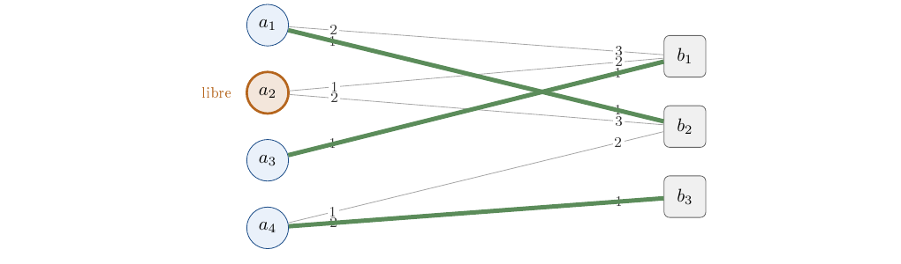
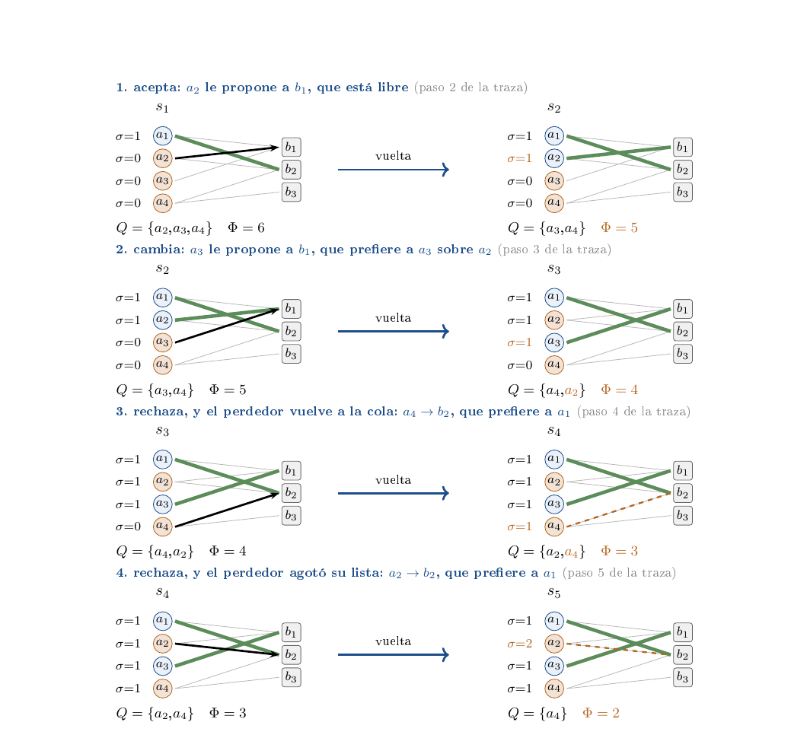

# Ejercicio 12 — Gale-Shapley con listas incompletas

**Dificultad:** ★★★   **Conferencias:** C3 (Correctitud);
método de C2 §1

## Enunciado

> Gale-Shapley con listas incompletas: cada proponente lista solo a algunos receptores, y prefiere quedarse
> solo antes que con uno que no listó. Adapta el algoritmo, su potencial y la definición de pareja
> bloqueante. ¿Sigue siendo estable el resultado? Demuéstralo.

## El camino

Seguimos el ciclo de C2 §1 con las tres herramientas de C3: el invariante, el potencial y el primer fallo. Cada
paso termina anunciando el siguiente, que resuelve lo que quedó pendiente, hasta llegar a lo que queremos demostrar:

> **Lo que queremos demostrar**
>
> El emparejamiento que devuelve Gale-Shapley con listas incompletas sigue siendo **estable**, para cualquier
> orden de ejecución. La demostración de C3 §8 se conserva y solo necesita **un caso más**: el proponente
> que termina sin pareja.

| **§** | **Pregunta que se responde** | **Y lo que queda por resolver** |
|---|---|---|
| 1 | ¿Qué es un emparejamiento estable con listas parciales? | el cambio en el algoritmo |
| 2 | ¿Qué algoritmo lo resuelve? | lo que sigue valiendo del código de C3 |
| 3 | ¿Qué invariantes mantiene el algoritmo? | la terminación |
| 4 | ¿Termina? ¿Cuántas propuestas hace? (potencial) | la estabilidad |
| 5 | ¿Es estable? (primer fallo) | cuánto de C3 sobrevive |
| 6 | Lo que se hereda de C3 | el costo |
| 7 | Costo y comportamiento medio | — |

## 1. Pregunta 1: ¿cuál es el problema?

C2 §1 (pregunta 1) pide precisar la entrada, la salida y los casos raros. Aquí además hay que precisar *qué significa*
“estable” cuando algunos pares no son aceptables.

**El modelo.** Hay $n_a$ proponentes y $n_b$ receptores. Cada proponente $a$ tiene una lista $L(a)$ de
receptores *aceptables*, sin repetidos y ordenada de mejor a peor. Sea $E=\{(a,b):b\in L(a)\}$ el conjunto de
*parejas mutuamente aceptables*. El enunciado solo da listas a los proponentes, así que modelamos que cada
receptor $b$ acepta a cualquier proponente que lo liste (es el único que podría proponerle) y tiene un orden
estricto $\succ_b$ sobre $E(b)=\{a:(a,b)\in E\}$.

**Preferencias con el vacío.** Escribimos $\varnothing$ para “quedarse sin pareja”. La frase del
enunciado, “prefiere quedarse solo antes que con uno que no listó”, es exactamente esta preferencia de $a$ sobre
$B\cup\{\varnothing\}$:

$$
\underbrace{L(a)\ \text{en su orden}}_{\text{aceptables}}\ \succ_a\ \varnothing\ \succ_a\ \underbrace{\text{los no listados}}_{\text{inaceptables}} ,
$$

y análogamente para $b$: los proponentes de $E(b)$ en su orden, luego $\varnothing$, luego el resto.

**Emparejamiento.** Es un $M\subseteq E$ en que cada agente aparece a lo sumo una vez. Puede dejar libres a
agentes de ambos lados. Escribimos $M(x)=\varnothing$ si $x$ está libre. (Que $M\subseteq E$ es la
*racionalidad individual*: nadie queda con alguien inaceptable.)

> **Definición (pareja bloqueante, adaptada)**
>
> $(a,b)$ **bloquea** a $M$ si $b\succ_a M(a)$ y $a\succ_b M(b)$. Un emparejamiento es **estable** si
> $M\subseteq E$ y no tiene parejas bloqueantes.

La adaptación es mínima porque el vacío ya está dentro de las preferencias, pero conviene desplegarla.

> **Lema 0 (las cuatro cláusulas)**
>
> Si $(a,b)$ bloquea a $M$, entonces $(a,b)\in E$. Y para $(a,b)\in E$: $(a,b)$ bloquea a $M$ si y solo si
> ( $a$ está libre *o* prefiere $b$ a $M(a)$ ) **y** ( $b$ está libre *o* prefiere $a$ a
> $M(b)$ ).

*Demostración.* Si $b\notin L(a)$, entonces $b$ está por debajo de $\varnothing$ en $\succ_a$, y $M(a)$ es
$\varnothing$ o un elemento de $L(a)$, los dos por encima de $b$: no se cumple $b\succ_aM(a)$. Lo mismo si
$a\notin E(b)$. Para $(a,b)\in E$ se tiene $b\succ_a\varnothing$ y $a\succ_b\varnothing$; luego
$b\succ_aM(a)$ equivale a “$M(a)=\varnothing$ o $b$ está antes que $M(a)$ en $L(a)$”, y lo mismo del lado de
$b$. $\square$

La cláusula “está libre” es lo nuevo: en C3 §6 el emparejamiento es perfecto y nadie queda libre, así que
nunca hizo falta. **El ejemplo que usaremos en todo el ejercicio** tiene cuatro proponentes y tres
receptores (la figura 1 lo dibuja):

```text
a1: b2 > b1
a2: b1 > b2
a3: b1
a4: b2 > b3
b1 (lo listan a1,a2,a3): a3 > a2 > a1
b2 (lo listan a1,a2,a4): a1 > a4 > a2
b3 (lo listan a4): a4
```



*Figura 1. El ejemplo. Una arista es una pareja aceptable. El número junto a $a_i$ es el lugar de ese receptor
en la lista de $a_i$; el número junto a $b_j$, el lugar de ese proponente en la lista de $b_j$. En verde, el
emparejamiento estable que calcula el algoritmo del §2. $a_2$ queda libre: recorrió toda su lista y los dos
receptores prefieren a otro.*

**Los cuatro casos, con ejemplos.** Como cada lado puede estar libre o emparejado, una pareja bloqueante
tiene cuatro formas posibles, y las cuatro ocurren en este ejemplo (cada fila es un emparejamiento $M$
y una pareja que lo bloquea):

```text
  a y b con pareja       M = {a1-b1, a2-b2}         bloquea (a1, b2)
  a libre, b con pareja  M = {a1-b1}                bloquea (a2, b1)
  a con pareja, b libre  M = {a1-b1}                bloquea (a1, b2)
  a y b libres           M = {}                     bloquea (a1, b2)
```

**A continuación:** la pregunta 2 adapta el algoritmo de C3 §7 a las listas incompletas.

## 2. Pregunta 2: ¿qué algoritmo lo resuelve?

El algoritmo de C3 §7 es la aceptación diferida: mientras haya un proponente libre, ese proponente le propone al
mejor receptor de su lista al que todavía no le propuso; el receptor acepta si está libre, cambia si prefiere al
nuevo, y rechaza si no. Con listas completas siempre queda alguien a quien proponerle. Con listas incompletas
un proponente puede **agotar su lista**, y entonces no tiene a quién proponerle. La adaptación es una sola:

> **El algoritmo adaptado**
>
> Mientras exista un proponente **libre que todavía tenga receptores pendientes en su lista**, ese proponente
> le propone al mejor receptor pendiente. Las tres reacciones del receptor son las de C3. Un proponente que agota
> su lista sin ser aceptado queda libre para siempre.

Es no determinista, como en C3: cualquier proponente libre con pendientes puede actuar, y lo que se demuestre
tiene que valer para toda elección (la implementación deja elegir cola, pila o azar).

```text
funcion GaleShapleyIncompleto(L, R):
    para cada proponente a:  siguiente[a] ← 0       // propuestas que a ya hizo
    para cada receptor b:    pareja[b]    ← libre
    libres ← { a : L[a] no es vacia }              // libres con receptores pendientes

    mientras libres no es vacio:
        a ← extrae algun proponente de libres      // no determinista: cola, pila o azar
        b ← L[a][siguiente[a]]                     // el mejor receptor pendiente de a
        siguiente[a] ← siguiente[a] + 1            // a le propone a b: una propuesta

        si pareja[b] es libre:                           // b acepta
            pareja[b] ← a
            perdedor  ← nadie
        sino si R[b][a] < R[b][pareja[b]]:               // b prefiere a: cambia
            perdedor  ← pareja[b]
            pareja[b] ← a
        sino:                                            // b rechaza a
            perdedor  ← a

        si perdedor existe y siguiente[perdedor] < largo(L[perdedor]):
            libres ← libres \cup { perdedor }   // sigue libre y le quedan pendientes

    devolver M = { (a, b) : pareja[b] = a }
```

Aquí `L[a]` es la lista de $a$, `R[b][a]` es el lugar de $a$ en la lista de $b$ (menor es mejor)
y `siguiente[a]` cuenta las propuestas de $a$. El código ejecutable, el que se usó en todas las
verificaciones de este ejercicio, es la función `gale_shapley_incompleto` de `verif.py`
(líneas 17 a 42).

La cola `libres` contiene *exactamente* a los proponentes libres con receptores pendientes: entra
al comenzar si tiene lista no vacía, y un proponente rechazado o desplazado vuelve a entrar solo si todavía le
queda alguien. Es esa guarda la que reemplaza al “mientras haya un proponente libre” de C3.

Con el ejemplo (cola de proponentes, columna `phi` que se explica en el §4):

```text
paso  propone   a  tenia  queda con  phi  que pasa
   1       a1  b2      -         a1    6  acepta
   2       a2  b1      -         a2    5  acepta
   3       a3  b1     a2         a3    4  cambia; a2 queda libre
   4       a4  b2     a1         a1    3  rechaza a a4
   5       a2  b2     a1         a1    2  rechaza a a2
   6       a4  b3      -         a4    1  acepta
resultado: {a1-b2, a3-b1, a4-b3} en 6 propuestas
libres: a2 (agoto su lista: b1 > b2)
parejas bloqueantes de ese resultado: []
```

$a_2$ propuso a $b_1$ (aceptado), fue desplazado por $a_3$, propuso a $b_2$ (rechazado) y agotó su lista:
queda libre. Los tres receptores terminan emparejados y el resultado no tiene parejas bloqueantes.
**A continuación:** la pregunta 3 enuncia y demuestra, con invariantes, qué de lo que C3 afirma del algoritmo sigue valiendo.

## 3. Pregunta 3: ¿qué invariantes mantiene el algoritmo?

C3 §7 destaca dos invariantes “de una línea”, y las demostraciones de estabilidad y de optimalidad se apoyan
en ellos. Con listas incompletas sigue valiendo lo mismo y hace falta uno más. Aquí se enuncian y se demuestran
con precisión, por inducción sobre las vueltas. Sea `siguiente[a]` el número de propuestas que $a$ ya hizo.

> **Invariantes**
>
> **(I1) Receptores.** Un receptor, una vez que tiene pareja, no vuelve a quedar libre, y su pareja solo
> mejora en $\succ_b$.
>
> **(I2) Proponentes.** Las propuestas de $a$ recorren $L(a)$ de arriba abajo, sin saltos ni repeticiones: si
> `siguiente[a]` $=k$, entonces $a$ propuso exactamente a los primeros $k$ receptores de $L(a)$. Si $a$
> está emparejado con $b$, entonces $b$ es el *último* al que le propuso.
>
> **(I3) La cola (nuevo).** La cola contiene exactamente a los proponentes libres con receptores
> pendientes.

### Demostración: inducción sobre las vueltas, acotada por el potencial

**Estados y vueltas.** El estado tras $t$ vueltas es $s_t=(\sigma_t,\pi_t,Q_t)$: $\sigma_t(a)$ es el valor
de `siguiente[a]`, $\pi_t(b)\in A\cup\{\varnothing\}$ es la pareja de $b$ y $Q_t$ es la cola. Un proponente
está *libre en $s$* si no es pareja de ningún receptor, y *tiene pendientes* si $\sigma(a)<|L(a)|$.
Sea $F(s)$ el conjunto de los proponentes libres con pendientes. El estado inicial es $\sigma_0\equiv0$,
$\pi_0\equiv\varnothing$ y $Q_0=\{a:L(a)\ne\varnothing\}$. Una *vuelta* elige cualquier $a\in Q_t$, toma
$b=L(a)[\sigma_t(a)]$ y sube $\sigma(a)$ en $1$; lo demás depende de la rama del receptor:

| **rama** | **pareja de $b$ después** | **perdedor $\ell$** |
|---|---|---|
| acepta: $\pi_t(b)=\varnothing$ | $\pi_{t+1}(b)=a$ | $\ell=\varnothing$ |
| cambia: $\pi_t(b)=a'$ y $a\succ_ba'$ | $\pi_{t+1}(b)=a$ | $\ell=a'$ |
| rechaza: $\pi_t(b)=a'$ y $a'\succ_ba$ | $\pi_{t+1}(b)=a'$ | $\ell=a$ |

y $Q_{t+1}=(Q_t\setminus\{a\})\ \cup\ \{\ell:\ \ell\ne\varnothing\ \text{y}\ \sigma_{t+1}(\ell)<|L(\ell)|\}$. Ninguna
otra pareja ni otro $\sigma$ cambia. La figura 2 lo muestra con cuatro vueltas del ejemplo.



*Figura 2. Una vuelta es una transición $s_t\to s_{t+1}$. Cada fila es una vuelta real del ejemplo (pasos 2 a 5 de
la traza): a la izquierda el estado antes, con la propuesta (flecha negra); a la derecha el estado después. En cada
estado: $\sigma$ junto a cada proponente (propuestas que ya hizo), $\pi$ en las aristas verdes gruesas (parejas),
la cola $Q$ y el potencial $\Phi$. En naranja, lo que cambia. $\sigma(a)$ sube en 1 y $\Phi$ baja exactamente 1 en las
cuatro; $\pi$ cambia solo en *acepta* y *cambia*; y el perdedor entra a la cola solo si le quedan
pendientes: en la fila 3 $a_4$ vuelve, en la fila 4 $a_2$ ya agotó su lista (en naranja, libre) y **no** vuelve a
entrar, que es lo que dice (I3). Los proponentes libres están en naranja; la arista punteada es una propuesta
rechazada.*

**Esquema.** Cada invariante es una afirmación $P(s)$ sobre estados, y se demuestra como en C3 §1: la
*inicialización* $P(s_0)$ y el *mantenimiento* $P(s_t)\Rightarrow P(s_{t+1})$ para toda vuelta posible,
es decir, para cualquier $a\in Q_t$ y cualquiera de las tres ramas. La inducción alcanza a toda la ejecución
porque **el potencial la acota**: $\Phi(s)=\sum_a\bigl(|L(a)|-\sigma(a)\bigr)$ baja exactamente $1$ en cada
vuelta (solo cambia $\sigma(a)$, en $+1$) y es $\ge0$; ambas cosas exigen que la vuelta esté bien definida, o sea
que $a$ tenga pendientes, y eso lo da (I3), que se prueba *primero* y no usa $\Phi$. Entonces toda ejecución es
una sucesión finita $s_0,s_1,\dots,s_T$ con $T\le\Phi(s_0)=\sum_a|L(a)|$ y $Q_T=\varnothing$, y cada $P$ vale en
todos sus estados, en particular en el final.

**(I3) $Q=F(s)$.**

- *Inicialización.* En $s_0$ todos están libres y $\sigma_0=0$, luego $F(s_0)=\{a:L(a)\ne\varnothing\}=Q_0$.
- *Mantenimiento.* Supongamos $Q_t=F(s_t)$ y una vuelta con $a\in Q_t$: $a$ está libre con pendientes, y la
  vuelta está bien definida. Solo cambian el estado de $a$ y el del perdedor $\ell$; ningún otro proponente cambia
  su $\sigma$ ni su condición de libre o emparejado. *Acepta:* $a$ queda emparejado y no hay perdedor, así que
  $F(s_{t+1})=F(s_t)\setminus\{a\}$. *Cambia:* $a$ queda emparejado y $a'$ pasa a libre con el mismo $\sigma$, así
  que $F(s_{t+1})=(F(s_t)\setminus\{a\})\cup\{a'\ \text{si}\ \sigma(a')<|L(a')|\}$. *Rechaza:* $a$ sigue libre con
  $\sigma+1$, luego $F(s_{t+1})=(F(s_t)\setminus\{a\})\cup\{a\ \text{si}\ \sigma_t(a)+1<|L(a)|\}$. En las tres ramas es
  exactamente $Q_{t+1}$.

**(I2) Proponentes.** $P_2(s)$: (a) las propuestas de cada $a$ son exactamente los primeros $\sigma(a)$
receptores de $L(a)$; (b) si $\pi(b)=a$, entonces $b=L(a)[\sigma(a)-1]$.

- *Inicialización.* $\sigma_0\equiv0$ y nadie está emparejado.
- *Mantenimiento.* (a): la vuelta solo agrega a $a$ la propuesta a $L(a)[\sigma_t(a)]$, el siguiente de su
  lista, y sube $\sigma(a)$ en $1$. (b): las parejas de $s_{t+1}$ son las de $s_t$, salvo $\pi_{t+1}(b)=a$ en las
  ramas acepta y cambia, y menos la del desplazado $a'$. Para la nueva, $b=L(a)[\sigma_t(a)]=L(a)[\sigma_{t+1}(a)-1]$.
  Para una pareja $\pi(b'')=a''$ que sobrevive, $a''\ne a$, porque $a\in Q_t=F(s_t)$ *estaba libre* (I3); entonces
  $\sigma(a'')$ no cambió y (b) vale por hipótesis.

**(I1) Receptores.** $P_1$: en toda vuelta, si $\pi_t(b)\ne\varnothing$, entonces $\pi_{t+1}(b)\ne\varnothing$ y
$\pi_{t+1}(b)=\pi_t(b)$ o $\pi_{t+1}(b)\succ_b\pi_t(b)$. Es una propiedad de un paso: la vuelta solo puede cambiar la
pareja del receptor $b$ que recibe la propuesta, y ninguna rama deja a nadie sin pareja. En *acepta* no hay
nada que conservar ($\pi_t(b)=\varnothing$); en *cambia*, $\pi_{t+1}(b)=a\succ_b a'=\pi_t(b)$; en *rechaza*
no hay cambio. Por transitividad de $\succ_b$ vale entre dos estados cualesquiera $s_t,s_{t'}$ con $t\le t'$: una vez con
pareja, nunca libre, y la pareja solo mejora. $\square$

**Por qué (I3) es nuevo.** En C3 la cola contiene a *todos* los proponentes libres, y eso basta:
con listas completas un proponente libre siempre tiene a quién proponerle (es lo que demuestra el argumento del
emparejamiento perfecto de C3 §7), así que “estar libre” y “estar en la cola” son lo mismo. Aquí no.
Un proponente puede quedar libre *habiendo agotado su lista*: sigue libre, pero ya no hay nada que
procesar con él y sale de la cola para siempre. La cola deja de ser “los libres” y pasa a ser “los libres con
pendientes” (la guarda del §2), y (I3) es el que lo afirma. Su consecuencia es la que reemplaza a C3: cuando la
cola se vacía, **los que siguen libres son exactamente los que agotaron su lista**, en vez de “todos
están emparejados”.

> **Lema 2 (qué le pasa a quien recibe una propuesta)**
>
> Si $a$ le propuso a $b$ en algún momento, entonces al terminar $b$ tiene pareja y $M(b)=a$ o $M(b)\succ_ba$.

*Demostración.* Sea la vuelta en que $a$ le propone a $b$. En $s_{t+1}$ se tiene $\pi(b)=a$ (ramas acepta y
cambia) o $\pi(b)=a'\succ_ba$ (rama rechaza). Por (I1) desde ahí $b$ tiene pareja siempre y su pareja solo mejora,
luego en el estado final $\pi(b)\ne\varnothing$ y $\pi(b)=a$ o $\pi(b)\succ_ba$. $\square$

**Un invariante también se puede ejecutar** (C3 §4). Esta versión vigilada del algoritmo comprueba, en
cada vuelta, (I1), (I2), (I3), el Lema 2 y, de paso, que el potencial del §4 baja exactamente $1$:

```python
def gs_vigilado(L, R):
    """GS comprobando en cada vuelta el potencial y los invariantes.
    Devuelve (vueltas, violaciones)."""
    sig = [0] * len(L)
    pareja_de_b = {}
    libres = deque(a for a in range(len(L)) if L[a])
    phi = sum(map(len, L))
    rango_previo = {}                   # rango de la pareja de b, vuelta anterior
    vueltas = viol = 0
    while libres:
        a = libres.popleft()
        b = L[a][sig[a]]
        sig[a] += 1
        vueltas += 1
        actual = pareja_de_b.get(b)
        perdedor = a
        if actual is None or R[b][a] < R[b][actual]:
            pareja_de_b[b], perdedor = a, actual
        if perdedor is not None and sig[perdedor] < len(L[perdedor]):
            libres.append(perdedor)
        nuevo = sum(len(L[x]) - sig[x] for x in range(len(L)))
        viol += nuevo != phi - 1                    # el potencial baja 1
        phi = nuevo
        r = R[b][pareja_de_b[b]]
        viol += b in rango_previo and r > rango_previo[b]   # I1
        viol += r > R[b][a]                         # Lema 2: a o algo mejor
        rango_previo[b] = r
        viol += any(L[x][sig[x] - 1] != y           # I2: el ultimo al que
                    for y, x in pareja_de_b.items())    # le propuso
        emparejados = set(pareja_de_b.values())
        pendientes = {x for x in range(len(L))
                      if x not in emparejados and sig[x] < len(L[x])}
        viol += sorted(libres) != sorted(pendientes)    # I3: la cola
    return vueltas, viol
```

```text
3000 instancias: 49061 vueltas comprobadas, violaciones (deberia ser 0): 0
propuestas <= suma de los largos de las listas: 3000 de 3000
```

**A continuación:** la pregunta 4 demuestra que termina y cuenta cuántas propuestas hace.

## 4. Pregunta 4: ¿termina? El potencial adaptado

Es la terminación de C3 §1: una cantidad entera no negativa que baja en cada vuelta.

> **Potencial**
>
> $\Phi=\#\{(a,b)\in E:\ a\text{ todavía no le propuso a }b\}=\sum_a\bigl(|L(a)|-\texttt{siguiente[a]}\bigr)$.

Gracias a la guarda del §2, **cada vuelta es exactamente una propuesta**: por (I3) el proponente que actúa tiene
pendientes, y por (I2) una propuesta nunca se repite. Entonces $\Phi$ baja en $1$ por vuelta y $\Phi\ge0$, que es
el argumento del esquema del §3. La diferencia con C3 es la cota inicial: antes era $n^2$ (todas las listas de largo
$n$); ahora $\Phi_0=\sum_a|L(a)|$.

> **Terminación**
>
> El algoritmo hace a lo sumo $\sum_a|L(a)|$ vueltas, y todas son propuestas. Al terminar no queda ningún proponente
> libre con pendientes (I3).

**Cuántas propuestas hace, exactamente.** Por (I2), un proponente emparejado propuso hasta su pareja
inclusive, y uno libre al terminar propuso a toda su lista (I3). Entonces:

$$
\text{propuestas}\;=\;\sum_{a\ \text{emparejado}}\mathrm{pos}\bigl(M(a)\bigr)\;+\;\sum_{a\ \text{libre}}|L(a)| ,
$$

donde $\mathrm{pos}$ es el lugar (desde 1) del receptor en $L(a)$. Lo que sobra hasta $\Phi_0$ es lo que cada
emparejado no necesitó probar, los receptores que estaban *debajo* de su pareja final. En el ejemplo:
$1+1+2$ de los emparejados y $2$ del libre dan las $6$ propuestas de la tabla, y $\Phi$ termina en $1$.

```text
propuestas = suma pos(M(a)) (emparejados) + suma |L(a)| (libres):
   coincide en 3000 de 3000 instancias
```

**Por qué importa la guarda.** Una variante natural deja en la cola a todos los proponentes y descarta al
agotado cuando lo saca. Esa vuelta de descarte no es una propuesta: $\Phi$ no baja, y la afirmación “cada vuelta
baja $\Phi$ en 1” deja de ser cierta. La cota correcta de *vueltas* para esa variante sería
$\sum_a|L(a)|+n_a$, y la que se escribe por analogía con C3, $\sum_a|L(a)|$, es falsa:

```text
cola con agotados: vueltas > suma|L| en 672 de 3000 instancias
   (exceso maximo 14); con 3 listas vacias: suma = 0, vueltas = 3
```

**A continuación:** la pregunta 5 demuestra que el resultado es estable.

## 5. Pregunta 5: ¿es estable? El primer fallo

Falta la correctitud parcial, que en C3 §8 se demuestra por contradicción sobre el primer fallo.

> **Teorema**
>
> El emparejamiento que devuelve el algoritmo del §2 es estable, para cualquier orden de ejecución.

*Demostración.* Sea $M$ el resultado. Es un emparejamiento y $M\subseteq E$, porque solo se propone a
receptores de la lista, cada receptor tiene una única pareja y, por (I2), cada proponente solo puede estar
emparejado con el último receptor al que le propuso. Supongamos que $(a,b)$ bloquea a $M$. Por el
Lema 0, $(a,b)\in E$, o sea $b\in L(a)$, con $b\succ_aM(a)$ y $a\succ_bM(b)$.

*Primero se ve que $a$ le propuso a $b$ en algún momento.* Hay dos casos.

- $M(a)=\varnothing$ (**el caso nuevo**). Por (I3), al terminar no queda ningún proponente libre con
  pendientes, así que $a$ propuso a toda su lista; en particular a $b\in L(a)$.
- $M(a)=b'\ne\varnothing$. Por (I2), $b'$ es el último receptor al que $a$ le propuso, y las propuestas
  siguen el orden de la lista. Como $b\succ_ab'$, $b$ está antes que $b'$ en $L(a)$, y $a$ le propuso a $b$ antes.

Por el Lema 2, al terminar $b$ tiene pareja y $M(b)=a$ o $M(b)\succ_ba$. Si fuera $M(b)=a$ tendríamos $M(a)=b$,
y no $b\succ_aM(a)$. Luego $M(b)\succ_ba$, lo que contradice $a\succ_bM(b)$. $\square$

Respecto de C3 §8, la demostración cambia en un lugar: aparece el caso $M(a)=\varnothing$, que allí no existía
porque todos terminaban emparejados, y se resuelve con el invariante nuevo (I3). La cláusula “$b$ libre” del
bloqueo no necesita un caso propio: si $a$ le propuso a $b$, el Lema 2 asegura que $b$ no terminó libre.

**Corolario.** Toda instancia con listas incompletas tiene un emparejamiento estable, y el algoritmo lo
construye.

**Verificado**, con un oráculo independiente que busca parejas bloqueantes con las cuatro cláusulas:

```text
emparejamiento valido (M en E, sin repetir receptor): 3000 de 3000
sin parejas bloqueantes (deberia ser 3000 de 3000): 3000 de 3000
```

El listado del oráculo, que es el Lema 0 (las cuatro cláusulas del §1) escrito tal cual:

```python
def pares_bloqueantes(M, L, R):
    """(a, b) mutuamente aceptables tales que (a libre o a prefiere b a M[a])
    y (b libre o b prefiere a a su pareja en M)."""
    pareja_de_b = {b: a for a, b in M.items()}
    bloqueantes = []
    for a in range(len(L)):
        for lugar, b in enumerate(L[a]):                # b es aceptable para a
            a_quiere = a not in M or lugar < L[a].index(M[a])
            actual = pareja_de_b.get(b)
            b_quiere = actual is None or R[b][a] < R[b][actual]
            if a_quiere and b_quiere:
                bloqueantes.append((a, b))
    return bloqueantes
```

**La cláusula “libre” no es decorativa.** Un chequeo que solo compara preferencias cuando los dos
tienen pareja, como el verificador de C3 §8, no ve las parejas bloqueantes con un agente libre. Se rompe una pareja del
resultado de Gale-Shapley (los dos quedan libres y son mutuamente aceptables):

```text
romper una pareja (1000 casos): el chequeo ingenuo dice 'estable' en 1000;
   el chequeo con las cuatro clausulas encuentra la pareja bloqueante en 1000
```

Y la definición con el vacío del §1 es la misma que las cuatro cláusulas, no solo en teoría:

```text
vacio en las listas vs cuatro clausulas: 0 diferencias en 6130 emparejamientos
```

**A continuación:** la sección 6 recorre cuánto de lo que C3 demostró para listas completas sobrevive.

## 6. Lo que se hereda de C3

C3 §9 demuestra que el resultado es óptimo para quien propone y no depende del orden. Con listas incompletas
**la misma demostración funciona con un caso más**: al tomar el primer rechazo hecho por una pareja válida,
$a$ rechazado por $b$ a favor de $a'$, si $a'$ no tiene pareja en el emparejamiento estable $M'$ donde $a$ y $b$
están juntos, entonces $(a',b)$ bloquea $M'$ igual (por la cláusula “$a'$ libre”). Por eso ejecutamos las
mismas afirmaciones que C3 enumerando *todos* los emparejamientos de instancias pequeñas, y se agrega una
propia de las listas incompletas:

```text
600 instancias de 3 a 5 por lado: 98 con mas de un estable,
   238 con algun proponente libre:
  el resultado de GS es uno de los estables: 600 de 600
  cada proponente obtiene su mejor pareja valida: 600 de 600
  cada receptor emparejado obtiene su peor pareja valida: 600 de 600
  todos los estables emparejan a los mismos agentes: 600 de 600
  mismo resultado con cuatro ordenes de ejecucion: 600 de 600
  solo en las 98 con varios estables: optimo 98, mismos agentes 98
```

- **Mismo resultado en cualquier orden** y **óptimo para los proponentes**: cada $a$ obtiene su mejor
  pareja válida (o queda libre si lo está en todos los estables). El reverso de C3, ejercicio 5, también vale:
  cada receptor emparejado obtiene su peor pareja válida.
- **Nuevo: todos los estables emparejan a los mismos agentes.** Quién queda libre no depende del
  emparejamiento estable que se elija ni del orden de ejecución. No lo demostramos aquí; es un caso particular del
  teorema de los hospitales rurales (Roth, 1984 y 1986; Gale y Sotomayor, 1985), y lo verificamos en este modelo.

Gale-Shapley sigue sin ser neutral: decide quién propone, y eso decide quién gana entre los estables.
**A continuación:** la sección 7 calcula cuánto cuesta.

## 7. Costo y comportamiento medio

Como en C3 §10, el potencial acota las vueltas, y para que cada una cueste $O(1)$ hacen falta las dos
estructuras de C3: `siguiente[a]` y la tabla invertida `R[b][a]`, que se construye en
$O(n_b+\sum_a|L(a)|)$ porque la suma de los tamaños de las listas de los receptores es $\sum_a|L(a)|$. Con las
inicializaciones de `siguiente`, `pareja` y `libres`, que recorren a los $n_a$ proponentes y a los $n_b$ receptores, el
costo es $O\bigl(n_a+n_b+\sum_a|L(a)|\bigr)$ en tiempo y en memoria, que es **lineal en el tamaño de la entrada**,
como en C3. (Aparecen $n_a$ y $n_b$ y no solo $\sum_a|L(a)|$ porque hay instancias con listas vacías, como las del §4.)

En promedio es mucho menor que la cota, como en C3 §8: el caso típico y la garantía son cosas distintas. Con
$n_a=n_b=12$ y cada receptor aceptable para cada proponente con probabilidad $p$ (300 instancias por fila; la segunda
columna es la fracción de proponentes que terminan libres y la tercera, el promedio de propuestas$/\sum_a|L(a)|$),
se ve también cómo $p=1$ recupera el caso completo (nadie queda libre):

```text
    p  proponentes libres  propuestas / suma|L|
  0.2               0.227                 0.567
  0.4               0.092                 0.418
  0.6               0.027                 0.341
  0.8               0.007                 0.256
  1.0               0.000                 0.215
```

> **Respuesta**
>
> **Algoritmo:** el de C3, con la guarda “proponente libre *con pendientes*”. **Potencial:**
> $\Phi=\sum_a(|L(a)|-\texttt{siguiente[a]})$, con $\Phi_0=\sum_a|L(a)|$, que baja en $1$ por vuelta.
> **Pareja bloqueante:** $(a,b)$ con $b\succ_aM(a)$ y $a\succ_bM(b)$, con el vacío entre las preferencias; es
> decir, ( $a$ libre o prefiere $b$ ) y ( $b$ libre o prefiere $a$ ). **¿Estable?** Sí: la demostración de C3
> §8 con el caso adicional $M(a)=\varnothing$, resuelto por el invariante (I3).

## Errores que hay que vigilar

> - **Contar vueltas donde hay que contar propuestas.** Si la cola guarda a los agotados, hay vueltas que no
>   son propuestas y la cota $\sum_a|L(a)|$ de *vueltas* es falsa: con tres proponentes de listas vacías la suma
>   es $0$ y hay $3$ vueltas, y ocurre en 672 de 3000 instancias aleatorias. La guarda del §2 hace que cada
>   vuelta sea una propuesta.
> - **Chequear la estabilidad sin las cláusulas “libre”.** Compara solo cuando los dos tienen pareja y
>   declara estable un emparejamiento al que se le rompió una pareja (1000 de 1000 casos). Con un
>   agente libre y una pareja mutuamente aceptable *sí* hay bloqueo: preferirían estar juntos a estar solos.
> - **Confundir “estable” con “todos emparejados”.** Son independientes. En las instancias con listas
>   incompletas suele haber agentes libres en un emparejamiento estable (en 238 de 600 instancias del §6 algún
>   proponente queda libre); la estabilidad solo dice que ningún par mutuamente aceptable preferiría juntarse.
> - **Aceptar parejas inaceptables.** Un emparejamiento tiene que ser un $M\subseteq E$: un proponente
>   prefiere quedarse solo a quedar con un receptor que no listó. Un chequeador que no verifique $M\subseteq E$ aprobaría emparejamientos ilegales.
> - **Suponer que quien termina libre “no lo intentó”.** El invariante (I3) dice lo contrario: un
>   proponente que termina libre propuso a toda su lista y todos lo rechazaron (o lo desplazaron).
> - **Creer que el orden de ejecución cambia quién queda libre.** No: el resultado es el mismo con cola,
>   pila o azar (600 de 600 instancias), y por el teorema de los hospitales rurales los agentes libres son
>   los mismos en todos los estables.
