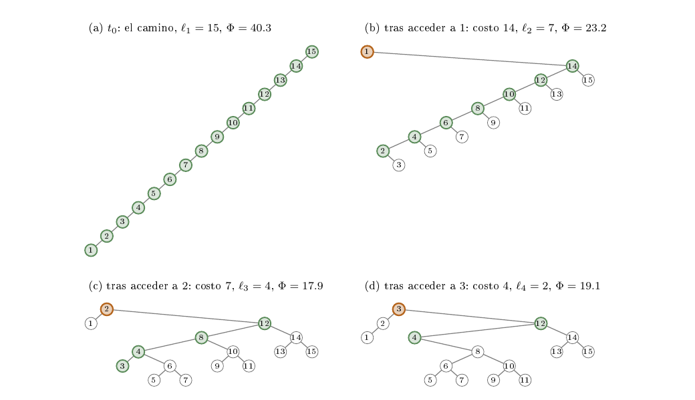
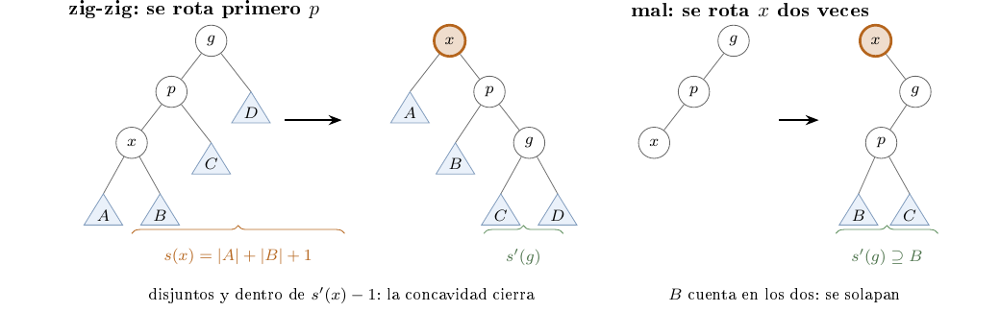
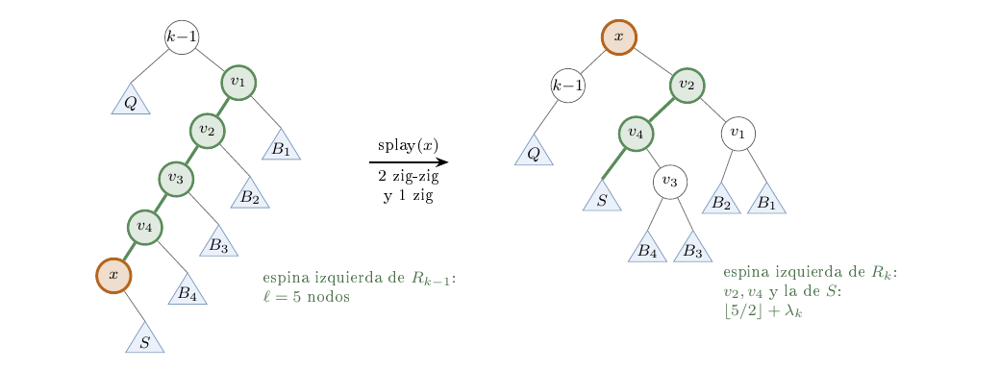
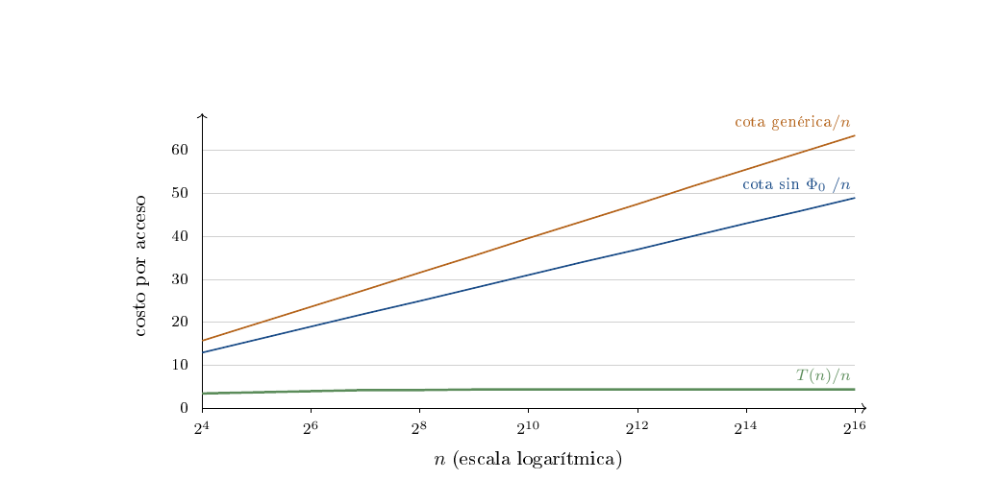

# Ejercicio 13 — Splay tree: acceso en orden 1,...,n

**Dificultad:** ★★   **Conferencias:** C4 (Análisis amortizado);
método de C2 §1 y herramientas de C3

## Enunciado

> En un splay tree que empieza como un camino de $n$ nodos se accede a las claves $1,\dots,n$ en orden.
> Acota el costo total con el lema de acceso y la cuenta de la sección 5 de la conferencia 4, y compáralo con
> lo que mide la sección 6. ¿Es ajustada la cota?

## El camino

Seguimos el ciclo de C2 §1 con las herramientas de C3 (invariante, potencial, primer fallo) y el potencial de C4.
Cada paso termina anunciando el siguiente, que resuelve lo que quedó pendiente, hasta llegar a lo que queremos demostrar:

> **Lo que queremos demostrar**
>
> (1) El lema de acceso da $T(n)\le n(3\log_2 n+1)+\log_2 n!$, y se afina a $T(n)\le n(3\log_2n+1)$ porque la
> pasada **devuelve el árbol al camino del que partió** (el potencial no cambia). (2) Lo que se mide es
> $T(n)\approx4{,}4\,n$: el costo es $\Theta(n)$ y la cota **no es ajustada**, pierde un factor $\Theta(\log n)$.
> (3) La razón se ve en una recurrencia exacta del largo del camino de búsqueda.

| **§** | **Pregunta que se responde** | **Y lo que queda por resolver** |
|---|---|---|
| 1 | ¿Qué se mide, sobre qué entrada? | el algoritmo |
| 2 | ¿Qué es el splay? (y el ejemplo $n=15$) | su correctitud |
| 3 | ¿Es correcto? (invariante y potencial de terminación) | la garantía de costo |
| 4 | El lema de acceso (potencial, demostración, primer fallo) | aplicarlo a esta secuencia |
| 5 | Costo de la pasada: el árbol que regresa | si la cota es ajustada |
| 6 | ¿Es ajustada? ¿Se puede hacer mejor? | el contraste con subir a la raíz |
| 7 | El contraste: subir a la raíz | — |

## 1. Pregunta 1: ¿qué se mide, sobre qué entrada?

C2 §2 pide precisar entrada, salida y casos raros antes de buscar nada. Aquí hay que precisar además *qué* se
mide: el costo de una **secuencia** de accesos, no el de un acceso suelto (C4 §1).

**El modelo.** Un *estado* es un árbol binario de búsqueda $t$ cuyos nodos llevan las claves
$\{1,\dots,n\}$. Un *acceso* a la clave $k$ localiza su nodo $x$ y hace *splay* de $x$: lo sube hasta la
raíz con rotaciones (pregunta 2). Su costo es $c=\max(\rho,1)$, donde $\rho$ es el número de rotaciones, que la
pregunta 3 demuestra que es la profundidad de $x$; el $\max$ con $1$ cuenta el acceso a la raíz (C4 §4: “contamos
rotaciones, y 1 cuando el nodo ya es la raíz”).

**La entrada.** `camino(n)`: la raíz es $n$ y cada clave $k$ es hijo izquierdo de $k+1$, así que la
clave $1$ está en el fondo, a profundidad $n-1$ (C4 §4). La secuencia es $1,2,\dots,n$, una *pasada*. Sea
$T(n)$ el costo total de la pasada.

**El potencial (C4 §5).** Para un nodo $v$ sea $s(v)$ el número de nodos de su subárbol, $r(v)=\log_2s(v)$ su
rango, y $\Phi(t)=\sum_vr(v)$. El costo amortizado de un acceso que lleva $t$ a $t'$ es $a=c+\Phi(t')-\Phi(t)$.
En el camino los tamaños son $1,2,\dots,n$, luego

$$
\Phi_0=\sum_{j=1}^{n}\log_2 j=\log_2 n!\ \approx\ n\log_2 n,
$$

el valor más alto que puede tener $\Phi$ en un árbol de $n$ nodos. Pero “potencial máximo” no es “peor para
esta secuencia”: eso se descarta en la pregunta 6.

**Lo que se pide.** (i) Acotar $T(n)$ con el lema de acceso y la cuenta de C4 §5. (ii) Compararlo con lo que
mide C4 §6. (iii) Decidir si la cota es ajustada: $B(n)$ es *ajustada* para $T$ si $T(n)=\Theta(B(n))$. Si
$T=\Theta(n)$ y $B=\Theta(n\log n)$, no lo es.

**Casos raros.** $n=1$: $T=1$. $n=2$: $T=2$ (dos zig de costo $1$). Acceder a la raíz cuesta $1$, no $0$.

**A continuación:** la pregunta 2 explica cómo se sube un nodo a la raíz sin romper el orden.

## 2. Pregunta 2: ¿qué es el splay?

El splay sube $x$ de dos niveles en dos, mirando la forma del camino (C4 §4): **zig** si el padre $p$ es la
raíz (una rotación); **zig-zig** si $x$ y $p$ son hijos del mismo lado (se rota *primero el padre*
y después $x$); **zig-zag** si son de lados distintos (se rota $x$ dos veces).

```text
funcion Rotar(x):                         // sube x un nivel; conserva el orden
    p ← padre[x];   g ← padre[p]
    si x es hijo izquierdo de p:
        izq[p] ← der[x];   der[x] ← p
    sino:
        der[p] ← izq[x];   izq[x] ← p
    padre[p] ← x;   padre[x] ← g       // el hijo que cambio de lado cambia de padre
    si g existe: g apunta ahora a x, donde apuntaba a p

funcion Splay(x):                         // devuelve el numero de rotaciones
    rotaciones ← 0
    mientras x tiene padre:
        p ← padre[x];   g ← padre[p]
        si g no existe:                                   // zig
            Rotar(x);   rotaciones ← rotaciones + 1
        sino si x y p son hijos del mismo lado:           // zig-zig
            Rotar(p);   Rotar(x);   rotaciones ← rotaciones + 2     // primero el padre
        sino:                                             // zig-zag
            Rotar(x);   Rotar(x);   rotaciones ← rotaciones + 2
    devolver rotaciones

funcion Pasada(raiz, n):                  // accede a 1, 2, ..., n en orden
    para k desde 1 hasta n:
        x ← Buscar(raiz, k)
        costo[k] ← max(Splay(x), 1)
        raiz ← x
```

El código ejecutable, el que se usó en todas las verificaciones, es `verif.py`: `rotar` (línea
18), `splay` (líneas 37 a 52) y la pasada (líneas 80 a
87). Zig y zig-zag hacen exactamente las rotaciones de “subir a la raíz”; la *única* diferencia
entre las dos heurísticas es el orden de las dos rotaciones del zig-zig (C4 §4), y toda la pregunta 4 consiste en
explicar por qué ese orden importa.

**El ejemplo que usaremos** es $n=15$, el de la figura 4 de C4. Los costos de los quince accesos, con el
resto de las comprobaciones del ejemplo (la figura 1 dibuja los primeros estados):

```text
costo de acceder a 1..15: 14 7 4 2 4 2 3 1 3 1 2 1 2 1 1
total T(15) = 48;  primer acceso = 14 = n-1
el resto de los accesos cuesta 34, 2.4 veces el primero
arbol final == arbol inicial: True
n=31: primeros 12 costos 30 15 8 4 5 2 3 1 3 1 2 1 ...  T = 114
n=63: primeros 12 costos 62 31 16 8 7 3 3 1 3 1 2 1 ...  T = 250
```



*Figura 1. La pasada sobre `camino(15)`: el estado inicial y los estados tras acceder a $1$, $2$ y $3$.
Cada árbol se dibuja con la clave en el eje horizontal y la profundidad en el vertical. En naranja, el nodo
recién accedido (queda en la raíz); en verde, la *espina izquierda* del subárbol que se recorrerá a continuación
(los nodos que se alcanzan bajando siempre por la izquierda), cuya longitud $\ell$ es el costo del siguiente acceso.
El primer acceso cuesta $14=n-1$ y deja una espina de $7$ nodos; el segundo, $7$, y deja $4$; el tercero, $4$, y deja $2$:
el camino se parte por la mitad en cada acceso. Esa es la regularidad que explica el $\Theta(n)$ de la pregunta 6.*

Lo que se ve en el ejemplo corrige una idea intuitiva. El primer acceso cuesta $n-1=14$, pero no es el grueso del
trabajo: los otros catorce cuestan $34$, más del doble. Y al final el árbol es **exactamente el camino del que se
partió** (la última línea del bloque). Ambas cosas se demuestran en la pregunta 5.

**A continuación:** la pregunta 3 comprueba que la operación es correcta, es decir, que conserva el orden y deja a $x$ en la raíz.

## 3. Pregunta 3: ¿es correcto el splay?

Aquí se usan dos herramientas de C3: un invariante para el orden y un potencial para la terminación. El estado de
`Splay` es el árbol $t$ junto con $x$; una *vuelta* es una ejecución del cuerpo del `mientras` (no se confunde con la *pasada* de la pregunta 1, que es la secuencia $1,\dots,n$ completa).

> **Lema 0 (el splay es una operación correcta)**
>
> Sea $t$ un árbol de búsqueda con $x$ en uno de sus nodos y $d_0$ su profundidad. Entonces `Splay(x)` termina,
> hace exactamente $d_0$ rotaciones, deja a $x$ en la raíz y deja un árbol de búsqueda con las mismas claves.

**Invariante (orden).** $\mathrm{I}_{\text{ord}}$: el recorrido en inorden de $t$ es creciente.
*Inicialización:* $t$ es de búsqueda. *Mantenimiento:* una rotación de $x$ con su padre $p$ cambia
$p(x(A,B),C)$ por $x(A,p(B,C))$, o su simétrica; el inorden es $A\,x\,B\,p\,C$ antes y después, así que
$\mathrm{I}_{\text{ord}}$ se conserva, y cada vuelta es una o dos rotaciones. *Conclusión:* al salir del
ciclo $t$ sigue siendo de búsqueda.

**Potencial (terminación y costo).** $D=$ profundidad de $x$. Es un natural, y vale $D\ge1$ al entrar a una
vuelta. En un *zig* ($D=1$) `Rotar(x)` baja $D$ en $1$. En un *zig-zig*, `Rotar(p)` sube a
$p$ y $x$ lo acompaña (baja $D$ en $1$), y `Rotar(x)` baja $D$ en $1$ más. En un *zig-zag* cada
`Rotar(x)` baja $D$ en $1$. Luego **$D$ baja exactamente lo que cuesta la vuelta** (1 o 2): termina en
a lo sumo $d_0$ vueltas, con $D=0$ ($x$ en la raíz), y las rotaciones suman $d_0-0=d_0$. $\square$

Ejecutado sobre árboles de formas variadas (caminos, zigzag, al azar):

```text
3000 splays en arboles de 1 a 40 nodos (formas variadas):
  el recorrido inorden no cambia:            3000 de 3000
  x termina en la raiz:                      3000 de 3000
  la profundidad de x baja 1 o 2 por paso:   3000 de 3000
  rotaciones = profundidad inicial de x:     3000 de 3000
```

Con esto, **el costo de un acceso es $c=\max(d_0,1)$**, la profundidad del nodo. Falta lo importante: que
sumado sobre una secuencia no sea grande.

**A continuación:** la pregunta 4 demuestra qué garantiza el costo del splay sobre una secuencia de accesos.

## 4. Pregunta 4: el lema de acceso

La garantía de C4 §5 es un costo amortizado, y se demuestra con el potencial $\Phi$ de la pregunta 1. Es la
misma herramienta que en C3 (“una cantidad que no puede bajar de un piso”), usada ahora para acotar costo.

> **Lema 1 (concavidad)**
>
> Si $\alpha,\beta>0$ y $\alpha+\beta\le\gamma$, entonces $\log_2\alpha+\log_2\beta\le2\log_2\gamma-2$.

*Demostración.* $\sqrt{\alpha\beta}\le(\alpha+\beta)/2\le\gamma/2$ (media aritmética–geométrica). Tomando
$\log_2$ de $\alpha\beta\le\gamma^2/4$ sale la desigualdad. $\square$

> **Lema 2 (un paso del splay)**
>
> Sea $a=\text{costo}+\Delta\Phi$ de un paso, y $r,r'$ los rangos antes y después. Un **zig** cumple
> $a\le3(r'(x)-r(x))+1$; un **zig-zig** y un **zig-zag**, $a\le3(r'(x)-r(x))$.

*Demostración.* Usamos dos hechos. (i) Tras el paso $x$ ocupa el lugar del nodo más alto que rotó, con el mismo
subárbol: $r'(x)$ es el rango anterior de ese nodo ($p$ en el zig, $g$ en los otros). (ii) Lo que rota queda debajo de $x$,
y antes estaba debajo de $x$ o ocupaba su lugar: $r'(p)\le r'(x)$ y $r(p)\ge r(x)$. Solo cambian los rangos de los nodos
que rotan.

- *Zig* (costo $1$; cambian $p$ y $x$). $\Delta\Phi=r'(p)+r'(x)-r(p)-r(x)=r'(p)-r(x)\le r'(x)-r(x)$, por (i) y (ii).
  Luego $a\le1+r'(x)-r(x)\le1+3(r'(x)-r(x))$.
- *Zig-zig* (costo $2$; cambian $x,p,g$). Por (i), $r'(x)=r(g)$, y por (ii),
  $\Delta\Phi=r'(p)+r'(g)-r(x)-r(p)\le r'(x)+r'(g)-2r(x)$. Entonces $a\le2+r'(x)+r'(g)-2r(x)$, y basta
  $2+r'(g)+r(x)\le2r'(x)$, es decir $r(x)+r'(g)\le2r'(x)-2$. Con los subárboles $A,B$ de $x$ y $C,D$ de $g$ (figura 2, izquierda): al rotar
  *primero $p$*, quedan $x$ en la raíz, $p$ como su hijo derecho con $B$ a la izquierda, y $g$ como hijo derecho de $p$ con $C$ y $D$.
  Luego $s(x)=|A|+|B|+1$ y $s'(g)=|C|+|D|+1$ **no comparten nodos** y están dentro del nuevo subárbol de $x$ *menos el nodo $p$*:
  $s(x)+s'(g)\le s'(x)-1$ (de hecho vale la igualdad). El Lema 1 con $\gamma=s'(x)-1$ da lo que faltaba.
- *Zig-zag* (costo $2$). Igual: $a\le2+r'(p)+r'(g)-2r(x)$. Tras el paso $p$ y $g$ son los dos hijos de $x$, con subárboles disjuntos
  dentro del de $x$: $s'(p)+s'(g)\le s'(x)-1$, y el Lema 1 da $r'(p)+r'(g)\le2r'(x)-2$. Así $a\le2(r'(x)-r(x))\le3(r'(x)-r(x))$. $\square$

> **Teorema (lema de acceso) y corolario**
>
> Hacer splay de $x$ en un árbol de $n$ nodos cuesta amortizado a lo sumo $3(\log_2n-r(x))+1$. Para $m$ accesos desde un
> árbol de potencial $\Phi_0$ que termina en $\Phi_m$:
>

$$
\sum_{i=1}^mc_i\ \le\ m(3\log_2 n+1)\ +\ \Phi_0-\Phi_m\ \le\ m(3\log_2n+1)+\Phi_0 .
$$

*Demostración.* Sumar el Lema 2 sobre los pasos: los $r'(x)-r(x)$ se telescopian, de $r(x)$ al rango final de $x$, que es
$\log_2n$ (es la raíz); el zig ocurre a lo sumo una vez, al final. Para el corolario, $\sum a_i=\sum c_i+\Phi_m-\Phi_0$
(el potencial se telescopia), y $r(x)\ge0$. La condición $\Phi_m\ge\Phi_0$ de C4 §2 *no* se cumple aquí
(el camino tiene el potencial más alto), y se paga aparte: el término $\Phi_0-\Phi_m$. $\square$



*Figura 2. El paso delicado del lema de acceso. Izquierda: en el zig-zig bien ordenado, el subárbol viejo de $x$ ($A,B$) y el nuevo de $g$
($C,D$) son disjuntos, y eso es lo que usa la concavidad. Derecha: rotando $x$ dos veces (subir a la raíz), el subárbol nuevo de $g$
contiene a $p$ y a $B$, que ya estaban en el viejo de $x$: no son disjuntos y la cuenta no cierra (a la derecha, $A$ y $D$ no se dibujan).*

**Un lema también se puede ejecutar.** Esta versión del splay calcula el potencial completo antes y después de cada paso y
comprueba el Lema 2 paso a paso, y el teorema en cada acceso (el parámetro `zigzig_mal` rota $x$ dos veces):

```python
def splay_vigilado(x, zigzig_mal=False):
    """Splay de x que comprueba el lema de paso de C4 5 en cada paso.
    Devuelve (rotaciones, pasos); cada paso es (tipo, amortizado, cota)."""
    rotaciones, pasos = 0, []
    while x.padre:
        p, g = x.padre, x.padre.padre
        tam = tamanos(raiz_de(x))
        phi, r_ant = sum(math.log2(s) for s in tam.values()), math.log2(tam[x])
        if g is None:
            tipo, costo = "zig", 1
            rotar(x)
        elif (g.izq is p) == (p.izq is x):
            tipo, costo = "zig-zig", 2
            if zigzig_mal:                      # rotar x dos veces: subir a la raiz
                rotar(x)
            else:
                rotar(p)
            rotar(x)
        else:
            tipo, costo = "zig-zag", 2
            rotar(x)
            rotar(x)
        tam = tamanos(raiz_de(x))
        phi2, r_nue = sum(math.log2(s) for s in tam.values()), math.log2(tam[x])
        amortizado = costo + phi2 - phi
        cota = 3 * (r_nue - r_ant) + (1 if tipo == "zig" else 0)
        pasos.append((tipo, amortizado, cota))
        rotaciones += costo
    return rotaciones, pasos
```

```text
6606 accesos (camino 1..n y dos mas, arboles al azar):
     paso  cantidad  violan   max(amortizado-cota)
      zig      4030       0                 -0.087
  zig-zig      5890       0                 -0.147
  zig-zag      3288       0                 -0.372
por acceso: violan 0 de 6606; max(a - cota del acceso) = 0.000
zig-zig mal ordenado (rotar x dos veces), camino 1..n con n=16,31,50:
      zig        50       0                 -0.087
  zig-zig       881     705                  1.820
  zig-zag        46       0                 -0.886
por acceso: violan 51 de 97
```

El splay no viola nunca la cota, ni por paso ni por acceso (la holgura máxima por acceso, $0$, ocurre al acceder a la raíz, donde
la cota es $1$ y el costo amortizado es $1$). Con el zig-zig mal ordenado la cota por paso falla en la mayoría de los zig-zig.

### El primer fallo

Como en C3 §5, buscamos el primer lugar donde falla la variante. `subir_a_la_raiz` no es incorrecta: el árbol sigue siendo de
búsqueda y el nodo llega a la raíz (el Lema 0 le vale). Falla en la *cota*. El primer paso que viola el Lema 2, y la causa:

```text
camino de n=7, acceso a 1: el paso 3 (zig-zig) viola la cota
  amortizado = 2.000  >  3(r'(x)-r(x)) = 1.456
  s(x) = 5, s'(g) = 6, s'(x) = 7:  s(x)+s'(g) = 11  >  s'(x)-1 = 6
primer acceso del camino con subir a la raiz (amortizado = n-1):
   n  costo  delta phi  3 log2 n + 1  viola
  11     10      0.000        11.378  False
  12     11      0.000        11.755  False
  13     12      0.000        12.101  False
  14     13      0.000        12.422   True
  15     14      0.000        12.721   True
  16     15      0.000        13.000   True
menor n con violacion en el primer acceso: 14
```

El paso que falla es el tercer zig-zig del camino de $7$ nodos: ahí $x$ ya carga un subárbol derecho grande ($B$ de la figura 2) y
$s(x)+s'(g)=11>6=s'(x)-1$. Además, en el primer acceso al camino el potencial *no cambia* ($\Delta\Phi=0$: el camino se vuelve un árbol con los
mismos tamaños $1,\dots,n$), así que el costo amortizado vale exactamente $n-1$, y la cota $3\log_2n+1$ se viola desde $n=14$.

**A continuación:** la pregunta 5 aplica el lema a esta secuencia, el camino y los accesos $1,\dots,n$.

## 5. Pregunta 5: el costo de la pasada, y el árbol que regresa

**Aplicar el corolario.** Con $m=n$ y $\Phi_0=\log_2n!$,

$$
T(n)\ \le\ n(3\log_2n+1)+\log_2n!-\Phi_n .
$$

Todavía hay que saber cuánto vale $\Phi_n$: si no se mira, hay que quedarse con $\Phi_n\ge0$ y la cota
$n(3\log_2n+1)+\log_2n!$, que es lo que sale de C4 §5. Veremos que $\Phi_n=\Phi_0$. Para eso hace falta saber qué pasa
con el árbol, y la clave es que **siempre se accede al mínimo de lo que falta**.

**Notación.** Para un árbol $u$ sea $\esp(u)$ el número de nodos de su *espina izquierda* (el camino que baja desde la raíz siempre por la
izquierda; $\esp(\varnothing)=0$). Antes del acceso $k$ ($1\le k\le n$) llamamos $R_{k-1}$ al subárbol derecho de la raíz $k-1$ (si $k=1$, no hay
raíz sobre él y $R_0$ es el árbol entero). El nodo $x=k$ es el *mínimo* de $R_{k-1}$: todas las claves menores ya fueron accedidas y están en la raíz
$k-1$ o a su izquierda. Sean $\ell_k=\esp(R_{k-1})$, y $S_k$ el subárbol derecho de $x$ en ese momento, $\lambda_k=\esp(S_k)$.

> **Lema 3 (el splay del mínimo)**
>
> En el acceso $k$, sea $Q$ el subárbol izquierdo de la raíz $k-1$ (si $k\ge2$). Entonces:
>
> (a) El splay no toca a $k-1$ ni a $Q$ hasta su último paso, y al terminar $x$ es la raíz, con hijo izquierdo $k-1$ (con subárbol izquierdo $Q$ y
> derecho vacío). Si $k=1$, el hijo izquierdo de $x$ es vacío.
>
> (b) Hace $\ell_k$ rotaciones si $k\ge2$, y $\ell_1-1$ si $k=1$.
>
> (c) El nuevo subárbol derecho $R_k$ cumple $\ \esp(R_k)=\lfloor\ell_k/2\rfloor+\lambda_k$.



*Figura 3. El Lema 3 con $\ell=5$ (caso $k\ge2$). Los triángulos son subárboles que no cambian por dentro. Antes: la espina izquierda de $R_{k-1}$ es
$v_1,\dots,v_5=x$ y $x$ es su extremo; cada $v_i$ tiene un subárbol derecho $B_i$ ($B_5=S$). Después: $x$ es la raíz, su hijo izquierdo es $k-1$ con el mismo $Q$, y la
espina del nuevo $R_k$ conserva la mitad de los $v_i$ ($v_4$ y $v_2$) y sigue por la espina de $S$. Los $v_i$ con índice par, $v_3$ y $v_1$,
salen de la espina. Con $\ell$ par el último paso es un zig-zag en lugar de un zig, y la cuenta da lo mismo.*

*Demostración.* Sean $v_1,\dots,v_\ell=x$ la espina izquierda de $R_{k-1}$ (la figura 3 es el caso $\ell=5$) y $B_i$ el subárbol
derecho de $v_i$ (así $B_\ell=S_k$). El invariante del ciclo de `Splay` es

> (J) *el camino de la raíz de $R_{k-1}$ hasta $x$ usa solo aristas izquierdas y $x$ no tiene hijo izquierdo; tras $j$ zig-zig, el hijo derecho de $x$ es un
> árbol $Y_j$ con $\esp(Y_j)=j+\lambda_k$.*

*Inicialización* ($j=0$): $x=v_\ell$ es el mínimo, no tiene hijo izquierdo, y su hijo derecho es $Y_0=S_k$. *Mantenimiento:* mientras el abuelo $g$ de $x$ sea un
nodo de $R_{k-1}$, el padre $p=v_{\ell-2j-1}$ y $g=v_{\ell-2j-2}$ cumplen $x$ hijo izquierdo de $p$ hijo izquierdo de $g$: es un zig-zig. Con $A=\varnothing$ (por (J)), $B=Y_j$,
$C=B_p$ y $D=B_g$, el zig-zig deja $x$ con hijo derecho $p$, que tiene a $Y_j$ como hijo izquierdo y a $g$ como hijo derecho. Luego $Y_{j+1}=p(Y_j,\,g(\dots))$ y
$\esp(Y_{j+1})=1+\esp(Y_j)=j+1+\lambda_k$. Además $x$ queda en el lugar de $g$, hijo izquierdo del siguiente nodo de la espina: (J) sigue valiendo.

Los zig-zig siguen mientras el abuelo $g$ sea de $R_{k-1}$, y terminan cuando $x$ llega a la raíz de $R_{k-1}$ ($\ell$ impar, $\ell=2m+1$, tras $m$ zig-zig) o queda como hijo izquierdo de esa raíz
($\ell$ par, $\ell=2m$, tras $m-1$ zig-zig). Quedan cuatro casos, por $k$ y por la paridad de $\ell$:

- $\ell=2m+1$, $k\ge2$: $x$ es hijo derecho de $k-1$ y el último paso es un *zig*: $x$ pasa a la raíz, $k-1$ queda como su hijo izquierdo, y el hijo derecho de $k-1$ pasa a ser el antiguo hijo izquierdo de $x$, que es vacío. $R_k=Y_m$, $\esp=m+\lambda_k=\lfloor\ell/2\rfloor+\lambda_k$. Rotaciones: $2m+1=\ell$.
- $\ell=2m+1$, $k=1$: $x$ ya es la raíz; $R_1=Y_m$. Rotaciones: $2m=\ell-1$.
- $\ell=2m$, $k\ge2$: $x$ es hijo izquierdo de $v_1$, que es hijo derecho de $k-1$: un *zig-zag*. La primera rotación deja a $v_1$ como hijo derecho de $x$ con
  $Y_{m-1}$ a su izquierda; la segunda sube $x$ sobre $k-1$ (que queda con hijo derecho $=$ el izquierdo de $x$, vacío). $R_k=v_1(Y_{m-1},B_1)$, $\esp=1+(m-1)+\lambda_k=\ell/2+\lambda_k$.
  Rotaciones: $2(m-1)+2=\ell$.
- $\ell=2m$, $k=1$: $x$ es hijo izquierdo de la raíz $v_1$: un *zig*, y $R_1=v_1(Y_{m-1},B_1)$ con la misma cuenta. Rotaciones: $2(m-1)+1=\ell-1$.

En ningún caso se toca a $k-1$ ni a $Q$ antes del último paso, que deja a $x$ con hijo izquierdo $k-1$ con el mismo subárbol $Q$ y derecho vacío. $\square$

> **Corolario 4 (la pasada devuelve el camino)**
>
> Sea $P_m$ el camino izquierdo de $m$ nodos con claves $m,\dots,1$ ($P_0=\varnothing$). Partiendo de $P_n$, tras $k$ accesos la raíz es $k$, su subárbol izquierdo
> es $P_{k-1}$ y a la derecha están las claves $k+1,\dots,n$. En particular **tras la pasada el árbol es otra vez $P_n$**, así que $\Phi_n=\Phi_0$.

*Demostración.* Por inducción sobre $k$ con el Lema 3(a). Para $k=1$ el hijo izquierdo de $x=1$ es vacío, $=P_0$. Si tras el acceso $k$ el subárbol izquierdo de la raíz $k$ es $P_{k-1}$, en el acceso
$k+1$ se tiene $Q=P_{k-1}$, y el Lema 3(a) dice que el hijo izquierdo de $k+1$ es $k$ con subárbol izquierdo $P_{k-1}$ y derecho vacío: es $P_k$. Para $k=n$ no queda nada a la derecha. $\square$

> **Corolario 5 (la cota de la pasada)**
>
> $T(n)=\sum_ia_i\ \le\ \sum_{i=1}^n\bigl[3(\log_2n-r(x_i))+1\bigr]\ \le\ n(3\log_2n+1)$, y como las pasadas son idénticas, $m$ pasadas cuestan exactamente $m\,T(n)$.

Esto *quita* el término $\Phi_0\approx n\log_2n$ de la cota genérica. Lo ejecutado (el árbol final es el inicial; cuatro pasadas seguidas cuestan lo mismo; y la tabla con
las cotas, donde la columna `cota lema` es la genérica y `sin phi0` es el Corolario 5):

```text
invariante I(k) tras cada acceso, n=1..60:  fallos = 0
arbol final == camino(n), n=1..200:         200 de 200
costo de 4 pasadas seguidas, n=100: [416, 416, 416, 416]
```

```text
    n   T(n)   T/n     phi0    phi_n  suma a_i  cota lema  sin phi0
   16     54  3.38     44.3     44.3      54.0      252.3     208.0
   64    256  4.00    296.0    296.0     256.0     1512.0    1216.0
  256   1096  4.28   1684.0   1684.0    1096.0     8084.0    6400.0
 1024   4478  4.37   8769.0   8769.0    4478.0    40513.0   31744.0
```

Dos cosas se ven. $\Phi_n=\Phi_0$ en todos los tamaños, y por eso la suma de los costos amortizados *es* el costo real. Y que la tercera
columna, la suma de $a_i$, vale lo que $T$: es el telescopio hecho cifra. También se explica que C4 §6 mida $4{,}2$ por acceso sobre *tres* rondas: cada ronda
cuesta $T(n)$.

**A continuación:** la pregunta 6 decide si la cota es ajustada, cuánto cuesta de verdad la pasada y por qué.

## 6. Pregunta 6: ¿es ajustada? ¿se puede hacer mejor?

### 6.1 Lo que se mide

El costo real contra la cota por acceso, para $n=2^k$ (columnas: $T(n)$, $T/n$, $3\log_2n+1$ y el cociente de esta cota con $T/n$; la figura 4 lo dibuja junto con la cota genérica):

```text
      n     T(n)    T/n  3 log2 n + 1  (3 log2 n+1)/(T/n)
     16       54  3.375          13.0                3.85
     32      120  3.750          16.0                4.27
     64      256  4.000          19.0                4.75
    128      534  4.172          22.0                5.27
    256     1096  4.281          25.0                5.84
    512     2222  4.340          28.0                6.45
   1024     4478  4.373          31.0                7.09
   2048     9006  4.397          34.0                7.73
   4096    18044  4.405          37.0                8.40
   8192    36122  4.409          40.0                9.07
  16384    72282  4.412          43.0                9.75
  32768   144604  4.413          46.0               10.42
  65536   289260  4.414          49.0               11.10
```



*Figura 4. $T(n)/n$ (verde) contra las dos cotas que da el lema, por acceso. La genérica (naranja) incluye $\log_2 n!/n\approx\log_2n-1{,}44$ por acceso;
la azul es el Corolario 5. Los datos son los de la tabla anterior (cota genérica calculada con la fórmula, $T$ medido).*

**Qué se concluye, y qué no.** Cada acceso cuesta al menos $1$, así que $T(n)\ge n$: eso está demostrado. La cota superior $T(n)=O(n)$ no se
deduce de lo medido, que es finito. Lo que sí hay es: (i) $T(n)/n$ crece cada vez más despacio ($4{,}405$, $4{,}409$, $4{,}412$, $4{,}413$, $4{,}414$ para
$n=2^{12},\dots,2^{16}$) mientras la cota crece como $3\log_2n$; (ii) el **teorema de acceso secuencial**, de Tarjan (“Sequential access in splay
trees takes linear time”, *Combinatorica* 5(4), 1985): acceder a todas las claves en orden cuesta $O(n)$ *para cualquier árbol inicial*, resultado que
**citamos y no demostramos**; Elmasry (*Theoretical Computer Science* 314, 2004) lo retoma y mejora la constante (dato de segunda mano, no verificado en el artículo); (iii) la comprobación exhaustiva siguiente.

**Todas las formas iniciales.** Para $n\le12$ se prueban *todos* los árboles de búsqueda (hay $C_n$ formas, $208012$ con $n=12$):

```text
  n  formas  min  max  max/n  camino  camino es el max
  1       1    1    1   1.00       1              True
  2       2    2    2   1.00       2              True
  3       5    3    4   1.33       4              True
  4      14    4    8   2.00       8              True
  5      42    5   10   2.00      10              True
  6     132    6   14   2.33      14              True
  7     429    7   18   2.57      16             False
  8    1430    8   22   2.75      22              True
  9    4862    9   26   2.89      24             False
 10   16796   10   30   3.00      28             False
 11   58786   11   32   2.91      30             False
 12  208012   12   40   3.33      40              True
max T/n sobre todas las formas con n <= 12: 3.33
```

Con $n\le12$ el peor árbol cuesta a lo sumo $3{,}33\,n$, consistente con el teorema. Y aparece algo que **corrige** una afirmación habitual: el camino
*no* es siempre el peor árbol inicial para esta secuencia. Es el de mayor potencial, pero con $n=7$ otra forma cuesta $18$ y el camino $16$ (por eso en
la pregunta 1 se dijo “potencial máximo”, que no es lo mismo que “costo máximo”).

### 6.2 Dónde pierde la cota

La cota $n(3\log_2n+1)$ pierde por varios lados a la vez. En esta tabla, `suma cotas` es $\sum_i[3(\log_2n-r(x_i))+1]$ con el rango *real* $r(x_i)$ del nodo accedido,
`cota/T` su cociente con $T$, `r medio` el rango medio de los nodos accedidos y `max a` el mayor costo amortizado individual:

```text
    n   T/n  suma cotas  cota/T  r medio  log2 n  max a  2log2 n
   16  3.38       158.6     2.9     1.03     4.0   6.81     8.00
   64  4.00       850.2     3.3     1.91     6.0  11.28    12.00
  256  4.28      4313.6     3.9     2.72     8.0  15.90    16.00
 1024  4.37     21047.8     4.7     3.48    10.0  20.18    20.00
```

- El nodo accedido tiene un subárbol pequeño: su rango medio es $\approx3{,}5$ con $n=1024$, contra $\log_2n=10$. El lema cobra $3(\log_2n-r(x_i))+1\approx20{,}5$ por acceso, que es lo
  que costaría subir un nodo *desde el fondo de un árbol equilibrado*; lo que se paga de verdad es $\approx4{,}4$.
- La concavidad del Lema 1 es una igualdad solo cuando $\alpha=\beta=\gamma/2$; si un tamaño es mucho menor que el otro, como al subir por una espina larga, pierde.
- **Con este potencial, $\Phi$ no basta para demostrar el $O(1)$ por acceso**: el mayor $a_i$ crece como $2\log_2n$ (columna `max a`). Solo la *suma* $\sum a_i$ es lineal.
  Por eso el teorema de Tarjan no es un corolario del lema de acceso y usa otro argumento.

### 6.3 Por qué la suma es lineal: el camino de búsqueda se parte por la mitad

El Lema 3(b)–(c) da una recurrencia **exacta** para los costos. Para $k\ge2$, $c_k=\ell_k$; $c_1=\max(\ell_1-1,1)$; y

$$
\boxed{\ \ell_{k+1}=\Bigl\lfloor\frac{\ell_k}{2}\Bigr\rfloor+\lambda_k\ }\qquad(1\le k<n),
$$

donde $\lambda_k$ es lo que había colgado a la derecha de $k$. En el ejemplo: $\ell=15,7,4,2,\dots$ (figura 1). Se verifica (en caminos y en árboles aleatorios) y de ahí salen
dos consecuencias:

```text
l_(k+1) = floor(l_k/2) + lambda_k, 719 pasadas:   fallos = 0
T = suma de l_k - 1 (l_1 >= 2), las mismas pasadas: fallos = 0
arbol que no cambia: suma lambda_k = n - l_1 en 500 arboles: fallos = 0
```

1. Sea $\Lambda=\sum_k\lambda_k$ y $L=\sum_k\ell_k$. Sumando la recurrencia, $L=\ell_1+\sum_{k<n}\lfloor\ell_k/2\rfloor+\Lambda\le\ell_1+(L-\ell_n)/2+\Lambda$, de donde

$$
\Lambda\ \le\ T\ \le\ 2(n+\Lambda) .
$$

   Así que $T=\Theta(n)$ *si y solo si* $\Lambda=O(n)$: el costo de toda la pasada se reduce a un solo número, que cuenta, para cada $k$, los nodos del camino que baja de $k$ hasta su sucesor $k+1$ (sin contar a $k$), cuando $k+1$ está debajo de $k$.
2. En un árbol que *no cambiara*, cada nodo que no está en la espina izquierda de la raíz está en la espina del subárbol derecho de exactamente un $k$, así que $\Lambda=n-\ell_1\le n-1$ (comprobado arriba).
   El contenido del teorema de Tarjan es que el splay no estropea esa suma más que por una constante. Aquí **no lo demostramos**; se mide:

```text
     n    T(n)  suma lambda  lambda/n  2(n + suma lambda)
    16      54           16      1.00                  64
    64     256           87      1.36                 302
   256    1096          383      1.50                1278
  1024    4478         1582      1.54                5212
  4096   18044         6394      1.56               20980
```

$\Lambda/n$ se estabiliza cerca de $1{,}5$ y $T\le2(n+\Lambda)$ se cumple.

**Dónde se gasta el costo.** Si $\lambda_k=0$, la recurrencia da $\ell_{k+1}=\lfloor\ell_k/2\rfloor$: el camino inicial se parte por la mitad en cada acceso, $n-1,\ n/2,\ n/4,\dots$, y
esa suma geométrica es $\approx2n$. Es casi la mitad de $T$; el resto son accesos baratos:

```text
primeros 10 costos: 1022 511 256 128 67 33 18 9 7 3
los 10 primeros suman 2054 (2n = 2046); los otros 1013 suman 2418
los otros: promedio 2.39, maximo 10 (log2 n = 10.0)
 costo >=  accesos  fraccion
        1     1013     1.000
        2      646     0.638
        4      147     0.145
        8        7     0.007
       16        0     0.000
```

Los primeros diez accesos suman $\approx2n$ y los $1013$ restantes cuestan $2{,}39$ en promedio, con un máximo de $10=\log_2n$. El $n\log n$ de la cota no aparece en ninguna parte.

### 6.4 ¿Es ajustada en general? Sí

No hay que concluir que el lema “está flojo”: para *otras* secuencias es del orden correcto. Con claves uniformes al azar:

```text
     n  cost/acceso  log2 n  cost/log2 n  3 log2 n + 1
    64         5.76     6.0         0.96          19.0
   256         8.65     8.0         1.08          25.0
  1024        11.46    10.0         1.15          31.0
  4096        14.35    12.0         1.20          37.0
 16384        17.27    14.0         1.23          43.0
```

El costo por acceso crece $\approx1{,}4$ por cada duplicación de $n$, o sea $\Theta(\log n)$. Y no puede ser mucho menos para ninguna estructura: en un árbol binario de $n$ nodos hay a lo sumo $2^j$ nodos a profundidad $j$,
luego la profundidad media es $\ge\log_2(n+1)-2$; con claves independientes y uniformes, el costo esperado de cada acceso es $\ge\log_2(n+1)-2$, sea cual sea el árbol en ese momento. El lema de acceso es, entonces,
ajustado *como cota válida para toda secuencia* (salvo constantes), y no ajustado *para esta*.

**A continuación:** la pregunta 7 mide cuánto pierde “subir a la raíz”, la heurística que C4 §6 descarta.

## 7. Pregunta 7: el contraste, subir a la raíz

C4 §6 mide dos heurísticas sobre esta misma secuencia: el splay cuesta una constante por acceso, subir a la raíz cuesta $\Theta(n)$ por acceso. Con el Lema 3 en la mano se
puede demostrar exacto, que es el ejercicio 4 de C4.

> **Lema 6 (subir a la raíz desde el camino)**
>
> Con subir a la raíz, los accesos $1,\dots,n$ desde $P_n$ cuestan $n-1,\ n-1,\ n-2,\ \dots,\ 1$, en total $T_{\text{raíz}}(n)=\tfrac{(n-1)(n+2)}{2}=\Theta(n^2)$, y el árbol final
> vuelve a ser $P_n$.

*Demostración.* *Observación.* Rotar un nodo $x$ que es hijo izquierdo de $v$ pone a $x$ en el lugar de $v$, a $v$ como hijo derecho de $x$, y deja como hijo
izquierdo de $v$ el antiguo hijo derecho de $x$ (es `Rotar`). Por inducción, si $x$ es la hoja del fondo de un camino izquierdo $v_1,\dots,v_d,x$ (con $v_1$ arriba) y se rota
sobre $v_d,v_{d-1},\dots,v_1$ en ese orden, tras rotar sobre $v_j$ el hijo derecho de $x$ es el camino izquierdo $v_j,\dots,v_d$ (con $v_j$ arriba): la rotación sobre $v_j$ pone a $v_j$
como hijo derecho de $x$ con el camino anterior $v_{j+1},\dots,v_d$ a su izquierda.

Sea $Q_k$ el camino izquierdo con claves $n,n-1,\dots,k+1$ ($n$ arriba, $k+1$ en el fondo), $Q_n=\varnothing$. Invariante $\mathrm{I}'(k)$: tras el acceso $k$ ($1\le k<n$) el árbol es la raíz
$k$ con subárbol izquierdo $P_{k-1}$ y subárbol derecho $Q_k$.
*Inicialización ($k=1$):* $x=1$ es la hoja del fondo del camino $n,\dots,2,1=P_n$, a profundidad $n-1$. Por la observación, tras las $n-1$ rotaciones su hijo derecho es el camino
$n,\dots,2=Q_1$, y no tiene hijo izquierdo ($P_0$).
*Mantenimiento:* $x=k+1$ es la hoja del fondo del camino $n,\dots,k+2,k+1$ (que cuelga a la derecha de la raíz $k$), a profundidad $1+(n-k-1)=n-k$. Por la observación, tras rotar sobre
$k+2,\dots,n$ su hijo derecho es $n,\dots,k+2=Q_{k+1}$ y es hijo derecho de $k$; la última rotación lo sube sobre $k$, que pasa a ser su hijo izquierdo, con subárbol izquierdo $P_{k-1}$ y
derecho vacío (el antiguo hijo izquierdo de $x$): $x$ tiene a $P_k$ a la izquierda y a $Q_{k+1}$ a la derecha. Son $n-k$ rotaciones. Para $k+1=n$ queda $Q_n=\varnothing$ y el árbol es $P_n$.
Sumando: $(n-1)+\sum_{j=1}^{n-1}j=\tfrac{(n-1)(n+2)}{2}$. $\square$

El potencial explica por qué *no* se aplica el lema: el primer acceso deja $\Phi$ igual (ambos árboles tienen los tamaños $1,\dots,n$), así que su costo amortizado es $n-1$ (pregunta 4).
Ejecutado, y comparado con la tabla de C4 §6 (tres rondas, por acceso):

```text
costos = n-1, n-1, n-2, ..., 1; total (n-1)(n+2)/2; arbol final = camino:
  fallos en n=2..200: 0
```

```text
costo por acceso en 3 pasadas (la tabla de C4 6):
    n   splay  subir a la raiz  (n-1)(n+2)/(2n)
  100    4.16            50.49            50.49
  200    4.20           100.50           100.50
  400    4.33           200.50           200.50
  800    4.36           400.50           400.50
```

Las cifras de la tabla de C4 §6 ($4{,}2;\ 4{,}2;\ 4{,}3;\ 4{,}4$ y $50{,}5;\ 100{,}5;\ 200{,}5;\ 400{,}5$) son estas, redondeadas.

> **Respuesta**
>
> **Cota con el lema:** $T(n)\le n(3\log_2n+1)+\log_2n!$, que se afina a $T(n)\le n(3\log_2n+1)=O(n\log n)$ porque el árbol vuelve a ser el camino
> (Corolario 4: $\Phi_n=\Phi_0$). **Lo medido (C4 §6):** $T(n)/n$ pasa de $3{,}4$ ($n=16$) a $4{,}41$ ($n=2^{16}$), y
> cada acceso cuesta una constante. **¿Ajustada?** **No**: $T(n)=\Theta(n)$ (cota inferior $T\ge n$ demostrada; cota superior por el teorema de Tarjan, citado, y comprobada
> aquí hasta $n=2^{16}$ y en todos los árboles con $n\le12$), así que la cota pierde un factor $\Theta(\log n)$; con $n=2^{16}$, 11$\times$ la cota sin $\Phi_0$ y 14$\times$ la genérica. El lema *sí* es ajustado como cota para toda secuencia
> (accesos al azar, $\Theta(\log n)$ por acceso). **La razón:** $\ell_{k+1}=\lfloor\ell_k/2\rfloor+\lambda_k$ parte el camino de búsqueda por la mitad en cada acceso; y subir a la raíz no,
> y cuesta $\tfrac{(n-1)(n+2)}{2}$.

## Errores que hay que vigilar

> - **Creer que el lema “está mal” porque no es ajustado.** El lema es correcto (se ejecutó en 6606 accesos sin una violación) y es ajustado como cota para toda secuencia; solo no lo es
>   para *esta*. Una cota que vale siempre rara vez es ajustada para una secuencia concreta.
> - **Dejar el término $\Phi_0$ sin mirar $\Phi_n$.** La cota $m(3\log_2n+1)+\Phi_0$ es la del corolario *sin* información sobre el final. Aquí $\Phi_n=\Phi_0$ y el término se anula; dejarlo
>   agrega un $\log_2n!\approx n\log_2n$ que no hace falta.
> - **Creer que el camino es el peor árbol inicial para esta secuencia.** Es el de mayor potencial, no el de mayor costo: con $n=7$, otra forma cuesta $18$ y el camino $16$.
> - **Decir que el primer acceso es casi todo el costo.** Cuesta $n-1$, pero los demás suman más del doble: $34$ contra $14$ con $n=15$, y $2418$ contra $1022$ con $n=1023$. Lo que sí es cierto
>   es que los *primeros $\log_2n$* accesos suman $\approx2n$.
> - **Atribuir mal el teorema de acceso secuencial.** Es de Tarjan (1985, *Combinatorica*), no del artículo de Sleator y Tarjan sobre splay trees; el trabajo de Sundar (1992) trata de la
>   *conjetura de la deque*, otro problema. La demostración de Tarjan no sale del lema de acceso: con este potencial, el mayor costo amortizado individual crece como $2\log_2n$.
> - **Creer que “subir a la raíz” es incorrecta.** Es correcta (el Lema 0 le vale): el árbol sigue siendo de búsqueda y el nodo llega a la raíz. Pasa cualquier prueba de correctitud;
>   falla la cota, y solo con secuencias con estructura: en el primer acceso del camino desde $n=14$.
> - **Generalizar de “en orden” a cualquier secuencia.** La garantía lineal es para el acceso secuencial. Con claves al azar el costo por acceso crece como $\log n$ (tabla de 6.4),
>   y no puede ser menos (cota de información, C5).
