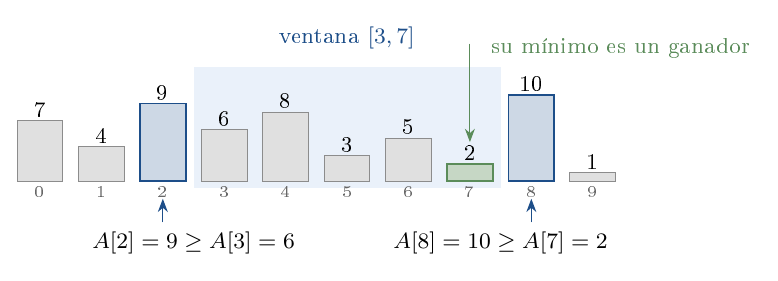
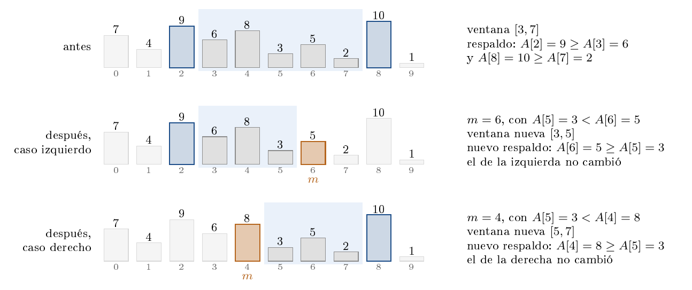
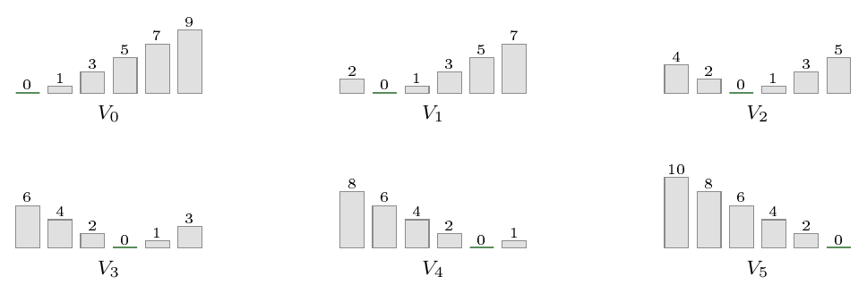
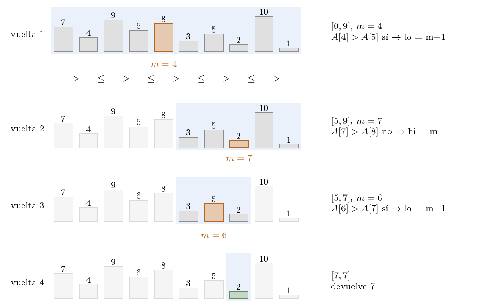
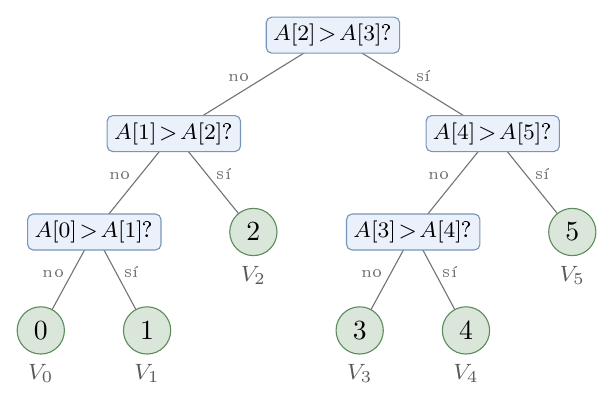

# Ejercicio 14 — Ciclo completo: mínimo local de un arreglo

**Dificultad:** ★★★   **Conferencias:** C2 a C5

## Enunciado y alcance

Escoge un problema nuevo, recorre el ciclo completo de C2 y consigue que el algoritmo y la cota mínima
coincidan.

El problema principal será el siguiente: dado un arreglo de reales sin ordenar, encontrar un mínimo local.
Al final se extiende el resultado a varias consultas. Se separa así el caso central, que sí queda resuelto
de forma óptima, del caso general de consultas solapadas, para el que solo se darán cotas.

## 1. ¿Cuál es el problema?

Sea $A[0..n-1]$ un arreglo de $n\ge1$ números reales. Se debe devolver un índice $i$ tal que

$$
(i=0\ \text{o}\ A[i-1]\ge A[i])
\quad\text{y}\quad
(i=n-1\ \text{o}\ A[i+1]\ge A[i]).
$$

Es decir, $A[i]$ no tiene un vecino menor. En los extremos se supone que hay un centinela $+\infty$.
Los valores repetidos están permitidos; por eso se usa $\ge$ y no $>$.

Siempre existe una respuesta: un elemento mínimo global del arreglo es también un mínimo local.
No se pide encontrar el mínimo global, porque eso requiere $n-1$ comparaciones.

### Modelo de costo

Se trabaja en el modelo de comparaciones de C5: el algoritmo solo puede aprender sobre los valores mediante
comparaciones entre elementos. Cada comparación cuesta uno; índices, ciclos y aritmética se consideran
gratuitos. Las comparaciones con $+\infty$ se resuelven por el índice y no cuentan.

El resultado que se demostrará es:

> Existe un algoritmo que encuentra un mínimo local con exactamente
> $\lceil\log_2 n\rceil$ comparaciones en el peor caso, y ningún algoritmo
> del modelo puede hacerlo con menos.

La demostración sigue las cinco preguntas de C2. Primero se presenta una solución inicial, luego se obtiene
la cota mínima, y finalmente se repite el ciclo para cerrar el factor que queda entre ambas.

## 2. Primera ronda

### 2.1 Una solución directa

La fuerza bruta recorre los pares consecutivos y devuelve el primer $i$ para el que $A[i]\le A[i+1]$;
si no encuentra ninguno, devuelve $n-1$.

Si devuelve un índice interior, todos los pares anteriores fueron estrictamente decrecientes, así que
$A[i-1]>A[i]$; además, la comparación actual da $A[i]\le A[i+1]$. En un extremo, la condición del
centinela es automática. Por tanto, el algoritmo es correcto y cuesta a lo sumo $n-1$ comparaciones.

### 2.2 V1: búsqueda binaria mirando dos vecinos

El barrido sugiere mirar solo vecinos, pero todavía los mira de izquierda a derecha. Para saltar hacia la
mitad hay que justificar que una mitad descartada no contiene todas las respuestas posibles. La observación
clave es mantener una ventana $[\mathrm{lo},\mathrm{hi}]$ que todavía contenga un mínimo local y que tenga
respaldo en sus dos bordes:

$$
(\mathrm{lo}=0\ \text{o}\ A[\mathrm{lo}-1]\ge A[\mathrm{lo}])
\quad\text{y}\quad
(\mathrm{hi}=n-1\ \text{o}\ A[\mathrm{hi}+1]\ge A[\mathrm{hi}]).
$$

Una ventana con respaldo contiene un mínimo local. En efecto, el mínimo de la ventana no puede tener un
vecino menor dentro de ella y, si está en un borde, el respaldo garantiza lo mismo para el vecino exterior.

Por ejemplo, en la ventana $[3,7]$ del arreglo de prueba se cumple
$A[2]\ge A[3]$ y $A[8]\ge A[7]$. La ventana no necesita estar ordenada: solo importa que no se pueda
salir de ella bajando.



*Una ventana con respaldo contiene un mínimo local. Los vecinos exteriores de $[3,7]$ son mayores o
iguales que sus bordes.*

V1 toma $m=\lfloor(\mathrm{lo}+\mathrm{hi})/2\rfloor$:

```text
V1(A):
    lo ← 0; hi ← n - 1
    mientras verdadero:
        m ← (lo + hi) div 2
        si m > 0 y A[m] > A[m-1]:
            hi ← m - 1
        sino si m < n-1 y A[m] > A[m+1]:
            lo ← m + 1
        sino:
            devolver m
```

**Correctitud.** El invariante es precisamente que la ventana es no vacía y tiene respaldo.

- Al inicio, $[0,n-1]$ tiene respaldo por los centinelas.
- Si $A[m]>A[m-1]$, entonces $m>\mathrm{lo}$. Si $m=\mathrm{lo}>0$, el respaldo izquierdo daría
  $A[m-1]\ge A[m]$, contradicción. Por tanto, $[\mathrm{lo},m-1]$ no es vacía, conserva el borde
  izquierdo y tiene respaldo derecho porque $A[m]>A[m-1]$.
- El caso $A[m]>A[m+1]$ es simétrico: $m<\mathrm{hi}$ y la nueva ventana $[m+1,\mathrm{hi}]$
  conserva el respaldo.
- Si ninguna rama se toma, $m$ no tiene vecino menor y se devuelve una respuesta correcta.

Esta es la idea que permite descartar media ventana. Si $A[m-1]<A[m]$, se conserva la mitad izquierda y
$A[m]$ se convierte en el nuevo respaldo derecho. Si $A[m+1]<A[m]$, se conserva la mitad derecha y $A[m]$
se convierte en el nuevo respaldo izquierdo.



*Las dos formas de achicar una ventana con respaldo. El nuevo borde queda protegido por el elemento $m$ que
se acaba de comparar.*

Para la terminación, el potencial $D=\mathrm{hi}-\mathrm{lo}$ es un natural y disminuye estrictamente en
cada rama. Por tanto, V1 termina y es totalmente correcto.

En cada vuelta la ventana se reduce a lo sumo a la mitad, pero se hacen hasta dos comparaciones. Así,

$$
\text{costo de V1}\le 2\lfloor\log_2 n\rfloor+2=O(\log n).
$$

La primera ronda produce una solución logarítmica, pero todavía no muestra que sea óptima: la constante
puede ser aproximadamente dos veces mayor que la cota mínima.

## 3. ¿Se puede hacer mejor? Cota mínima

Para cada $k\in\{0,\dots,n-1\}$ consideremos el arreglo $V_k$ definido por

$$
V_k[i]=
\begin{cases}
2(k-i), & i<k,\\
0, & i=k,\\
2(i-k)-1, & i>k.
\end{cases}
$$

El arreglo decrece estrictamente hasta $k$ y crece estrictamente después.



*Cada $V_k$ tiene su único mínimo local en la posición $k$. Estas instancias fuerzan respuestas distintas en
el árbol de decisión.*

**Lema.** $k$ es el único mínimo local de $V_k$.

**Demostración.** Si $i<k$, entonces $V_k[i]>V_k[i+1]$, de modo que $i$ no es mínimo local. Si
$i>k$, entonces $V_k[i-1]<V_k[i]$, y tampoco lo es. En $k$, el valor es menor que sus vecinos,
incluidos los centinelas si corresponde. $\square$

Consideremos el árbol de decisión de cualquier algoritmo correcto. La salida depende únicamente de la hoja:
dos entradas que siguen el mismo camino reciben las mismas respuestas de las comparaciones y producen la
misma salida. Como $V_k$ y $V_{k'}$ tienen respuestas únicas y distintas cuando $k\ne k'$, deben llegar a
hojas distintas.

En los arreglos $V_k$ todos los valores son distintos, por lo que solo se usan dos ramas de cada
comparación. El árbol contiene al menos $n$ hojas. Si su altura es $h$, entonces

$$
2^h\ge n,
\qquad\text{por tanto}\qquad
h\ge\lceil\log_2 n\rceil.
$$

Así, todo algoritmo de comparaciones necesita al menos $\lceil\log_2 n\rceil$ comparaciones en el peor
caso.

## 4. Segunda ronda: V2

La diferencia entre V1 y la cota está en que V1 compara a $m$ con dos vecinos. Para elegir una mitad solo
hace falta una comparación.

Definamos, para $i=0,\dots,n-2$,

$$
P(i)=[A[i]>A[i+1]],
$$

y además $P(-1)=\text{cierto}$ y $P(n-1)=\text{falso}$. La sucesión de valores de $P$ empieza en cierto
y termina en falso, así que tiene una transición cierto-falso. Si la transición está entre $i-1$ e $i$,
entonces

$$
A[i-1]>A[i]\le A[i+1],
$$

por lo que $i$ es un mínimo local.

La sucesión $P$ convierte el problema en encontrar una transición: mientras $P(i)$ es cierto, el arreglo
baja hacia la derecha; cuando pasa a falso, aparece un mínimo local. V2 busca esa transición, no un elemento
en un arreglo ordenado.

V2 busca esa transición por búsqueda binaria:

```text
V2(A):
    lo ← 0; hi ← n - 1
    mientras lo < hi:
        m ← (lo + hi) div 2
        si A[m] > A[m+1]:
            lo ← m + 1
        sino:
            hi ← m
    devolver lo
```



*V2 sobre $[7,4,9,6,8,3,5,2,10,1]$. Cada vuelta conserva la transición cierto--falso y hace una sola
comparación.*

### Correctitud

El invariante, al evaluar la guarda, es

$$
0\le\mathrm{lo}\le\mathrm{hi}\le n-1,
\qquad P(\mathrm{lo}-1)=\text{cierto},
\qquad P(\mathrm{hi})=\text{falso}.
$$

**Inicialización.** Para $\mathrm{lo}=0$, $P(-1)$ es cierto por el centinela izquierdo. Para
$\mathrm{hi}=n-1$, $P(n-1)$ es falso por el centinela derecho.

**Mantenimiento.** Si $P(m)$ es cierto, se asigna $\mathrm{lo}'=m+1$. Entonces
$P(\mathrm{lo}'-1)=P(m)$ sigue siendo cierto y el límite derecho no cambia. Si $P(m)$ es falso, se
asigna $\mathrm{hi}'=m$; entonces $P(\mathrm{hi}')=P(m)$ sigue siendo falso y el límite izquierdo no
cambia. En ambos casos el invariante se conserva.

**Conclusión.** Al salir, $\mathrm{lo}=\mathrm{hi}=i$. El invariante da
$P(i-1)$ cierto y $P(i)$ falso, es decir, $A[i-1]>A[i]\le A[i+1]$. Por tanto, $i$ es un mínimo local.

**Terminación.** Si $P(m)$ es cierto, $\mathrm{lo}$ aumenta; si es falso, $\mathrm{hi}$ disminuye. En
ambos casos el potencial $\mathrm{hi}-\mathrm{lo}$ disminuye estrictamente y no puede hacerlo
indefinidamente. V2 termina y es correcto.

### Costo

Cada vuelta hace una sola comparación. Si la ventana tiene tamaño $s$, la nueva ventana tiene tamaño a lo
sumo $\lceil s/2\rceil$. Después de $t$ comparaciones su tamaño es a lo sumo
$\lceil n/2^t\rceil$, de modo que termina cuando $2^t\ge n$. Por tanto,

$$
\text{costo de V2}\le\lceil\log_2 n\rceil.
$$

La cota mínima de la sección anterior da la desigualdad contraria para cualquier algoritmo. En consecuencia,

> **V2 es óptimo:** su costo en el peor caso es exactamente
> $\lceil\log_2 n\rceil$ comparaciones.

Para una consulta de longitud $L$, basta aplicar el mismo algoritmo al tramo $A[l..r]$; el costo exacto
es $\lceil\log_2 L\rceil$.



*Para $n=6$, el árbol de V2 tiene seis hojas, una por posible posición de la transición, y altura
$\lceil\log_2 6\rceil=3$.*

## 5. Extensión: varias consultas

Ahora sí consideremos consultas $(l_j,r_j)$ de longitudes $L_j=r_j-l_j+1$. Cada consulta puede verse como
un arreglo independiente, añadiendo $+\infty$ en sus dos bordes. V2 se aplica a esa vista y devuelve el
índice local desplazado por $l_j$.

Si se recuerdan las comparaciones, solo se almacenan pares adyacentes $(m,m+1)$ de $A$. Por tanto, para
consultas arbitrarias,

$$
\text{costo de V2 con memoria}
\le
\min\left(n-1,\sum_j\lceil\log_2 L_j\rceil\right).
$$

La primera cota cuenta los pares adyacentes posibles de todo el arreglo; la segunda suma el costo máximo
de cada consulta por separado.

### Consultas disjuntas

Si los rangos son disjuntos dos a dos, la suma es también una cota mínima. Para demostrarlo, en cada rango
$j$ se coloca una instancia $V_{k_j}$ y se elige una constante $M$ suficientemente grande para que los
valores de bloques distintos estén siempre separados. Las comparaciones entre rangos no revelan nada sobre
los índices $k_j$.

El adversario mantiene un conjunto $C_j$ de posiciones todavía posibles en el rango $j$. Una comparación
interna divide $C_j$ según su resultado, y el adversario conserva la parte más grande. Después de $t_j$
comparaciones quedan al menos

$$
\left\lceil\frac{L_j}{2^{t_j}}\right\rceil
$$

posibilidades. Si $t_j<\lceil\log_2L_j\rceil$, quedan al menos dos instancias con el mismo historial de
respuestas, pero con respuestas correctas distintas. El algoritmo fallaría en una de ellas. Por tanto,

$$
\mathrm{OPT}\ge\sum_j\lceil\log_2L_j\rceil.
$$

Junto con la cota superior, V2 es exactamente óptimo para consultas disjuntas.

### Consultas solapadas

Para consultas solapadas, lo que queda demostrado es

$$
\max_{S\subseteq Q\ \text{disjunta}}
\sum_{j\in S}\lceil\log_2L_j\rceil
\le \mathrm{OPT}(Q)\le
\min\left(n-1,\sum_j\lceil\log_2L_j\rceil\right).
$$

No se afirma que estas cotas coincidan siempre. Por ejemplo, para $n=4$ y
$Q=\{(0,2),(1,3)\}$ existe un algoritmo de dos comparaciones, mientras que aplicar V2 a cada consulta
y recordar resultados puede usar tres. Este caso queda como extensión acotada, no como parte del resultado
óptimo principal.

## Conclusión

El problema central —encontrar un mínimo local en un arreglo mediante comparaciones— queda completamente
resuelto:

1. La fuerza bruta cuesta $n-1$ comparaciones.
2. V1 reduce el costo a $O(\log n)$, pero usa hasta dos comparaciones por vuelta.
3. La familia $V_k$ demuestra la cota mínima $\lceil\log_2n\rceil$.
4. V2 hace una comparación por vuelta y alcanza exactamente esa cota.

Para una consulta de longitud $L$, el costo óptimo es $\lceil\log_2L\rceil$. Para consultas disjuntas, el
costo óptimo es la suma de esas cotas; para consultas solapadas se tienen las cotas anteriores, pero no una
caracterización exacta en este desarrollo.

Las pruebas de `verif.py` comprueban casos con empates, arreglos monótonos, valles, permutaciones y todas
las consultas pequeñas. Esas pruebas respaldan el argumento, pero la correctitud y la optimalidad se siguen
de las demostraciones anteriores.

## Errores que hay que evitar

- Confundir mínimo local con mínimo global: el segundo requiere $n-1$ comparaciones.
- Suponer que el arreglo está ordenado: V2 usa una transición local, no un orden global.
- Olvidar los centinelas en los extremos de una consulta.
- Sumar automáticamente los costos de consultas solapadas como si fueran independientes.
- Omitir el modelo: la cota solo vale para algoritmos que acceden a los valores mediante comparaciones.
